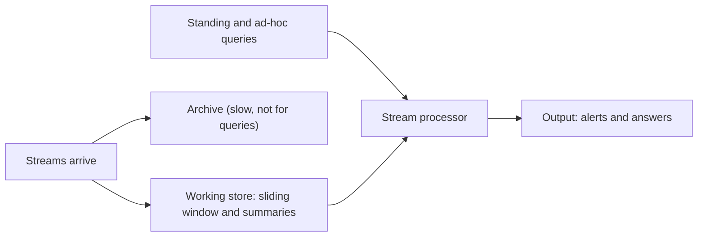
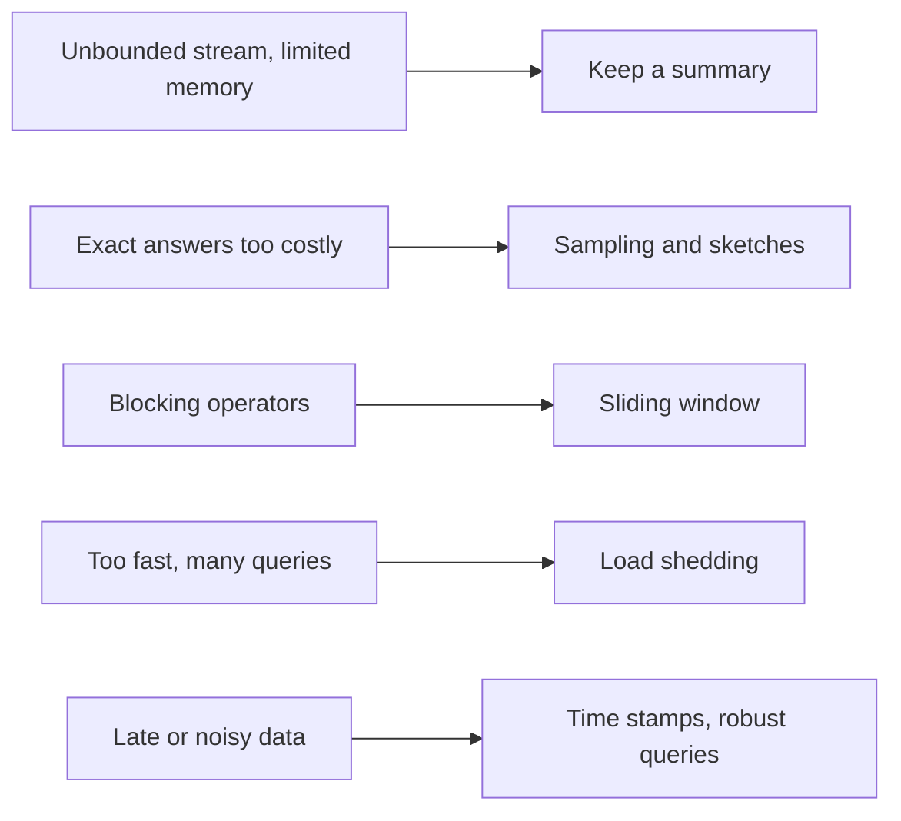

**Ek line mein:** <mark>Data stream endless, tez aur ek baar dikhne wali hoti hai, isliye uspe query processing mein memory, time aur accuracy ki wo limits aati hain jo stored database mein nahi hoti</mark>. <Cite id="stream-data-model-babcock2002" /> <Cite id="stream-data-model-wiki-ds" />

<Box kind="key">

**Har "issues in stream queries" question mein ye points likho:**

- <mark>Unbounded data, limited memory</mark>: stream kabhi khatam nahi hoti, isliye sirf chhota summary rakh sakte hain.
- <mark>Single pass aur high speed</mark>: har item ek baar dikhta hai; processing speed ke saath chalni chahiye warna items kho jaate hain.
- <mark>Approximate answers</mark>: exact answers ke liye bahut memory chahiye, isliye sampling, sketches aur windows known error ke saath.
- <mark>Blocking operators</mark> (sort, aggregate, join) ko poora input chahiye, isliye wo <mark>sliding window</mark> pe chalte hain.
- <mark>Standing aur ad-hoc queries</mark>: standing queries hamesha chalti hain; past ke ad-hoc queries sirf summaries use kar sakti hain.
- Kayi queries CPU share karti hain, isliye system <mark>load shed</mark> kar sakta hai (jaan-boojhkar kuch items drop).
- Late, out-of-order aur noisy data ko turant handle karna padta hai.

</Box>

## Core answer (5 marks, yahan ke har question ke liye)

<Box kind="definition">

A **data stream** is an endless flow of items (sensor readings, clicks, tweets) that we see once and cannot store fully. Queries on it are **continuous**: registered once, they keep giving answers as new data arrives. This is much harder than querying a stored table. <Cite id="stream-data-model-babcock2002" /> <Cite id="stream-data-model-geisler" />

</Box>

**Main issues aur challenges:**

1. **Unbounded data, limited memory.** Stream kabhi khatam nahi hoti, isliye sab store nahi ho sakta. Sirf chhota summary (synopsis) rakhte hain.
2. **One pass, tez arrival.** Har item ek baar dikhta hai aur system rate control nahi kar sakta. Processing ko speed ke saath chalna padta hai, warna items kho jaate hain.
3. **Approximate answers.** Kayi exact answers (jaise distinct count) ke liye unbounded memory chahiye, isliye samples, sketches aur histograms se approximate answer, known error ke saath, accept karte hain.
4. **Blocking operators.** Sort, aggregate aur join ko aam taur pe poora input chahiye. Stream pe wo kabhi khatam nahi hote, isliye latest items ki **sliding window** pe chalte hain. <Cite id="stream-data-model-gfg-dbms-dsms" />
5. **Window aur time handling.** Window size chunna aur late ya out-of-order items sambhalna mushkil hai.
6. **Kayi standing queries.** Sainkdon continuous queries limited CPU aur memory share karti hain, isliye system ko kaam share karna padta hai aur overload mein **load shed** karna padta hai.
7. **Past pe ad-hoc queries.** Purana data chala gaya, isliye aise queries ka answer sirf stored summaries se mil sakta hai.

<Cite id="stream-data-model-gfg-dbms-dsms" loc="diagram" />

**Conclusion:** <mark>stream query processing ko bounded memory, ek pass, windows aur approximate answers ke saath kaam karna padta hai, ordinary DBMS ke ulte</mark>.

## Extended answer (10 marks): ye add karo

### 1. Query ke do kinds

**Standing (continuous) query** ek baar poochi jaati hai aur data aate rehne ke saath hamesha answer deti hai ("temperature 40 se upar ho to alert do"). **Ad-hoc query** ek baar, abhi ke baare mein poochi jaati hai ("last 5 minutes mein maximum kya hai?"). Purana data store nahi hota, isliye pehle se decide karna padta hai ki kaunsa summary rakhna hai. <Cite id="stream-data-model-cs246-slides" />

### 2. Issues, wo kyun problem hain, aur aam remedy

| Issue | Problem kyun hai | Aam remedy |
|---|---|---|
| Unbounded memory | Stream khatam nahi hoti par memory fixed hai | Sirf summary (synopsis) rakho |
| Approximate answers | Exact answer ke liye saara data chahiye | Sampling, sketches, known error ke saath |
| Sliding windows | Purana data count nahi hona chahiye; window define karni padti hai (last $N$ items ya last $T$ minutes) | Sirf latest window pe answer |
| Blocking operators | SUM, COUNT, MAX, sort aur kuch joins ko pehle output se pehle poora input chahiye | Window versions ya running results |
| Past data | Ad-hoc query ko wo data chahiye ho sakta hai jo guzar chuka | Sirf window ya future queries allow, ya summaries rakho |
| Speed aur load | Data tez aata hai, aise rate pe jo system control nahi karta | Achhi scheduling, load shedding |
| Out-of-order aur noisy data | Items late, galat ya missing aate hain | Time stamps, robust queries |
| Real-time answers | Results kuch hi pal mein chahiye | Lambe batch jobs nahi; incremental updates |

<Cite id="stream-data-model-babcock2002" loc="§4" /> <Cite id="stream-data-model-ibm" />

### 3. Example

Pichhle ek ghante mein product X ki sales ginne ke liye har sale hamesha store nahi kar sakte. Ek ghante ki window rakhte hain, aur kuch percent ka error acceptable hai.

### 4. "Data streaming" ke apne issues

Streaming systems ko high-volume ingestion, time ke saath badalte bursty load, aur kayi machines pe scale out karne ki zaroorat bhi jhelni padti hai. <Cite id="stream-data-model-aws" />

## Har question mein kaise fit karein

- **"List and explain the different issues and challenges in data stream query processing."** (5 marks) <PYQ id="2023-05-ce/q1d" />: sirf core answer: saat numbered issues, har ek ki ek ya do lines, aur chhota diagram.
- **"Explain Issues in Data stream query processing."** (10 marks) <PYQ id="2024-05/q3b" />: core answer + section 1 (query ke do kinds) + section 2 ki table + example.
- **"Write issues in data stream queries. Explain the issues in data streaming."** (10 marks) <PYQ id="2024-12/q5a" />: do lists. Pehli query issues (standing aur ad-hoc, windows, approximate answers, blocking operators). Doosri streaming issues (unbounded size, single pass, limited memory, high speed, real-time answers, out-of-order aur bursty data, noise). Doosri list ke liye section 2 ki table use karo.

## Exam tips

- **Hamesha draw karo:** working store aur archive wala chhota diagram.
- Keywords use karo: **"unbounded", "one pass", "limited memory", "sliding window", "approximate", "blocking operators", "load shedding"**.
- Har issue ke saath ek remedy likho; isse list answer ban jaati hai.

Exam mein English mein likho.
