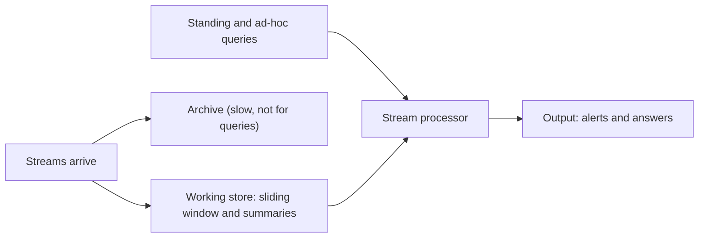
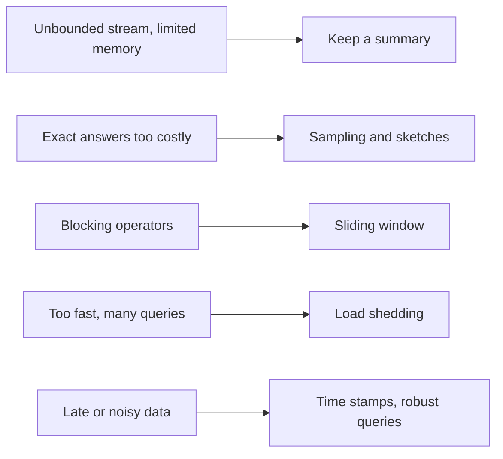

**In one line:** <mark>A data stream is endless, fast and seen once, so query processing on it faces limits on memory, time and accuracy that a stored database does not have</mark>. <Cite id="stream-data-model-babcock2002" /> <Cite id="stream-data-model-wiki-ds" />

<Box kind="key">

**Key points to write (any "issues in stream queries" question):**

- <mark>Unbounded data, limited memory</mark>: the stream never ends, so only a small summary can be kept.
- <mark>Single pass and high speed</mark>: each item is seen once; processing must keep up or items are lost.
- <mark>Approximate answers</mark>: exact answers need too much memory, so use sampling, sketches and windows with known error.
- <mark>Blocking operators</mark> (sort, aggregate, join) need all input, so they must work on a <mark>sliding window</mark>.
- <mark>Standing and ad-hoc queries</mark>: standing queries run forever; ad-hoc queries about the past can only use summaries.
- Many queries share the CPU, so the system may <mark>shed load</mark> (drop some items on purpose).
- Late, out-of-order and noisy data must be handled on the fly.

</Box>

## Core answer (5 marks, fits every question here)

<Box kind="definition">

A **data stream** is an endless flow of items (sensor readings, clicks, tweets) that we see once and cannot store fully. Queries on it are **continuous**: registered once, they keep giving answers as new data arrives. This is much harder than querying a stored table. <Cite id="stream-data-model-babcock2002" /> <Cite id="stream-data-model-geisler" />

</Box>

**Main issues and challenges:**

1. **Unbounded data, limited memory.** The stream never ends, so it cannot all be stored. Only a small summary (synopsis) is kept.
2. **One pass, fast arrival.** Each item is seen once and the system cannot control the rate. Processing must keep up, or items are lost.
3. **Approximate answers.** Many exact answers (such as a distinct count) need unbounded memory, so we accept approximate answers from samples, sketches and histograms, with a known error.
4. **Blocking operators.** Sort, aggregate and join normally need all the input. On a stream they never finish, so they work on a **sliding window** of the latest items. <Cite id="stream-data-model-gfg-dbms-dsms" />
5. **Window and time handling.** Choosing the window size and handling late or out-of-order items is difficult.
6. **Many standing queries.** Hundreds of continuous queries share limited CPU and memory, so the system must share work and, when overloaded, **shed load**.
7. **Ad-hoc queries on the past.** Old data is gone, so such queries can only be answered from the stored summaries.

<Cite id="stream-data-model-gfg-dbms-dsms" loc="diagram" />

**Conclusion:** <mark>stream query processing must work with bounded memory, one pass, windows and approximate answers, unlike an ordinary DBMS</mark>.

## Extended answer (10 marks): add these

### 1. Two kinds of query

A **standing (continuous) query** is asked once and answered forever as data arrives ("alert me if temperature is above 40"). An **ad-hoc query** is asked once about now ("what is the maximum in the last 5 minutes?"). Because old data is not stored, we must decide in advance what summary to keep. <Cite id="stream-data-model-cs246-slides" />

### 2. Issues, why they matter, and the usual remedy

| Issue | Why it is a problem | Usual remedy |
|---|---|---|
| Unbounded memory | The stream never ends but memory is fixed | Keep only a summary (synopsis) |
| Approximate answers | Exact answers need all data | Sampling, sketches, with a known error |
| Sliding windows | Old data must not count; the window must be defined (last $N$ items or last $T$ minutes) | Answer over the latest window only |
| Blocking operators | SUM, COUNT, MAX, sort and some joins need all input before the first output | Window versions or running results |
| Past data | An ad-hoc query may need data that has already passed | Allow only window or future queries, or keep summaries |
| Speed and load | Data arrives fast, at a rate the system does not control | Good scheduling, load shedding |
| Out-of-order and noisy data | Items arrive late, wrong or missing | Time stamps, robust queries |
| Real-time answers | Results are needed within moments | No long batch jobs; incremental updates |

<Cite id="stream-data-model-babcock2002" loc="§4" /> <Cite id="stream-data-model-ibm" />

### 3. Example

To count sales of product X in the last hour we cannot store every sale forever. We keep a one-hour window, and a count that is a few percent off is acceptable.

### 4. Issues in "data streaming" itself

Streaming systems also face high-volume ingestion, bursty load that changes over time, and the need to scale out over many machines. <Cite id="stream-data-model-aws" />

## Fit it to each question

- **"List and explain the different issues and challenges in data stream query processing."** (5 marks) <PYQ id="2023-05-ce/q1d" />: core answer only: the seven numbered issues, one or two lines each, and the small diagram.
- **"Explain Issues in Data stream query processing."** (10 marks) <PYQ id="2024-05/q3b" />: core answer + section 1 (two kinds of query) + the table of section 2 + the example.
- **"Write issues in data stream queries. Explain the issues in data streaming."** (10 marks) <PYQ id="2024-12/q5a" />: two lists. First the query issues (standing and ad-hoc, windows, approximate answers, blocking operators). Then the streaming issues (unbounded size, single pass, limited memory, high speed, real-time answers, out-of-order and bursty data, noise). Use the table of section 2 for the second list.

## Exam tips

- **Always draw:** the small diagram with the working store and the archive.
- Use the keywords: **"unbounded", "one pass", "limited memory", "sliding window", "approximate", "blocking operators", "load shedding"**.
- Give one remedy per issue; it turns a list into an answer.
