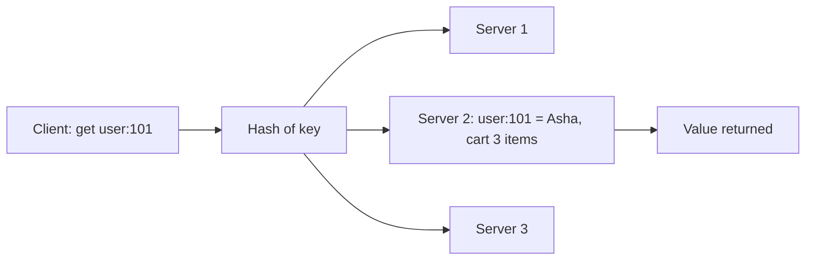
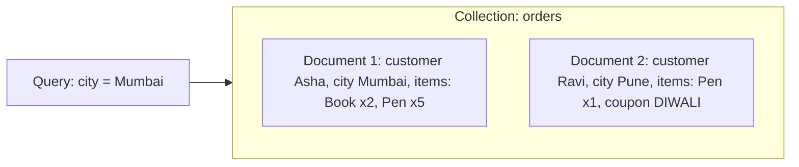

**Ek line mein:** <mark>Key-value store data ko (key, value) pairs mein rakhta hai aur value sirf key se milti hai</mark>; <mark>document store har record ko ek self-describing JSON document ki tarah rakhta hai jise kisi bhi field se query kar sakte hain</mark>. <Cite id="nosql-patterns-aws-kv" /> <Cite id="nosql-patterns-mongo-doc" />

<Box kind="key">

**Key-value ya document ke har question mein ye points likho:**

- <mark>Key-value store: ek unique key ek value ko point karti hai</mark>; database value ke **andar nahi dekhta** (wo ek blob hai).
- Sirf teen operations: <mark>put(key, value), get(key), delete(key)</mark>. Key ko **hash** karke server chuna jaata hai.
- Benefits: <mark>bahut fast, simple, scalable (scale out), flexible (fixed schema nahi), highly available</mark>.
- <mark>Document store: har record ek JSON document hai</mark> jisme nested fields hote hain; documents ek **collection** mein rehte hain aur sabke fields same hone zaroori nahi.
- Farq: <mark>key-value sirf key se query karta hai; document store kisi bhi field se</mark>.
- Examples: <mark>key-value: Redis, DynamoDB, Riak; document: MongoDB, CouchDB</mark>.

</Box>

## Core answer (5 marks, yahan ke har question ke liye)

<Box kind="definition">

A **key-value store** is the simplest NoSQL pattern. Data is stored as **(key, value)** pairs, like a dictionary: you give the unique key and get back exactly the value you stored. A **document store** keeps each record as a **document** (usually JSON) that carries its own field names. <Cite id="nosql-patterns-aws-kv" /> <Cite id="nosql-patterns-aws-doc" />

</Box>

**Kyun chahiye:** relational database ko fixed table design aur joins chahiye, jo web scale pe slow ho jaate hain. Ye patterns data ko usi shape mein rakhte hain jo application use karti hai aur use bahut saste servers pe failate hain. <Cite id="big-data-intro-nosql" />

**Key-value store kaise kaam karta hai:**

1. **Key** ek unique naam hai, jaise `user:101`. Data dhoondhne ka bas yehi tareeka hai.
2. **Value** kuch bhi ho sakti hai (number, text, JSON, image). Database uske andar kabhi nahi padhta. <Cite id="nosql-patterns-wiki-kv" />
3. Sirf `put`, `get` aur `delete` operations hote hain.
4. Key ko hash kiya jaata hai, aur hash decide karta hai ki pair kis server pe rahega, isliye data kayi machines pe fail jaata hai.



<Cite id="nosql-patterns-gfg-kv" loc="diagram" />

**Document store do lines mein:** ek order ek document hai jisme nested customer data aur items ki list hoti hai. Database fields samajhta hai, isliye "Mumbai ke saare orders" jaisi query ho sakti hai. <Cite id="nosql-patterns-mongo-doc" />

| Point | Key-value | Document |
|---|---|---|
| Value | Opaque blob | JSON jo database samajhta hai |
| Query | Sirf key se | Key ya kisi bhi field se |
| Examples | Redis, DynamoDB | MongoDB, CouchDB |

**Conclusion:** <mark>key-value sabse fast simple lookup deta hai; document store flexible data pe richer queries deta hai</mark>.

## Extended answer (10 marks): ye add karo

### 1. NoSQL ke architectural patterns

NoSQL databases chaar patterns follow karte hain: <mark>key-value store, document store, column-family store aur graph store</mark>. Ye answer pehle do cover karta hai. <Cite id="nosql-patterns-gfg-types" /> <Cite id="big-data-intro-nosql" />

### 2. Key-value store: benefits, limits, use cases

- **Benefits:** bahut fast (seedha lookup, joins nahi, aksar memory mein), simple API, keys hash karke scale out, fixed schema nahi, replicate karna aasaan to ek server fail hone pe system nahi rukta, saste commodity hardware. <Cite id="nosql-patterns-redis-kv" />
- **Limits:** value pe query nahi, joins ya relations nahi, poori value ek saath padhi aur likhi jaati hai.
- **Use cases:** shopping carts, user sessions, caches, user profiles, leaderboards.
- **Examples:** Redis, Amazon DynamoDB, Riak, Memcached. <Cite id="nosql-intro-dynamo" />

| Key | Value |
|---|---|
| `session:8f3a` | `{user: 101, login: "10:42"}` |
| `cart:77` | `[book-12, pen-3]` |

### 3. Document store: characteristics aur example



<Cite id="nosql-patterns-gfg-doc" loc="diagram" />

```json
{ "_id": 1, "customer": { "name": "Asha", "city": "Mumbai" },
  "items": [ { "product": "Book", "qty": 2 } ] }
```

- **Characteristics:** flexible schema, nested data, kisi bhi field pe query aur index, ek document hi store aur copy hone wali unit hai.
- **Use cases:** product catalogues, user profiles, content management.
- **Examples:** MongoDB, CouchDB, Amazon DocumentDB. <Cite id="nosql-patterns-mongo-doc" />
- **Limits:** repeated data kayi documents mein update karna padta hai, aur joins aur multi-document transactions weak hain.

### 4. Comparison

| Point | Key-value | Document |
|---|---|---|
| Value | Opaque blob | Structured JSON |
| Query | Sirf key se | Key aur kisi bhi field se |
| Update | Poori value replace | Ek field badlo |
| Best for | Sessions, cache, carts | Catalogues, profiles, CMS |
| Speed | Sabse fast | Fast |

## Har question mein kaise fit karein

- **"What is a key-value store? What are the benefits of using a key-value store?"** (10 marks) <PYQ id="2023-05-ce/q2a" />: core answer (key-value part, diagram) + section 2 (benefits, limits, use cases). Document store sirf ek line mein.
- **"List the architectural patterns in NoSQL databases. Discuss the Key-Value and Document-Oriented patterns, focusing on their characteristics, use cases, and examples."** (10 marks) <PYQ id="2024-12-ce/q2a" />: chaaron patterns ki list (section 1), phir dono ke characteristics, use cases, examples (sections 2 aur 3) aur comparison table.
- **"Explain Key-value store and Document Store NoSQL architectural pattern with example."** (10 marks) <PYQ id="2025-05/q3b" />: core answer + dono diagrams (sections 2 aur 3) + JSON example + comparison table.

## Exam tips

- **Hamesha draw karo:** hash-to-server wala key-value diagram aur ek JSON document.
- Key-value ke liye **"database never looks inside the value"** aur document ke liye **"queries on any field"** likho; ye do phrases marks dilate hain.
- Confuse mat karo: Redis aur DynamoDB key-value hain, MongoDB document hai.

Exam mein English mein likho.
