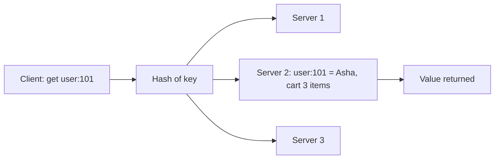
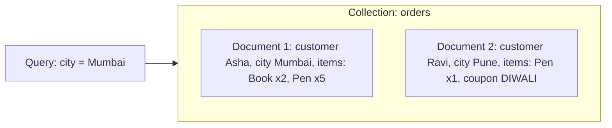

**In one line:** <mark>A key-value store keeps data as (key, value) pairs and finds a value only by its key</mark>; a <mark>document store keeps each record as a self-describing JSON document that can be queried by any field</mark>. <Cite id="nosql-patterns-aws-kv" /> <Cite id="nosql-patterns-mongo-doc" />

<Box kind="key">

**Key points to write (any key-value or document question):**

- <mark>Key-value store: a unique key points to a value</mark>; the database does **not look inside** the value (it is a blob).
- Only three operations: <mark>put(key, value), get(key), delete(key)</mark>. The key is **hashed** to pick the server.
- Benefits: <mark>very fast, simple, scalable (scale out), flexible (no fixed schema), highly available</mark>.
- <mark>Document store: each record is a JSON document</mark> with nested fields; documents sit in a **collection** and need not have the same fields.
- Difference: <mark>key-value queries only by key; document store queries by any field</mark>.
- Examples: <mark>key-value: Redis, DynamoDB, Riak; document: MongoDB, CouchDB</mark>.

</Box>

## Core answer (5 marks, fits every question here)

<Box kind="definition">

A **key-value store** is the simplest NoSQL pattern. Data is stored as **(key, value)** pairs, like a dictionary: you give the unique key and get back exactly the value you stored. A **document store** keeps each record as a **document** (usually JSON) that carries its own field names. <Cite id="nosql-patterns-aws-kv" /> <Cite id="nosql-patterns-aws-doc" />

</Box>

**Why they are needed:** a relational database needs a fixed table design and joins, which slow down at web scale. These patterns store data in the shape the application uses and spread it over many cheap servers. <Cite id="big-data-intro-nosql" />

**How a key-value store works:**

1. The **key** is a unique name such as `user:101`. It is the only way to find data.
2. The **value** can be anything (number, text, JSON, image). The database never reads inside it. <Cite id="nosql-patterns-wiki-kv" />
3. `put`, `get` and `delete` are the only operations.
4. The key is hashed, and the hash decides which server holds the pair, so data spreads over many machines.



<Cite id="nosql-patterns-gfg-kv" loc="diagram" />

**Document store in two lines:** one order is one document with nested customer data and a list of items. Because the database understands the fields, you can ask "all orders from Mumbai". <Cite id="nosql-patterns-mongo-doc" />

| Point | Key-value | Document |
|---|---|---|
| Value | Opaque blob | JSON the database understands |
| Query | Only by key | By key or any field |
| Examples | Redis, DynamoDB | MongoDB, CouchDB |

**Conclusion:** <mark>key-value gives the fastest simple lookup; a document store gives richer queries on flexible data</mark>.

## Extended answer (10 marks): add these

### 1. The architectural patterns of NoSQL

NoSQL databases follow four patterns: <mark>key-value store, document store, column-family store and graph store</mark>. This answer covers the first two. <Cite id="nosql-patterns-gfg-types" /> <Cite id="big-data-intro-nosql" />

### 2. Key-value store: benefits, limits, use cases

- **Benefits:** very fast (direct lookup, no joins, often in memory), simple API, scales out by hashing keys, no fixed schema, easy to replicate so one server failing does not stop the system, cheap commodity hardware. <Cite id="nosql-patterns-redis-kv" />
- **Limits:** no query on the value, no joins or relations, the whole value is read and written together.
- **Use cases:** shopping carts, user sessions, caches, user profiles, leaderboards.
- **Examples:** Redis, Amazon DynamoDB, Riak, Memcached. <Cite id="nosql-intro-dynamo" />

| Key | Value |
|---|---|
| `session:8f3a` | `{user: 101, login: "10:42"}` |
| `cart:77` | `[book-12, pen-3]` |

### 3. Document store: characteristics and example



<Cite id="nosql-patterns-gfg-doc" loc="diagram" />

```json
{ "_id": 1, "customer": { "name": "Asha", "city": "Mumbai" },
  "items": [ { "product": "Book", "qty": 2 } ] }
```

- **Characteristics:** flexible schema, nested data, queries and indexes on any field, one document is the unit stored and copied.
- **Use cases:** product catalogues, user profiles, content management.
- **Examples:** MongoDB, CouchDB, Amazon DocumentDB. <Cite id="nosql-patterns-mongo-doc" />
- **Limits:** repeated data must be updated in many documents, and joins and multi-document transactions are weak.

### 4. Comparison

| Point | Key-value | Document |
|---|---|---|
| Value | Opaque blob | Structured JSON |
| Query | Only by key | By key and any field |
| Update | Replace the whole value | Change one field |
| Best for | Sessions, cache, carts | Catalogues, profiles, CMS |
| Speed | Fastest | Fast |

## Fit it to each question

- **"What is a key-value store? What are the benefits of using a key-value store?"** (10 marks) <PYQ id="2023-05-ce/q2a" />: core answer (key-value part, diagram) + section 2 (benefits, limits, use cases). Skip the document store except one line.
- **"List the architectural patterns in NoSQL databases. Discuss the Key-Value and Document-Oriented patterns, focusing on their characteristics, use cases, and examples."** (10 marks) <PYQ id="2024-12-ce/q2a" />: list the four patterns (section 1), then characteristics, use cases and examples for each (sections 2 and 3) and the comparison table.
- **"Explain Key-value store and Document Store NoSQL architectural pattern with example."** (10 marks) <PYQ id="2025-05/q3b" />: core answer + both diagrams (sections 2 and 3) + the JSON example + comparison table.

## Exam tips

- **Always draw:** the hash-to-server key-value diagram and one JSON document.
- Write **"database never looks inside the value"** for key-value, and **"queries on any field"** for documents; these two phrases carry the marks.
- Do not mix up: Redis and DynamoDB are key-value, MongoDB is document.
