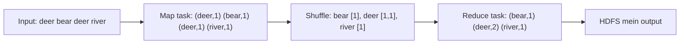

**Ek line mein:** <mark>Map task ek input split padhta hai aur har record ke liye (key, value) pairs emit karta hai; reduce task har key ko uski values ki list ke saath leta hai aur final result mein combine karta hai</mark>. <Cite id="hadoop-ecosystem-mmds" loc="§2.2" /> <Cite id="hadoop-ecosystem-dean2004" />

<Box kind="key">

**Map aur reduce tasks ke question mein ye points likho:**

- <mark>Map task: ek input split pe kaam karta hai, har record pe map function ek baar chalata hai, zero, ek ya kai (key, value) pairs emit karta hai</mark>.
- <mark>Map ek time pe ek hi record dekhta hai, isliye bahut map tasks parallel chalte hain</mark>.
- <mark>Map output local disk pe likha jata hai, HDFS mein nahi</mark>.
- <mark>Reduce task: shuffle aur sort ke baad (key, list of values) leta hai, har key pe ek baar chalta hai</mark>.
- <mark>Reduce output HDFS mein likha jata hai, har reduce task ka ek file</mark>.
- Map tasks ki sankhya = **splits ki sankhya**; reduce tasks **user chunta hai**.
- Example: **word count**, map (word, 1) emit karta hai, reduce add karta hai.

</Box>

## Core answer (5 marks, yahan ke har question ke liye)

<Box kind="definition">

A **map task** runs the programmer's map function on every record of one input split and emits intermediate (key, value) pairs. A **reduce task** runs the programmer's reduce function once per key on the list of values for that key and emits the final result. <Cite id="hadoop-ecosystem-mmds" loc="§2.2.1" /> <Cite id="hadoop-ecosystem-apache-mr-tutorial" />

</Box>

**Map task:** input splits mein katta hai (aam taur pe har HDFS block pe ek) aur ek map task ek split pe kaam karta hai. RecordReader split ko records mein badalta hai (text mein ek line). Map function ek time pe **ek record** dekhta hai, isliye bahut map tasks alag nodes pe ek saath chalte hain, behtar hai ki us node pe jahan block hai (**data locality**). Emit ki gayi keys unique hona zaroori nahi. <Cite id="hadoop-ecosystem-dean2004" loc="§3.4" />

**Reduce task:** framework same key wale saare pairs group karta hai (shuffle aur sort) aur har reduce task keys ka ek hissa sambhalta hai. Reduce function ek key ke liye add, count, join ya max karta hai aur result HDFS mein likhta hai. <Cite id="hadoop-ecosystem-mmds" loc="§2.2.3" />

**Example (word count):** input line `deer bear deer river`.



<Cite id="mapreduce-gfg-wordcount" loc="diagram" /> <Cite id="mapreduce-av" loc="diagram" />

**Conclusion:** <mark>map kaam ko chhote independent tukdon mein todta hai, reduce tukdon ko wapas jodta hai</mark>.

## Extended answer (10 marks): ye add karo

### 1. Map task aur reduce task ki comparison

| Point | Map task | Reduce task |
|---|---|---|
| Input | Ek input split (records) | Shuffle se (key, list of values) ke groups |
| Function | Har record pe ek baar | Har key pe ek baar |
| Output | Koi bhi sankhya ke (key, value) pairs | Final (key, result) pairs |
| Output kahan | Node ki local disk | HDFS |
| Sankhya | Har split pe ek (file size bhaag block size) | User chunta hai |
| Node failure ke baad | Finished ho tab bhi dobara chalta hai | Sirf tab dobara chalta hai jab finished na ho |

### 2. Pseudo code

```text
map(offset, line):
    for each word w in line:
        emit(w, 1)

reduce(word, counts):
    total = 0
    for c in counts:
        total = total + c
    emit(word, total)
```

### 3. Kitne tasks? (ek quick sum)

1,300 MB ki file aur 128 MB blocks ko $\lceil 1300 \div 128 \rceil = 11$ map tasks chahiye (1,280 MB ke 10 full splits aur 20 MB). 3 reducers hon to 3 output files. Check: $11 \times 128 = 1408 \ge 1300$ lekin $10 \times 128 = 1280 < 1300$.

### 4. Doosre roles

- **Combiner (optional):** map side pe mini reduce, network pe bheja data kam karne ke liye. <Cite id="hadoop-ecosystem-dean2004" loc="§4.3" />
- **Partitioner:** hash(key) mod R har key ko ek reducer deta hai.
- **Real uses:** words gin ke search index banana, logs mein page visits ginna, bahut bade data ko sort karna, PageRank ke link tables.


## Har question mein kaise fit karein

- **"What is function of Map Tasks in the Map Reduce framework? Explain with the help of an example."** (5 marks) <PYQ id="2022-12-ce/q1a" />: **map task wala paragraph**, word count example aur diagram; reduce pe ek line kaafi hai.
- **"The Map and Reduce Tasks"** (5 marks) <PYQ id="2024-05/q1c" />: poora core answer (dono tasks, example, diagram), aur section 1 ki **comparison table**.

## Exam tips

- Hamesha map ke **(word, 1)** pairs aur reduce se pehle ki **grouped list** dikhao.
- Saaf likho ki map output **local disk** pe jata hai aur reduce output **HDFS** pe.
- Map tasks ki sankhya **"one per input split"** likho; ye ek aam one-mark point hai.
