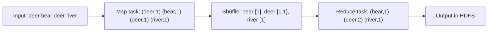

**In one line:** <mark>A map task reads one input split and emits (key, value) pairs for every record; a reduce task receives each key with the list of its values and combines them into the final result</mark>. <Cite id="hadoop-ecosystem-mmds" loc="§2.2" /> <Cite id="hadoop-ecosystem-dean2004" />

<Box kind="key">

**Key points to write (map and reduce tasks):**

- <mark>Map task: works on one input split, calls the map function once per record, emits zero, one or many (key, value) pairs</mark>.
- <mark>Map looks at one record at a time, so many map tasks run in parallel</mark>.
- <mark>Map output is written to the local disk, not to HDFS</mark>.
- <mark>Reduce task: gets (key, list of values) after shuffle and sort, called once per key</mark>.
- <mark>Reduce output is written to HDFS, one file per reduce task</mark>.
- Number of map tasks = **number of splits**; number of reduce tasks is **chosen by the user**.
- Example: **word count**, map emits (word, 1), reduce adds.

</Box>

## Core answer (5 marks, fits every question here)

<Box kind="definition">

A **map task** runs the programmer's map function on every record of one input split and emits intermediate (key, value) pairs. A **reduce task** runs the programmer's reduce function once per key on the list of values for that key and emits the final result. <Cite id="hadoop-ecosystem-mmds" loc="§2.2.1" /> <Cite id="hadoop-ecosystem-apache-mr-tutorial" />

</Box>

**Map task:** the input is cut into splits (usually one per HDFS block) and one map task works on one split. A RecordReader turns the split into records (for text, one line). The map function sees **one record at a time**, so many map tasks run at once on different nodes, preferably on the node that holds the block (**data locality**). The keys it emits need not be unique. <Cite id="hadoop-ecosystem-dean2004" loc="§3.4" />

**Reduce task:** the framework groups all pairs with the same key (shuffle and sort) and each reduce task handles a share of the keys. The reduce function adds, counts, joins or takes max for one key and writes its result to HDFS. <Cite id="hadoop-ecosystem-mmds" loc="§2.2.3" />

**Example (word count):** input line `deer bear deer river`.



<Cite id="mapreduce-gfg-wordcount" loc="diagram" /> <Cite id="mapreduce-av" loc="diagram" />

**Conclusion:** <mark>map breaks the work into small independent pieces, reduce brings the pieces back together</mark>.

## Extended answer (10 marks): add these

### 1. Map task and reduce task compared

| Point | Map task | Reduce task |
|---|---|---|
| Input | One input split (records) | Groups of (key, list of values) from the shuffle |
| Function | Called once per record | Called once per key |
| Output | Any number of (key, value) pairs | Final (key, result) pairs |
| Output stored | Local disk of the node | HDFS |
| Number | One per split (file size divided by block size) | Chosen by the user |
| After node failure | Re-run even if finished | Re-run only if not finished |

### 2. Pseudo code

```text
map(offset, line):
    for each word w in line:
        emit(w, 1)

reduce(word, counts):
    total = 0
    for c in counts:
        total = total + c
    emit(word, total)
```

### 3. How many tasks? (a quick sum)

A 1,300 MB file with 128 MB blocks needs $\lceil 1300 \div 128 \rceil = 11$ map tasks (10 full splits of 1,280 MB plus 20 MB). With 3 reducers there are 3 output files. Check: $11 \times 128 = 1408 \ge 1300$ but $10 \times 128 = 1280 < 1300$.

### 4. Other roles

- **Combiner (optional):** a mini reduce on the map side to shrink the data sent over the network. <Cite id="hadoop-ecosystem-dean2004" loc="§4.3" />
- **Partitioner:** hash(key) mod R sends each key to one reducer.
- **Real uses:** counting words and building a search index, counting page visits in logs, sorting huge data, link tables for PageRank.


## Fit it to each question

- **"What is function of Map Tasks in the Map Reduce framework? Explain with the help of an example."** (5 marks) <PYQ id="2022-12-ce/q1a" />: the **map task paragraph**, the word count example and the diagram; one line on reduce is enough.
- **"The Map and Reduce Tasks"** (5 marks) <PYQ id="2024-05/q1c" />: the whole core answer (both tasks, example, diagram), plus the **comparison table** from section 1.

## Exam tips

- Always show **(word, 1)** pairs from map and the **grouped list** before reduce.
- Say clearly that map output goes to the **local disk** and reduce output goes to **HDFS**.
- Write the number of map tasks as **"one per input split"**; it is a common one-mark point.
