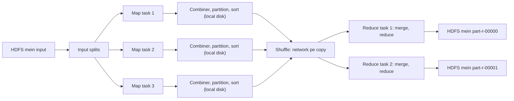
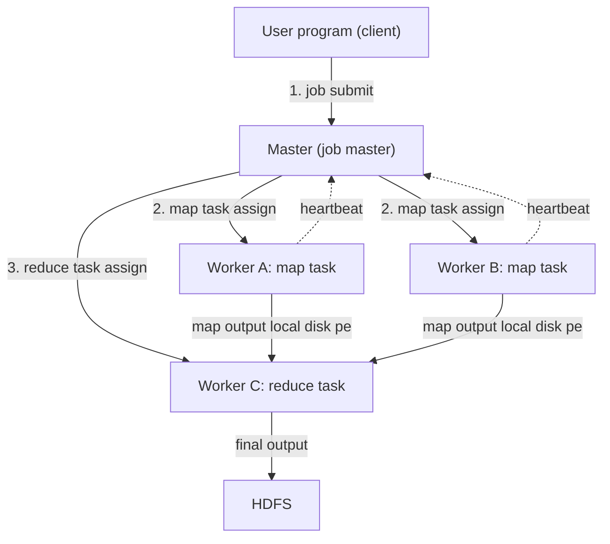

**Ek line mein:** <mark>MapReduce pipeline ye hai: input splits, map, (combiner), partition, shuffle aur sort, reduce, HDFS mein output, aur ek master workers pe tasks schedule karta hai</mark>. <Cite id="hadoop-ecosystem-dean2004" /> <Cite id="mapreduce-gfg-mr" />

<Box kind="key">

**MapReduce execution pipeline aur components ke question mein ye points likho:**

- <mark>Components: client, resource manager, job master, workers, InputFormat/RecordReader, Mapper, Combiner, Partitioner, Shuffle aur Sort, Reducer, OutputFormat</mark>.
- <mark>Map tasks ki sankhya = input splits ki sankhya (lagbhag har HDFS block pe ek); reduce tasks user set karta hai</mark>.
- <mark>Map output local disk pe likha jata hai, HDFS mein nahi</mark>.
- <mark>Partitioner hash(key) mod R se har key ko reducer deta hai</mark>.
- <mark>Shuffle buckets ko reducers tak copy karta hai, jo key se sort aur group karte hain</mark>.
- <mark>Reduce output HDFS mein likha jata hai, har reducer ka ek file</mark>.
- Master **sirf coordinate** karta hai; data ko kabhi touch nahi karta.

</Box>

## Core answer (5 marks, yahan ke har question ke liye)

<Box kind="definition">

**MapReduce** is a programming model for processing very large data in parallel on a cluster. The programmer writes a **Map** and a **Reduce** function; the framework splits the input, schedules tasks near the data, groups the map output by key and recovers from failures. <Cite id="hadoop-ecosystem-dean2004" /> <Cite id="hadoop-ecosystem-mmds" loc="§2.2" />

</Box>

**Execution steps:** <Cite id="hadoop-ecosystem-apache-mr-tutorial" /> <Cite id="mapreduce-gfg-mr" />

1. **Submit:** client job code aur settings submit karta hai.
2. **Split:** input splits mein bantta hai; har split pe ek map task.
3. **Schedule:** job master map tasks start karta hai, un nodes ko prefer karke jahan block hai (data locality).
4. **Map:** har map task har record pe map call karta hai; output memory buffer mein jata hai aur local disk pe spill hota hai, partitioned aur sorted (combiner ho to combined).
5. **Shuffle:** har reducer apna bucket har map task se network pe copy karta hai.
6. **Sort aur merge:** reducer apni copies ko sorted key groups mein merge karta hai.
7. **Reduce:** reduce har key pe ek baar chalta hai.
8. **Output:** result HDFS mein likha jata hai.

<Cite id="mapreduce-gfg-mr" loc="diagram" /> <Cite id="mapreduce-tpoint" loc="diagram" />

**Conclusion:** <mark>programmer sirf map aur reduce likhta hai; splitting, scheduling, shuffling aur failure recovery framework karta hai</mark>.

## Extended answer (10 marks): ye add karo

### 1. Components aur unke functions

| Component | Function |
|---|---|
| Client | Map aur Reduce code (JAR) pack karta hai, input aur output paths batata hai, job submit karta hai |
| Resource manager (YARN ResourceManager, Hadoop 1 mein JobTracker) | Cluster resources deta hai, data ke paas free nodes dhoondhta hai |
| Job master (MRAppMaster, book mein "master controller") | Ek job chalata hai: tasks banata hai, workers ko assign karta hai, progress track karta hai, failed tasks restart karta hai |
| Workers (NodeManager containers, Hadoop 1 mein TaskTracker) | Map aur reduce tasks chalate hain, heartbeats bhejte hain |
| InputFormat, InputSplit, RecordReader | Input ko splits mein kaat ke har ek ko (key, value) records banate hain |
| Mapper | Har record pe map function chalata hai |
| Combiner (optional) | Map output pe mini reduce, use chhota karne ke liye |
| Partitioner | Reducer chunta hai: hash(key) mod R |
| Shuffle aur sort | Buckets reducers tak copy karta hai aur sorted groups mein merge karta hai |
| Reducer | Har key group pe reduce function chalata hai |
| OutputFormat aur HDFS | Result files likhte hain |

<Cite id="hadoop-ecosystem-apache-yarn" /> <Cite id="hadoop-ecosystem-gfg-hadoop-arch" /> <Cite id="mapreduce-tp" />

### 2. Master aur workers

<Cite id="hadoop-ecosystem-dean2004" loc="Figure 1" />

### 3. Example (word count)

Teen map tasks splits padhte hain: `deer bear deer river`, `car car river car` aur `deer car bear bear`. 2 reducers ke saath:

| Stage | Result |
|---|---|
| Map output | (word, 1) ke 12 pairs |
| Combiner ke baad | M1: bear 1, deer 2, river 1. M2: car 3, river 1. M3: bear 2, car 1, deer 1 (8 pairs) |
| Partition | Reducer 0 ko bear aur deer, Reducer 1 ko car aur river |
| Reduce | bear 3, deer 3, car 4, river 2 |

Check: 12 words andar gaye, aur $3 + 3 + 4 + 2 = 12$ gine gaye. <Cite id="mapreduce-gfg-wordcount" loc="diagram" />

### 4. Kaam ki details

- Map output buffer default 100 MB hota hai; lagbhag 80% bharne pe local disk pe spill hota hai. <Cite id="mapreduce-apache-mapred-default" />
- Reduce tabhi shuru hota hai jab **saare** maps khatam ho jayein, kyunki ek key kisi adhoore map mein abhi bhi aa sakti hai.
- Hadoop 1 mein ek JobTracker tha (bottleneck); Hadoop 2 mein YARN hai jisme ResourceManager aur per-job ApplicationMaster hain.

## Har question mein kaise fit karein

- **"List the main components of Mapreduce execution pipeline."** (10 marks) <PYQ id="2023-12/q4a" /> <PYQ id="2024-05/q4a" />: **section 1 table** har ek ke ek line function ke saath, pipeline diagram, aur 8 steps chhote mein.
- **"Write the functions of the components and execution steps in Map Reduce."** (10 marks) <PYQ id="2024-12/q4b" /> <PYQ id="2025-05/q2b" />: section 1 table (functions) aur **numbered execution steps** aur diagram.
- **"Explain Map Reduce execution pipeline with suitable example."** (10 marks) <PYQ id="2023-12-ce/q4a" /> <PYQ id="2024-12-ce/q3a" />: core answer (steps aur diagram), phir **section 3 (word count example)**; time ho to section 2 add karo.

## Exam tips

- **Pipeline draw karo**: input splits, maps, shuffle, reduces, HDFS output, aur map output ke neeche "local disk" likho.
- Hamesha **Mapper, Combiner, Partitioner, Shuffle, Reducer** isi order mein likho.
- **Chhota example** (word count) lo aur har stage pe pairs dikhao; isse theory answer poora ho jata hai.
