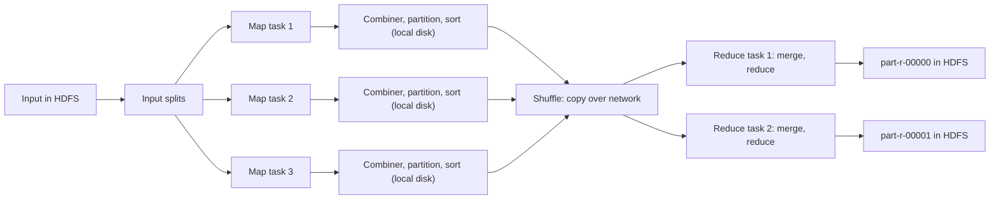
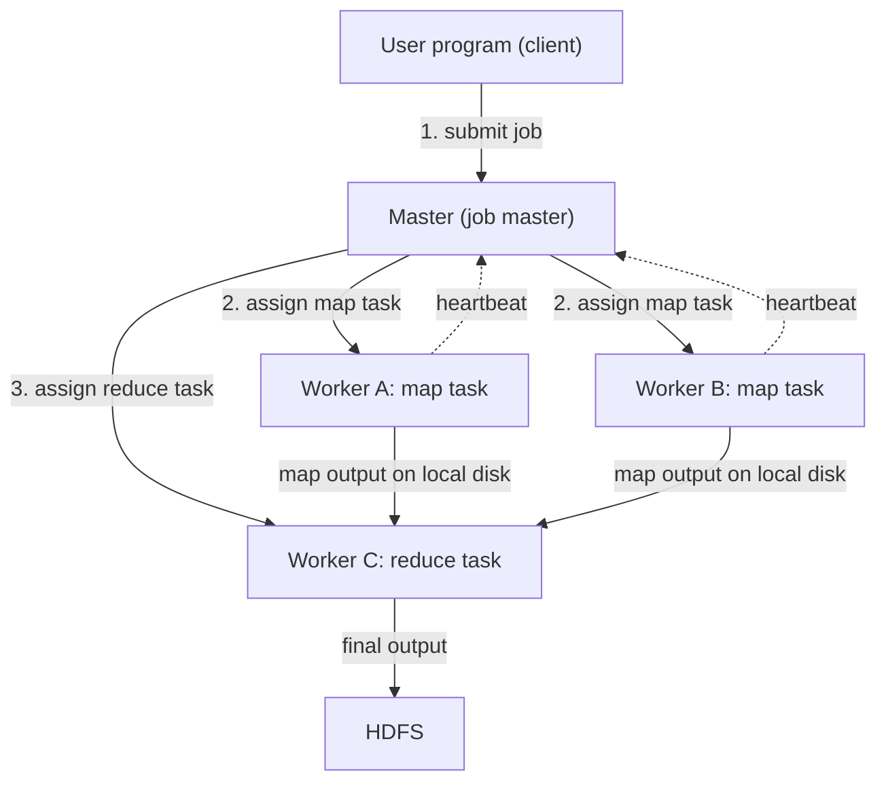

**In one line:** <mark>The MapReduce pipeline is: input splits, map, (combiner), partition, shuffle and sort, reduce, output to HDFS, run by a master that schedules tasks on workers</mark>. <Cite id="hadoop-ecosystem-dean2004" /> <Cite id="mapreduce-gfg-mr" />

<Box kind="key">

**Key points to write (MapReduce execution pipeline and components):**

- <mark>Components: client, resource manager, job master, workers, InputFormat/RecordReader, Mapper, Combiner, Partitioner, Shuffle and Sort, Reducer, OutputFormat</mark>.
- <mark>Number of map tasks = number of input splits (about one per HDFS block); the user sets the number of reduce tasks</mark>.
- <mark>Map output is written to the local disk, not to HDFS</mark>.
- <mark>Partitioner sends each key to a reducer with hash(key) mod R</mark>.
- <mark>Shuffle copies the buckets to the reducers, which sort and group by key</mark>.
- <mark>Reduce output is written to HDFS, one file per reducer</mark>.
- The master **only coordinates**; it never touches the data.

</Box>

## Core answer (5 marks, fits every question here)

<Box kind="definition">

**MapReduce** is a programming model for processing very large data in parallel on a cluster. The programmer writes a **Map** and a **Reduce** function; the framework splits the input, schedules tasks near the data, groups the map output by key and recovers from failures. <Cite id="hadoop-ecosystem-dean2004" /> <Cite id="hadoop-ecosystem-mmds" loc="§2.2" />

</Box>

**Execution steps:** <Cite id="hadoop-ecosystem-apache-mr-tutorial" /> <Cite id="mapreduce-gfg-mr" />

1. **Submit:** the client submits the job code and settings.
2. **Split:** input is divided into splits; one map task per split.
3. **Schedule:** the job master starts map tasks, preferring nodes that hold the block (data locality).
4. **Map:** each map task calls map on every record; output is kept in a memory buffer and spilled to local disk, partitioned and sorted (combined if there is a combiner).
5. **Shuffle:** each reducer copies its bucket from every map task over the network.
6. **Sort and merge:** the reducer merges its copies into sorted key groups.
7. **Reduce:** reduce runs once per key.
8. **Output:** the result is written to HDFS.

<Cite id="mapreduce-gfg-mr" loc="diagram" /> <Cite id="mapreduce-tpoint" loc="diagram" />

**Conclusion:** <mark>the programmer writes only map and reduce; the framework does splitting, scheduling, shuffling and failure recovery</mark>.

## Extended answer (10 marks): add these

### 1. Components and their functions

| Component | Function |
|---|---|
| Client | Packages the Map and Reduce code (a JAR), names the input and output paths, submits the job |
| Resource manager (YARN ResourceManager, JobTracker in Hadoop 1) | Gives out cluster resources, finds free nodes near the data |
| Job master (MRAppMaster, the "master controller" in the book) | Runs one job: creates tasks, assigns them to workers, tracks progress, restarts failed tasks |
| Workers (NodeManager containers, TaskTracker in Hadoop 1) | Run map and reduce tasks, send heartbeats |
| InputFormat, InputSplit, RecordReader | Cut input into splits and turn each into (key, value) records |
| Mapper | Runs the map function on each record |
| Combiner (optional) | Mini reduce on map output to shrink it |
| Partitioner | Chooses the reducer: hash(key) mod R |
| Shuffle and sort | Copies buckets to reducers and merges them into sorted groups |
| Reducer | Runs the reduce function on each key group |
| OutputFormat and HDFS | Write the result files |

<Cite id="hadoop-ecosystem-apache-yarn" /> <Cite id="hadoop-ecosystem-gfg-hadoop-arch" /> <Cite id="mapreduce-tp" />

### 2. Master and workers

<Cite id="hadoop-ecosystem-dean2004" loc="Figure 1" />

### 3. Example (word count)

Three map tasks read the splits `deer bear deer river`, `car car river car` and `deer car bear bear`. With 2 reducers:

| Stage | Result |
|---|---|
| Map output | 12 pairs of (word, 1) |
| After combiner | M1: bear 1, deer 2, river 1. M2: car 3, river 1. M3: bear 2, car 1, deer 1 (8 pairs) |
| Partition | Reducer 0 gets bear and deer, Reducer 1 gets car and river |
| Reduce | bear 3, deer 3, car 4, river 2 |

Check: 12 words in, and $3 + 3 + 4 + 2 = 12$ counted. <Cite id="mapreduce-gfg-wordcount" loc="diagram" />

### 4. Useful details

- Map output buffer is 100 MB by default; at about 80% it is spilled to local disk. <Cite id="mapreduce-apache-mapred-default" />
- Reduce starts only after **all** maps finish, because a key may still appear in an unfinished map.
- Hadoop 1 had one JobTracker (a bottleneck); Hadoop 2 uses YARN with a ResourceManager and a per-job ApplicationMaster.

## Fit it to each question

- **"List the main components of Mapreduce execution pipeline."** (10 marks) <PYQ id="2023-12/q4a" /> <PYQ id="2024-05/q4a" />: **section 1 table** with a one-line function each, the pipeline diagram, and the 8 steps in short.
- **"Write the functions of the components and execution steps in Map Reduce."** (10 marks) <PYQ id="2024-12/q4b" /> <PYQ id="2025-05/q2b" />: section 1 table (functions) plus the **numbered execution steps** and the diagram.
- **"Explain Map Reduce execution pipeline with suitable example."** (10 marks) <PYQ id="2023-12-ce/q4a" /> <PYQ id="2024-12-ce/q3a" />: core answer (steps and diagram), then **section 3 (word count example)**; add section 2 if you have time.

## Exam tips

- **Draw** the pipeline: input splits, maps, shuffle, reduces, HDFS output, with "local disk" written under the map output.
- Always name **Mapper, Combiner, Partitioner, Shuffle, Reducer** in that order.
- Use a **small example** (word count) and show the pairs at each stage; it turns a theory answer into a full one.
