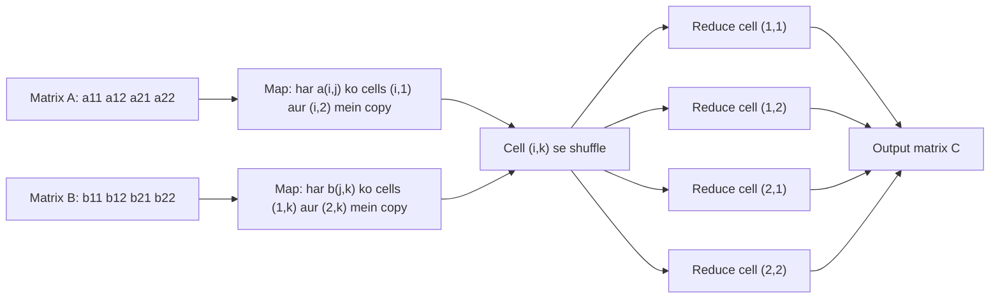

**Ek line mein:** <mark>One-step matrix multiplication mein key output cell (i, k) hai: map har element ko har us cell mein copy karta hai jise woh chahiye, A ya B tag aur common index j ke saath, aur reduce matching pairs multiply karke add karta hai</mark>. <Cite id="hadoop-ecosystem-mmds" loc="§2.3.9" /> <Cite id="mapreduce-algorithms-gfg-matmul" />

<Box kind="key">

**Matrix-matrix multiplication ke question mein ye points likho:**

- <mark>$c_{ik} = \sum_j a_{ij} b_{jk}$: $A$ ki row $i$ ko $B$ ke column $k$ se multiply karo</mark>.
- <mark>Map: har $a_{ij}$ har $k$ ke liye cell $(i, k)$ mein $((i,k), (A, j, a_{ij}))$ ki tarah jata hai; har $b_{jk}$ har $i$ ke liye cell $(i, k)$ mein $((i,k), (B, j, b_{jk}))$ ki tarah</mark>.
- <mark>Reduce: key $(i,k)$ ke liye same $j$ wali A-value aur B-value ko pair karo, multiply karo aur add karo</mark>.
- **Tag A ya B** source batata hai, aur **$j$** common index hai.
- **Two-step method** bade sparse matrices ke liye: job 1 key $j$ se saare products banata hai, job 2 har $(i,k)$ ke products add karta hai.
- Saari entries ke **sum se check** karo.

</Box>

## Core answer (5 marks: woh method jo yahan ke har question mein chalta hai)

<Box kind="definition">

For $A$ of size $I \times J$ and $B$ of size $J \times K$, the product $C = AB$ has entries $c_{ik} = \sum_j a_{ij} b_{jk}$. Each output cell needs a whole row of $A$ and a whole column of $B$, and each input number is used by many cells, so map must **copy each input number to every cell that needs it**. <Cite id="mapreduce-algorithms-gfg-matmul" /> <Cite id="mapreduce-algorithms-wiki-matmul" />

</Box>

**Pseudo code (one-step method):** <Cite id="hadoop-ecosystem-mmds" loc="§2.3.10" />

```text
map(matrix, row, col, value):
    if matrix == A:                       # value is a[i][j], row=i, col=j
        for k in 1..K:
            emit((row, k), ('A', col, value))
    else:                                 # value is b[j][k], row=j, col=k
        for i in 1..I:
            emit((i, col), ('B', row, value))

reduce((i, k), values):
    a = dict of j -> value for tags 'A'
    b = dict of j -> value for tags 'B'
    emit((i, k), sum(a[j] * b[j] for j in a))
```



<Cite id="mapreduce-algorithms-gfg-matmul" loc="diagram" />

**Conclusion:** <mark>key output cell hai, map copy karta hai, reduce multiply aur add karta hai</mark>.

## Extended answer (10 marks): question poora solve karo

<Sum>

<Given>

$$
A = \begin{bmatrix} 1 & 2 \\ 3 & 4 \end{bmatrix}, \quad B = \begin{bmatrix} 6 & 7 \\ 8 & 9 \end{bmatrix}
$$

</Given>

<Find>

$C = AB$ with the one-step MapReduce method.

</Find>

<Steps>

1. **Map for A.** Each $a_{ij}$ goes to both cells of its row $i$ (columns $k = 1, 2$), tagged with $j$:

   | $a_{ij}$ | Map output |
   |---|---|
   | $a_{11} = 1$ | ((1,1), (A,1,1)), ((1,2), (A,1,1)) |
   | $a_{12} = 2$ | ((1,1), (A,2,2)), ((1,2), (A,2,2)) |
   | $a_{21} = 3$ | ((2,1), (A,1,3)), ((2,2), (A,1,3)) |
   | $a_{22} = 4$ | ((2,1), (A,2,4)), ((2,2), (A,2,4)) |

2. **Map for B.** Each $b_{jk}$ goes to both cells of its column $k$ (rows $i = 1, 2$), tagged with $j$:

   | $b_{jk}$ | Map output |
   |---|---|
   | $b_{11} = 6$ | ((1,1), (B,1,6)), ((2,1), (B,1,6)) |
   | $b_{12} = 7$ | ((1,2), (B,1,7)), ((2,2), (B,1,7)) |
   | $b_{21} = 8$ | ((1,1), (B,2,8)), ((2,1), (B,2,8)) |
   | $b_{22} = 9$ | ((1,2), (B,2,9)), ((2,2), (B,2,9)) |

3. **Shuffle and reduce.** Each cell gets two A-values and two B-values. Match by $j$, multiply and add:

   | Cell | A-values (j: value) | B-values (j: value) | Sum of products | Result |
   |---|---|---|---|---|
   | (1,1) | 1: 1, 2: 2 | 1: 6, 2: 8 | $1 \times 6 + 2 \times 8 = 6 + 16$ | 22 |
   | (1,2) | 1: 1, 2: 2 | 1: 7, 2: 9 | $1 \times 7 + 2 \times 9 = 7 + 18$ | 25 |
   | (2,1) | 1: 3, 2: 4 | 1: 6, 2: 8 | $3 \times 6 + 4 \times 8 = 18 + 32$ | 50 |
   | (2,2) | 1: 3, 2: 4 | 1: 7, 2: 9 | $3 \times 7 + 4 \times 9 = 21 + 36$ | 57 |

</Steps>

<Answer>

$$
C = \begin{bmatrix} 22 & 25 \\ 50 & 57 \end{bmatrix}
$$

</Answer>

<Box kind="verify">

Sum of all entries: $22 + 25 + 50 + 57 = 154$, and (column sums of $A$) times (row sums of $B$) is $4 \times 13 + 6 \times 17 = 52 + 102 = 154$. The two-step method gives the same: job 1 with $j = 1$ makes the products 6, 7, 18, 21 for cells (1,1), (1,2), (2,1), (2,2), and $j = 2$ makes 16, 18, 32, 36. Job 2 adds per cell: $6 + 16 = 22$, $7 + 18 = 25$, $18 + 32 = 50$, $21 + 36 = 57$.

</Box>

</Sum>


### One-step versus two-step

| Method | Jobs | Map output size | Kab prefer karein |
|---|---|---|---|
| One-step | 1 | Har element $K$ ya $I$ baar copy | Chhote ya medium matrices; aam exam answer |
| Two-step | 2 | Har element ek baar copy, lekin products jobs ke beech likhe jate hain | Bade sparse matrices |

Two-step ek line mein: job 1 common index $j$ ko key banata hai (map $(j, (A, i, a_{ij}))$ aur $(j, (B, k, b_{jk}))$ emit karta hai, reduce cell $(i,k)$ ke liye har product $a_{ij} b_{jk}$ banata hai); job 2 mein identity map aur reduce hai jo har $(i,k)$ ke products add karta hai. <Cite id="hadoop-ecosystem-mmds" loc="§2.3.9" />

## Har question mein kaise fit karein

- **"Write a map reduce pseudo code to multiply two matrices. Apply map reduce working to perform following matrix multiplication: $\begin{bmatrix} 1 & 2 \\ 3 & 4 \end{bmatrix} \times \begin{bmatrix} 6 & 7 \\ 8 & 9 \end{bmatrix}$."** (10 marks) <PYQ id="2023-05-ce/q2b" />: pseudo code, phir upar ka solved sum, bilkul waisa.
- **"Write a Map reduce pseudo code to multiply two matrices. Illustrate with an example showing all the steps."** (10 marks) <PYQ id="2024-05/q3a" />: pseudo code aur wahi worked example (ya koi bhi chhota 2 by 2 pair jo aap compute kar sako); dono map tables, reduce table aur check dikhao.

## Exam tips

- **Pehle pseudo code**, tags 'A' aur 'B' aur common index $j$ ko saaf naam do.
- **Likho ki key cell $(i,k)$ hai** aur har element har us cell mein copy hota hai jise woh chahiye (2 by 2 mein har ek ki 2 copies).
- **End mein sum check likho** (154); isse multiplication sahi dikhta hai.
