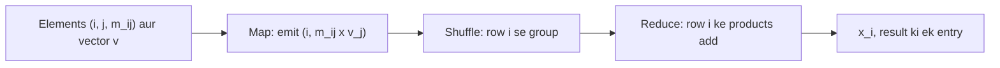

**Ek line mein:** <mark>Matrix-vector multiplication mein map har matrix element ko vector ki matching entry se multiply karke row number key ke saath emit karta hai, aur reduce har row ke products add karta hai</mark>. <Cite id="hadoop-ecosystem-mmds" loc="§2.3.1" /> <Cite id="mapreduce-algorithms-wiki-matmul" />

<Box kind="key">

**Matrix-vector multiplication ke question mein ye points likho:**

- <mark>$x_i = \sum_j m_{ij} v_j$: $M$ ki har row ko vector se multiply karke add karo</mark>.
- <mark>Map: har element $m_{ij}$ ke liye $(i, m_{ij} \cdot v_j)$ emit; key row number $i$ hai</mark>.
- <mark>Reduce: key $i$ ke liye saari values add karo aur $(i, x_i)$ emit karo</mark>.
- <mark>Maana jata hai ki vector $v$ har map task ki memory mein aa jata hai</mark>.
- $v$ bahut bada ho to: **matrix ko vertical stripes mein aur vector ko matching pieces mein kaato**.
- Matrix triples $(i, j, m_{ij})$ mein store hota hai, isliye **sparse matrix** sirf non-zero entries ka kharcha leta hai.
- Column sums se **check** karo.

</Box>

## Core answer (5 marks: woh method jo yahan ke har question mein chalta hai)

<Box kind="definition">

For an $n \times n$ matrix $M$ and a vector $v$ of length $n$, the product $x = Mv$ has entries $x_i = \sum_j m_{ij} v_j$. In words: for each row, multiply each matrix number by the vector number in the same column, and add. <Cite id="hadoop-ecosystem-mmds" loc="§2.3.1" /> <Cite id="mapreduce-algorithms-wiki-matmul" />

</Box>

**Pseudo code** ($v$ memory mein loaded maano):

```text
map(i, j, m_ij):
    emit(i, m_ij * v[j])

reduce(i, products):
    emit(i, sum(products))
```

**Steps:**

1. **Input:** har element triple $(i, j, m_{ij})$ ki tarah.
2. **Map:** $(i, m_{ij} \times v_j)$ emit karo. *Key row hai, kyunki ek row ke saare products saath add hone chahiye.*
3. **Shuffle aur sort:** products ko row number $i$ se group karo.
4. **Reduce:** har group add karke $x_i$ nikalo.



<Cite id="mapreduce-algorithms-gfg-matmul" loc="diagram" />

**Conclusion:** <mark>map multiply karta hai, reduce add karta hai, aur row number key hai</mark>.

## Extended answer (10 marks): question poora solve karo

<Sum>

<Given>

$$
M = \begin{bmatrix} 1 & 2 & 3 \\ 4 & 5 & 6 \\ 7 & 8 & 9 \end{bmatrix}, \quad V = \begin{bmatrix} 1 \\ 2 \\ 3 \end{bmatrix}
$$

so $v_1 = 1$, $v_2 = 2$, $v_3 = 3$.

</Given>

<Find>

$X = M \times V$ using map, shuffle and reduce.

</Find>

<Steps>

1. **Input.** The 9 elements $(i, j, m_{ij})$: $(1,1,1), (1,2,2), (1,3,3), (2,1,4), (2,2,5), (2,3,6), (3,1,7), (3,2,8), (3,3,9)$.
2. **Map.** For each element emit $(i, m_{ij} \times v_j)$:

   | Input $(i, j, m_{ij})$ | Calculation | Map output |
   |---|---|---|
   | (1,1,1) | $1 \times 1$ | (1, 1) |
   | (1,2,2) | $2 \times 2$ | (1, 4) |
   | (1,3,3) | $3 \times 3$ | (1, 9) |
   | (2,1,4) | $4 \times 1$ | (2, 4) |
   | (2,2,5) | $5 \times 2$ | (2, 10) |
   | (2,3,6) | $6 \times 3$ | (2, 18) |
   | (3,1,7) | $7 \times 1$ | (3, 7) |
   | (3,2,8) | $8 \times 2$ | (3, 16) |
   | (3,3,9) | $9 \times 3$ | (3, 27) |

3. **Shuffle and sort.** Group by row. *Reason: one reducer must see all products of a row.*

   | Key (row) | Grouped values |
   |---|---|
   | 1 | [1, 4, 9] |
   | 2 | [4, 10, 18] |
   | 3 | [7, 16, 27] |

4. **Reduce.** Row 1 $= 1 + 4 + 9 = 14$; row 2 $= 4 + 10 + 18 = 32$; row 3 $= 7 + 16 + 27 = 50$.

</Steps>

<Answer>

$X = \begin{bmatrix} 14 \\ 32 \\ 50 \end{bmatrix}$, that is (1, 14), (2, 32), (3, 50).

</Answer>

<Box kind="verify">

Direct check: row 1 $= 1\cdot1 + 2\cdot2 + 3\cdot3 = 14$, row 2 $= 4 + 10 + 18 = 32$, row 3 $= 7 + 16 + 27 = 50$. Column-sum check: the column sums of $M$ are 12, 15, 18, and $12 \cdot 1 + 15 \cdot 2 + 18 \cdot 3 = 96$, which equals $14 + 32 + 50 = 96$.

</Box>

</Sum>


### Vector memory mein na aaye to

Matrix ko vertical stripes mein aur vector ko matching horizontal pieces mein kaato. Tab map task vector ka sirf ek piece load karta hai aur matrix ki matching stripe sambhalta hai; keys aur reduce wahi rehte hain. Har mapper pe ek row ke products add karne wala **combiner** network pe bheja data kam karta hai. <Cite id="hadoop-ecosystem-mmds" loc="§2.3.2" />

### Ye kyun important hai

Bade matrices (web graph, ratings) matrix-vector problems hain, aur PageRank baar baar matrix-vector multiplication hai, har round ke liye ek MapReduce job.

## Har question mein kaise fit karein

- **"Write a map reduce pseudo code to multiply two matrices. Apply map reduce working to perform following matrix multiplication: $M$ (3 by 3) times $V$ = (1, 2, 3)."** (10 marks) <PYQ id="2023-12-ce/q2b" />: pseudo code, phir upar ka solved sum, bilkul waisa. Yahan "two matrices" ka matlab ek matrix aur ek vector hai, isliye ye method use karo, matrix-matrix wala nahi.
- **"Write a Map Reduce pseudo code to Vector-Matrix multiplication. Demonstrate all the steps for following matrix and vector."** (10 marks) <PYQ id="2025-12-ce/q4b" />: wahi matrix aur vector, isliye wahi solved sum. Input triples, map table, shuffle table aur reduce line dikhao.

## Exam tips

- **Pehle pseudo code likho** (4 lines) aur likho "key row number $i$ hai".
- **Teeno tables dikhao** (map, shuffle, reduce) aur final vector $(14, 32, 50)$.
- **End mein column-sum check likho**; isse numbers prove ho jate hain.
