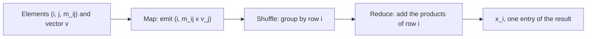

**In one line:** <mark>In matrix-vector multiplication, map multiplies each matrix element by the matching vector entry and emits it with the row number as key, and reduce adds the products of each row</mark>. <Cite id="hadoop-ecosystem-mmds" loc="§2.3.1" /> <Cite id="mapreduce-algorithms-wiki-matmul" />

<Box kind="key">

**Key points to write (matrix-vector multiplication):**

- <mark>$x_i = \sum_j m_{ij} v_j$: each row of $M$ times the vector, added up</mark>.
- <mark>Map: for each element $m_{ij}$ emit $(i, m_{ij} \cdot v_j)$; the key is the row number $i$</mark>.
- <mark>Reduce: for key $i$ add all values and emit $(i, x_i)$</mark>.
- <mark>The vector $v$ is assumed to fit in the memory of every map task</mark>.
- If $v$ is too big: **cut the matrix into vertical stripes and the vector into matching pieces**.
- Matrix is stored as triples $(i, j, m_{ij})$, so a **sparse matrix** costs only its non-zero entries.
- **Check** with column sums.

</Box>

## Core answer (5 marks: the method that fits every question here)

<Box kind="definition">

For an $n \times n$ matrix $M$ and a vector $v$ of length $n$, the product $x = Mv$ has entries $x_i = \sum_j m_{ij} v_j$. In words: for each row, multiply each matrix number by the vector number in the same column, and add. <Cite id="hadoop-ecosystem-mmds" loc="§2.3.1" /> <Cite id="mapreduce-algorithms-wiki-matmul" />

</Box>

**Pseudo code** (assume $v$ is loaded in memory):

```text
map(i, j, m_ij):
    emit(i, m_ij * v[j])

reduce(i, products):
    emit(i, sum(products))
```

**Steps:**

1. **Input:** every element as a triple $(i, j, m_{ij})$.
2. **Map:** emit $(i, m_{ij} \times v_j)$. *The key is the row, because all products of one row must be added together.*
3. **Shuffle and sort:** group the products by row number $i$.
4. **Reduce:** add each group to get $x_i$.



<Cite id="mapreduce-algorithms-gfg-matmul" loc="diagram" />

**Conclusion:** <mark>map multiplies, reduce adds, and the row number is the key</mark>.

## Extended answer (10 marks): solve the question fully

<Sum>

<Given>

$$
M = \begin{bmatrix} 1 & 2 & 3 \\ 4 & 5 & 6 \\ 7 & 8 & 9 \end{bmatrix}, \quad V = \begin{bmatrix} 1 \\ 2 \\ 3 \end{bmatrix}
$$

so $v_1 = 1$, $v_2 = 2$, $v_3 = 3$.

</Given>

<Find>

$X = M \times V$ using map, shuffle and reduce.

</Find>

<Steps>

1. **Input.** The 9 elements $(i, j, m_{ij})$: $(1,1,1), (1,2,2), (1,3,3), (2,1,4), (2,2,5), (2,3,6), (3,1,7), (3,2,8), (3,3,9)$.
2. **Map.** For each element emit $(i, m_{ij} \times v_j)$:

   | Input $(i, j, m_{ij})$ | Calculation | Map output |
   |---|---|---|
   | (1,1,1) | $1 \times 1$ | (1, 1) |
   | (1,2,2) | $2 \times 2$ | (1, 4) |
   | (1,3,3) | $3 \times 3$ | (1, 9) |
   | (2,1,4) | $4 \times 1$ | (2, 4) |
   | (2,2,5) | $5 \times 2$ | (2, 10) |
   | (2,3,6) | $6 \times 3$ | (2, 18) |
   | (3,1,7) | $7 \times 1$ | (3, 7) |
   | (3,2,8) | $8 \times 2$ | (3, 16) |
   | (3,3,9) | $9 \times 3$ | (3, 27) |

3. **Shuffle and sort.** Group by row. *Reason: one reducer must see all products of a row.*

   | Key (row) | Grouped values |
   |---|---|
   | 1 | [1, 4, 9] |
   | 2 | [4, 10, 18] |
   | 3 | [7, 16, 27] |

4. **Reduce.** Row 1 $= 1 + 4 + 9 = 14$; row 2 $= 4 + 10 + 18 = 32$; row 3 $= 7 + 16 + 27 = 50$.

</Steps>

<Answer>

$X = \begin{bmatrix} 14 \\ 32 \\ 50 \end{bmatrix}$, that is (1, 14), (2, 32), (3, 50).

</Answer>

<Box kind="verify">

Direct check: row 1 $= 1\cdot1 + 2\cdot2 + 3\cdot3 = 14$, row 2 $= 4 + 10 + 18 = 32$, row 3 $= 7 + 16 + 27 = 50$. Column-sum check: the column sums of $M$ are 12, 15, 18, and $12 \cdot 1 + 15 \cdot 2 + 18 \cdot 3 = 96$, which equals $14 + 32 + 50 = 96$.

</Box>

</Sum>


### If the vector does not fit in memory

Cut the matrix into vertical stripes and the vector into matching horizontal pieces. A map task then loads only one piece of the vector and handles the matching stripe of the matrix; the keys and the reduce stay the same. A **combiner** that adds the products of a row on each mapper cuts the data sent over the network. <Cite id="hadoop-ecosystem-mmds" loc="§2.3.2" />

### Why it matters

Huge matrices (the web graph, ratings) are matrix-vector problems, and PageRank is repeated matrix-vector multiplication, one MapReduce job per round.

## Fit it to each question

- **"Write a map reduce pseudo code to multiply two matrices. Apply map reduce working to perform following matrix multiplication: $M$ (3 by 3) times $V$ = (1, 2, 3)."** (10 marks) <PYQ id="2023-12-ce/q2b" />: pseudo code, then the solved sum above, exactly. The "two matrices" wording here means a matrix and a vector, so use this method and not the matrix-matrix one.
- **"Write a Map Reduce pseudo code to Vector-Matrix multiplication. Demonstrate all the steps for following matrix and vector."** (10 marks) <PYQ id="2025-12-ce/q4b" />: the same matrix and vector, so the same solved sum. Show the input triples, the map table, the shuffle table and the reduce line.

## Exam tips

- **Write the pseudo code first** (4 lines) and say "the key is the row number $i$".
- **Show the three tables** (map, shuffle, reduce) and the final vector $(14, 32, 50)$.
- **Finish with the column-sum check**; it proves the numbers.
