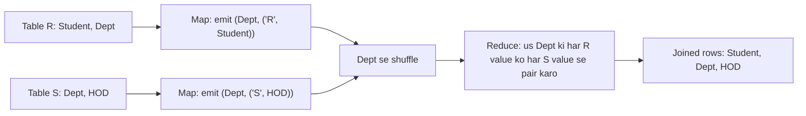

**Ek line mein:** <mark>Natural join mein join column key hota hai, isliye dono tables ki matching rows ek reducer pe milti hain; grouping aur aggregation mein grouping column key hota hai aur reduce SUM, COUNT, AVG, MAX ya MIN lagata hai</mark>. <Cite id="hadoop-ecosystem-mmds" loc="§2.3.7, §2.3.8" /> <Cite id="mapreduce-algorithms-wiki-join" />

<Box kind="key">

**Natural join, grouping aur aggregation ke question mein ye points likho:**

- <mark>Natural join $R(A,B) \bowtie S(B,C)$: common column $B$ mein same value wali rows jodo</mark>.
- <mark>Join map: R tuple $(a,b)$ se $(b, (R, a))$; S tuple $(b,c)$ se $(b, (S, c))$; tag batata hai kaunsa table</mark>.
- <mark>Join reduce: key $b$ ke liye R ki ek value aur S ki ek value ke har pair ka $(a, b, c)$ output</mark>.
- <mark>Grouping map: (grouping value, aggregate hone wali value) emit; reduce: list pe SUM, COUNT, AVG, MAX ya MIN</mark>.
- Combiner: **SUM, COUNT, MAX, MIN ke liye safe**; AVG ke liye **(sum, count)** bhejo, partial averages kabhi nahi.
- Jis key ki values **sirf ek table** se hon, uska join output nahi hota.

</Box>

## Core answer (5 marks, yahan ke har question ke liye)

<Box kind="definition">

A **natural join** combines every row of $R(A, B)$ with every row of $S(B, C)$ that has the same value in the common column $B$ (like SQL `JOIN` on a shared column). **Grouping and aggregation** $\gamma_{X, \theta(Y)}(R)$ puts rows with the same value of column $X$ into a group and computes one number per group, like `SELECT Dept, AVG(Marks) FROM R GROUP BY Dept`. <Cite id="mapreduce-algorithms-wiki-join" /> <Cite id="mapreduce-algorithms-tp-relalg" />

</Box>

**Natural join (reduce-side join):** key join attribute $B$ hai, kyunki jin rows ko match hona hai unka $B$ same hota hai.

```text
map(tuple from R(A,B)):  emit(B, ('R', A))
map(tuple from S(B,C)):  emit(B, ('S', C))
reduce(b, values):
    As = [x for (tag, x) in values if tag == 'R']
    Cs = [x for (tag, x) in values if tag == 'S']
    for a in As: for c in Cs: emit((a, b, c))
```



<Cite id="mapreduce-algorithms-gfg-join" loc="diagram" />

**Grouping aur aggregation:** key grouping attribute hai.

- **Map:** har tuple ke liye (grouping value, aggregate hone wali value) emit karo.
- **Reduce:** ek group ki list pe SUM, COUNT, AVG, MAX ya MIN lagao aur (group, result) emit karo.

```text
map(t):  emit(t.Dept, t.Marks)
reduce(dept, marks):  emit(dept, aggregate(marks))   # SUM, COUNT, AVG, MAX or MIN
```

**Conclusion:** <mark>dono operations mein map key chunta hai (join column ya grouping column) aur reduce ek key ke liye asli kaam karta hai</mark>.

## Extended answer (10 marks): ye add karo

### 1. Worked example: natural join

<Sum>

<Given>

$R$(Student, Dept): (Asha, CSE), (Ravi, IT), (Meena, CSE). $S$(Dept, HOD): (CSE, Rao), (IT, Shah), (ECE, Iyer).

</Given>

<Find>

$R \bowtie S$ on Dept.

</Find>

<Steps>

1. **Map.** Key is Dept:

   | From | Map output |
   |---|---|
   | R | (CSE, (R, Asha)), (IT, (R, Ravi)), (CSE, (R, Meena)) |
   | S | (CSE, (S, Rao)), (IT, (S, Shah)), (ECE, (S, Iyer)) |

2. **Shuffle.**

   | Dept | Values |
   |---|---|
   | CSE | (R, Asha), (R, Meena), (S, Rao) |
   | IT | (R, Ravi), (S, Shah) |
   | ECE | (S, Iyer) |

3. **Reduce.** CSE: 2 R-values times 1 S-value gives 2 rows. IT: 1 times 1 gives 1 row. ECE: 0 times 1 gives nothing. *Reason: a key with values from only one relation has no partner.*

</Steps>

<Answer>

$\{(Asha, CSE, Rao), (Meena, CSE, Rao), (Ravi, IT, Shah)\}$

</Answer>

<Box kind="verify">

Row count: for each Dept, (number in R) times (number in S): $2 \times 1 + 1 \times 1 + 0 \times 1 = 3$. The answer has 3 rows. ECE has no student, so it correctly does not appear.

</Box>

</Sum>

### 2. Worked example: grouping aur aggregation

<Sum>

<Given>

Marks relation (Dept, Marks): (CSE, 70), (IT, 60), (CSE, 80), (IT, 90), (ECE, 50). Group by Dept and find SUM and AVG of Marks.

</Given>

<Find>

SUM and AVG per Dept.

</Find>

<Steps>

1. **Map.** Emit (Dept, Marks): (CSE,70), (IT,60), (CSE,80), (IT,90), (ECE,50).
2. **Shuffle.** CSE: [70, 80]; IT: [60, 90]; ECE: [50].
3. **Reduce.**

   | Dept | Marks list | SUM | COUNT | AVG |
   |---|---|---|---|---|
   | CSE | [70, 80] | 150 | 2 | 75 |
   | IT | [60, 90] | 150 | 2 | 75 |
   | ECE | [50] | 50 | 1 | 50 |

</Steps>

<Answer>

CSE: SUM 150, AVG 75. IT: SUM 150, AVG 75. ECE: SUM 50, AVG 50.

</Answer>

<Box kind="verify">

Total of all marks: $70 + 60 + 80 + 90 + 50 = 350$. Total of the group sums: $150 + 150 + 50 = 350$. They match.

</Box>

</Sum>

### 3. Combiners aur cost

- SUM, COUNT, MAX aur MIN ke liye **combiner** safe hai, isliye har mapper har key ka ek partial result bhejta hai.
- AVG ke liye combiner ko **(sum, count)** pairs bhejne chahiye, kyunki groups ke size alag hon to averages ka average galat hota hai.
- Join mein map phase dono tables ki har row ek baar copy karta hai, isliye shuffle mein dono tables jate hain. Bahut common key (bahut rows) ek reducer ko slow kar deti hai.

### 4. Practice mein

Hive aur Pig `JOIN` aur `GROUP BY` ko bilkul inhi MapReduce jobs mein compile karte hain. <Cite id="web-bda-1-hive-tutorial" /> <Cite id="hadoop-ecosystem-mmds" loc="§2.3.7, §2.3.8" />

## Har question mein kaise fit karein

- **"Explain natural join and grouping and aggregation relational algebraic operation using MapReduce."** (10 marks) <PYQ id="2023-05-ce/q4a" /> <PYQ id="2025-05-ce/q3b" />: core answer poora (definition, key choice, map aur reduce rules, diagram, pseudo code), phir **section 1 aur 2** traced examples ki tarah, aur section 3 closing points ki tarah.

## Exam tips

- Har case mein **key ka naam** likho: join ke liye join column, grouping ke liye grouping column.
- Join mein har map output mein **tag** ('R' ya 'S') dikhao; yahi answer ka dil hai.
- **Har example ka end check se karo** (join mein row count, grouping mein sums ka total).
