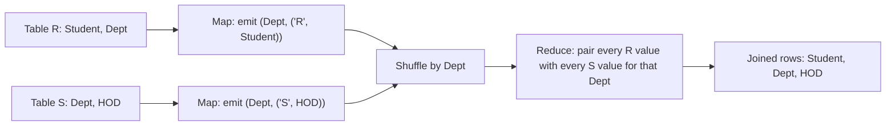

**In one line:** <mark>In a natural join the join column is the key, so matching rows of both tables meet at one reducer; in grouping and aggregation the grouping column is the key and reduce applies SUM, COUNT, AVG, MAX or MIN</mark>. <Cite id="hadoop-ecosystem-mmds" loc="§2.3.7, §2.3.8" /> <Cite id="mapreduce-algorithms-wiki-join" />

<Box kind="key">

**Key points to write (natural join, grouping and aggregation):**

- <mark>Natural join $R(A,B) \bowtie S(B,C)$: combine rows that have the same value in the common column $B$</mark>.
- <mark>Join map: R tuple $(a,b)$ gives $(b, (R, a))$; S tuple $(b,c)$ gives $(b, (S, c))$; the tag says which table</mark>.
- <mark>Join reduce: for key $b$ output $(a, b, c)$ for every pair of one R value and one S value</mark>.
- <mark>Grouping map: emit (grouping value, value to aggregate); reduce: apply SUM, COUNT, AVG, MAX or MIN to the list</mark>.
- Combiner: **safe for SUM, COUNT, MAX, MIN**; for AVG send **(sum, count)**, never partial averages.
- A key with values from **only one table** gives no join output.

</Box>

## Core answer (5 marks, fits every question here)

<Box kind="definition">

A **natural join** combines every row of $R(A, B)$ with every row of $S(B, C)$ that has the same value in the common column $B$ (like SQL `JOIN` on a shared column). **Grouping and aggregation** $\gamma_{X, \theta(Y)}(R)$ puts rows with the same value of column $X$ into a group and computes one number per group, like `SELECT Dept, AVG(Marks) FROM R GROUP BY Dept`. <Cite id="mapreduce-algorithms-wiki-join" /> <Cite id="mapreduce-algorithms-tp-relalg" />

</Box>

**Natural join (reduce-side join):** key choice is the join attribute $B$, because rows that must match have the same $B$.

```text
map(tuple from R(A,B)):  emit(B, ('R', A))
map(tuple from S(B,C)):  emit(B, ('S', C))
reduce(b, values):
    As = [x for (tag, x) in values if tag == 'R']
    Cs = [x for (tag, x) in values if tag == 'S']
    for a in As: for c in Cs: emit((a, b, c))
```



<Cite id="mapreduce-algorithms-gfg-join" loc="diagram" />

**Grouping and aggregation:** key choice is the grouping attribute.

- **Map:** for each tuple emit (grouping value, value to aggregate).
- **Reduce:** for one group apply SUM, COUNT, AVG, MAX or MIN to the list and emit (group, result).

```text
map(t):  emit(t.Dept, t.Marks)
reduce(dept, marks):  emit(dept, aggregate(marks))   # SUM, COUNT, AVG, MAX or MIN
```

**Conclusion:** <mark>in both operations map chooses the key (join column or grouping column) and reduce does the real work for one key</mark>.

## Extended answer (10 marks): add these

### 1. Worked example: natural join

<Sum>

<Given>

$R$(Student, Dept): (Asha, CSE), (Ravi, IT), (Meena, CSE). $S$(Dept, HOD): (CSE, Rao), (IT, Shah), (ECE, Iyer).

</Given>

<Find>

$R \bowtie S$ on Dept.

</Find>

<Steps>

1. **Map.** Key is Dept:

   | From | Map output |
   |---|---|
   | R | (CSE, (R, Asha)), (IT, (R, Ravi)), (CSE, (R, Meena)) |
   | S | (CSE, (S, Rao)), (IT, (S, Shah)), (ECE, (S, Iyer)) |

2. **Shuffle.**

   | Dept | Values |
   |---|---|
   | CSE | (R, Asha), (R, Meena), (S, Rao) |
   | IT | (R, Ravi), (S, Shah) |
   | ECE | (S, Iyer) |

3. **Reduce.** CSE: 2 R-values times 1 S-value gives 2 rows. IT: 1 times 1 gives 1 row. ECE: 0 times 1 gives nothing. *Reason: a key with values from only one relation has no partner.*

</Steps>

<Answer>

$\{(Asha, CSE, Rao), (Meena, CSE, Rao), (Ravi, IT, Shah)\}$

</Answer>

<Box kind="verify">

Row count: for each Dept, (number in R) times (number in S): $2 \times 1 + 1 \times 1 + 0 \times 1 = 3$. The answer has 3 rows. ECE has no student, so it correctly does not appear.

</Box>

</Sum>

### 2. Worked example: grouping and aggregation

<Sum>

<Given>

Marks relation (Dept, Marks): (CSE, 70), (IT, 60), (CSE, 80), (IT, 90), (ECE, 50). Group by Dept and find SUM and AVG of Marks.

</Given>

<Find>

SUM and AVG per Dept.

</Find>

<Steps>

1. **Map.** Emit (Dept, Marks): (CSE,70), (IT,60), (CSE,80), (IT,90), (ECE,50).
2. **Shuffle.** CSE: [70, 80]; IT: [60, 90]; ECE: [50].
3. **Reduce.**

   | Dept | Marks list | SUM | COUNT | AVG |
   |---|---|---|---|---|
   | CSE | [70, 80] | 150 | 2 | 75 |
   | IT | [60, 90] | 150 | 2 | 75 |
   | ECE | [50] | 50 | 1 | 50 |

</Steps>

<Answer>

CSE: SUM 150, AVG 75. IT: SUM 150, AVG 75. ECE: SUM 50, AVG 50.

</Answer>

<Box kind="verify">

Total of all marks: $70 + 60 + 80 + 90 + 50 = 350$. Total of the group sums: $150 + 150 + 50 = 350$. They match.

</Box>

</Sum>

### 3. Combiners and cost

- For SUM, COUNT, MAX and MIN a **combiner** is safe, so each mapper sends one partial result per key.
- For AVG the combiner must send **(sum, count)** pairs, because an average of averages is wrong when groups differ in size.
- In the join, the map phase copies every row of both tables once, so the shuffle carries both tables. A key that is very common (many rows) makes one reducer slow.

### 4. In practice

Hive and Pig compile `JOIN` and `GROUP BY` into exactly these MapReduce jobs. <Cite id="web-bda-1-hive-tutorial" /> <Cite id="hadoop-ecosystem-mmds" loc="§2.3.7, §2.3.8" />

## Fit it to each question

- **"Explain natural join and grouping and aggregation relational algebraic operation using MapReduce."** (10 marks) <PYQ id="2023-05-ce/q4a" /> <PYQ id="2025-05-ce/q3b" />: core answer in full (definition, key choice, map and reduce rules, diagram, pseudo code), then **sections 1 and 2** as the traced examples, and section 3 as the closing points.

## Exam tips

- **Name the key** in each case: join column for the join, grouping column for the grouping.
- For join, **show the tag** ('R' or 'S') in every map output; it is the heart of the answer.
- **End each example with the check** (row count for join, total of sums for grouping).
