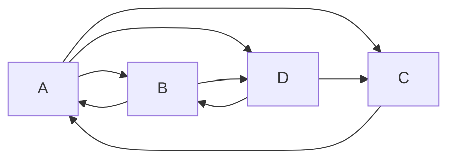

**Ek line mein:** <mark>PageRank (Page aur Brin, 1998) har web page ko score deta hai ki wo kitna important hai: page tab important hai jab important pages uspe link karein, aur ye r = M r ko tab tak repeat karke nikalta hai jab tak wo badalna band na kare</mark>. <Cite id="hadoop-ecosystem-mmds" loc="§5.1" /> <Cite id="web-bda-2-wiki-pagerank" />

<Box kind="key">

**Har PageRank question mein ye points likho:**

- <mark>Links votes hain, aur important page ka vote zyada count hota hai.</mark>
- <mark>Random surfer model: PageRank = wo fraction of time jo random out-links click karta surfer us page pe bitata hai.</mark>
- <mark>n_j out-links wala page apne rank ka 1/n_j har linked page ko deta hai.</mark>
- <mark>Transition matrix M: page j, page i ko link kare to m_ij = 1/n_j, warna 0. r = (1/n, ..., 1/n) se shuru karo aur r = M r repeat karo.</mark>
- Problems: <mark>dead ends (koi out-link nahi) aur spider traps (links sirf group ke andar)</mark>.
- Fix: <mark>taxation (teleportation)</mark> $r = \beta M r + (1-\beta)e/n$, $\beta$ lagbhag 0.8 se 0.9.

</Box>

## Core answer (5 marks, yahan ke har question ke liye)

<Box kind="definition">

**PageRank** is a link-analysis algorithm that gives every web page a score for how important it is. A page is important if important pages link to it. Imagine a **random surfer** who keeps clicking a random out-link; the fraction of time spent on a page is its PageRank. <Cite id="hadoop-ecosystem-mmds" loc="§5.1" /> <Cite id="mapreduce-algorithms-wiki-pagerank" />

</Box>

**Kyun chahiye:** sirf words se search karne par spam milta hai. Links votes ki tarah kaam karte hain, aur important page ka vote zyada hota hai, isliye PageRank search results ko importance se order karta hai. Isse cheat karna mushkil hai, kyunki spammer ko important pages se links nahi mil sakte.

**Kaise kaam karta hai:**

1. $n_j$ out-links wala page apne rank ka $1/n_j$ har linked page ko deta hai.
2. **Transition matrix** $M$ banao: page $j$, page $i$ ko link kare to $m_{ij} = 1/n_j$, warna 0.
3. Rank vector $r = (1/n, \dots, 1/n)$ se shuru karo.
4. $r \leftarrow M r$ tab tak repeat karo jab tak wo badalna band na kare. Limit $r = Mr$ ko satisfy karti hai.
5. Har iteration matrix-vector multiplication hai, isliye MapReduce mein fit hoti hai. <Cite id="pagerank-cs246-pagerank" />

<Cite id="mapreduce-algorithms-gfg-pagerank" loc="diagram" />

**Conclusion:** <mark>PageRank page ko is baat se score karta hai ki uspe link karne wale pages kitne important hain, repeated matrix-vector multiplication se</mark>.

## Extended answer (10 marks): ye add karo

### 1. Worked example

<Sum>

<Given>

Upar wala chaar-page web, starting ranks har ek $1/4$.

</Given>

<Find>

do iterations ke baad ranks, aur limit.

</Find>

<Steps>

1. Out-links se equations: $r_A = r_B/2 + r_C$; $r_B = r_A/3 + r_D/2$; $r_C = r_A/3 + r_D/2$; $r_D = r_A/3 + r_B/2$.
2. $(1/4, 1/4, 1/4, 1/4)$ se **Iteration 1**: $r_A = 1/8 + 1/4 = 3/8$; $r_B = 1/12 + 1/8 = 5/24$; $r_C = 5/24$; $r_D = 1/12 + 1/8 = 5/24$.
3. **Iteration 2:** $r_A = 5/48 + 5/24 = 15/48$; $r_B = 1/8 + 5/48 = 11/48$; $r_C = 11/48$; $r_D = 1/8 + 5/48 = 11/48$.
4. **Limit.** Total 1 ke saath $r = Mr$ solve karo: $r_B = r_C = r_D$ aur $r_A = r_B/2 + r_C = 1.5\, r_B$, isliye $1.5 r_B + 3 r_B = 1$, jisse $r_B = 2/9$ aur $r_A = 3/9$.

</Steps>

<Answer>

iteration 2 ke baad: $A = 15/48 \approx 0.313$, $B = C = D = 11/48 \approx 0.229$. Limit: $A = 3/9$, $B = C = D = 2/9$.

</Answer>

<Box kind="verify">

Ranks ka jod hamesha 1 hai: $3/8 + 3 \times 5/24 = 9/24 + 15/24 = 1$, aur $15/48 + 3 \times 11/48 = 48/48 = 1$. Limit har equation satisfy karti hai: $r_A = 1/9 + 2/9 = 3/9$ aur $r_B = 1/9 + 1/9 = 2/9$.

</Box>

</Sum>

### 2. Real web ki problems, aur fix

- **Dead end:** **bina out-links** wala page. Uske rank ko jaane ki jagah nahi milti aur wo leak ho jaata hai, isliye saare ranks 0 ki taraf jaate hain. Example: A, B aur C ko link karta hai, B, A aur C ko, C kisi ko nahi; $1/3$ se shuru karo to ek step ke baad total $2/3$ aur phir $1/3$.
- **Spider trap:** pages ka group jiske out-links **group ke andar** hi rehte hain (sabse simple: ek page jo sirf khud ko link kare). Ye poora rank absorb kar lete hain. Example: A, B aur C ko link karta hai, B, A ko, C, C ko; ranks $(1/3, 1/3, 1/3)$, $(1/3, 1/6, 1/2)$, $(1/6, 1/6, 2/3)$ hote hain aur C ka rank 1 ho jaata hai. <Cite id="pagerank-wiki-spidertrap" />
- **Fix: taxation (teleporting).** Probability $\beta$ se surfer link follow karta hai, aur $1-\beta$ se random page pe jump: $r \leftarrow \beta M r + (1-\beta)\dfrac{e}{n}$, jahan $e$ 1s ka vector hai. Chaar-page web ke liye $\beta = 0.85$ pe limit lagbhag $A = 0.325$ aur $B = C = D = 0.225$ hai. <Cite id="web-bda-2-mmds-linkanalysis" loc="slides 41-47" />

### 3. Advantages aur limits

| Advantages | Limits |
|---|---|
| Cheat karna mushkil, kyunki important pages ke votes chahiye | Purane pages ko favour karta hai jinhone bahut links jama kar liye |
| Offline compute hota hai, query se independent | Bade web pe kayi iterations chahiye |
| Link structure pe based, words pe nahi | Dead ends aur spider traps ke liye taxation chahiye |

## Har question mein kaise fit karein

- **"Explain PageRank algorithm."** (10 marks) <PYQ id="2024-05/q6a" />: core answer (definition, kyun, paanch steps, chaar-page graph) + section 1 (worked example) + section 2 (dead end, spider trap, formula ke saath taxation) + advantages aur limits table.

## Exam tips

- **Hamesha draw karo:** arrows wala chhota web graph, aur har page ki equation uske paas likho.
- Update rule $r = Mr$ aur $\beta$ ke saath **taxation formula** likho.
- Har iteration ke baad check karo ki ranks ka **jod 1** hai; isse dikhta hai ki working sahi hai.

Exam mein English mein likho.
