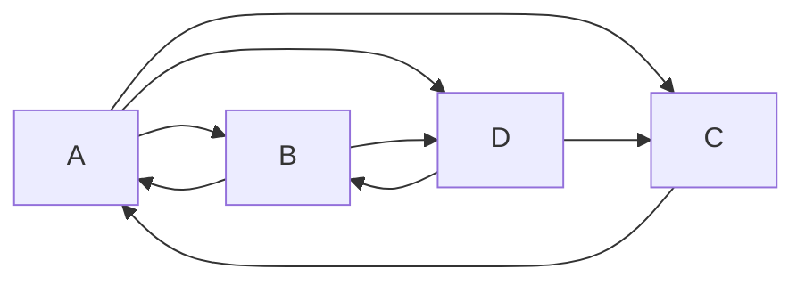

**In one line:** <mark>PageRank (Page and Brin, 1998) gives every web page a score for how important it is: a page is important if important pages link to it, computed by repeating r = M r until it stops changing</mark>. <Cite id="hadoop-ecosystem-mmds" loc="§5.1" /> <Cite id="web-bda-2-wiki-pagerank" />

<Box kind="key">

**Key points to write (any PageRank question):**

- <mark>Links are votes, and a vote from an important page counts more.</mark>
- <mark>Random surfer model: PageRank = the fraction of time a surfer who keeps clicking random out-links spends on the page.</mark>
- <mark>A page with n_j out-links gives 1/n_j of its rank to each page it links to.</mark>
- <mark>Transition matrix M: m_ij = 1/n_j if page j links to page i, else 0. Start r = (1/n, ..., 1/n) and repeat r = M r.</mark>
- Problems: <mark>dead ends (no out-links) and spider traps (links only inside a group)</mark>.
- Fix: <mark>taxation (teleportation)</mark> $r = \beta M r + (1-\beta)e/n$, $\beta$ about 0.8 to 0.9.

</Box>

## Core answer (5 marks, fits every question here)

<Box kind="definition">

**PageRank** is a link-analysis algorithm that gives every web page a score for how important it is. A page is important if important pages link to it. Imagine a **random surfer** who keeps clicking a random out-link; the fraction of time spent on a page is its PageRank. <Cite id="hadoop-ecosystem-mmds" loc="§5.1" /> <Cite id="mapreduce-algorithms-wiki-pagerank" />

</Box>

**Why it is needed:** searching by words alone returns spam. Links work like votes, and a vote from an important page counts more, so PageRank orders search results by importance. It is hard to cheat, because a spammer cannot easily get links from important pages.

**How it works:**

1. A page with $n_j$ out-links gives $1/n_j$ of its rank to each page it links to.
2. Build the **transition matrix** $M$: $m_{ij} = 1/n_j$ if page $j$ links to page $i$, else 0.
3. Start with the rank vector $r = (1/n, \dots, 1/n)$.
4. Repeat $r \leftarrow M r$ until it stops changing. The limit satisfies $r = Mr$.
5. Each iteration is a matrix-vector multiplication, so it fits MapReduce. <Cite id="pagerank-cs246-pagerank" />

<Cite id="mapreduce-algorithms-gfg-pagerank" loc="diagram" />

**Conclusion:** <mark>PageRank scores a page by the importance of the pages linking to it, computed by repeated matrix-vector multiplication</mark>.

## Extended answer (10 marks): add these

### 1. Worked example

<Sum>

<Given>

The four-page web above, starting ranks $1/4$ each.

</Given>

<Find>

ranks after two iterations, and the limit.

</Find>

<Steps>

1. Equations from out-links: $r_A = r_B/2 + r_C$; $r_B = r_A/3 + r_D/2$; $r_C = r_A/3 + r_D/2$; $r_D = r_A/3 + r_B/2$.
2. **Iteration 1** from $(1/4, 1/4, 1/4, 1/4)$: $r_A = 1/8 + 1/4 = 3/8$; $r_B = 1/12 + 1/8 = 5/24$; $r_C = 5/24$; $r_D = 1/12 + 1/8 = 5/24$.
3. **Iteration 2:** $r_A = 5/48 + 5/24 = 15/48$; $r_B = 1/8 + 5/48 = 11/48$; $r_C = 11/48$; $r_D = 1/8 + 5/48 = 11/48$.
4. **Limit.** Solve $r = Mr$ with the total 1: $r_B = r_C = r_D$ and $r_A = r_B/2 + r_C = 1.5\, r_B$, so $1.5 r_B + 3 r_B = 1$, giving $r_B = 2/9$ and $r_A = 3/9$.

</Steps>

<Answer>

after iteration 2: $A = 15/48 \approx 0.313$, $B = C = D = 11/48 \approx 0.229$. Limit: $A = 3/9$, $B = C = D = 2/9$.

</Answer>

<Box kind="verify">

The ranks always add to 1: $3/8 + 3 \times 5/24 = 9/24 + 15/24 = 1$, and $15/48 + 3 \times 11/48 = 48/48 = 1$. The limit satisfies every equation: $r_A = 1/9 + 2/9 = 3/9$ and $r_B = 1/9 + 1/9 = 2/9$.

</Box>

</Sum>

### 2. Problems on the real web, and the fix

- **Dead end:** a page with **no out-links**. Its rank has nowhere to go and leaks out, so all ranks drift to 0. Example: A links to B and C, B links to A and C, C links to nothing; starting at $1/3$ each, the total after one step is $2/3$ and then $1/3$.
- **Spider trap:** a group of pages whose out-links stay **inside the group** (the simplest is a page linking only to itself). They absorb all the rank. Example: A links to B and C, B links to A, C links to C; ranks go $(1/3, 1/3, 1/3)$, $(1/3, 1/6, 1/2)$, $(1/6, 1/6, 2/3)$ and C ends with rank 1. <Cite id="pagerank-wiki-spidertrap" />
- **Fix: taxation (teleporting).** With probability $\beta$ the surfer follows a link, and with probability $1-\beta$ jumps to a random page: $r \leftarrow \beta M r + (1-\beta)\dfrac{e}{n}$, where $e$ is a vector of 1s. For the four-page web with $\beta = 0.85$ the limit is about $A = 0.325$ and $B = C = D = 0.225$. <Cite id="web-bda-2-mmds-linkanalysis" loc="slides 41-47" />

### 3. Advantages and limits

| Advantages | Limits |
|---|---|
| Hard to cheat, because votes from important pages are needed | Favours old pages that have collected many links |
| Computed offline, independent of the query | Many iterations are needed on a huge web |
| Based on the link structure, not on the words | Needs taxation to handle dead ends and spider traps |

## Fit it to each question

- **"Explain PageRank algorithm."** (10 marks) <PYQ id="2024-05/q6a" />: core answer (definition, why, five steps, four-page graph) + section 1 (worked example) + section 2 (dead end, spider trap, taxation with the formula) + the advantages and limits table.

## Exam tips

- **Always draw:** a small web graph with arrows, and write the equation for each page next to it.
- Write the update rule $r = Mr$ and the **taxation formula** with $\beta$.
- Check that the ranks **add up to 1** after every iteration; it shows the working is right.
