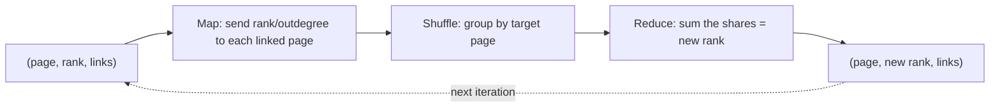
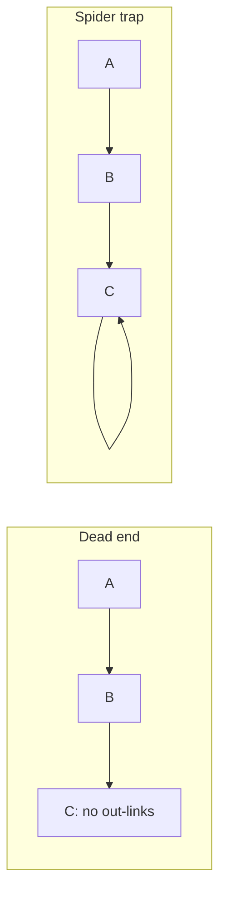

**Ek line mein:** <mark>PageRank page ko is baat se score karta hai ki us par link karne wale pages kitne important hain; ek iteration matrix-vector multiplication hai, jo MapReduce mein map (har linked page ko rank/out-degree bhejo) aur reduce (shares ka sum) se hota hai</mark>. <Cite id="mapreduce-algorithms-wiki-pagerank" /> <Cite id="pagerank-cs246-pagerank" />

<Box kind="key">

**Har PageRank-on-MapReduce question mein ye points likho:**

- <mark>Page tab important hai jab important pages uspe link karein</mark>; rank = random surfer ke us page pe hone ki chance.
- Har page <mark>apna rank apne out-links mein barabar baant deta hai</mark>; ranks rukne tak repeat: $v' = Mv$.
- <mark>Map: (linked page, rank/out-degree) emit karo aur (page, uski link list) bhi. Reduce: aane wali values ka sum = naya rank.</mark> Har iteration ke liye job repeat.
- <mark>Dead end: bina out-links wala page; rank leak ho jaata hai aur saare ranks 0 ho jaate hain.</mark>
- <mark>Spider trap: pages ka group jiske links group ke andar hi rehte hain; wo poora rank absorb kar leta hai.</mark>
- Dono ka fix: <mark>taxation (teleportation)</mark>: $v' = \beta M v + (1-\beta)e/n$, $\beta$ lagbhag 0.8 se 0.9.

</Box>

## Core answer (5 marks, yahan ke har question ke liye)

<Box kind="definition">

**PageRank** gives every web page a score for how important it is. A page is important if important pages link to it. Imagine a **random surfer** who keeps clicking a random out-link; the fraction of time spent on a page is its PageRank. <Cite id="web-bda-2-wiki-pagerank" /> <Cite id="hadoop-ecosystem-mmds" loc="§5.1" />

</Box>

**MapReduce kyun:** web mein arabon pages hain, isliye rank vector aur link matrix ek machine pe nahi aate. Ek iteration $v' = Mv$ hai, jahan $M$ mein $m_{ij} = 1/n_j$ agar page $j$ ($n_j$ out-links wala) page $i$ ko link karta hai. Matrix-vector multiplication wahi cheez hai jo MapReduce achhe se karta hai. <Cite id="mapreduce-algorithms-gfg-pagerank" />

**Ek iteration MapReduce job ki tarah:**

- **Map:** rank $r$ aur $q_1 \dots q_d$ ko $d$ out-links wale page $p$ ke liye, har ek ke liye $(q_i, r/d)$ emit karo, aur $(p, \text{link list})$ bhi taaki graph agle round ke liye bacha rahe.
- **Shuffle:** ek page $q$ ki saari values ek reducer pe milti hain.
- **Reduce:** aane wali values jodke $q$ ka naya rank nikalo, aur $(q, \text{new rank}, \text{link list})$ likho.
- Job tab tak repeat karo jab tak ranks bahut kam na badlein.

**Dead ends aur spider traps (short mein):**

| | Dead end | Spider trap |
|---|---|---|
| Kya hai | Bina outgoing links wala page | Pages ka group jiske links sirf group ke andar point karte hain (ek page jo khud ko link kare tab bhi) |
| Effect | Rank aata hai aur gayab ho jaata hai; saare ranks 0 | Group poora rank ikattha kar leta hai; baaki web 0 |
| Fix | Dead ends hatao, ya taxation | Taxation (teleportation) |

<Cite id="pagerank-wiki-spidertrap" />

**Conclusion:** <mark>PageRank MapReduce rounds mein hone wala baar baar matrix-vector multiplication hai, aur taxation dead ends aur spider traps ko ranks kharab karne se rokta hai</mark>.

## Extended answer (10 marks): ye add karo

### 1. Ek worked iteration

<Sum>

<Given>

Pages A, B, C, links A se B, C; B se C; C se A. Start rank har ek ka $1/3$.

</Given>

<Find>

2 iterations ke baad ranks.

</Find>

<Steps>

1. **Map, iteration 1.** A (1/3, 2 links) B ko 1/6 aur C ko 1/6 bhejta hai. B (1/3, 1 link) C ko 1/3 bhejta hai. C (1/3, 1 link) A ko 1/3 bhejta hai.

   | Key | Mili values | Reduce sum |
   |---|---|---|
   | A | 1/3 | 1/3 |
   | B | 1/6 | 1/6 |
   | C | 1/6, 1/3 | 1/2 |

2. $(1/3, 1/6, 1/2)$ se **Iteration 2**: A ko C ka poora rank milta hai, $1/2$. B ko A ka aadha, $1/6$. C ko A ka aadha aur B ka poora: $1/6 + 1/6 = 1/3$.

</Steps>

<Answer>

1 iteration ke baad $(1/3, 1/6, 1/2)$; 2 iterations ke baad (A, B, C) ke liye $(1/2, 1/6, 1/3)$.

</Answer>

<Box kind="verify">

Total har baar 1 rehta hai: $1/3 + 1/6 + 1/2 = 1$ aur $1/2 + 1/6 + 1/3 = 1$. Limit $v = Mv$ solve karti hai: $A = C$, $B = A/2$, $C = A/2 + B$ se $(0.4, 0.2, 0.4)$ aata hai, jiska sum 1 hai, aur ranks usi ki taraf badh rahe hain.

</Box>

</Sum>

### 2. Dead ends aur spider traps examples ke saath

- **Dead end.** A, B ko link karta hai, B, C ko link karta hai, C ka koi link nahi. Har ek $1/3$ se shuru karo to ranks $(0, 1/3, 1/3)$, phir $(0, 0, 1/3)$, phir 0 ho jaate hain: rank leak ho gaya.
- **Spider trap.** A, B ko link karta hai, B, C ko link karta hai, C khud ko link karta hai. Ranks $(0, 1/3, 2/3)$, phir $(0, 0, 1)$ ho jaate hain: C sab le leta hai.

### 3. Fix: taxation (teleportation)

Probability $\beta$ (lagbhag 0.8 se 0.9) se surfer link follow karta hai, warna random page pe jump karta hai: $v' = \beta M v + (1-\beta)\,e/n$, jahan $e$ 1s ka vector hai aur $n$ pages ki sankhya. Upar ke spider trap ke liye $\beta = 0.8$ ke saath pehle round mein $(0.067, 0.333, 0.600)$ aata hai, jiska sum abhi bhi 1 hai, isliye trap ab sab kuch nahi leta. Dead ends ko nikalne ka raasta milta hai, kyunki unka rank sabhi pages mein baant diya jaata hai. <Cite id="web-bda-2-mmds-linkanalysis" loc="slides 41-47" />

## Har question mein kaise fit karein

- **"Explain Page rank using Map reduce, also explain spider traps and dead ends."** (10 marks) <PYQ id="2024-12/q5b" /> <PYQ id="2025-05/q5a" />: core answer (definition, MapReduce map aur reduce, flowchart, dead-end aur spider-trap table) + section 1 (worked iteration) + sections 2 aur 3 (examples aur taxation). Teeno parts question ke order mein rakho: PageRank, MapReduce, phir dono problems.

## Exam tips

- **Hamesha draw karo:** MapReduce flowchart, aur dead end aur spider trap ke liye ek teen-page graph.
- **Map output** exactly likho: (target page, rank / out-links ki sankhya).
- Common galti: dono ko mix karna. **Dead end = koi out-link nahi (rank gayab). Spider trap = links sirf group ke andar (rank jama).**

Exam mein English mein likho.
