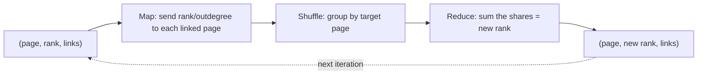
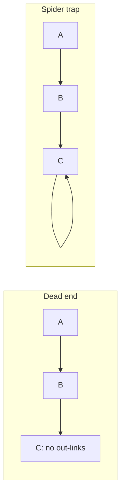

**In one line:** <mark>PageRank scores a page by the importance of the pages that link to it; one iteration is a matrix-vector multiplication, which MapReduce does as map (send rank/out-degree to each linked page) and reduce (sum the shares)</mark>. <Cite id="mapreduce-algorithms-wiki-pagerank" /> <Cite id="pagerank-cs246-pagerank" />

<Box kind="key">

**Key points to write (any PageRank-on-MapReduce question):**

- <mark>A page is important if important pages link to it</mark>; rank = chance that a random surfer is on the page.
- Each page <mark>splits its rank equally among its out-links</mark>; repeat until the ranks stop changing: $v' = Mv$.
- <mark>Map: emit (linked page, rank/out-degree) and also (page, its link list). Reduce: sum the incoming values = new rank.</mark> Repeat the job each iteration.
- <mark>Dead end: a page with no out-links; rank leaks away and all ranks go to 0.</mark>
- <mark>Spider trap: a group of pages whose links stay inside the group; it absorbs all the rank.</mark>
- Fix for both: <mark>taxation (teleportation)</mark>: $v' = \beta M v + (1-\beta)e/n$, with $\beta$ about 0.8 to 0.9.

</Box>

## Core answer (5 marks, fits every question here)

<Box kind="definition">

**PageRank** gives every web page a score for how important it is. A page is important if important pages link to it. Imagine a **random surfer** who keeps clicking a random out-link; the fraction of time spent on a page is its PageRank. <Cite id="web-bda-2-wiki-pagerank" /> <Cite id="hadoop-ecosystem-mmds" loc="§5.1" />

</Box>

**Why MapReduce:** the web has billions of pages, so the rank vector and link matrix cannot fit on one machine. One iteration is $v' = Mv$, where $M$ has $m_{ij} = 1/n_j$ if page $j$ (with $n_j$ out-links) links to page $i$. Matrix-vector multiplication is what MapReduce does well. <Cite id="mapreduce-algorithms-gfg-pagerank" />

**One iteration as a MapReduce job:**

- **Map:** for a page $p$ with rank $r$ and $d$ out-links to $q_1 \dots q_d$, emit $(q_i, r/d)$ for each, and also emit $(p, \text{link list})$ so the graph is kept for the next round.
- **Shuffle:** all values for one page $q$ meet at one reducer.
- **Reduce:** add the incoming values to get $q$'s new rank, and write $(q, \text{new rank}, \text{link list})$.
- Repeat the job until the ranks change very little.

**Dead ends and spider traps (short):**

| | Dead end | Spider trap |
|---|---|---|
| What it is | A page with no outgoing links | A group of pages whose links only point inside the group (even one page linking to itself) |
| Effect | Rank flows in and then vanishes; all ranks go to 0 | The group collects all the rank; the rest of the web goes to 0 |
| Fix | Drop dead ends, or taxation | Taxation (teleportation) |

<Cite id="pagerank-wiki-spidertrap" />

**Conclusion:** <mark>PageRank is repeated matrix-vector multiplication done as MapReduce rounds, and taxation keeps dead ends and spider traps from ruining the ranks</mark>.

## Extended answer (10 marks): add these

### 1. A worked iteration

<Sum>

<Given>

Pages A, B, C with links A to B, C; B to C; C to A. Start rank $1/3$ each.

</Given>

<Find>

ranks after 2 iterations.

</Find>

<Steps>

1. **Map, iteration 1.** A (1/3, 2 links) sends 1/6 to B and 1/6 to C. B (1/3, 1 link) sends 1/3 to C. C (1/3, 1 link) sends 1/3 to A.

   | Key | Values received | Reduce sum |
   |---|---|---|
   | A | 1/3 | 1/3 |
   | B | 1/6 | 1/6 |
   | C | 1/6, 1/3 | 1/2 |

2. **Iteration 2** from $(1/3, 1/6, 1/2)$: A gets all of C's rank, $1/2$. B gets half of A's, $1/6$. C gets half of A's plus all of B's: $1/6 + 1/6 = 1/3$.

</Steps>

<Answer>

after 1 iteration $(1/3, 1/6, 1/2)$; after 2 iterations $(1/2, 1/6, 1/3)$ for (A, B, C).

</Answer>

<Box kind="verify">

The total stays 1 each time: $1/3 + 1/6 + 1/2 = 1$ and $1/2 + 1/6 + 1/3 = 1$. The limit solves $v = Mv$: $A = C$, $B = A/2$, $C = A/2 + B$ gives $(0.4, 0.2, 0.4)$, which sums to 1, and the ranks are moving towards it.

</Box>

</Sum>

### 2. Dead ends and spider traps with examples

- **Dead end.** A links to B, B links to C, C has no links. Starting at $1/3$ each, ranks become $(0, 1/3, 1/3)$, then $(0, 0, 1/3)$, then 0: the rank leaks out.
- **Spider trap.** A links to B, B links to C, C links to C. Ranks become $(0, 1/3, 2/3)$, then $(0, 0, 1)$: C takes everything.

### 3. The fix: taxation (teleportation)

With probability $\beta$ (about 0.8 to 0.9) the surfer follows a link, otherwise jumps to a random page: $v' = \beta M v + (1-\beta)\,e/n$, where $e$ is a vector of 1s and $n$ the number of pages. For the spider trap above with $\beta = 0.8$ the first round gives $(0.067, 0.333, 0.600)$, which still sums to 1, so the trap no longer takes everything. Dead ends get a way out, because their rank is spread over all pages. <Cite id="web-bda-2-mmds-linkanalysis" loc="slides 41-47" />

## Fit it to each question

- **"Explain Page rank using Map reduce, also explain spider traps and dead ends."** (10 marks) <PYQ id="2024-12/q5b" /> <PYQ id="2025-05/q5a" />: core answer (definition, MapReduce map and reduce, flowchart, dead-end and spider-trap table) + section 1 (worked iteration) + sections 2 and 3 (examples and taxation). Keep the three parts in the order of the question: PageRank, MapReduce, then the two problems.

## Exam tips

- **Always draw:** the MapReduce flowchart, and one three-page graph for the dead end and the spider trap.
- Write the **map output** exactly: (target page, rank / number of out-links).
- Common mistake: mixing up the two. **Dead end = no out-links (rank disappears). Spider trap = links only inside the group (rank piles up).**
