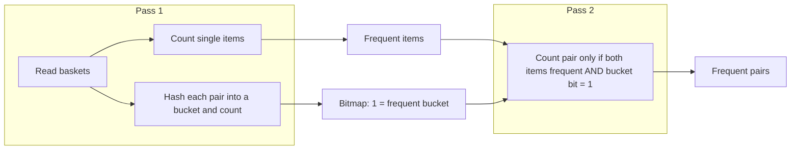
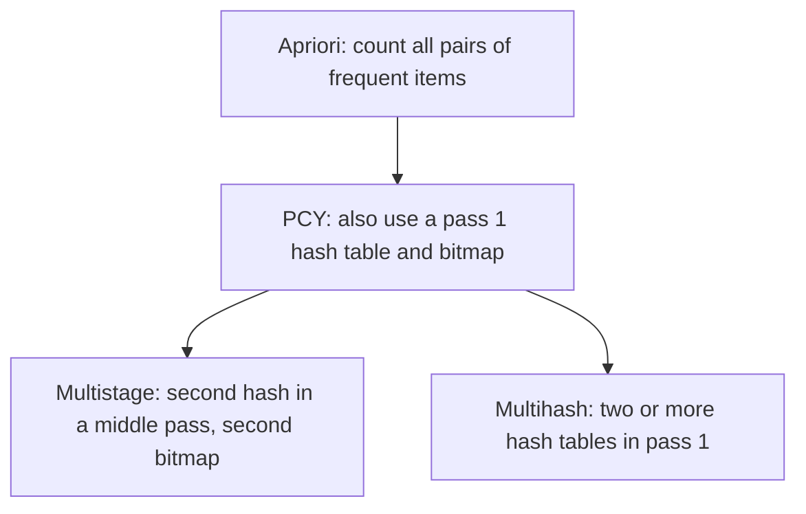

**Ek line mein:** <mark>PCY (Park, Chen, Yu) Apriori ki tarah frequent itemsets dhoondhta hai, par pass 1 ki free memory mein pairs ko buckets mein hash karta hai, isliye pass 2 mein bahut kam candidate pairs ginne padte hain</mark>. <Cite id="pyq-2024-12-gfg-pcy" /> <Cite id="web-bda-2-mmds-pcy" loc="slides 40-46" />

<Box kind="key">

**Har PCY question mein ye points likho:**

- Goal: <mark>frequent itemsets dhoondhna (jo items aksar saath kharide jaate hain), jinka support kam se kam s ho</mark>.
- Apriori ki problem: <mark>pass 2 mein frequent items ke har pair ko ginna padta hai, jo memory ke liye bahut zyada ho sakta hai</mark>.
- <mark>Pass 1: single items ginte hain, aur har basket ke har pair ko hash karke bucket ka count 1 badhate hain.</mark>
- <mark>Passes ke beech: frequent items (count kam se kam s) aur ek bitmap, har frequent bucket ke liye 1</mark> (4-byte count ki jagah 1 bit).
- <mark>Pass 2: pair tabhi ginte hain jab dono items frequent hon AUR uske bucket ka bit 1 ho.</mark>
- Types: <mark>Multistage (doosre hash ke saath extra pass) aur Multihash (ek pass mein kayi hash tables)</mark>.

</Box>

## Core answer (5 marks, yahan ke har question ke liye)

<Box kind="definition">

**PCY** is a frequent-itemset algorithm by Park, Chen and Yu. It improves **Apriori** by using the idle main memory in pass 1 to count **hashed pairs**, so that pass 2 has far fewer candidate pairs to count. The support threshold $s$ is the minimum number of baskets an itemset must appear in. <Cite id="pyq-2024-12-gfg-pcy" /> <Cite id="stream-counting-wiki-apriori" />

</Box>

**Kyun chahiye:** Apriori ka pass 1 sirf single items ginta hai aur bahut kam memory use karta hai, par pass 2 mein frequent items ke har pair ko ginna padta hai, jo bahut zyada ho sakte hain. PCY pass 1 ki bachi memory se pass 2 ka kaam kam karta hai. <Cite id="hadoop-ecosystem-mmds" loc="§6.3.1" />

**PCY kaise kaam karta hai:**

1. **Pass 1.** Har item ginte hain. Har basket ke har pair pe hash function lagate hain aur us pair ke **bucket** ka count 1 badhate hain.
2. **Passes ke beech.** Jin items ka count $\ge s$ hai wo frequent. Bucket counts ko **bitmap** mein badlo: bucket count $\ge s$ (frequent bucket) to 1, warna 0.
3. **Pass 2.** Pair $\{i, j\}$ tabhi ginte hain jab $i$ aur $j$ **dono** frequent hon **aur** pair aise bucket mein hash ho jiska bit 1 hai.
4. Jin pairs ka count $\ge s$ hai wo frequent pairs hain.

<Cite id="pyq-2024-12-gfg-pcy" loc="diagram" />

**Conclusion:** <mark>PCY = Apriori + pass 1 mein hash table; uska bitmap pass 2 se pehle pairs kam kar deta hai</mark>.

## Extended answer (10 marks): ye add karo

### 1. PCY ke types (variants)

Dono variants zyada hashing se zyada pairs kaat dete hain. <Cite id="hadoop-ecosystem-mmds" loc="§6.3.2-6.3.3" /> <Cite id="web-bda-2-mmds-pcy" loc="slides 40-46" />

| Variant | Idea | Cost |
|---|---|---|
| **Multistage** | Beech mein ek extra pass: doosra, alag hash function sirf un pairs pe lagta hai jo frequent items ke hain aur pehli table ke frequent bucket mein girte hain; isse doosra bitmap milta hai. Aakhri pass sirf wahi pairs ginta hai jo dono bitmaps pass karein. | Data pe ek aur pass |
| **Multihash** | Pass 1 mein do (ya zyada) hash tables, har ek mein aadhe buckets. Pair tab candidate hai jab wo har table ke frequent bucket mein ho. | Passes utne hi, par tables chhoti, isliye buckets kam bhare hone chahiye |

### 2. Ek worked example

<Sum>

<Given>

Baskets: B1 = \{1,2,3\}, B2 = \{1,2,4\}, B3 = \{1,2\}, B4 = \{2,3,4\}, B5 = \{1,3\}. Support $s = 3$. Hash $h(i,j) = (i \times j) \bmod 5$, buckets 0 se 4.

</Given>

<Find>

frequent pairs, aur pass 2 ko kitne pairs ginne padte hain.

</Find>

<Steps>

1. **Item counts.** 1 B1, B2, B3, B5 mein = 4; 2 B1, B2, B3, B4 mein = 4; 3 B1, B4, B5 mein = 3; 4 B2, B4 mein = 2. Frequent items: 1, 2, 3.
2. **Har basket ke pairs.** B1: 12, 13, 23. B2: 12, 14, 24. B3: 12. B4: 23, 24, 34. B5: 13.
3. **Har pair ko hash karo.**

   | Pair | Kitni baar | $i \times j$ | Bucket |
   |---|---|---|---|
   | 12 | 3 | 2 | 2 |
   | 13 | 2 | 3 | 3 |
   | 23 | 2 | 6 | 1 |
   | 14 | 1 | 4 | 4 |
   | 24 | 2 | 8 | 3 |
   | 34 | 1 | 12 | 2 |

4. **Bucket counts.** Bucket 0 = 0; bucket 1 = 2 (pair 23); bucket 2 = 3 + 1 = 4 (12 aur 34); bucket 3 = 2 + 2 = 4 (13 aur 24); bucket 4 = 1 (14).
5. **Bitmap** ($s = 3$): buckets 0 se 4 ke liye 0, 0, 1, 1, 0.
6. **Pass 2 candidates.** Frequent items ke pairs 12, 13, 23 hain. Pair 12 bucket 2 mein (bit 1), rakha; 13 bucket 3 mein (bit 1), rakha; 23 bucket 1 mein (bit 0), hata diya. Count 12 = 3 aur 13 = 2.

</Steps>

<Answer>

frequent pair: \{1, 2\} (count 3). Pass 2 ne 2 pairs gine, jabki Apriori 3 ginta.

</Answer>

<Box kind="verify">

Bucket total: $0 + 2 + 4 + 4 + 1 = 11$, jo pair occurrences $3 + 2 + 2 + 1 + 2 + 1 = 11$ ke barabar hai. Pair 12 ka seedha count: wo B1, B2, B3 mein hai = 3, aur koi doosra pair 3 tak nahi pahunchta (13 = 2, 23 = 2, 24 = 2), isliye \{1, 2\} sahi hai.

</Box>

</Sum>

### 3. Apriori vs PCY

| Point | Apriori | PCY |
|---|---|---|
| Pass 1 | Sirf items ginta hai | Items aur hashed pairs ginta hai |
| Pass 1 mein memory | Zyadatar idle | Bucket table ke liye use |
| Pass 2 ke candidate pairs | Frequent items ke saare pairs | Sirf frequent buckets mein girne wale frequent-item pairs |
| Result | Wahi frequent pairs | Wahi frequent pairs, kam counting |

PCY kabhi koi frequent pair nahi khota: frequent pair apna bucket frequent bana deta hai, isliye uska bit 1 hota hai. Koi galat candidate rah sakta hai (doosre pairs ne bucket frequent banaya ho), par pass 2 exact ginta hai aur use hata deta hai.

## Har question mein kaise fit karein

- **"Explain PCY algorithm and its types with neat labeled diagram."** (10 marks) <PYQ id="2024-12/q3a" />: core answer labelled two-pass diagram ke saath, phir section 1 (multistage aur multihash, doosre diagram ke saath), phir time ho to chhota example (section 2), aur Apriori comparison.

## Exam tips

- **Hamesha draw karo:** two-pass diagram, jisme "item counts", "bucket counts", "bitmap" aur "count only if both items frequent AND bit = 1" likha ho.
- Pass 2 mein candidate pair ki **teen conditions** likho: dono items frequent, bucket frequent (bit 1), aur phir pair count $\ge s$.
- Common galti: ye likhna ki PCY answer badal deta hai. Ye Apriori jaise **wahi** frequent pairs deta hai, kam kaam mein.

Exam mein English mein likho.
