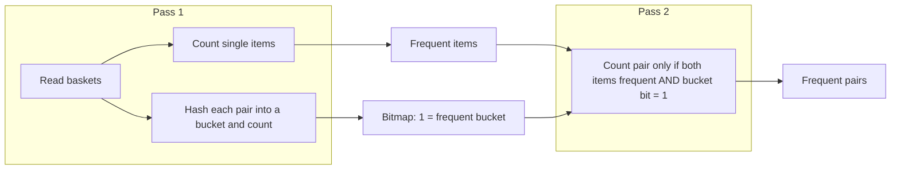
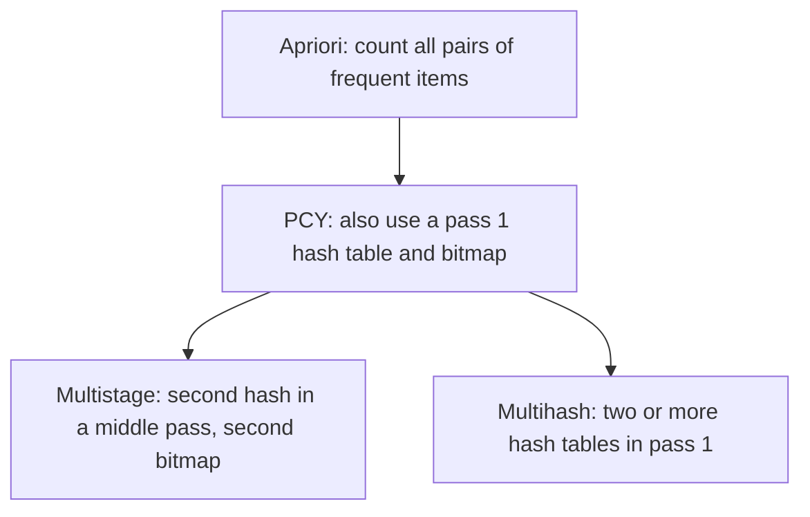

**In one line:** <mark>PCY (Park, Chen, Yu) finds frequent itemsets like Apriori, but uses the free memory in pass 1 to hash pairs into buckets, so pass 2 counts far fewer candidate pairs</mark>. <Cite id="pyq-2024-12-gfg-pcy" /> <Cite id="web-bda-2-mmds-pcy" loc="slides 40-46" />

<Box kind="key">

**Key points to write (any PCY question):**

- Goal: <mark>find frequent itemsets (items often bought together) whose support is at least s</mark>.
- Problem with Apriori: <mark>pass 2 must count every pair of frequent items, which can be too many for memory</mark>.
- <mark>Pass 1: count single items, and also hash every pair of every basket to a bucket and add 1 to the bucket count.</mark>
- <mark>Between passes: frequent items (count at least s) and a bitmap, 1 for each frequent bucket</mark> (1 bit instead of a 4-byte count).
- <mark>Pass 2: count a pair only if both items are frequent AND its bucket bit is 1.</mark>
- Types: <mark>Multistage (extra pass with a second hash) and Multihash (several hash tables in one pass)</mark>.

</Box>

## Core answer (5 marks, fits every question here)

<Box kind="definition">

**PCY** is a frequent-itemset algorithm by Park, Chen and Yu. It improves **Apriori** by using the idle main memory in pass 1 to count **hashed pairs**, so that pass 2 has far fewer candidate pairs to count. The support threshold $s$ is the minimum number of baskets an itemset must appear in. <Cite id="pyq-2024-12-gfg-pcy" /> <Cite id="stream-counting-wiki-apriori" />

</Box>

**Why it is needed:** Apriori's pass 1 counts only single items and uses very little memory, but pass 2 must count every pair of frequent items, which can be too many. PCY uses the spare memory of pass 1 to cut pass 2's work. <Cite id="hadoop-ecosystem-mmds" loc="§6.3.1" />

**How PCY works:**

1. **Pass 1.** Count every item. For every pair in every basket, apply a hash function and add 1 to that pair's **bucket** count.
2. **Between the passes.** Keep items with count $\ge s$ as frequent. Turn the bucket counts into a **bitmap**: 1 if the bucket count is $\ge s$ (a frequent bucket), else 0.
3. **Pass 2.** Count a pair $\{i, j\}$ only if **both** $i$ and $j$ are frequent **and** the pair hashes to a bucket whose bit is 1.
4. Pairs with count $\ge s$ are the frequent pairs.

<Cite id="pyq-2024-12-gfg-pcy" loc="diagram" />

**Conclusion:** <mark>PCY = Apriori + a hash table in pass 1; its bitmap prunes pairs before pass 2</mark>.

## Extended answer (10 marks): add these

### 1. Types (variants) of PCY

Both variants use more hashing to prune more pairs. <Cite id="hadoop-ecosystem-mmds" loc="§6.3.2-6.3.3" /> <Cite id="web-bda-2-mmds-pcy" loc="slides 40-46" />

| Variant | Idea | Cost |
|---|---|---|
| **Multistage** | Add a middle pass: a second, different hash function is applied only to pairs of frequent items that fall in frequent buckets of the first table; this gives a second bitmap. The last pass counts only pairs that pass both bitmaps. | One more pass over the data |
| **Multihash** | Use two (or more) hash tables in pass 1, each with half the buckets. A pair is a candidate only if it is in a frequent bucket in every table. | Same number of passes, but smaller tables, so buckets must be less crowded |

### 2. A worked example

<Sum>

<Given>

Baskets: B1 = \{1,2,3\}, B2 = \{1,2,4\}, B3 = \{1,2\}, B4 = \{2,3,4\}, B5 = \{1,3\}. Support $s = 3$. Hash $h(i,j) = (i \times j) \bmod 5$ with buckets 0 to 4.

</Given>

<Find>

the frequent pairs, and how many pairs pass 2 has to count.

</Find>

<Steps>

1. **Item counts.** 1 appears in B1, B2, B3, B5 = 4; 2 in B1, B2, B3, B4 = 4; 3 in B1, B4, B5 = 3; 4 in B2, B4 = 2. Frequent items: 1, 2, 3.
2. **Pairs per basket.** B1: 12, 13, 23. B2: 12, 14, 24. B3: 12. B4: 23, 24, 34. B5: 13.
3. **Hash every pair.**

   | Pair | Times seen | $i \times j$ | Bucket |
   |---|---|---|---|
   | 12 | 3 | 2 | 2 |
   | 13 | 2 | 3 | 3 |
   | 23 | 2 | 6 | 1 |
   | 14 | 1 | 4 | 4 |
   | 24 | 2 | 8 | 3 |
   | 34 | 1 | 12 | 2 |

4. **Bucket counts.** Bucket 0 = 0; bucket 1 = 2 (pair 23); bucket 2 = 3 + 1 = 4 (12 and 34); bucket 3 = 2 + 2 = 4 (13 and 24); bucket 4 = 1 (14).
5. **Bitmap** ($s = 3$): buckets 0 to 4 give 0, 0, 1, 1, 0.
6. **Pass 2 candidates.** Pairs of frequent items are 12, 13, 23. Pair 12 is in bucket 2 (bit 1), kept; 13 in bucket 3 (bit 1), kept; 23 in bucket 1 (bit 0), dropped. Count 12 = 3 and 13 = 2.

</Steps>

<Answer>

frequent pair: \{1, 2\} (count 3). Pass 2 counts 2 pairs instead of the 3 that Apriori would count.

</Answer>

<Box kind="verify">

Bucket total: $0 + 2 + 4 + 4 + 1 = 11$, equal to the pair occurrences $3 + 2 + 2 + 1 + 2 + 1 = 11$. Direct count of pair 12: it is in B1, B2, B3 = 3, and no other pair reaches 3 (13 = 2, 23 = 2, 24 = 2), so \{1, 2\} is right.

</Box>

</Sum>

### 3. Apriori versus PCY

| Point | Apriori | PCY |
|---|---|---|
| Pass 1 | Counts items only | Counts items and hashed pairs |
| Memory in pass 1 | Mostly idle | Used for the bucket table |
| Candidate pairs in pass 2 | All pairs of frequent items | Only pairs of frequent items in frequent buckets |
| Result | Same frequent pairs | Same frequent pairs, less counting |

PCY never loses a frequent pair: a frequent pair makes its bucket frequent, so its bit is 1. A false candidate may remain (a bucket made frequent by other pairs), but pass 2 counts exactly and drops it.

## Fit it to each question

- **"Explain PCY algorithm and its types with neat labeled diagram."** (10 marks) <PYQ id="2024-12/q3a" />: core answer with the labelled two-pass diagram, then section 1 (multistage and multihash with the second diagram), then the small example (section 2) if time allows, and the Apriori comparison.

## Exam tips

- **Always draw:** the two-pass diagram with "item counts", "bucket counts", "bitmap" and "count only if both items frequent AND bit = 1".
- Write the **three conditions** for a candidate pair in pass 2: both items frequent, bucket frequent (bit 1), and then the pair count $\ge s$.
- Common mistake: saying PCY changes the answer. It gives the **same** frequent pairs as Apriori, with less work.
