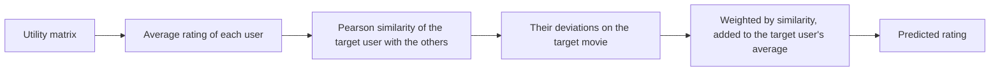
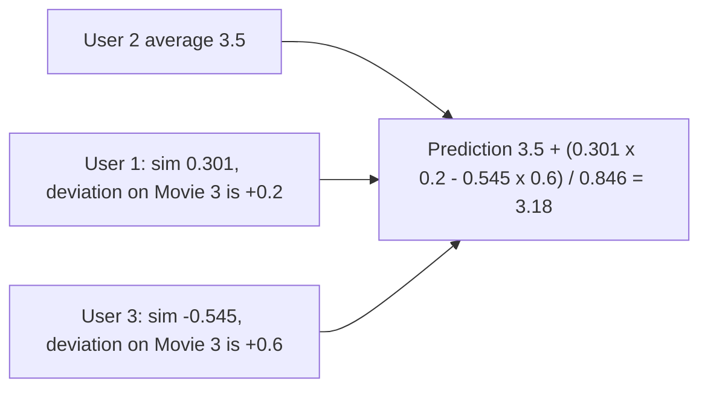

**Ek line mein:** <mark>Pearson correlation se rating predict karne ke liye har user ki apni average ghatake ratings se dekho ki target user doosre users se kitna milta hai, phir un users ke similarity-weighted deviations ko target user ki average mein jodo</mark>. <Cite id="recommendation-systems-wiki-pearson" /> <Cite id="web-bda-2-mmds-recsys" loc="slides 24-25" />

<Box kind="key">

**Har Pearson prediction sum mein ye points likho:**

- Ye <mark>user-user collaborative filtering</mark> hai.
- <mark>Step 1: har user ki average rating.</mark> <mark>Step 2: deviation = rating minus apni average.</mark>
- <mark>Step 3: target user ki har doosre user se Pearson similarity, un movies pe jo dono ne rate ki hon.</mark> +1 same pattern, 0 koi link nahi, -1 ulta taste.
- <mark>Step 4: predicted rating = target ki average + (sim x neighbour ka movie pe deviation ka sum) / (|sim| ka sum).</mark>
- <mark>Negative similarity wala user prediction ko ulti taraf dhakelta hai</mark>.
- Check: answer target ki apni average ke paas hona chahiye aur similar users ke deviations ki disha mein khiskna chahiye.

</Box>

## Core answer (5 marks, yahan ke har question ke liye): method

<Box kind="definition">

**Pearson correlation** measures how alike two users' tastes are, after removing each user's own rating habit (an easy marker and a strict marker can still be compared). **Pearson-based collaborative filtering** predicts a missing rating from the ratings of similar users. <Cite id="recommendation-systems-wiki-pearson" /> <Cite id="recommendation-systems-google-cf" />

</Box>

**Formulas.** Maano $\bar r_a$ user $a$ ki average rating hai; sums un movies $i$ pe chalte hain jo $a$ aur $b$ dono ne rate ki hain:

$$
\text{sim}(a, b) = \frac{\sum_i (r_{a,i} - \bar r_a)(r_{b,i} - \bar r_b)}{\sqrt{\sum_i (r_{a,i} - \bar r_a)^2}\; \sqrt{\sum_i (r_{b,i} - \bar r_b)^2}}
$$

$$
\hat r_{a,p} = \bar r_a + \frac{\sum_b \text{sim}(a, b)\,(r_{b,p} - \bar r_b)}{\sum_b |\text{sim}(a, b)|}
$$

Doosra formula user ki apni average se shuru hota hai aur movie $p$ pe neighbours ke **deviations** jodta hai, similarity se weight karke.

**Steps:**

1. Har user ki average rating nikalo.
2. Har rating se use ghatao taaki deviations mile.
3. Har doosre user $b$ ke liye $\text{sim}(a, b)$ nikalo (dono ki rate ki hui movies pe).
4. Target movie $p$ pe har user $b$ ka deviation lo.
5. Doosre formula se $\hat r_{a,p}$ predict karo.

**Conclusion:** <mark>Pearson correlation dikhata hai ki target user jaisa kaun hai, aur unki raay milake predicted rating milti hai</mark>.

## Extended answer (10 marks): ye add karo

### 1. Solved sum

<Sum>

<Given>

| Users | Movie 1 | Movie 2 | Movie 3 | Movie 4 | Movie 5 |
| --- | --- | --- | --- | --- | --- |
| User 1 | 2 | 3 | 2 | 1 | 1 |
| User 2 | 3 | 4 | ? | 4 | 3 |
| User 3 | 4 | 3 | 4 | 3 | 3 |

</Given>

<Find>

Movie 3 ke liye User 2 ki predicted rating.

</Find>

<Steps>

1. **Averages** (har user ne jitni ratings di unka). User 1: $(2+3+2+1+1)/5 = 1.8$. User 2: $(3+4+4+3)/4 = 3.5$. User 3: $(4+3+4+3+3)/5 = 3.4$. *Reason: Pearson har user ki apni average se deviations pe chalta hai.*
2. **Common movies.** User 2 ne Movie 3 rate nahi ki, isliye similarity Movies 1, 2, 4 aur 5 se nikalte hain, jo baaki dono users ne bhi rate ki hain.
3. Un movies pe **deviations** (rating minus apni average):

   | Movie | User 2 ($-3.5$) | User 1 ($-1.8$) | User 3 ($-3.4$) |
   |---|---|---|---|
   | 1 | $-0.5$ | $+0.2$ | $+0.6$ |
   | 2 | $+0.5$ | $+1.2$ | $-0.4$ |
   | 4 | $+0.5$ | $-0.8$ | $-0.4$ |
   | 5 | $-0.5$ | $-0.8$ | $-0.4$ |

4. **User 2 aur User 1 ki similarity.** Numerator: $(-0.5)(0.2) + (0.5)(1.2) + (0.5)(-0.8) + (-0.5)(-0.8) = -0.1 + 0.6 - 0.4 + 0.4 = 0.5$. Lengths: User 2 $= \sqrt{0.25 \times 4} = 1$; User 1 $= \sqrt{0.04 + 1.44 + 0.64 + 0.64} = \sqrt{2.76} = 1.661$. To $\text{sim}(2,1) = 0.5 / 1.661 = 0.301$.
5. **User 2 aur User 3 ki similarity.** Numerator: $(-0.5)(0.6) + (0.5)(-0.4) + (0.5)(-0.4) + (-0.5)(-0.4) = -0.3 - 0.2 - 0.2 + 0.2 = -0.5$. User 3 ki length $= \sqrt{0.36 + 0.16 + 0.16 + 0.16} = \sqrt{0.84} = 0.917$. To $\text{sim}(2,3) = -0.5 / 0.917 = -0.545$.
6. **Movie 3 pe deviations.** User 1: $2 - 1.8 = +0.2$. User 3: $4 - 3.4 = +0.6$.
7. **Prediction.**

   $$
   \hat r = 3.5 + \frac{0.301 \times 0.2 + (-0.545) \times 0.6}{0.301 + 0.545} = 3.5 + \frac{0.0602 - 0.3273}{0.846} = 3.5 - 0.316 = 3.18
   $$

</Steps>

<Answer>

Movie 3 ke liye User 2 ki predicted rating $\approx 3.2$ (3.18).

</Answer>

<Box kind="verify">

Check 1: User 2 ke deviations ka jod zero hai: $-0.5 + 0.5 + 0.5 - 0.5 = 0$. Check 2 (sign): User 3, User 2 ka ulta hai ($\text{sim} < 0$) aur usne Movie 3 ko apni average se upar rate kiya (+0.6), isliye User 2 apni average 3.5 se neeche dhakela jaata hai; answer 3.18, 3.5 se neeche hai, jaisa hona chahiye. Check 3: weights $0.301/0.846 = 0.356$ aur $0.545/0.846 = 0.644$ hain, isliye $3.5 + 0.356 \times 0.2 - 0.644 \times 0.6 = 3.5 + 0.071 - 0.387 = 3.18$.

</Box>

</Sum>

### 2. Doosre accepted versions (likho kaunsa use kiya)

- Agar averages sirf **common movies** pe lo (User 1 ke liye 1.75 aur User 3 ke liye 3.25), to result 3.09 aata hai, lagbhag same.
- Agar sirf **positively similar** User 1 use karo, to prediction $3.5 + 0.2 = 3.7$.

### 3. Advantages aur disadvantages

| Collaborative filtering ke advantages | Disadvantages |
|---|---|
| Item features nahi chahiye | Naye users aur movies ka cold start |
| Surprising items dhoondh sakta hai | Sparse rating matrix |
| Jaise users judte hain behtar hota hai | Lakhon users tak scale karna mushkil |

<Cite id="recommendation-systems-wiki-cf" /> <Cite id="recommendation-systems-av" />

## Har question mein kaise fit karein

- **"Predict rating of user 2 for Movie 3 using Pearson's Correlation coefficient."** (10 marks) <PYQ id="2025-12-ce/q4a" />: ye upar wala solved sum hai. Pehle do formulas likho (core answer), phir deviation table ke saath steps 1 se 7, aur one-line conclusion se khatam karo: User 2, User 1 jaisa hai (0.30) aur User 3 ka ulta (-0.55), isliye predicted rating lagbhag 3.2 hai.

## Exam tips

- **Hamesha dikhao:** har user ki average, deviation table, dono similarities aur final fraction.
- Average **user ki di hui saari ratings** pe lo, aur likho ki aisa kiya. Versions mix mat karo.
- **Signs** dekho: negative similarity ghatati hai. Plain sum se nahi, $|\text{sim}|$ ke sum se divide karo.

Exam mein English mein likho.
