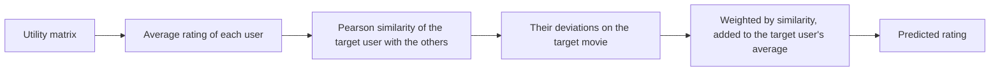
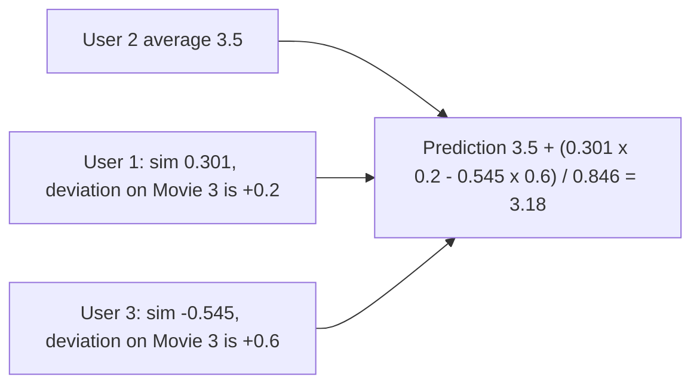

**In one line:** <mark>To predict a rating with Pearson correlation, find how similar the target user is to each other user using ratings minus each user's own average, then add the similarity-weighted deviations of those users to the target user's average</mark>. <Cite id="recommendation-systems-wiki-pearson" /> <Cite id="web-bda-2-mmds-recsys" loc="slides 24-25" />

<Box kind="key">

**Key points to write (any Pearson prediction sum):**

- This is <mark>user-user collaborative filtering</mark>.
- <mark>Step 1: average rating of each user.</mark> <mark>Step 2: deviation = rating minus own average.</mark>
- <mark>Step 3: similarity (Pearson) of the target user with every other user over the movies both rated.</mark> +1 same pattern, 0 no link, -1 opposite taste.
- <mark>Step 4: predicted rating = target's average + (sum of sim x neighbour's deviation on the movie) / (sum of |sim|).</mark>
- A user with <mark>negative similarity pushes the prediction the other way</mark>.
- Check: the answer is near the target's own average and moves the way the similar users' deviations point.

</Box>

## Core answer (5 marks, fits every question here): the method

<Box kind="definition">

**Pearson correlation** measures how alike two users' tastes are, after removing each user's own rating habit (an easy marker and a strict marker can still be compared). **Pearson-based collaborative filtering** predicts a missing rating from the ratings of similar users. <Cite id="recommendation-systems-wiki-pearson" /> <Cite id="recommendation-systems-google-cf" />

</Box>

**Formulas.** Let $\bar r_a$ be the average rating of user $a$; the sums run over the movies $i$ rated by both users $a$ and $b$:

$$
\text{sim}(a, b) = \frac{\sum_i (r_{a,i} - \bar r_a)(r_{b,i} - \bar r_b)}{\sqrt{\sum_i (r_{a,i} - \bar r_a)^2}\; \sqrt{\sum_i (r_{b,i} - \bar r_b)^2}}
$$

$$
\hat r_{a,p} = \bar r_a + \frac{\sum_b \text{sim}(a, b)\,(r_{b,p} - \bar r_b)}{\sum_b |\text{sim}(a, b)|}
$$

The second formula starts from the user's own average and adds the neighbours' **deviations** on the movie $p$, weighted by similarity.

**Steps:**

1. Find the average rating of every user.
2. Subtract it from each rating to get deviations.
3. Compute $\text{sim}(a, b)$ for every other user $b$ (movies both rated).
4. Take the deviation of each user $b$ on the target movie $p$.
5. Predict $\hat r_{a,p}$ with the second formula.

**Conclusion:** <mark>Pearson correlation shows who is like the target user, and combining their opinions gives the predicted rating</mark>.

## Extended answer (10 marks): add these

### 1. The solved sum

<Sum>

<Given>

| Users | Movie 1 | Movie 2 | Movie 3 | Movie 4 | Movie 5 |
| --- | --- | --- | --- | --- | --- |
| User 1 | 2 | 3 | 2 | 1 | 1 |
| User 2 | 3 | 4 | ? | 4 | 3 |
| User 3 | 4 | 3 | 4 | 3 | 3 |

</Given>

<Find>

the predicted rating of User 2 for Movie 3.

</Find>

<Steps>

1. **Averages** (of all ratings each user gave). User 1: $(2+3+2+1+1)/5 = 1.8$. User 2: $(3+4+4+3)/4 = 3.5$. User 3: $(4+3+4+3+3)/5 = 3.4$. *Reason: Pearson works on deviations from each user's own average.*
2. **Common movies.** User 2 has not rated Movie 3, so similarity uses Movies 1, 2, 4 and 5, which both of the other users rated too.
3. **Deviations** (rating minus own average) on those movies:

   | Movie | User 2 ($-3.5$) | User 1 ($-1.8$) | User 3 ($-3.4$) |
   |---|---|---|---|
   | 1 | $-0.5$ | $+0.2$ | $+0.6$ |
   | 2 | $+0.5$ | $+1.2$ | $-0.4$ |
   | 4 | $+0.5$ | $-0.8$ | $-0.4$ |
   | 5 | $-0.5$ | $-0.8$ | $-0.4$ |

4. **Similarity of User 2 and User 1.** Numerator: $(-0.5)(0.2) + (0.5)(1.2) + (0.5)(-0.8) + (-0.5)(-0.8) = -0.1 + 0.6 - 0.4 + 0.4 = 0.5$. Lengths: User 2 $= \sqrt{0.25 \times 4} = 1$; User 1 $= \sqrt{0.04 + 1.44 + 0.64 + 0.64} = \sqrt{2.76} = 1.661$. So $\text{sim}(2,1) = 0.5 / 1.661 = 0.301$.
5. **Similarity of User 2 and User 3.** Numerator: $(-0.5)(0.6) + (0.5)(-0.4) + (0.5)(-0.4) + (-0.5)(-0.4) = -0.3 - 0.2 - 0.2 + 0.2 = -0.5$. Length of User 3 $= \sqrt{0.36 + 0.16 + 0.16 + 0.16} = \sqrt{0.84} = 0.917$. So $\text{sim}(2,3) = -0.5 / 0.917 = -0.545$.
6. **Deviations on Movie 3.** User 1: $2 - 1.8 = +0.2$. User 3: $4 - 3.4 = +0.6$.
7. **Prediction.**

   $$
   \hat r = 3.5 + \frac{0.301 \times 0.2 + (-0.545) \times 0.6}{0.301 + 0.545} = 3.5 + \frac{0.0602 - 0.3273}{0.846} = 3.5 - 0.316 = 3.18
   $$

</Steps>

<Answer>

User 2's predicted rating for Movie 3 $\approx 3.2$ (3.18).

</Answer>

<Box kind="verify">

Check 1: User 2's deviations add to zero: $-0.5 + 0.5 + 0.5 - 0.5 = 0$. Check 2 (sign): User 3 is the opposite of User 2 ($\text{sim} < 0$) and rated Movie 3 above their average (+0.6), so User 2 is pushed below their own average of 3.5; the answer 3.18 is below 3.5, as expected. Check 3: the weights are $0.301/0.846 = 0.356$ and $0.545/0.846 = 0.644$, so $3.5 + 0.356 \times 0.2 - 0.644 \times 0.6 = 3.5 + 0.071 - 0.387 = 3.18$.

</Box>

</Sum>

### 2. Other accepted versions (state which you use)

- If the averages are taken over the **common movies only** (1.75 for User 1 and 3.25 for User 3), the result is 3.09, close to the same.
- If only the **positively similar** User 1 is used, the prediction is $3.5 + 0.2 = 3.7$.

### 3. Advantages and disadvantages

| Advantages of collaborative filtering | Disadvantages |
|---|---|
| Needs no item features | Cold start for new users and movies |
| Can find surprising items | Sparse rating matrix |
| Improves as more users join | Hard to scale to millions of users |

<Cite id="recommendation-systems-wiki-cf" /> <Cite id="recommendation-systems-av" />

## Fit it to each question

- **"Predict rating of user 2 for Movie 3 using Pearson's Correlation coefficient."** (10 marks) <PYQ id="2025-12-ce/q4a" />: this is the solved sum above. Write the two formulas first (core answer), then steps 1 to 7 with the deviation table, and finish with the one-line conclusion: User 2 is like User 1 (0.30) and unlike User 3 (-0.55), so the predicted rating is about 3.2.

## Exam tips

- **Always show:** the average of each user, the deviation table, the two similarities and the final fraction.
- Take the average over **all ratings the user gave**, and say that you did. Do not mix versions.
- Watch the **signs**: a negative similarity subtracts. Divide by the sum of $|\text{sim}|$, not the plain sum.
