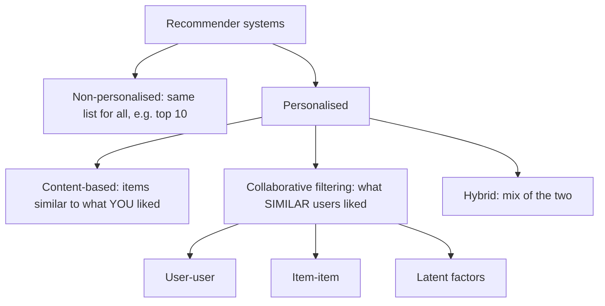
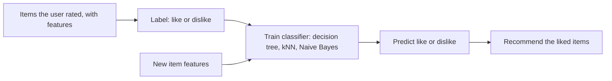

**Ek line mein:** <mark>Recommender system predict karta hai ki user ko wo items kitne pasand aayenge jo usne try nahi kiye, aur sabse achhe kuch dikhata hai; main types content-based, collaborative filtering aur hybrid hain</mark>. <Cite id="recommendation-systems-wiki-recsys" /> <Cite id="recommendation-systems-ibm" />

<Box kind="key">

**Har recommender-system question mein ye points likho:**

- Definition: <mark>software jo item ke liye user ki rating ya preference predict karta hai aur sabse achhe suggest karta hai</mark>. Examples: Amazon products, Netflix films, YouTube videos, Spotify songs.
- Kyun: <mark>lakhon items hote hain, kisi ke browse karne se bahut zyada; recommender logon ko long tail se jodta hai</mark>.
- Data: <mark>utility matrix</mark> (users x items, ratings, zyadatar khaali); system khaali cells predict karta hai.
- Types: <mark>content-based (item properties), collaborative filtering (similar users ki ratings), hybrid (dono)</mark>.
- Classification ka use: <mark>har user ke liye uske rate kiye items pe classifier train karo (features input, like ya dislike label), phir unseen items classify karo</mark>.
- Problems: <mark>cold start, sparsity, over-specialisation</mark>.

</Box>

## Core answer (5 marks, yahan ke har question ke liye)

<Box kind="definition">

A **recommender system** (recommendation system) is software that predicts how much a user will like items they have not tried yet and shows the best few. It is like a friend who knows your taste, working for millions of people at once. <Cite id="recommendation-systems-wiki-recsys" /> <Cite id="recommendation-systems-ibm" />

</Box>

**Kyun chahiye.** Online shop mein lakhon items hote hain, kisi ke browse karne se bahut zyada. Kam bikne wale items **long tail** hain. Recommender har insaan ko wo tail items dikhata hai jo use pasand aayenge, isse sales aur satisfaction badhte hain. <Cite id="recommendation-systems-mmds-slides" /> <Cite id="recommendation-systems-wiki-longtail" />

**Basic model.** Data **utility matrix** hai: rows users, columns items, cell mein user ki di hui rating. Zyadatar cells khaali hote hain, aur system unhe predict karta hai. <Cite id="recommendation-systems-mmds-book" loc="§9.1" />

| | Movie 1 | Movie 2 | Movie 3 |
|---|---|---|---|
| User A | 5 | 4 | ? |
| User B | 1 | ? | 5 |

<Cite id="recommendation-systems-ibm" loc="diagram" /> <Cite id="recommendation-systems-google-types" />

**Types:**

1. **Content-based.** Wo items recommend karta hai jo user ke pasand kiye items jaise hon, item properties (genre, actors, important words) se judge karke. Steps: item profiles, pasand kiye items se user profile, phir naye items match (jaise cosine similarity se).
2. **Collaborative filtering.** Sirf kayi users ki ratings use karta hai. Milte-julte rating pattern wale users (ya items) dhoondhta hai aur unki ratings se predict karta hai: "aap jaise logon ko ye pasand aaya". <Cite id="recommendation-systems-av" />
3. **Hybrid.** Dono milata hai taaki har ek doosre ki kamzori cover kare. Netflix aur YouTube aisa karte hain.

**Conclusion:** <mark>content-based poochta hai "ye item kaisa hai?", collaborative poochta hai "is user jaisa kaun hai?", aur hybrid dono use karta hai</mark>.

## Extended answer (10 marks): ye add karo

### 1. Types ki comparison

| Type | Kya use karta hai | Kamzori |
|---|---|---|
| Content-based | Item properties aur user ki apni history | Achhe features chahiye; sirf milte-julte items recommend |
| Collaborative | Kayi users ki ratings | Cold start: naye users aur items; sparse matrix |
| Hybrid | Dono | Zyada complex |

### 2. Classification algorithm kaise use hota hai (content-based method)

Recommendation ko **har user ke liye ek classification problem** maana jaata hai. <Cite id="recommendation-systems-gfg-cb" /> <Cite id="recommendation-systems-ibm" />

1. **Item features banao.** Har item ko features se describe karo, jaise movie ko genre, director aur actors se.
2. **Training data banao.** Ek user ke liye uske rate kiye items examples hain. Features input hain, aur label "like" (high rating) ya "dislike" (low rating).
3. Us user ke liye **classifier train karo**. Aam choices decision tree, k-nearest neighbours, Naive Bayes ya logistic regression hain.
4. **Predict karo.** Unseen item ke features classifier ko do. Wo like ya dislike batata hai.
5. "Like" predict hue items **recommend** karo, classifier ke confidence se rank karke.

**Example.** User A ne 3 comedy films pasand ki aur 2 horror films nahi. Decision tree seekhta hai "genre = comedy, to like". Nayi comedy film like classify hoti hai aur recommend hoti hai.

| Advantage | Limitation |
|---|---|
| Doosre users nahi chahiye, isliye unique taste wale user ke liye kaam karta hai | Har user ke liye kaafi rated examples chahiye (cold start) |
| Jin naye items ke features hon unhe recommend kar sakta hai | Sirf unhi jaise items recommend karta hai jo user ne pehle pasand kiye |
| Wajah samjhana aasaan | Achhe item features chahiye |

### 3. Har recommender ki problems

- **Cold start:** naye user ya item ki ratings nahi hoti.
- **Sparsity:** users bahut kam items rate karte hain.
- **Over-specialisation:** sirf usi jaisa aur suggest hota hai.

## Har question mein kaise fit karein

- **"What is Recommender System? Explain Types of recommender system."** (10 marks) <PYQ id="2023-12/q5a" />: core answer poora (definition, kyun, utility matrix, taxonomy diagram, teen types) + section 1 ki comparison table.
- **"What is recommendation system? How is classification algorithm used in recommendation system?"** (10 marks) <PYQ id="2025-05-ce/q6b" />: core answer se definition aur utility matrix (chhota), phir section 2 poora (paanch steps, flowchart, example, advantages aur limits). Classifiers ke naam likho (decision tree, kNN, Naive Bayes).

## Exam tips

- **Hamesha draw karo:** taxonomy tree (content-based, collaborative, hybrid), aur classification question ke liye flowchart.
- **Utility matrix "?" ke saath** hamesha dikhao; isse dikhta hai ki recommender kya karta hai.
- Ek line ka farq likho: **"content-based item ko dekhta hai, collaborative crowd ko"**.

Exam mein English mein likho.
