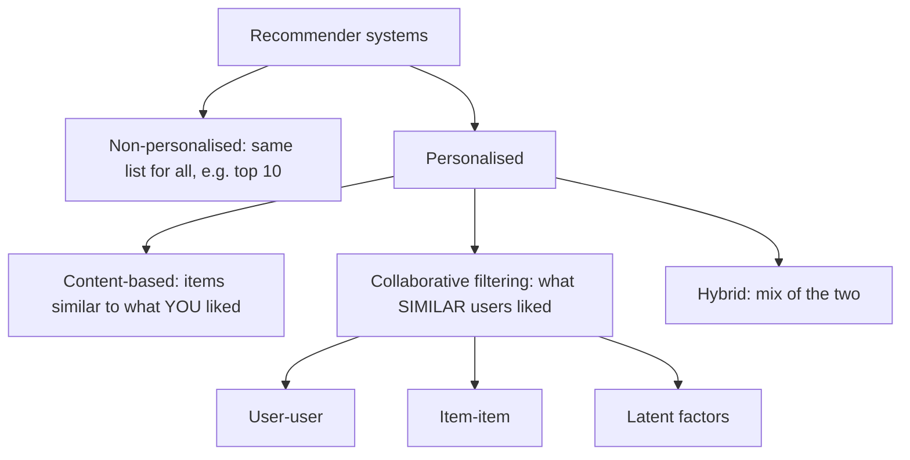
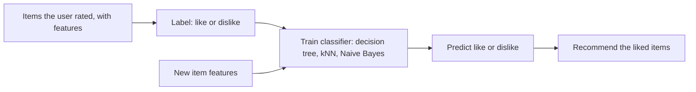

**In one line:** <mark>A recommender system predicts how much a user will like items they have not tried and shows the best few; the main types are content-based, collaborative filtering and hybrid</mark>. <Cite id="recommendation-systems-wiki-recsys" /> <Cite id="recommendation-systems-ibm" />

<Box kind="key">

**Key points to write (any recommender-system question):**

- Definition: <mark>software that predicts a user's rating or preference for an item and suggests the best ones</mark>. Examples: Amazon products, Netflix films, YouTube videos, Spotify songs.
- Why: <mark>millions of items, far more than anyone can browse; recommenders connect people to the long tail</mark>.
- Data: the <mark>utility matrix</mark> (users x items, ratings, mostly empty); the system predicts the empty cells.
- Types: <mark>content-based (item properties), collaborative filtering (ratings of similar users), hybrid (both)</mark>.
- Classification use: <mark>for each user, train a classifier on the items they rated (features as input, like or dislike as label), then classify unseen items</mark>.
- Problems: <mark>cold start, sparsity, over-specialisation</mark>.

</Box>

## Core answer (5 marks, fits every question here)

<Box kind="definition">

A **recommender system** (recommendation system) is software that predicts how much a user will like items they have not tried yet and shows the best few. It is like a friend who knows your taste, working for millions of people at once. <Cite id="recommendation-systems-wiki-recsys" /> <Cite id="recommendation-systems-ibm" />

</Box>

**Why it is needed.** An online shop can list millions of items, far more than anyone can browse. The rarely bought items are the **long tail**. A recommender connects each person to the tail items they would like, which raises sales and satisfaction. <Cite id="recommendation-systems-mmds-slides" /> <Cite id="recommendation-systems-wiki-longtail" />

**Basic model.** The data is a **utility matrix**: rows are users, columns are items, a cell holds the rating the user gave. Most cells are empty, and the system must predict them. <Cite id="recommendation-systems-mmds-book" loc="§9.1" />

| | Movie 1 | Movie 2 | Movie 3 |
|---|---|---|---|
| User A | 5 | 4 | ? |
| User B | 1 | ? | 5 |

<Cite id="recommendation-systems-ibm" loc="diagram" /> <Cite id="recommendation-systems-google-types" />

**Types:**

1. **Content-based.** Recommends items similar to what the user liked, judged by item properties such as genre, actors or important words. Steps: item profiles, a user profile from the liked items, then match new items (for example by cosine similarity).
2. **Collaborative filtering.** Uses only the ratings of many users. It finds users (or items) with similar rating patterns and predicts from their ratings: "people like you liked this". <Cite id="recommendation-systems-av" />
3. **Hybrid.** Combines both so that each covers the other's weakness. Netflix and YouTube do this.

**Conclusion:** <mark>content-based asks "what is this item like?", collaborative asks "who is like this user?", and hybrid uses both</mark>.

## Extended answer (10 marks): add these

### 1. Types compared

| Type | Uses | Weakness |
|---|---|---|
| Content-based | Item properties and the user's own history | Needs good features; recommends only similar things |
| Collaborative | Ratings of many users | Cold start: new users and new items; sparse matrix |
| Hybrid | Both | More complex |

### 2. How a classification algorithm is used (content-based method)

Recommendation is treated as a **classification problem for each user**. <Cite id="recommendation-systems-gfg-cb" /> <Cite id="recommendation-systems-ibm" />

1. **Build item features.** Describe each item by features, for example a movie by genre, director and actors.
2. **Make training data.** For one user, the items they rated are the examples. The features are the input, and the label is "like" (high rating) or "dislike" (low rating).
3. **Train a classifier** for that user. Common choices are a decision tree, k-nearest neighbours, Naive Bayes or logistic regression.
4. **Predict.** Give the features of an unseen item to the classifier. It returns like or dislike.
5. **Recommend** the items predicted as "like", ranked by the classifier's confidence.

**Example.** User A liked 3 comedy films and disliked 2 horror films. A decision tree learns "genre = comedy, then like". A new comedy film is classified as like and recommended.

| Advantage | Limitation |
|---|---|
| Needs no other users, so it works for a user with unique taste | Needs enough rated examples for each user (cold start) |
| Can recommend new items that have features | Only recommends items similar to what the user already liked |
| Easy to explain why an item was shown | Needs good item features |

### 3. Problems every recommender faces

- **Cold start:** a new user or new item has no ratings.
- **Sparsity:** users rate very few items.
- **Over-specialisation:** only more of the same is suggested.

## Fit it to each question

- **"What is Recommender System? Explain Types of recommender system."** (10 marks) <PYQ id="2023-12/q5a" />: core answer in full (definition, why, utility matrix, taxonomy diagram, the three types) + the comparison table of section 1.
- **"What is recommendation system? How is classification algorithm used in recommendation system?"** (10 marks) <PYQ id="2025-05-ce/q6b" />: definition and utility matrix from the core answer (short), then section 2 in full (five steps, flowchart, example, advantages and limits). Name the classifiers (decision tree, kNN, Naive Bayes).

## Exam tips

- **Always draw:** the taxonomy tree (content-based, collaborative, hybrid), and for the classification question the flowchart.
- Always show the **utility matrix with "?"**; it shows what a recommender does.
- Write the one-line difference: **"content-based looks at the item, collaborative looks at the crowd"**.
