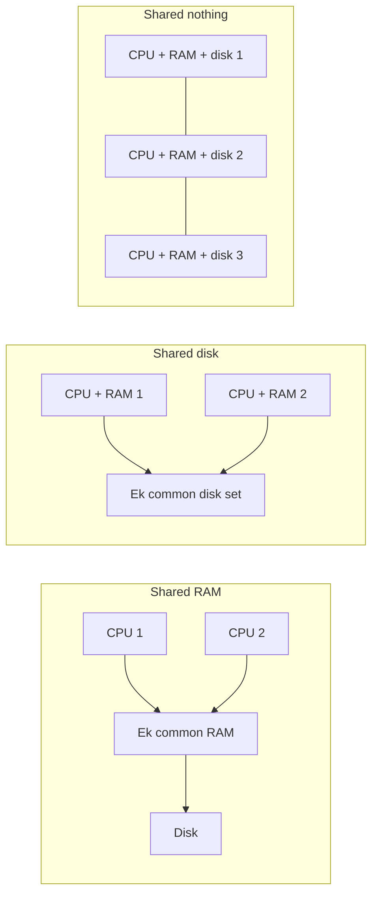

**Ek line mein:** <mark>System RAM, disk ya kuch bhi share kar sakta hai; big data solutions shared-nothing architecture use karte hain, jisme har node ka apna CPU, RAM aur disk hota hai aur nodes sirf network pe baat karte hain</mark>. <Cite id="web-bda-1-stonebraker-shared-nothing" /> <Cite id="big-data-intro-nosql" />

<Box kind="key">

**Resource sharing aur shared-nothing ke question mein ye points likho:**

- <mark>Resources share karne ke teen tarike: shared RAM (shared memory), shared disk, shared nothing</mark>.
- <mark>Shared RAM: bahut CPUs, ek common memory aur ek OS; memory bus bottleneck hai aur machine mehngi</mark>.
- <mark>Shared disk: har CPU ki apni RAM par sab ek set of disks use karte hain; disk bottleneck aur single point of failure</mark>.
- <mark>Shared nothing: har node ka apna CPU, RAM aur disk; koi common resource nahi, isliye kisi ka intezaar nahi</mark>.
- <mark>Big data solutions (Hadoop, Cassandra, MongoDB, Bigtable) shared-nothing use karte hain</mark>.
- Fayde: **lagbhag linear scaling, fault isolation, cheap commodity nodes**. Nuksan: **nodes ke beech joins aur transactions slow**.

</Box>

## Core answer (5 marks, yahan ke har question ke liye)

<Box kind="definition">

A computer system has three main resources: **RAM**, **disk** and **CPU**. When many processors work together they can **share** these in three ways: shared RAM, shared disk, or shared nothing. The architecture used in big data solutions is **shared-nothing**. <Cite id="big-data-intro-nosql" /> <Cite id="nosql-intro-wiki-sn" />

</Box>

1. **Shared RAM (shared memory):** bahut CPUs ek common memory aur ek operating system use karte hain (bada multiprocessor machine). Simple, par memory bus bottleneck hai aur machine mehngi.
2. **Shared disk:** har CPU ki apni RAM hai par sab ek common set of disks use karte hain (storage network). Disk bottleneck aur single point of failure ban jati hai.
3. **Shared nothing:** har node ka apna CPU, RAM aur disk hai aur woh doosron se sirf network pe baat karta hai. Kuch share nahi hota, isliye kisi ka intezaar nahi.

<Cite id="nosql-intro-wiki-sn" loc="diagram" />

**Conclusion:** <mark>big data mein shared-nothing use hota hai kyunki har node independent hai, isliye cluster scale out karta hai aur node failures se bach jata hai</mark>.

## Extended answer (10 marks): ye add karo

### 1. Shared-nothing architecture detail mein

Kyunki har node independent hai: <Cite id="big-data-intro-nosql" /> <Cite id="nosql-intro-wiki-sn" />

- Data nodes mein baanta jata hai (**sharded**), aur har node apne hisse ke sawaalon ka jawab deta hai. <Cite id="nosql-intro-wiki-sharding" />
- Nodes badhane pe capacity aur speed lagbhag seedhi line mein badhti hain.
- Ek node fail hone se doosre nahi rukte; uske data ki copies doosre nodes pe hoti hain.
- Cheap commodity machines use ho sakti hain, isliye kharcha kam.
- Hadoop, Cassandra, MongoDB aur Bigtable sab ise use karte hain. <Cite id="big-data-intro-mapreduce" /> <Cite id="nosql-intro-bigtable" /> <Cite id="nosql-intro-dynamo" />

Stonebraker ke 1986 ke paper "The Case for Shared Nothing" ne yahi teen themes (shared memory, shared disk, shared nothing) compare kiye aur shared nothing ke paksh mein baat ki. <Cite id="web-bda-1-stonebraker-shared-nothing" />

### 2. Comparison table

| Point | Shared RAM | Shared disk | Shared nothing |
|---|---|---|---|
| Kya common hai | Ek memory aur OS | Ek set of disks | Kuch nahi |
| Bottleneck | Memory bus | Disk aur uska network | Kuch share nahi |
| Failure | Poori machine ek failure point | Disk failure point | Sirf ek node, copies maujood |
| Scaling | Limited, mehnga bada machine | Disk se limited | Nodes jodo, lagbhag linear |
| Cost | High | Medium se high | Low (commodity nodes) |
| Example | Bada multiprocessor server | Storage-area network clusters | Hadoop, Cassandra |

### 3. Worked example: speed-up

<Sum>

<Given>

One file of 1 TB (take $1\text{ TB} = 1{,}000{,}000$ MB). One disk reads 100 MB per second. In a shared-nothing cluster the file is split evenly over 50 nodes, each with its own disk, and all read at the same time.

</Given>

<Find>

the read time on one machine, the read time on the cluster, and the speed-up.

</Find>

<Steps>

1. One machine: time $= 1{,}000{,}000 \div 100 = 10{,}000$ seconds, about 2.78 hours. *Reason: time is data divided by speed.*
2. Each node's share: $1{,}000{,}000 \div 50 = 20{,}000$ MB. *Reason: the file is split evenly.*
3. Each node reads its share in $20{,}000 \div 100 = 200$ seconds, and all work at once, so the cluster time is 200 seconds (about 3.3 minutes).
4. Speed-up $= 10{,}000 \div 200 = 50$.

</Steps>

<Answer>

One machine 10,000 s (about 2.78 h); cluster 200 s; speed-up 50 times.

</Answer>

<Box kind="verify">

The cluster reads $50 \times 100 = 5{,}000$ MB per second and $1{,}000{,}000 \div 5{,}000 = 200$ s, the same answer. The speed-up equals the number of nodes because nothing is shared; in real life it is a little less because of network and start-up costs.

</Box>

</Sum>

### 4. Disadvantage

Jin joins aur transactions mein bahut nodes shaamil hon woh slow aur complex hote hain, isliye NoSQL related data ko ek node pe saath rakhta hai.

## Har question mein kaise fit karein

- **"Name the three ways that resources can be shared between computer systems. Name the architecture used in big data solutions and describe it in detail."** (10 marks) <PYQ id="2022-12-ce/q2a" />: part 1 teen tarike (core answer ki list aur diagram), part 2 **shared nothing** ka naam saaf likho aur section 1, comparison table aur sum se describe karo.

## Exam tips

- **Teen tarike order mein likho**: shared RAM, shared disk, shared nothing, phir saaf likho "big data shared nothing use karta hai".
- Diagram ki tarah **teen boxes side by side draw karo**.
- Description mein **"each node has its own CPU, RAM and disk"** aur **"scales out"** likho; yahi marked phrases hain.
