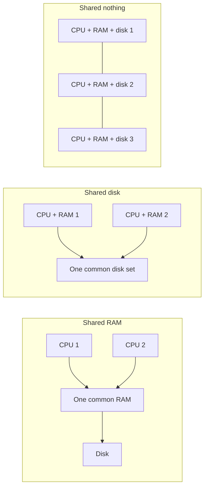

**In one line:** <mark>A system can share RAM, disk or nothing; big data solutions use the shared-nothing architecture, in which every node has its own CPU, RAM and disk and nodes talk only over the network</mark>. <Cite id="web-bda-1-stonebraker-shared-nothing" /> <Cite id="big-data-intro-nosql" />

<Box kind="key">

**Key points to write (resource sharing and shared-nothing):**

- <mark>Three ways to share resources: shared RAM (shared memory), shared disk, shared nothing</mark>.
- <mark>Shared RAM: many CPUs, one common memory and one OS; the memory bus is the bottleneck and it is costly</mark>.
- <mark>Shared disk: each CPU has its own RAM but all use one set of disks; the disk is the bottleneck and a single point of failure</mark>.
- <mark>Shared nothing: every node has its own CPU, RAM and disk; no common resource, so nothing to wait for</mark>.
- <mark>Big data solutions (Hadoop, Cassandra, MongoDB, Bigtable) use shared-nothing</mark>.
- Benefits: **near-linear scaling, fault isolation, cheap commodity nodes**. Drawback: **joins and transactions across nodes are slow**.

</Box>

## Core answer (5 marks, fits every question here)

<Box kind="definition">

A computer system has three main resources: **RAM**, **disk** and **CPU**. When many processors work together they can **share** these in three ways: shared RAM, shared disk, or shared nothing. The architecture used in big data solutions is **shared-nothing**. <Cite id="big-data-intro-nosql" /> <Cite id="nosql-intro-wiki-sn" />

</Box>

1. **Shared RAM (shared memory):** many CPUs use one common memory and one operating system (a big multiprocessor machine). Simple, but the memory bus is a bottleneck and the machine is costly.
2. **Shared disk:** each CPU has its own RAM but all use one common set of disks (a storage network). The disk becomes the bottleneck and a single point of failure.
3. **Shared nothing:** every node has its own CPU, RAM and disk and talks to others only over the network. Nothing is shared, so there is nothing to wait for.

<Cite id="nosql-intro-wiki-sn" loc="diagram" />

**Conclusion:** <mark>shared-nothing is used in big data because each node is independent, so the cluster scales out and survives node failures</mark>.

## Extended answer (10 marks): add these

### 1. Shared-nothing architecture in detail

Because each node is independent: <Cite id="big-data-intro-nosql" /> <Cite id="nosql-intro-wiki-sn" />

- Data is split (**sharded**) across nodes, and each node answers questions about its own part. <Cite id="nosql-intro-wiki-sharding" />
- Capacity and speed grow almost in a straight line as nodes are added.
- One node failing does not stop the others; copies of its data live on other nodes.
- Cheap commodity machines can be used, so it costs less.
- Hadoop, Cassandra, MongoDB and Bigtable all use it. <Cite id="big-data-intro-mapreduce" /> <Cite id="nosql-intro-bigtable" /> <Cite id="nosql-intro-dynamo" />

Stonebraker's 1986 paper "The Case for Shared Nothing" compared exactly these three themes (shared memory, shared disk, shared nothing) and argued for shared nothing. <Cite id="web-bda-1-stonebraker-shared-nothing" />

### 2. Comparison table

| Point | Shared RAM | Shared disk | Shared nothing |
|---|---|---|---|
| What is common | One memory and OS | One set of disks | Nothing |
| Bottleneck | Memory bus | Disk and its network | None shared |
| Failure | Whole machine is one failure point | Disk is a failure point | One node only, copies exist |
| Scaling | Limited, costly big machine | Limited by the disk | Add nodes, near-linear |
| Cost | High | Medium to high | Low (commodity nodes) |
| Example | Big multiprocessor server | Storage-area network clusters | Hadoop, Cassandra |

### 3. Worked example: speed-up

<Sum>

<Given>

One file of 1 TB (take $1\text{ TB} = 1{,}000{,}000$ MB). One disk reads 100 MB per second. In a shared-nothing cluster the file is split evenly over 50 nodes, each with its own disk, and all read at the same time.

</Given>

<Find>

the read time on one machine, the read time on the cluster, and the speed-up.

</Find>

<Steps>

1. One machine: time $= 1{,}000{,}000 \div 100 = 10{,}000$ seconds, about 2.78 hours. *Reason: time is data divided by speed.*
2. Each node's share: $1{,}000{,}000 \div 50 = 20{,}000$ MB. *Reason: the file is split evenly.*
3. Each node reads its share in $20{,}000 \div 100 = 200$ seconds, and all work at once, so the cluster time is 200 seconds (about 3.3 minutes).
4. Speed-up $= 10{,}000 \div 200 = 50$.

</Steps>

<Answer>

One machine 10,000 s (about 2.78 h); cluster 200 s; speed-up 50 times.

</Answer>

<Box kind="verify">

The cluster reads $50 \times 100 = 5{,}000$ MB per second and $1{,}000{,}000 \div 5{,}000 = 200$ s, the same answer. The speed-up equals the number of nodes because nothing is shared; in real life it is a little less because of network and start-up costs.

</Box>

</Sum>

### 4. Disadvantage

Joins and transactions that touch many nodes are slow and complex, which is why NoSQL keeps related data together on one node.

## Fit it to each question

- **"Name the three ways that resources can be shared between computer systems. Name the architecture used in big data solutions and describe it in detail."** (10 marks) <PYQ id="2022-12-ce/q2a" />: part 1 is the three ways (core answer list and diagram), part 2 is **shared nothing** named clearly and described with section 1, the comparison table and the sum.

## Exam tips

- **Name the three ways in order**: shared RAM, shared disk, shared nothing, then state clearly "big data uses shared nothing".
- **Draw the three boxes** side by side as in the diagram.
- In the description say **"each node has its own CPU, RAM and disk"** and **"scales out"**; these are the marked phrases.
