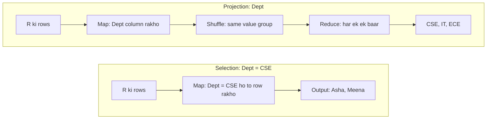

**Ek line mein:** <mark>Selection condition satisfy karne wali rows rakhta hai (sirf map, reduce identity), aur projection chune hue columns rakhta hai aur reduce mein duplicates hatata hai</mark>; union, intersection aur difference poore tuple ko key banate hain. <Cite id="hadoop-ecosystem-mmds" loc="§2.3.3" /> <Cite id="mapreduce-algorithms-wiki-relalg" />

<Box kind="key">

**Selection, projection aur relational operations ke question mein ye points likho:**

- <mark>Selection: map har tuple test karta hai aur condition C satisfy hone pe (t, t) emit karta hai; reduce identity hai (skip ho sakta hai)</mark>.
- <mark>Projection: map sirf chune columns rakhta hai aur (t', t') emit karta hai; reduce har key ek baar output karta hai, duplicates hat jate hain</mark>.
- <mark>Union: har key ek baar; intersection: woh keys jo dono relations se aayi; difference R - S: woh keys jo sirf R se aayi</mark>.
- <mark>Inme poora tuple key hota hai, aur use us relation ka tag lagta hai jahan se aaya</mark>.
- Selection ko **reduce nahi chahiye**, kyunki har tuple khud check hota hai.
- Projection mein **combiner** duplicates local pe hata sakta hai.

</Box>

## Core answer (5 marks, yahan ke har question ke liye)

<Box kind="definition">

**Relational algebra** is the small set of operations (selection, projection, union, intersection, difference, join, grouping) on which SQL is built. A big table can be spread over many machines, and each operation can be written as a map and a reduce. <Cite id="mapreduce-algorithms-wiki-relalg" /> <Cite id="mapreduce-algorithms-gfg-relalg" />

</Box>

Saare examples Student R(Id, Name, Dept) use karte hain: (1, Asha, CSE), (2, Ravi, IT), (3, Meena, CSE), (4, Kiran, IT), (5, Sara, ECE).

**Selection** $\sigma_C(R)$ condition satisfy karne wale tuples rakhta hai, jaise `WHERE Dept = 'CSE'`.

- **Map:** har tuple $t$ test karo; $C$ satisfy ho to $(t, t)$ emit karo, warna kuch nahi.
- **Reduce:** identity, bas value likh do. Ye **map-only job** ho sakti hai.

```text
map(t):  if t satisfies C: emit(t, t)
reduce(t, values): emit(t)       # identity, can be skipped
```

Dept = CSE ke liye: Asha aur Meena pass hote hain, answer $\{(1, Asha, CSE), (3, Meena, CSE)\}$ (5 mein se 2 rows).

**Projection** $\pi_S(R)$ sirf kuch columns rakhta hai, jaise `SELECT DISTINCT Dept`. Columns hatane ke baad alag rows identical ho sakti hain, aur relation ek set hai, isliye duplicates hatane padte hain. Isi liye projection ko reduce chahiye.

- **Map:** sirf chune columns wala $t'$ banao aur $(t', t')$ emit karo.
- **Reduce:** key $t'$ aur list $[t', t', ...]$ ke liye $t'$ ek baar emit karo.

```text
map(t):  t2 = keep columns S of t;  emit(t2, t2)
reduce(t2, values): emit(t2)       # many copies become one
```

Dept ke liye: map se CSE, IT, CSE, IT, ECE; shuffle se CSE [CSE, CSE], IT [IT, IT], ECE [ECE]; reduce se $\{CSE, IT, ECE\}$.



<Cite id="mapreduce-algorithms-gfg-relalg" loc="diagram" />

**Conclusion:** <mark>selection map mein rows filter karta hai, projection map mein columns aur reduce mein duplicates hatata hai</mark>.

## Extended answer (10 marks): ye add karo

### 1. Operations ek nazar mein

| Operation | Symbol | Matlab |
|---|---|---|
| Selection | $\sigma_C(R)$ | Condition $C$ satisfy karne wali rows |
| Projection | $\pi_S(R)$ | List $S$ ke columns, duplicates hatao |
| Union | $R \cup S$ | $R$ ya $S$ ki rows |
| Intersection | $R \cap S$ | Dono mein ki rows |
| Difference | $R - S$ | $R$ ki rows jo $S$ mein nahi |
| Natural join | $R \bowtie S$ | Common columns pe match hone wali rows jodo |
| Grouping aur aggregation | $\gamma_{X, \theta(Y)}(R)$ | $X$ se group, $Y$ ka aggregate |

<Cite id="mapreduce-algorithms-tp-relalg" />

### 2. Union, intersection aur difference

Key **poora tuple** hota hai, isliye dono relations ke equal tuples ek reducer pe milte hain. Har tuple pe source ka tag lagta hai.

| Operation | Map | Reduce rule |
|---|---|---|
| Union | har tuple $t$: $(t, t)$ emit | har key ke liye $t$ ek baar emit |
| Intersection | har tuple $t$: $(t, t)$ emit | $t$ tabhi emit jab list mein do copies hon (har relation ki ek) |
| Difference $R - S$ | $R$ se $(t, R)$, $S$ se $(t, S)$ emit | $t$ tabhi emit jab list sirf [R] ho |

<Sum>

<Given>

$R = \{Asha, Ravi, Meena\}$ and $S = \{Ravi, Meena, Kiran\}$.

</Given>

<Find>

$R \cup S$, $R \cap S$ and $R - S$.

</Find>

<Steps>

1. **Map.** Emit each tuple with its source tag. *Reason: the tag tells the reducer where each copy came from.*
2. **Shuffle.**

   | Key | Source tags |
   |---|---|
   | Asha | [R] |
   | Ravi | [R, S] |
   | Meena | [R, S] |
   | Kiran | [S] |

3. **Union:** every key, Asha, Ravi, Meena, Kiran.
4. **Intersection:** keys with both R and S, Ravi, Meena.
5. **Difference $R - S$:** keys with only [R], Asha.

</Steps>

<Answer>

$R \cup S = \{Asha, Ravi, Meena, Kiran\}$; $R \cap S = \{Ravi, Meena\}$; $R - S = \{Asha\}$.

</Answer>

<Box kind="verify">

$|R \cup S| = |R| + |S| - |R \cap S| = 3 + 3 - 2 = 4$, which matches. $|R - S| = |R| - |R \cap S| = 3 - 2 = 1$, which matches.

</Box>

</Sum>

### 3. Join aur grouping ek-ek line mein

Natural join **join column ko key** banata hai aur us key ke har R value ko har S value se jodta hai. Grouping **grouping column ko key** banata hai aur reduce mein SUM, COUNT, AVG, MAX ya MIN lagata hai. (Alag answer "natural join aur grouping" dekho.) <Cite id="hadoop-ecosystem-mmds" loc="§2.3.7, §2.3.8" />

### 4. MapReduce kyun

Tables ek machine ke liye bahut bade hain. Yahi operations **Hive aur Pig andar chalate hain**: Hive SQL query ko MapReduce jobs mein badal deta hai. <Cite id="mapreduce-algorithms-pig-basic" /> <Cite id="web-bda-1-hive-tutorial" />

## Har question mein kaise fit karein

- **"Explain selection and projection relational algebraic operation using MapReduce."** (10 marks) <PYQ id="2024-05-ce/q4a" /> <PYQ id="2025-05/q3a" />: **core answer** poora (dono operations map, reduce, pseudo code aur traced example ke saath), phir section 1 aur 4. Paanch rows ki map output table dikhao.
- **"Illustrate relational algebra operations with example."** (10 marks) <PYQ id="2024-12/q2a" />: section 1 table, phir selection, projection (core answer), **section 2 sum** (union, intersection, difference), aur join aur grouping ki ek-ek line.

## Exam tips

- **Words mein likho**: selection ko sirf map chahiye, projection ko duplicates hatane ke liye reduce.
- Union, intersection, difference ke liye **tagged pairs dikhao**; tag hi main idea hai.
- Har operation ke liye **wahi chhoti table** (Student R) use karo aur before aur after dikhao.
