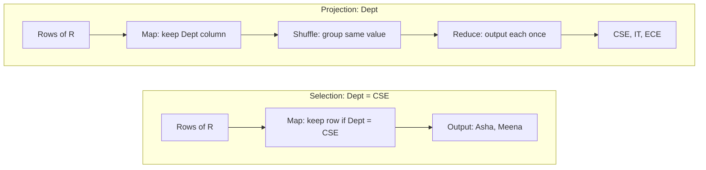

**In one line:** <mark>Selection keeps the rows that satisfy a condition (map only, reduce is identity), and projection keeps chosen columns and removes duplicates in reduce</mark>; union, intersection and difference use the whole tuple as the key. <Cite id="hadoop-ecosystem-mmds" loc="§2.3.3" /> <Cite id="mapreduce-algorithms-wiki-relalg" />

<Box kind="key">

**Key points to write (selection, projection and relational operations):**

- <mark>Selection: map tests each tuple and emits (t, t) if it satisfies the condition C; reduce is the identity (can be skipped)</mark>.
- <mark>Projection: map keeps only the chosen columns and emits (t', t'); reduce outputs each key once, removing duplicates</mark>.
- <mark>Union: emit every key once; intersection: keep keys that came from both relations; difference R - S: keep keys that came only from R</mark>.
- <mark>For these the whole tuple is the key, tagged with the relation it came from</mark>.
- Selection needs **no reduce**, because each tuple is checked on its own.
- A **combiner** can remove duplicates locally in projection.

</Box>

## Core answer (5 marks, fits every question here)

<Box kind="definition">

**Relational algebra** is the small set of operations (selection, projection, union, intersection, difference, join, grouping) on which SQL is built. A big table can be spread over many machines, and each operation can be written as a map and a reduce. <Cite id="mapreduce-algorithms-wiki-relalg" /> <Cite id="mapreduce-algorithms-gfg-relalg" />

</Box>

All examples use Student R(Id, Name, Dept): (1, Asha, CSE), (2, Ravi, IT), (3, Meena, CSE), (4, Kiran, IT), (5, Sara, ECE).

**Selection** $\sigma_C(R)$ keeps the tuples that satisfy a condition, like `WHERE Dept = 'CSE'`.

- **Map:** test each tuple $t$; if it satisfies $C$ emit $(t, t)$, otherwise emit nothing.
- **Reduce:** identity, just write the value. It can be a **map-only job**.

```text
map(t):  if t satisfies C: emit(t, t)
reduce(t, values): emit(t)       # identity, can be skipped
```

For Dept = CSE: Asha and Meena pass, so the answer is $\{(1, Asha, CSE), (3, Meena, CSE)\}$ (2 of 5 rows).

**Projection** $\pi_S(R)$ keeps only some columns, like `SELECT DISTINCT Dept`. Different rows can become identical after dropping columns, and a relation is a set, so duplicates must go. That is why projection needs a reduce.

- **Map:** build $t'$ with only the chosen columns and emit $(t', t')$.
- **Reduce:** for key $t'$ with the list $[t', t', ...]$ emit $t'$ once.

```text
map(t):  t2 = keep columns S of t;  emit(t2, t2)
reduce(t2, values): emit(t2)       # many copies become one
```

For Dept: map gives CSE, IT, CSE, IT, ECE; shuffle gives CSE [CSE, CSE], IT [IT, IT], ECE [ECE]; reduce gives $\{CSE, IT, ECE\}$.



<Cite id="mapreduce-algorithms-gfg-relalg" loc="diagram" />

**Conclusion:** <mark>selection filters rows in map, projection removes columns in map and duplicates in reduce</mark>.

## Extended answer (10 marks): add these

### 1. Operations at a glance

| Operation | Symbol | Meaning |
|---|---|---|
| Selection | $\sigma_C(R)$ | Keep rows satisfying condition $C$ |
| Projection | $\pi_S(R)$ | Keep columns in list $S$, drop duplicates |
| Union | $R \cup S$ | Rows in $R$ or $S$ |
| Intersection | $R \cap S$ | Rows in both |
| Difference | $R - S$ | Rows in $R$ not in $S$ |
| Natural join | $R \bowtie S$ | Combine rows that agree on common columns |
| Grouping and aggregation | $\gamma_{X, \theta(Y)}(R)$ | Group by $X$, aggregate $Y$ |

<Cite id="mapreduce-algorithms-tp-relalg" />

### 2. Union, intersection and difference

The key is the **whole tuple**, so equal tuples from the two relations meet at one reducer. Each tuple is tagged with its source.

| Operation | Map | Reduce rule |
|---|---|---|
| Union | each tuple $t$: emit $(t, t)$ | emit $t$ once for every key |
| Intersection | each tuple $t$: emit $(t, t)$ | emit $t$ only if the list has two copies (one from each relation) |
| Difference $R - S$ | from $R$ emit $(t, R)$, from $S$ emit $(t, S)$ | emit $t$ only if the list is exactly [R] |

<Sum>

<Given>

$R = \{Asha, Ravi, Meena\}$ and $S = \{Ravi, Meena, Kiran\}$.

</Given>

<Find>

$R \cup S$, $R \cap S$ and $R - S$.

</Find>

<Steps>

1. **Map.** Emit each tuple with its source tag. *Reason: the tag tells the reducer where each copy came from.*
2. **Shuffle.**

   | Key | Source tags |
   |---|---|
   | Asha | [R] |
   | Ravi | [R, S] |
   | Meena | [R, S] |
   | Kiran | [S] |

3. **Union:** every key, Asha, Ravi, Meena, Kiran.
4. **Intersection:** keys with both R and S, Ravi, Meena.
5. **Difference $R - S$:** keys with only [R], Asha.

</Steps>

<Answer>

$R \cup S = \{Asha, Ravi, Meena, Kiran\}$; $R \cap S = \{Ravi, Meena\}$; $R - S = \{Asha\}$.

</Answer>

<Box kind="verify">

$|R \cup S| = |R| + |S| - |R \cap S| = 3 + 3 - 2 = 4$, which matches. $|R - S| = |R| - |R \cap S| = 3 - 2 = 1$, which matches.

</Box>

</Sum>

### 3. Join and grouping in one line each

Natural join uses the **join column as the key** and pairs every R value with every S value for that key. Grouping uses the **grouping column as the key** and applies SUM, COUNT, AVG, MAX or MIN in reduce. (See the separate answer on natural join and grouping.) <Cite id="hadoop-ecosystem-mmds" loc="§2.3.7, §2.3.8" />

### 4. Why use MapReduce for this

The tables are too large for one machine. These same operations are what **Hive and Pig run underneath**: Hive turns a SQL query into MapReduce jobs. <Cite id="mapreduce-algorithms-pig-basic" /> <Cite id="web-bda-1-hive-tutorial" />

## Fit it to each question

- **"Explain selection and projection relational algebraic operation using MapReduce."** (10 marks) <PYQ id="2024-05-ce/q4a" /> <PYQ id="2025-05/q3a" />: the **core answer** in full (both operations with map, reduce, pseudo code and the traced example), then sections 1 and 4. Show the map output table for the five rows.
- **"Illustrate relational algebra operations with example."** (10 marks) <PYQ id="2024-12/q2a" />: section 1 table, then selection, projection (core answer), **section 2 sum** (union, intersection, difference), and the one-line join and grouping.

## Exam tips

- **Say it in words**: selection needs only map, projection needs reduce to remove duplicates.
- **Show the tagged pairs** for union, intersection and difference; the tag is the key idea.
- Use the **same small table** (Student R) for every operation and show before and after.
