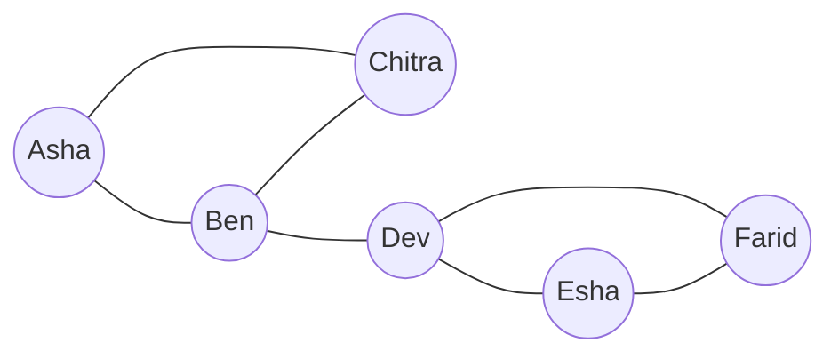

**Ek line mein:** <mark>Social network ek graph hai: log (actors) nodes hain aur relationships edges; graph ko cluster karne ka matlab nodes ko communities mein baantna hai jinke andar bahut edges hon aur groups ke beech kam</mark>. <Cite id="social-network-graphs-wiki-social-network" /> <Cite id="social-network-graphs-wiki-community" />

<Box kind="key">

**Har social-network question mein ye points likho:**

- <mark>Social network = actors ka set aur unke beech ke relationships</mark>; kayi networks mein locality dikhti hai: agar A, B aur C ko jaanta hai to B aur C ke ek doosre ko jaanne ki chance zyada (<mark>homophily aur triangles</mark>).
- Graph ki tarah: <mark>actor = node, relationship = edge</mark>, undirected (friends) ya directed (follows), weighted bhi ho sakta hai.
- Varieties: <mark>friendship (Facebook), follower (X, Instagram), telephone, email, collaboration, kayi node types wale networks</mark>.
- Graph ki zaroorat: <mark>communities dhoondhna, influential log dhoondhna, friends recommend karna, advertising target karna, news ya disease ka phailna study karna, fake accounts pakadna</mark>.
- Clustering: <mark>communities mein andar bahut edges aur beech kam</mark>. Ordinary clustering mushkil (coordinates nahi, centre nahi).
- Method: <mark>Girvan-Newman: sabse high betweenness wale edges hatao; sabse achhi modularity wala split chuno</mark>. Overlapping communities: clique percolation.

</Box>

## Core answer (5 marks, yahan ke har question ke liye)

<Box kind="definition">

A **social network** is a set of **actors** (people, accounts, companies) together with the **relationships** between them. Modelled as a **graph**, each actor is a **node** and each relationship is an **edge**. <Cite id="social-network-graphs-wiki-social-network" /> <Cite id="social-network-graphs-mmds-book" loc="§10.1" />

</Box>

**Social graph ko cluster karna** matlab nodes ko **communities** mein baantna: aise groups jinke andar bahut edges hon aur groups ke beech kam. <Cite id="social-network-graphs-wiki-community" />

<Cite id="social-network-graphs-ibm-sna" loc="diagram" />

**Ordinary clustering kyun mushkil:**

- Coordinates nahi hain, isliye average karne ke liye koi centre point nahi (k-means use nahi ho sakta).
- Sirf "edge hai" ya "nahi hai" pata hai, isliye zyadatar distances tie ho jaate hain.
- Communities overlap karti hain: ek insaan family group, class aur hobby group mein ho sakta hai.
- Real graphs mein lakhon nodes hote hain, isliye slow methods nahi chalte. <Cite id="social-network-graphs-mmds-book" loc="§10.2" />

**Conclusion:** <mark>graph model relationships ko naapne layak bana deta hai, aur clustering usme communities dhoondhti hai</mark>.

## Extended answer (10 marks): ye add karo

### 1. Social networks ki varieties

Edges undirected (friends) ya directed (follows) ho sakte hain, aur weights (calls ki sankhya) bhi ho sakte hain. <Cite id="social-network-graphs-wiki-sna" />

| Variety | Nodes | Edge ka matlab | Edge type |
|---|---|---|---|
| Friendship (Facebook) | People | Do log friends hain | Undirected |
| Follower (X, Instagram) | Accounts | Ek doosre ko follow karta hai | Directed |
| Telephone | Phone numbers | Call hui | Undirected, weighted |
| Email | Email addresses | Email bheji gayi | Directed |
| Collaboration | Authors, actors | Saath kaam kiya | Undirected, weighted |
| Kayi node types | Users, photos, tags | Upload kiya, tag kiya | Alag node types ko jodta hai |

### 2. Social network graph ki zaroorat

"Kaun kisko jaanta hai" ki list sirf rows of data hai. Graph ki tarah hum poore structure pe graph algorithms chala sakte hain: <Cite id="social-network-graphs-ibm-sna" />

1. **Communities** dhoondhna: classmates, fan groups, fraud rings.
2. **Influential** log dhoondhna jo kayi shortest paths pe hain.
3. Friends **recommend** karna: friend ka friend ek missing triangle edge hai.
4. Community pe **advertising** target karna.
5. News ya disease ka **phailna** study karna.
6. Ajeeb edge patterns se **fake accounts** aur spam pakadna.

### 3. Clustering methods

**Girvan-Newman (2002).** Do communities ko jodne wale edges pe bahut shortest paths hote hain, isliye unki **betweenness** sabse high. Sabse high hatao, dobara compute, repeat; pieces communities hain. Sabse achhi **modularity** wala level rakho $Q = \sum_c \left[ \dfrac{e_c}{m} - \left(\dfrac{d_c}{2m}\right)^2 \right]$, jahan $m$ edges ki sankhya, $e_c$ group $c$ ke andar ke edges aur $d_c$ uske nodes ki degrees ka jod hai. <Cite id="social-network-graphs-girvan-newman2002" /> <Cite id="social-network-graphs-gfg-girvan-newman" /> <Cite id="social-network-graphs-wiki-modularity" />

<Sum>

<Given>

Chhe log. Triangle A, B, C aur triangle D, E, F, ek edge C-D se jude. Edges: A-B, A-C, B-C, C-D, D-E, D-F, E-F (7 edges).

</Given>

<Find>

edge betweenness, pehla hataya gaya edge, aur communities.

</Find>

<Steps>

1. $\binom{6}{2} = 15$ pairs hain aur har shortest path unique hai, isliye har pair apne path ke har edge ko 1 deta hai.
2. **C-D.** \{A, B, C\} aur \{D, E, F\} mein se ek ek node wala har pair use cross karta hai: $3 \times 3 = 9$.
3. **A-C.** Pairs A-C, A-D, A-E, A-F: 4. **B-C** symmetry se: 4.
4. **A-B.** Sirf pair A-B: 1. **E-F** waise hi: 1.
5. **D-E.** Pairs D-E, C-E, A-E, B-E: 4. **D-F** symmetry se: 4.
6. Sabse high C-D, 9. Use hatao: components \{A, B, C\} aur \{D, E, F\}.
7. $m = 7$ ke saath **Modularity**. \{A, B, C\} ke liye: $e = 3$, degrees $2 + 2 + 3 = 7$, isliye $\frac37 - (\frac{7}{14})^2 = 0.4286 - 0.25 = 0.1786$. Doosra group bhi wahi deta hai. $Q = 0.357$.

</Steps>

<Answer>

C-D ki betweenness sabse high (9) hai. Use hatane se do communities milti hain, \{A, B, C\} aur \{D, E, F\}, modularity $Q = 5/14 \approx 0.357$ ke saath.

</Answer>

<Box kind="verify">

Betweenness values: 1, 4, 4, 9, 4, 4, 1, jinka jod 27 hai. Saare shortest-path lengths ka jod bhi 27 hona chahiye: triangles ke andar $3 + 3 = 6$; cross mein A, D, E, F se $2 + 3 + 3 = 8$ door hai, B bhi 8, aur C $1 + 2 + 2 = 5$, to $6 + 8 + 8 + 5 = 27$. Dono match karte hain.

</Box>

</Sum>

**Clique percolation (Palla, 2005).** Un $k$-cliques ko jodo jo $k-1$ nodes share karte hain; har judi hui group ek community hai, aur ek node kayi mein ho sakta hai (overlapping communities). <Cite id="social-network-graphs-palla2005" />

### 4. Girvan-Newman ki limitations

Slow (har round mein har node se shortest paths), ties order pe depend, aur har insaan sirf ek community mein jaata hai.

## Har question mein kaise fit karein

- **"What is a Social Network? Give Varieties of Social Networks and the need for social network graph."** (10 marks) <PYQ id="2023-12/q5b" />: core answer (definition, graph model, chhota diagram) + section 1 (varieties table) + section 2 (chhe zaroorat). Clustering wala part (section 3) yahan optional hai; communities pe ek line kaafi hai.
- **"Clustering of Social-Network Graphs."** (10 marks) <PYQ id="2025-05/q6c" />: definition aur community picture (core answer), ordinary clustering kyun mushkil, phir section 3 poora: Girvan-Newman ke steps, modularity, betweenness ke saath worked sum, aur clique percolation aur limitations pe ek line.

## Exam tips

- **Hamesha draw karo:** do dense groups wala chhota graph jo bridge se jude hon, aur bridge mark karo.
- Keywords use karo **"nodes and edges", "community", "betweenness", "modularity"**.
- Common galti: dosto ke kisi bhi group ko community kehna. Community mein **andar bahut edges aur bahar kam** hote hain.

Exam mein English mein likho.
