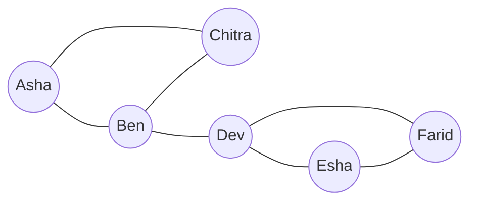

**In one line:** <mark>A social network is a graph: people (actors) are nodes and relationships are edges; clustering the graph means splitting the nodes into communities with many edges inside each group and few edges between groups</mark>. <Cite id="social-network-graphs-wiki-social-network" /> <Cite id="social-network-graphs-wiki-community" />

<Box kind="key">

**Key points to write (any social-network question):**

- <mark>Social network = a set of actors and the relationships between them</mark>; many networks show locality: if A knows B and C, then B and C are more likely to know each other (<mark>homophily and triangles</mark>).
- As a graph: <mark>actor = node, relationship = edge</mark>, undirected (friends) or directed (follows), possibly weighted.
- Varieties: <mark>friendship (Facebook), follower (X, Instagram), telephone, email, collaboration, networks with several node types</mark>.
- Need for the graph: <mark>find communities, find influential people, recommend friends, target advertising, study spread of news or disease, detect fake accounts</mark>.
- Clustering: <mark>communities have many edges inside and few between</mark>. Ordinary clustering struggles (no coordinates, no centre).
- Method: <mark>Girvan-Newman: remove the highest-betweenness edges; choose the split with the best modularity</mark>. Overlapping communities: clique percolation.

</Box>

## Core answer (5 marks, fits every question here)

<Box kind="definition">

A **social network** is a set of **actors** (people, accounts, companies) together with the **relationships** between them. Modelled as a **graph**, each actor is a **node** and each relationship is an **edge**. <Cite id="social-network-graphs-wiki-social-network" /> <Cite id="social-network-graphs-mmds-book" loc="§10.1" />

</Box>

**Clustering a social graph** means splitting the nodes into **communities**: groups with many edges inside each group and few edges between groups. <Cite id="social-network-graphs-wiki-community" />

<Cite id="social-network-graphs-ibm-sna" loc="diagram" />

**Why ordinary clustering struggles:**

- There are no coordinates, so there is no centre point to average (k-means cannot be used).
- The only facts are "edge" or "no edge", so most distances tie.
- Communities overlap: one person is in a family group, a class and a hobby group.
- Real graphs have millions of nodes, so slow methods are out. <Cite id="social-network-graphs-mmds-book" loc="§10.2" />

**Conclusion:** <mark>the graph model turns relationships into something we can measure, and clustering finds the communities in it</mark>.

## Extended answer (10 marks): add these

### 1. Varieties of social networks

Edges may be undirected (friends) or directed (follows), and may carry weights (number of calls). <Cite id="social-network-graphs-wiki-sna" />

| Variety | Nodes | Edge means | Edge type |
|---|---|---|---|
| Friendship (Facebook) | People | Two people are friends | Undirected |
| Follower (X, Instagram) | Accounts | One follows the other | Directed |
| Telephone | Phone numbers | A call was made | Undirected, weighted |
| Email | Email addresses | An email was sent | Directed |
| Collaboration | Authors, actors | Worked together | Undirected, weighted |
| Several node types | Users, photos, tags | Uploaded, tagged | Joins different node types |

### 2. Need for a social network graph

A list of "who knows whom" is only rows of data. As a graph we can run graph algorithms on the whole structure: <Cite id="social-network-graphs-ibm-sna" />

1. Find **communities**: classmates, fan groups, fraud rings.
2. Find **influential** people who lie on many shortest paths.
3. **Recommend** friends: a friend of a friend is a missing triangle edge.
4. Target **advertising** at a community.
5. Study the **spread** of news or disease.
6. Detect **fake accounts** and spam by odd edge patterns.

### 3. Clustering methods

**Girvan-Newman (2002).** Edges joining two communities carry many shortest paths, so they have the highest **betweenness**. Remove the highest, recompute, and repeat; the pieces are communities. Keep the level with the best **modularity** $Q = \sum_c \left[ \dfrac{e_c}{m} - \left(\dfrac{d_c}{2m}\right)^2 \right]$, where $m$ is the number of edges, $e_c$ the edges inside group $c$ and $d_c$ the sum of its node degrees. <Cite id="social-network-graphs-girvan-newman2002" /> <Cite id="social-network-graphs-gfg-girvan-newman" /> <Cite id="social-network-graphs-wiki-modularity" />

<Sum>

<Given>

Six people. Triangle A, B, C and triangle D, E, F, joined by one edge C-D. Edges: A-B, A-C, B-C, C-D, D-E, D-F, E-F (7 edges).

</Given>

<Find>

the edge betweenness, the first edge removed, and the communities.

</Find>

<Steps>

1. There are $\binom{6}{2} = 15$ pairs and every shortest path is unique, so each pair adds 1 to every edge on its path.
2. **C-D.** Every pair with one node in \{A, B, C\} and one in \{D, E, F\} crosses it: $3 \times 3 = 9$.
3. **A-C.** Pairs A-C, A-D, A-E, A-F: 4. **B-C** by symmetry: 4.
4. **A-B.** Only the pair A-B: 1. **E-F** similarly: 1.
5. **D-E.** Pairs D-E, C-E, A-E, B-E: 4. **D-F** by symmetry: 4.
6. The highest is C-D with 9. Remove it: the components are \{A, B, C\} and \{D, E, F\}.
7. **Modularity** with $m = 7$. For \{A, B, C\}: $e = 3$, degrees $2 + 2 + 3 = 7$, so $\frac37 - (\frac{7}{14})^2 = 0.4286 - 0.25 = 0.1786$. The other group gives the same. $Q = 0.357$.

</Steps>

<Answer>

C-D has the highest betweenness (9). Removing it gives two communities, \{A, B, C\} and \{D, E, F\}, with modularity $Q = 5/14 \approx 0.357$.

</Answer>

<Box kind="verify">

Betweenness values: 1, 4, 4, 9, 4, 4, 1, which add to 27. The sum of all shortest-path lengths must also be 27: within the triangles $3 + 3 = 6$; across, A is $2 + 3 + 3 = 8$ from D, E, F, B is 8, and C is $1 + 2 + 2 = 5$, so $6 + 8 + 8 + 5 = 27$. They match.

</Box>

</Sum>

**Clique percolation (Palla, 2005).** Join $k$-cliques that share $k-1$ nodes; each joined group is a community, and a node can be in several (overlapping communities). <Cite id="social-network-graphs-palla2005" />

### 4. Limitations of Girvan-Newman

Slow (shortest paths from every node in every round), ties depend on order, and each person lands in only one community.

## Fit it to each question

- **"What is a Social Network? Give Varieties of Social Networks and the need for social network graph."** (10 marks) <PYQ id="2023-12/q5b" />: core answer (definition, graph model, the small diagram) + section 1 (varieties table) + section 2 (six needs). The clustering part (section 3) is optional here; one line on communities is enough.
- **"Clustering of Social-Network Graphs."** (10 marks) <PYQ id="2025-05/q6c" />: definition and the community picture (core answer), why ordinary clustering struggles, then section 3 in full: Girvan-Newman steps, modularity, the worked sum with betweenness, and one line on clique percolation and the limitations.

## Exam tips

- **Always draw:** a small graph with two dense groups joined by a bridge, and mark the bridge.
- Use the keywords **"nodes and edges", "community", "betweenness", "modularity"**.
- Common mistake: calling any group of friends a community. A community has **many edges inside and few outside**.
