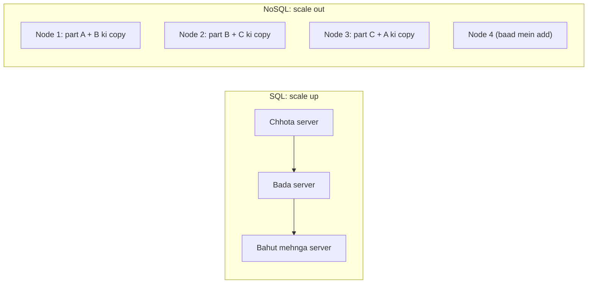

**Ek line mein:** <mark>SQL databases fixed-schema tables mein data rakhte hain, scale up karte hain aur full ACID transactions dete hain, jabki NoSQL databases key-value, document, column ya graph data flexible schema ke saath rakhte hain aur scale out karte hain, aksar eventual consistency ke saath</mark>. <Cite id="nosql-intro-gfg-sqlvs" /> <Cite id="nosql-intro-ibm-nosql" />

<Box kind="key">

**SQL vs NoSQL ke question mein ye points likho:**

- <mark>Data model: rows aur columns ke tables versus key-value, document, column family ya graph</mark>.
- <mark>Schema: pehle se fixed versus flexible ya schema-less</mark>.
- <mark>Scaling: vertical (scale up) versus horizontal (scale out)</mark>.
- <mark>Transactions: full ACID versus aksar BASE (eventual consistency)</mark>.
- Query language: **SQL (standard)** versus **koi common language nahi** (har product ka apna API).
- Joins: **strong** versus **kamzor ya nahi**.
- Koi bhi har jagah behtar nahi; bahut systems dono use karte hain (**polyglot persistence**).

</Box>

## Core answer (5 marks, yahan ke har question ke liye)

<Box kind="definition">

**SQL (relational) databases** keep data in tables with a fixed schema and are queried with SQL. **NoSQL** ("Not only SQL") databases do not use the fixed table-and-join model; they store data as key-value pairs, documents, wide columns or graphs and are built to run on a cluster of cheap machines. <Cite id="big-data-intro-wiki-rdbms" /> <Cite id="big-data-intro-wiki-nosql" />

</Box>

| Point | SQL (relational) | NoSQL |
|---|---|---|
| Data model | Rows aur columns ke tables | Key-value, document, column family ya graph |
| Schema | Pehle se fixed; badalna slow | Flexible ya schema-less; har record alag ho sakta hai |
| Query language | SQL, sab products mein same | Common language nahi; har product ka apna API |
| Scaling | Zyadatar scale up (bada server); scale out mushkil | Bahut cheap servers pe scale out |
| Transactions | Full ACID | Aksar limited ACID; kai BASE (eventual consistency) use karte hain |
| Joins | Strong support | Kamzor ya nahi; related data saath rakha jata hai |
| Best for | Structured data jahan strict correctness chahiye (banking, ERP) | Bahut bada, tez, alag-alag data (social media, logs, catalogues) |
| Examples | MySQL, Oracle, PostgreSQL | MongoDB, Cassandra, Redis, Neo4j |

<Cite id="nosql-intro-gfg-sqlvs" /> <Cite id="nosql-intro-aws-nosql" />

<Cite id="nosql-intro-gfg-sqlvs" loc="diagram" />

**Conclusion:** <mark>jab correctness aur structured data sabse zaroori ho tab SQL, aur jab data bahut bada, tez aur alag-alag ho tab NoSQL use karo</mark>.

## Extended answer (10 marks): ye add karo

### 1. NoSQL ke chaar types ek table mein

| Type | Shape | Example |
|---|---|---|
| Key-value | Unique key se value | Redis, DynamoDB |
| Document | Fields wale JSON documents | MongoDB |
| Column family | Row key aur column families | Cassandra, HBase |
| Graph | Nodes aur relationships | Neo4j |

<Cite id="big-data-intro-mongo" /> <Cite id="nosql-intro-ibm-nosql" />

### 2. Kab kya chunein

| SQL chunein | NoSQL chunein |
|---|---|
| Paise, orders, marks (pehle correctness) | Social media feeds, likes, sessions |
| Complex joins aur reports | Catalogues, profiles, content |
| Fixed, jaana-pehchana structure | Logs, sensor data, tezi se badalta structure |

### 3. NoSQL ke advantages aur limitations

| Advantages | Limitations |
|---|---|
| Cheap machines pe scale out | Joins kamzor ya nahi |
| Flexible schema, jaldi badalta hai | Aksar sirf eventual consistency |
| Fast simple reads aur writes | Har product alag seekhna padta hai |
| Built-in replication | SQL se kam experts aur tools |

<Cite id="nosql-intro-ibm-nosql" /> <Cite id="nosql-intro-aws-nosql" />

### 4. Polyglot persistence

Bahut real systems dono use karte hain: application ka har hissa woh database use karta hai jo uske data ko suit kare (orders ke liye SQL, sessions ke liye key-value, recommendations ke liye graph). <Cite id="nosql-intro-fowler-poly" />

## Har question mein kaise fit karein

- **"Differentiate between SQL vs NoSQL."** (5 marks) <PYQ id="2024-12/q1b" /> <PYQ id="2025-05/q1c" />: **core answer**: dono ki ek-ek line, 8-row table (kam se kam 6 rows likho) aur ek line ka conclusion. Lamba answer chahiye to section 1 aur 2 add karo.

## Exam tips

- Keywords ke saath **table likho**: fixed versus flexible schema, scale up versus scale out, ACID versus BASE.
- Har column mein **ek example product** do.
- "NoSQL mein SQL nahi hota" mat likho; **"Not only SQL"** likho.
