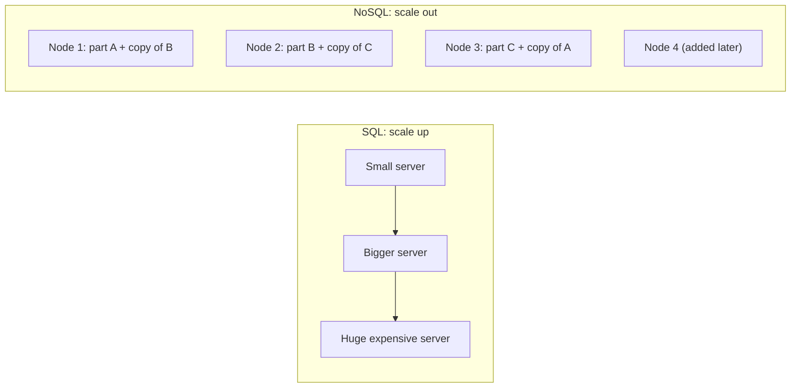

**In one line:** <mark>SQL databases store data in fixed-schema tables and scale up with full ACID transactions, while NoSQL databases store key-value, document, column or graph data with a flexible schema and scale out, often with eventual consistency</mark>. <Cite id="nosql-intro-gfg-sqlvs" /> <Cite id="nosql-intro-ibm-nosql" />

<Box kind="key">

**Key points to write (SQL vs NoSQL):**

- <mark>Data model: tables of rows and columns versus key-value, document, column family or graph</mark>.
- <mark>Schema: fixed in advance versus flexible or schema-less</mark>.
- <mark>Scaling: vertical (scale up) versus horizontal (scale out)</mark>.
- <mark>Transactions: full ACID versus often BASE (eventual consistency)</mark>.
- Query language: **SQL (standard)** versus **no common language** (each product has its own API).
- Joins: **strong** versus **weak or none**.
- Neither is better everywhere; many systems use both (**polyglot persistence**).

</Box>

## Core answer (5 marks, fits every question here)

<Box kind="definition">

**SQL (relational) databases** keep data in tables with a fixed schema and are queried with SQL. **NoSQL** ("Not only SQL") databases do not use the fixed table-and-join model; they store data as key-value pairs, documents, wide columns or graphs and are built to run on a cluster of cheap machines. <Cite id="big-data-intro-wiki-rdbms" /> <Cite id="big-data-intro-wiki-nosql" />

</Box>

| Point | SQL (relational) | NoSQL |
|---|---|---|
| Data model | Tables with rows and columns | Key-value, document, column family or graph |
| Schema | Fixed in advance; changing it is slow | Flexible or schema-less; each record can differ |
| Query language | SQL, same for all products | No common language; each product has its own API |
| Scaling | Mainly scale up (bigger server); scale out is hard | Scale out over many cheap servers |
| Transactions | Full ACID | Often limited ACID; many use BASE (eventual consistency) |
| Joins | Strong support | Weak or none; related data is kept together |
| Best for | Structured data needing strict correctness (banking, ERP) | Huge, fast, varied data (social media, logs, catalogues) |
| Examples | MySQL, Oracle, PostgreSQL | MongoDB, Cassandra, Redis, Neo4j |

<Cite id="nosql-intro-gfg-sqlvs" /> <Cite id="nosql-intro-aws-nosql" />

<Cite id="nosql-intro-gfg-sqlvs" loc="diagram" />

**Conclusion:** <mark>use SQL when correctness and structured data matter most, and NoSQL when data is huge, fast and varied</mark>.

## Extended answer (10 marks): add these

### 1. The four NoSQL types in one table

| Type | Shape | Example |
|---|---|---|
| Key-value | Unique key to a value | Redis, DynamoDB |
| Document | JSON documents with fields | MongoDB |
| Column family | Row key and column families | Cassandra, HBase |
| Graph | Nodes and relationships | Neo4j |

<Cite id="big-data-intro-mongo" /> <Cite id="nosql-intro-ibm-nosql" />

### 2. When to choose which

| Choose SQL for | Choose NoSQL for |
|---|---|
| Money, orders, marks (correctness first) | Social media feeds, likes, sessions |
| Complex joins and reports | Catalogues, profiles, content |
| Fixed, well-known structure | Logs, sensor data, fast-changing structure |

### 3. Advantages and limitations of NoSQL

| Advantages | Limitations |
|---|---|
| Scales out on cheap machines | Weak or no joins |
| Flexible schema, fast to change | Often only eventual consistency |
| Fast simple reads and writes | Learn each product separately |
| Built-in replication | Fewer experts and tools than SQL |

<Cite id="nosql-intro-ibm-nosql" /> <Cite id="nosql-intro-aws-nosql" />

### 4. Polyglot persistence

Many real systems use both: each part of the application uses the database that suits its data (SQL for orders, key-value for sessions, graph for recommendations). <Cite id="nosql-intro-fowler-poly" />

## Fit it to each question

- **"Differentiate between SQL vs NoSQL."** (5 marks) <PYQ id="2024-12/q1b" /> <PYQ id="2025-05/q1c" />: the **core answer**: one line each, the 8-row table (write at least 6 rows) and the one-line conclusion. For a longer answer add sections 1 and 2.

## Exam tips

- **Write a table** with the keywords: fixed versus flexible schema, scale up versus scale out, ACID versus BASE.
- Give **one example product** in each column.
- Do not say "NoSQL has no SQL"; say **"Not only SQL"**.
