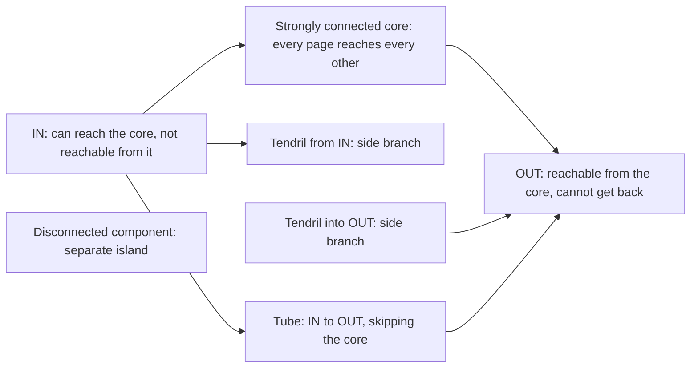

**Ek line mein:** <mark>Web ek bahut bada directed graph hai (pages nodes hain, hyperlinks directed edges) jiski shape bow-tie jaisi hai: strongly connected core, IN part, OUT part, tendrils, tubes aur disconnected pieces</mark>. <Cite id="hadoop-ecosystem-mmds" loc="§5.1.3" /> <Cite id="web-bda-2-broder-bowtie" />

<Box kind="key">

**Ye points likho:**

- <mark>Web ek directed graph hai: page = node, hyperlink = directed edge.</mark>
- <mark>Strongly connected core (SCC): har page links follow karke har doosre page tak pahunch sakta hai.</mark>
- <mark>IN: wo pages jo core tak pahunch sakte hain par core se unhe nahi pahuncha ja sakta.</mark> <mark>OUT: core se pahunche ja sakne wale pages jo wapas nahi aa sakte.</mark>
- <mark>Tendrils: IN se nikli ya OUT mein jaati side branches. Tubes: IN se OUT tak core ko skip karne wale raaste. Disconnected components: alag islands.</mark>
- Kyun important: <mark>rank sirf links ke through behta hai</mark>, isliye OUT aur dead-end tendrils mein rank jama hota hai aur IN ko kam milta hai; yehi dead ends aur spider traps hain jinhe PageRank ko handle karna padta hai.

</Box>

## Core answer (5 marks, yahan ke har question ke liye)

<Box kind="definition">

The web can be seen as a **directed graph**: each page is a **node** and each hyperlink is a **directed edge** from the page that contains it to the page it points to. Studies of large crawls found that this graph is not a random tangle but has a **bow-tie** structure. <Cite id="hadoop-ecosystem-mmds" loc="§5.1.3" /> <Cite id="pagerank-wiki-webgraph" />

</Box>

Aam bow-tie pictures se dobara banaya. <Cite id="web-bda-2-broder-bowtie" loc="Fig. 9" />

**Parts:**

- **Strongly connected core (SCC).** Pages ka bada set jisme har page links follow karke har doosre tak pahunch sakta hai. Ye web ka dil hai.
- **IN.** Wo pages jo core tak pahunch sakte hain par core se unhe nahi pahuncha ja sakta, jaise ek naya page jo popular pages ko link karta hai par use abhi koi link nahi karta.
- **OUT.** Wo pages jinhe core pahunch sakta hai par wo wapas nahi pahunch sakte, jaise company sites jinke links sirf apne hi pages ko jaate hain.
- **Tendrils.** IN se latakte pages (IN se reachable, core tak nahi jaate) ya OUT mein jaate pages (core se reachable nahi).
- **Tubes.** IN se seedhe OUT tak ke raaste jo core ko skip karte hain.
- **Disconnected components.** Chhote islands jinka main web se koi link path nahi.

**Conclusion:** <mark>web bow-tie shape wala directed graph hai, aur uska structure decide karta hai ki rank kaise behta hai aur search engines kaise crawl karte hain</mark>.

## Extended answer (10 marks): ye add karo

### 1. Bade study ne kya paaya

May 1999 ke AltaVista crawl (lagbhag 203 million pages) mein core mein lagbhag 56 million pages the, yaani lagbhag 28 percent, aur IN aur OUT mein har ek mein lagbhag 44 million. Do random pages ke liye ek se doosre tak path sirf lagbhag 24 percent baar milta hai. Isliye web "sab sabko link karta hai" se bahut door hai. <Cite id="web-bda-2-broder-bowtie" />

| Part | Idea | Example |
|---|---|---|
| SCC | Har page har doosre tak pahunchta hai | Popular, well-linked sites jo ek doosre ko link karti hain |
| IN | Core tak pahunchte hain, core se nahi pahunche ja sakte | Naya site jise abhi kisi ne link nahi kiya |
| OUT | Core se reachable, wapas raasta nahi | Sirf internal links wala corporate site |
| Tendrils | IN se ya OUT mein jaati side branches | IN se linked page jo core mein kuch link nahi karta |
| Tubes | IN se OUT, core skip karke | Do sites ke beech chhota seedha link path |
| Disconnected | Main web se koi path nahi | Ek chhota alag-thalag site |

### 2. Structure kyun matter karta hai

- **PageRank:** rank sirf links ke through behta hai. OUT aur dead-end tendrils ke pages rank jama karte ya khote hain, aur IN ko kam milta hai. Bina out-links wala page **dead end** hai, aur jis group ke links andar hi rahein wo **spider trap**; PageRank inse nipatne ke liye taxation use karta hai. <Cite id="pagerank-wiki-spidertrap" /> <Cite id="web-bda-2-mmds-linkanalysis" loc="slides 41-47" />
- **Crawling:** jo crawler OUT mein shuru ho wo wapas core tak nahi chal sakta, isliye crawlers core ke well-linked pages se shuru karte hain.

## Har question mein kaise fit karein

- **"Explain the structure of web with suitable diagram."** (10 marks) <PYQ id="2023-12/q6b" />: core answer (definition, bow-tie flowchart, chhe parts) + section 1 (study ke figures aur table) + section 2 (kyun matter karta hai). Diagram ka har part label karo.

## Exam tips

- **Hamesha draw karo:** bow tie: left mein IN, beech mein core, right mein OUT, saath mein tendrils, ek tube aur ek disconnected island.
- Har part ka one-line test likho: **"reach the core?"** aur **"reachable from the core?"**.
- PageRank se link (dead ends aur spider traps) mention karo; isse dikhta hai ki structure kyun matter karta hai.

Exam mein English mein likho.
