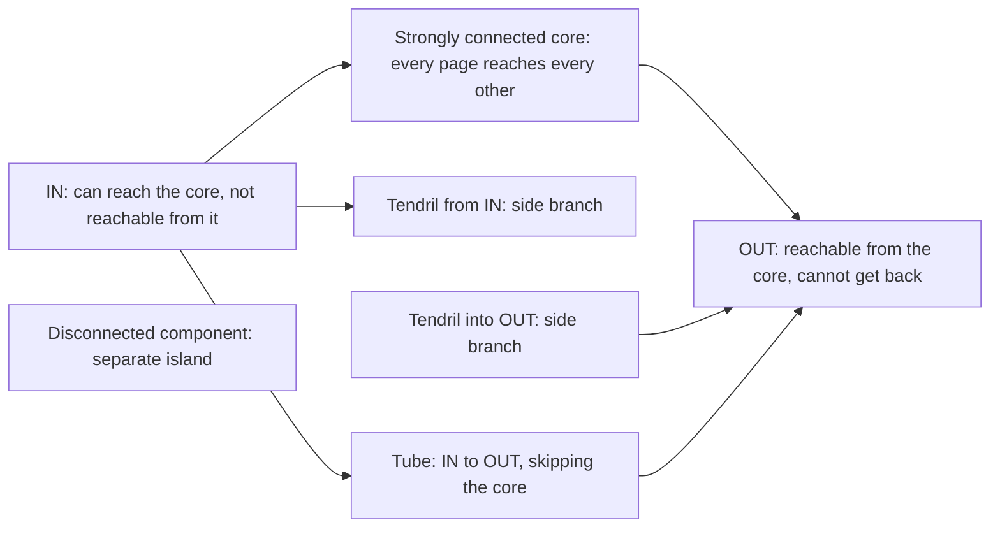

**In one line:** <mark>The web is a very large directed graph (pages are nodes, hyperlinks are directed edges) with a bow-tie shape: a strongly connected core, an IN part, an OUT part, tendrils, tubes and disconnected pieces</mark>. <Cite id="hadoop-ecosystem-mmds" loc="§5.1.3" /> <Cite id="web-bda-2-broder-bowtie" />

<Box kind="key">

**Key points to write:**

- <mark>The web is a directed graph: page = node, hyperlink = directed edge.</mark>
- <mark>Strongly connected core (SCC): every page can reach every other page by following links.</mark>
- <mark>IN: pages that can reach the core but cannot be reached from it.</mark> <mark>OUT: pages reachable from the core that cannot get back.</mark>
- <mark>Tendrils: side branches hanging off IN or leading into OUT. Tubes: paths from IN to OUT that skip the core. Disconnected components: separate islands.</mark>
- Why it matters: <mark>rank flows only along links</mark>, so rank piles up in OUT and in dead-end tendrils and IN receives little; these are the dead ends and spider traps PageRank must handle.

</Box>

## Core answer (5 marks, fits every question here)

<Box kind="definition">

The web can be seen as a **directed graph**: each page is a **node** and each hyperlink is a **directed edge** from the page that contains it to the page it points to. Studies of large crawls found that this graph is not a random tangle but has a **bow-tie** structure. <Cite id="hadoop-ecosystem-mmds" loc="§5.1.3" /> <Cite id="pagerank-wiki-webgraph" />

</Box>

Redrawn from the usual bow-tie pictures. <Cite id="web-bda-2-broder-bowtie" loc="Fig. 9" />

**The parts:**

- **Strongly connected core (SCC).** A large set of pages in which every page can reach every other by following links. It is the heart of the web.
- **IN.** Pages that can reach the core but cannot be reached from it, such as a new page that links to popular pages that nobody links to yet.
- **OUT.** Pages the core can reach but that cannot reach back, such as company sites whose links point only to their own pages.
- **Tendrils.** Pages hanging off IN (reachable from IN, not leading to the core) or leading into OUT (not reachable from the core).
- **Tubes.** Paths from IN straight to OUT that skip the core.
- **Disconnected components.** Small islands with no link path to or from the main web.

**Conclusion:** <mark>the web is a directed graph with a bow-tie shape, and its structure decides how rank flows and how search engines crawl it</mark>.

## Extended answer (10 marks): add these

### 1. What the large study found

In the AltaVista crawl of May 1999 (about 203 million pages), the core held about 56 million pages, around 28 percent, and IN and OUT held about 44 million pages each. For two random pages, a path from one to the other exists only about 24 percent of the time. So the web is far from "everything links to everything". <Cite id="web-bda-2-broder-bowtie" />

| Part | Idea | Example |
|---|---|---|
| SCC | Every page reaches every other | Popular, well-linked sites that link to each other |
| IN | Reach the core, not reachable from it | A new site nobody has linked to yet |
| OUT | Reachable from the core, no way back | A corporate site with only internal links |
| Tendrils | Side branches from IN or into OUT | A page linked from IN that links to nothing in the core |
| Tubes | IN to OUT, skipping the core | A short direct link path between two sites |
| Disconnected | No path to or from the main web | A tiny isolated site |

### 2. Why the structure matters

- **PageRank:** rank can flow only along links. Pages in OUT and in dead-end tendrils collect or lose rank, and IN receives little. A page with no out-links is a **dead end**, and a group whose links stay inside is a **spider trap**; PageRank uses taxation to cope. <Cite id="pagerank-wiki-spidertrap" /> <Cite id="web-bda-2-mmds-linkanalysis" loc="slides 41-47" />
- **Crawling:** a crawler that starts in OUT cannot walk back to the core, so crawlers start from well-linked pages in the core.

## Fit it to each question

- **"Explain the structure of web with suitable diagram."** (10 marks) <PYQ id="2023-12/q6b" />: core answer (definition, bow-tie flowchart, six parts) + section 1 (study figures and table) + section 2 (why it matters). Label every part of the diagram.

## Exam tips

- **Always draw:** the bow tie: IN on the left, core in the middle, OUT on the right, with tendrils, a tube and a disconnected island.
- Write the one-line test for each part: **"reach the core?"** and **"reachable from the core?"**.
- Mention the link to PageRank (dead ends and spider traps); it shows why the structure matters.
