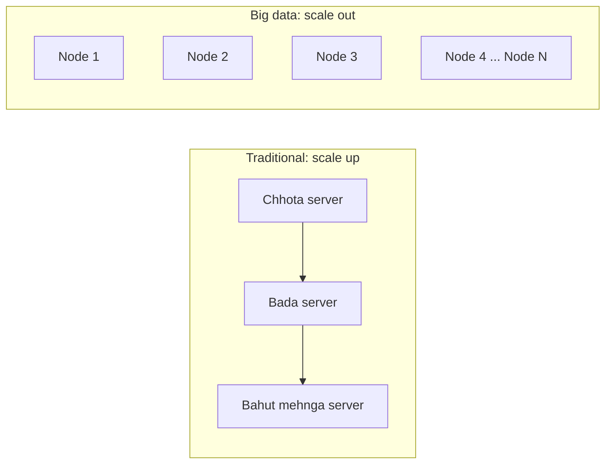
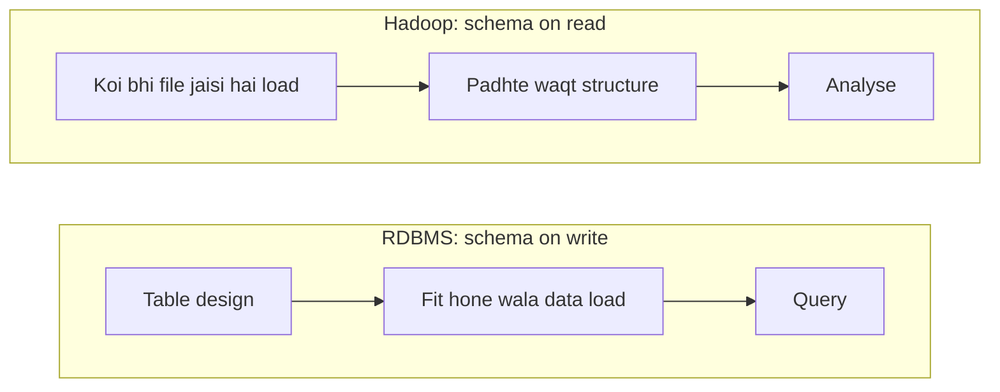

**Ek line mein:** <mark>Traditional database chhota, structured data ek server pe rakhta hai aur scale up karta hai, jabki big data systems bahut bada, mixed data cheap machines ke cluster pe rakhte hain aur scale out karte hain</mark>. <Cite id="big-data-intro-oracle" /> <Cite id="big-data-intro-av" />

<Box kind="key">

**Traditional vs big data, RDBMS vs Hadoop ke question mein ye points likho:**

- <mark>Size: megabytes se kuch terabytes versus terabytes se petabytes</mark>.
- <mark>Data type: sirf structured versus structured, semi-structured aur unstructured</mark>.
- <mark>Schema on write (pehle fixed) versus schema on read (flexible)</mark>.
- <mark>Scale up (bada server) versus scale out (zyada commodity nodes)</mark>.
- <mark>Data program ke paas jata hai versus program data ke paas jata hai</mark>.
- Failure: **special set-up** versus **replication se built in**.
- Hadoop RDBMS ko **replace nahi karta**; dono saath use hote hain.

</Box>

## Core answer (5 marks, yahan ke har question ke liye)

<Box kind="definition">

A **traditional database (RDBMS)** keeps structured data in tables with a fixed schema on one server and is queried with SQL. **Big data** is data too large, fast and varied for that model, so it is stored and processed on a cluster, for example with Hadoop. <Cite id="big-data-intro-wiki-rdbms" /> <Cite id="big-data-intro-tp" />

</Box>

| Point | Traditional data / database | Big data |
|---|---|---|
| Size | Megabytes se kuch terabytes | Terabytes se petabytes aur zyada |
| Data type | Zyadatar structured | Structured, semi-structured, unstructured |
| Schema | Store karne se pehle fixed (schema-on-write) | Flexible, padhte waqt lagta hai (schema-on-read) |
| Growth | Dheemi aur predictable | Tez aur lagatar |
| Scaling | Scale up: bada, mehnga server | Scale out: cheap nodes add karo |
| Processing | Ek machine, data program ke paas aata hai | Cluster, program data ke paas jata hai |
| Arrival | Zyadatar batch updates | Batch aur real-time streams |
| Tools | RDBMS, SQL, data warehouse | Hadoop, Spark, NoSQL, Kafka |
| Failure | Server fail hona serious | Node fail hona normal, copies se handle |
| Cost | Mehnga hardware aur licences | Cheap hardware, aksar open source |

<Cite id="big-data-intro-oracle" /> <Cite id="big-data-intro-av" /> <Cite id="big-data-intro-mmds" />

<Cite id="big-data-intro-tp" loc="diagram" />

**Conclusion:** <mark>structured data pe fast transactions ke liye RDBMS use karo, aur bade mixed data ke analysis ke liye big data tools</mark>.

## Extended answer (10 marks): ye add karo

### 1. RDBMS versus Hadoop

| Point | RDBMS | Hadoop |
|---|---|---|
| Data | Sirf structured tables | Koi bhi format |
| Schema | On write | On read |
| Scale | Vertical (bada server) | Horizontal (zyada nodes) |
| Hardware | Mehnga, high-end | Commodity |
| Best at | Fast chhote transactions, updates, joins | Bade data ka batch analysis |
| Access | SQL, low latency | Batch jobs (MapReduce, Spark, Hive), high throughput |
| Updates | Kahin bhi read aur write | Write once, read many, zyadatar append |
| Fault tolerance | Special set-up chahiye | Block copies se built in |

<Cite id="big-data-intro-hdfs" /> <Cite id="big-data-intro-wiki-hadoop" /> <Cite id="big-data-intro-gfg-hadoop" />

### 2. Schema on write versus schema on read

### 3. Dono saath kyun chalte hain

Banks account balance ke liye RDBMS use karte hain (exact, turant updates) aur saalon ke transactions mein fraud dhoondhne ke liye Hadoop-type systems. Hadoop RDBMS ko replace nahi karta. <Cite id="big-data-intro-oracle" />

## Har question mein kaise fit karein

- **"Compare traditional database and big data."** (5 marks) <PYQ id="2023-12/q1b" />: dono ki ek-ek line definition aur core table (8 se 10 rows).
- **"Compare traditional data and big data."** (5 marks) <PYQ id="2025-05/q1a" />: wahi core answer; size, type, schema aur scaling pe zor do.
- **"What is the basic difference between traditional RDBMS and Hadoop?"** (5 marks) <PYQ id="2023-12-ce/q1a" />: **section 1 table** (RDBMS versus Hadoop) likho aur schema on read, scale out aur commodity hardware mention karo.

## Exam tips

- **Pehle table**: 8 se 10 row ka do-column table hi poora answer hai; har cell chhota rakho.
- Teen **keywords** zaroor likho: structured versus unstructured, scale up versus scale out, schema on write versus schema on read.
- **Scale up versus scale out** ki picture bana do, extra marks milte hain.
