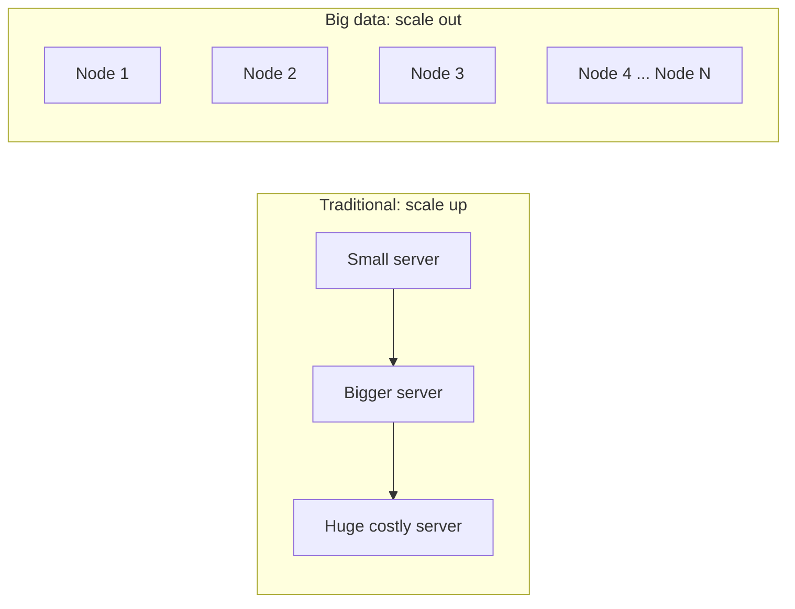
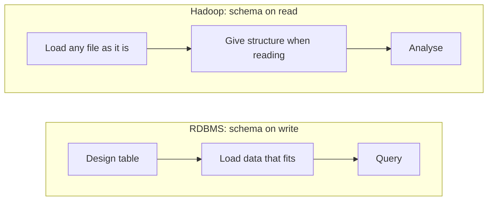

**In one line:** <mark>A traditional database stores small, structured data on one server and scales up, whereas big data systems store huge, mixed data on a cluster of cheap machines and scale out</mark>. <Cite id="big-data-intro-oracle" /> <Cite id="big-data-intro-av" />

<Box kind="key">

**Key points to write (traditional vs big data, RDBMS vs Hadoop):**

- <mark>Size: megabytes to a few terabytes versus terabytes to petabytes</mark>.
- <mark>Data type: structured only versus structured, semi-structured and unstructured</mark>.
- <mark>Schema on write (fixed first) versus schema on read (flexible)</mark>.
- <mark>Scale up (bigger server) versus scale out (more commodity nodes)</mark>.
- <mark>Data moves to the program versus the program moves to the data</mark>.
- Failure: **special set-up** versus **built in by replication**.
- Hadoop **does not replace** an RDBMS; they are used together.

</Box>

## Core answer (5 marks, fits every question here)

<Box kind="definition">

A **traditional database (RDBMS)** keeps structured data in tables with a fixed schema on one server and is queried with SQL. **Big data** is data too large, fast and varied for that model, so it is stored and processed on a cluster, for example with Hadoop. <Cite id="big-data-intro-wiki-rdbms" /> <Cite id="big-data-intro-tp" />

</Box>

| Point | Traditional data / database | Big data |
|---|---|---|
| Size | Megabytes to a few terabytes | Terabytes to petabytes and beyond |
| Data type | Mostly structured | Structured, semi-structured, unstructured |
| Schema | Fixed before storing (schema-on-write) | Flexible, applied on reading (schema-on-read) |
| Growth | Slow and predictable | Fast and continuous |
| Scaling | Scale up: bigger, costlier server | Scale out: add cheap nodes |
| Processing | One machine, data moves to the program | Cluster, program moves to the data |
| Arrival | Mostly batch updates | Batch and real-time streams |
| Tools | RDBMS, SQL, data warehouse | Hadoop, Spark, NoSQL, Kafka |
| Failure | Server failure is serious | Node failure expected, handled by copies |
| Cost | Costly hardware and licences | Cheap hardware, often open source |

<Cite id="big-data-intro-oracle" /> <Cite id="big-data-intro-av" /> <Cite id="big-data-intro-mmds" />

<Cite id="big-data-intro-tp" loc="diagram" />

**Conclusion:** <mark>use an RDBMS for fast transactions on structured data and big data tools for analysing huge, varied data</mark>.

## Extended answer (10 marks): add these

### 1. RDBMS versus Hadoop

| Point | RDBMS | Hadoop |
|---|---|---|
| Data | Structured tables only | Any format |
| Schema | On write | On read |
| Scale | Vertical (bigger server) | Horizontal (more nodes) |
| Hardware | Expensive, high-end | Commodity |
| Best at | Fast small transactions, updates, joins | Batch analysis of huge data |
| Access | SQL, low latency | Batch jobs (MapReduce, Spark, Hive), high throughput |
| Updates | Read and write anywhere | Write once, read many, mostly append |
| Fault tolerance | Needs special set-up | Built in through block copies |

<Cite id="big-data-intro-hdfs" /> <Cite id="big-data-intro-wiki-hadoop" /> <Cite id="big-data-intro-gfg-hadoop" />

### 2. Schema on write versus schema on read

### 3. Why they work together

Banks still use an RDBMS for account balances (exact, instant updates) and use Hadoop-type systems to study years of transactions for fraud. Hadoop does not replace the RDBMS. <Cite id="big-data-intro-oracle" />

## Fit it to each question

- **"Compare traditional database and big data."** (5 marks) <PYQ id="2023-12/q1b" />: definitions in one line each and the core table (8 to 10 rows).
- **"Compare traditional data and big data."** (5 marks) <PYQ id="2025-05/q1a" />: the same core answer; stress size, type, schema and scaling.
- **"What is the basic difference between traditional RDBMS and Hadoop?"** (5 marks) <PYQ id="2023-12-ce/q1a" />: write the **section 1 table** (RDBMS versus Hadoop) and mention schema on read, scale out and commodity hardware.

## Exam tips

- **Table first**: an 8 to 10 row two-column table is the whole answer; keep every cell short.
- Write the three **keywords** examiners look for: structured versus unstructured, scale up versus scale out, schema on write versus schema on read.
- Draw the **scale up versus scale out** picture for extra marks.
