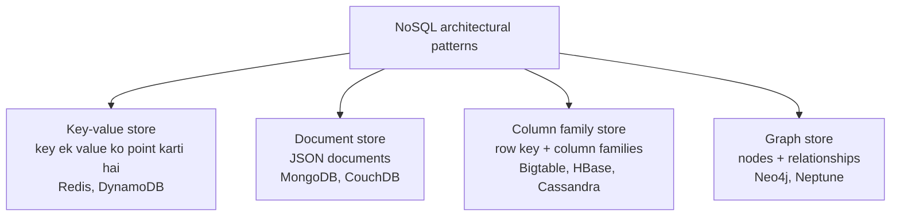

**Ek line mein:** <mark>NoSQL ke chaar architectural patterns key-value, document, column family aur graph stores hain, aur ye is baat mein alag hain ki woh data kis shape mein rakhte hain aur kaunse sawaal sabse achhe se solve karte hain</mark>. <Cite id="nosql-patterns-gfg-types" /> <Cite id="nosql-intro-ibm-nosql" />

<Box kind="key">

**NoSQL patterns, unki comparison aur variations ke question mein ye points likho:**

- <mark>Key-value: unique key ek opaque value ko point karti hai; sirf key se get, put, delete</mark>.
- <mark>Document: self-describing JSON documents jinhe kisi bhi field se query kar sakte hain</mark>.
- <mark>Column family: row key aur column families, sparse aur wide tables, timestamped versions</mark>.
- <mark>Graph: nodes, relationships (edges) aur properties; relationships seedhe follow hoti hain, joins nahi</mark>.
- Examples: **Redis aur DynamoDB, MongoDB, Cassandra, HBase aur Bigtable, Neo4j**.
- **Variations**: in-memory versus persistent key-value, ordered key-value, JSON versus XML documents, master-based versus peer-to-peer column stores, property graph versus RDF triples, multi-model databases, polyglot use.
- Data se aap **mukhya sawaal** kaunsa poochte ho uske hisaab se chuno.

</Box>

## Core answer (5 marks, yahan ke har question ke liye)

<Box kind="definition">

A **NoSQL architectural pattern** is the basic shape in which a NoSQL database stores data. Key-value, document and column family stores keep one **aggregate** (a bundle of related data read and written together) on one node, so a query rarely needs many machines. <Cite id="big-data-intro-nosql" /> <Cite id="nosql-intro-fowler-agg" />

</Box>



<Cite id="nosql-patterns-gfg-types" loc="diagram" /> <Cite id="nosql-intro-ibm-nosql" loc="diagram" />

| Point | Key-value | Document | Column family | Graph |
|---|---|---|---|---|
| Data shape | Key se opaque value | Self-describing JSON/XML document | Row key, column families, timestamped cells | Nodes, edges, properties |
| Query kaise | Sirf key se | Key aur kisi bhi field se | Row key (aur column ranges) | Relationships ke saath traversal |
| Schema | Nahi | Flexible | Families fixed, columns flexible | Flexible |
| Relationships | Nahi | Nested data ya references | Nahi (queries ke liye design) | First-class aur fast |
| Scale out | Bahut aasaan | Aasaan (sharding) | Bahut aasaan | Mushkil |
| Best for | Cache, sessions, carts | Catalogues, profiles, content | Bahut bada sparse data, time series, logs | Social, fraud, recommendations |
| Kamzor | Values ke andar search | Joins, heavy transactions | Ad-hoc queries | Bulk aggregate storage |
| Examples | Redis, DynamoDB, Riak | MongoDB, CouchDB | Bigtable, HBase, Cassandra | Neo4j, Neptune |

<Cite id="nosql-patterns-gfg-types" /> <Cite id="nosql-patterns-tp-cass" /> <Cite id="nosql-patterns-aws-graph" />

**Conclusion:** <mark>chaaron patterns alag-alag tarike se query power ko scale ke badle mein dete hain; access pattern ke hisaab se chuno aur ek kaafi na ho to milake use karo</mark>.

## Extended answer (10 marks): ye add karo

### 1. Key-value store

Bahut saari machines pe phaila hua ek bada dictionary ya hash table. Har item ki ek **unique key** aur ek **value** hoti hai; database value ke andar nahi dekhta. Sirf teen operations chahiye: `put(key, value)`, `get(key)` aur `delete(key)`. Key ko hash karke node chuna jata hai, aur copies doosre nodes pe jati hain. <Cite id="nosql-patterns-aws-kv" /> <Cite id="nosql-patterns-redis-kv" /> <Cite id="nosql-patterns-gfg-kv" />

- **Benefits:** bahut fast (ek lookup, joins nahi), scale out aasaan, high availability, fixed schema nahi, low cost.
- **Limits:** sirf key se data milta hai, relationships nahi, poori value padhni aur likhni padti hai.
- **Use cases:** sessions, shopping carts, user preferences, caching, leaderboards. **Examples:** Redis, DynamoDB, Riak, Memcached. <Cite id="nosql-patterns-aws-dynamo" />


### 2. Document store

Har record ek **document** hota hai, aam taur pe JSON, jisme apne field names, nested fields aur lists hote hain. Database **andar dekh sakta hai**, isliye kisi bhi field se search aur update ho sakta hai. Documents ka group **collection** hai, par usme documents ke same fields hone zaroori nahi. Ek customer ek hi document mein hota hai, isliye join nahi. <Cite id="nosql-patterns-mongo-doc" /> <Cite id="nosql-patterns-aws-doc" /> <Cite id="nosql-patterns-gfg-doc" />

```json
{
  "_id": 1,
  "customer": { "name": "Asha", "city": "Mumbai" },
  "items": [ { "product": "Book", "qty": 2 }, { "product": "Pen", "qty": 5 } ]
}
```

- **Advantages:** code ke objects se match, aam case mein joins nahi, badalna aasaan, sharding se scale.
- **Disadvantages:** repeated data har jagah update karna padta hai, joins aur multi-document transactions kamzor, size limit (MongoDB mein 16 MB). <Cite id="nosql-patterns-mongo-model" />
- **Use cases:** catalogues, profiles, content management, mobile back ends. **Examples:** MongoDB, CouchDB.


### 3. Column family store

Data **(row key, column key, timestamp)** se value tak ka sparse, distributed, sorted map hai; column key `family:qualifier` hoti hai. Columns **column families** mein group hote hain jo saath store hote hain, aur alag rows ke alag columns ho sakte hain, isliye khali cells jagah nahi lete. Rows row key se ranges mein bantti hain jo alag nodes serve karte hain. <Cite id="nosql-intro-bigtable" /> <Cite id="nosql-patterns-wiki-wide" /> <Cite id="nosql-patterns-gfg-col" />

| Row key | profile:name | profile:city | profile:phone | orders:o1 |
|---|---|---|---|---|
| user101 | Asha | Mumbai | (khali) | Book |
| user102 | Ravi | (khali) | 98xxx | (khali) |

- **Advantages:** hazaron commodity nodes pe petabytes, bahut high write speed, jagah waste nahi, time series aur logs ke liye achha.
- **Disadvantages:** ad-hoc queries aur joins ke liye kharab, table apni queries ke liye design karni padti hai.
- **Examples:** Bigtable, HBase, Cassandra. <Cite id="nosql-intro-hbase" /> <Cite id="nosql-patterns-cass-model" /> <Cite id="web-bda-1-hbase-book" />


### 4. Graph store

Data ek **graph** hai: **nodes** (cheezein), **relationships** ya edges (FRIEND_OF, BOUGHT) aur **properties** (name, date). Relationships asli links ki tarah store hoti hain, isliye database joins compute karne ki jagah unhe seedha follow karta hai. Friend-suggestion query mein Asha se shuru karo, do FRIEND_OF hops lo, existing friends hatao aur mutual friends se rank karo; RDBMS ko har hop ke liye self-join chahiye. <Cite id="nosql-patterns-neo4j-model" /> <Cite id="nosql-patterns-aws-graph" /> <Cite id="nosql-patterns-wiki-graph" />

- **Advantages:** deep connected queries pe fast, real world se match, nayi relationship types jodna aasaan.
- **Disadvantages:** machines pe shard karna mushkil, bulk aggregate reports ke liye kharab, kam tools.
- **Use cases:** social networks, recommendations, fraud detection, route finding. **Examples:** Neo4j, Amazon Neptune, JanusGraph.


### 5. Patterns ki variations

- **Key-value:** in-memory stores aur caches (Redis, Memcached) speed ke liye durability chhodte hain; persistent stores (DynamoDB, Riak) disk pe likhte hain; **ordered** key-value stores range scans ke liye keys sorted rakhte hain; Redis ki values list, set ya hash ho sakti hain, isliye woh document store ke kareeb hai. <Cite id="nosql-patterns-redis-data" />
- **Document:** JSON stores (MongoDB, CouchDB), native XML stores, aur woh stores jo multi-document transactions ya search add karte hain.
- **Column family:** master wale Bigtable-style tables (HBase) versus peer-to-peer Dynamo-style rings tunable consistency ke saath (Cassandra).
- **Graph:** property graphs (Neo4j) versus **RDF triple stores** (subject, predicate, object) jo semantic web mein use hote hain.
- **Multi-model databases:** ek product kai patterns saath deta hai.
- **Polyglot persistence:** application har zaroorat ke liye alag store use karti hai. <Cite id="nosql-intro-fowler-poly" />

### 6. Kaise chunein

"Is id ki cheez do", bahut fast: **key-value**. "In fields se match karne wale records do": **document**. "Bahut saare nodes pe bahut bada sparse data store karo": **column family**. "Ye cheezein kaise connected hain?": **graph**.

## Har question mein kaise fit karein

- **"Explain the four types of NoSQL database."** (10 marks) <PYQ id="2023-12/q2b" />: core diagram, phir **section 1 se 4** (definition, working, advantages, use case, example product, har ki picture), aur table ko closing summary ki tarah.
- **"Compare different types of NoSQL architectural pattern."** (10 marks) <PYQ id="2024-12/q3b" />: har pattern pe ek line, phir **comparison table** (saari 8 rows), chhota **kaise chunein** (section 6) aur conclusion.
- **"Write a short note on variations of NoSQL architectural patterns."** (10 marks) <PYQ id="2025-05-ce/q2b" />: chaar base patterns do line mein diagram ke saath, phir **section 5** poora (har pattern ki variations, multi-model, polyglot), aur kaise-chunein ki line.

## Exam tips

- **Hamesha draw karo** chaar-branch pattern diagram aur har branch ka ek **product name** do.
- "Compare" ke liye **table likho**; "explain four types" ke liye har type pe **definition, working, advantages, example** likho.
- Variations ke answer mein **polyglot persistence** aur **multi-model** databases pe zor do; ye do points bahut students chhod dete hain.
