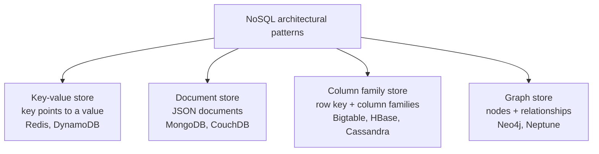

**In one line:** <mark>The four NoSQL architectural patterns are key-value, document, column family and graph stores, and they differ in the shape of the data they store and the questions they answer best</mark>. <Cite id="nosql-patterns-gfg-types" /> <Cite id="nosql-intro-ibm-nosql" />

<Box kind="key">

**Key points to write (NoSQL patterns, their comparison and variations):**

- <mark>Key-value: a unique key points to an opaque value; get, put, delete by key only</mark>.
- <mark>Document: self-describing JSON documents that can be queried by any field</mark>.
- <mark>Column family: row key plus column families, sparse and wide tables, timestamped versions</mark>.
- <mark>Graph: nodes, relationships (edges) and properties; relationships are followed directly, with no joins</mark>.
- Examples: **Redis and DynamoDB, MongoDB, Cassandra, HBase and Bigtable, Neo4j**.
- **Variations**: in-memory versus persistent key-value, ordered key-value, JSON versus XML documents, master-based versus peer-to-peer column stores, property graph versus RDF triples, multi-model databases, polyglot use.
- Choose by the **main question** you ask the data.

</Box>

## Core answer (5 marks, fits every question here)

<Box kind="definition">

A **NoSQL architectural pattern** is the basic shape in which a NoSQL database stores data. Key-value, document and column family stores keep one **aggregate** (a bundle of related data read and written together) on one node, so a query rarely needs many machines. <Cite id="big-data-intro-nosql" /> <Cite id="nosql-intro-fowler-agg" />

</Box>



<Cite id="nosql-patterns-gfg-types" loc="diagram" /> <Cite id="nosql-intro-ibm-nosql" loc="diagram" />

| Point | Key-value | Document | Column family | Graph |
|---|---|---|---|---|
| Data shape | Key to opaque value | Self-describing JSON/XML document | Row key, column families, timestamped cells | Nodes, edges, properties |
| Query by | Key only | Key and any field | Row key (and column ranges) | Traversal along relationships |
| Schema | None | Flexible | Families fixed, columns flexible | Flexible |
| Relationships | None | Nested data or references | None (design for queries) | First-class and fast |
| Scales out | Very easily | Easily (sharding) | Very easily | Hard |
| Best for | Cache, sessions, carts | Catalogues, profiles, content | Huge sparse data, time series, logs | Social, fraud, recommendations |
| Weak at | Searching inside values | Joins, heavy transactions | Ad-hoc queries | Bulk aggregate storage |
| Examples | Redis, DynamoDB, Riak | MongoDB, CouchDB | Bigtable, HBase, Cassandra | Neo4j, Neptune |

<Cite id="nosql-patterns-gfg-types" /> <Cite id="nosql-patterns-tp-cass" /> <Cite id="nosql-patterns-aws-graph" />

**Conclusion:** <mark>the four patterns trade query power for scale in different ways; pick by the access pattern and combine them when one is not enough</mark>.

## Extended answer (10 marks): add these

### 1. Key-value store

A giant dictionary or hash table spread over many machines. Every item has a **unique key** and a **value**; the database does not look inside the value. Only three operations are needed: `put(key, value)`, `get(key)` and `delete(key)`. The key is hashed to choose the node, and copies go to other nodes. <Cite id="nosql-patterns-aws-kv" /> <Cite id="nosql-patterns-redis-kv" /> <Cite id="nosql-patterns-gfg-kv" />

- **Benefits:** very fast (one lookup, no joins), easy to scale out, highly available, no fixed schema, low cost.
- **Limits:** find data by key only, no relationships, whole value read and written.
- **Use cases:** sessions, shopping carts, user preferences, caching, leaderboards. **Examples:** Redis, DynamoDB, Riak, Memcached. <Cite id="nosql-patterns-aws-dynamo" />


### 2. Document store

Each record is a **document**, usually JSON, carrying its own field names with nested fields and lists. The database **can look inside**, so you can search and update by any field. A group of documents is a **collection**, but documents in it need not share fields. One customer lives in one document, so there is no join. <Cite id="nosql-patterns-mongo-doc" /> <Cite id="nosql-patterns-aws-doc" /> <Cite id="nosql-patterns-gfg-doc" />

```json
{
  "_id": 1,
  "customer": { "name": "Asha", "city": "Mumbai" },
  "items": [ { "product": "Book", "qty": 2 }, { "product": "Pen", "qty": 5 } ]
}
```

- **Advantages:** matches objects in code, no joins for the common case, easy to change, scales by sharding.
- **Disadvantages:** repeated data must be updated everywhere, weaker joins and multi-document transactions, size limit (16 MB in MongoDB). <Cite id="nosql-patterns-mongo-model" />
- **Use cases:** catalogues, profiles, content management, mobile back ends. **Examples:** MongoDB, CouchDB.


### 3. Column family store

Data is a sparse, distributed, sorted map from **(row key, column key, timestamp)** to a value; the column key is `family:qualifier`. Columns are grouped into **column families** stored together, and different rows may have different columns, so empty cells use no space. Rows are split by row key into ranges served by different nodes. <Cite id="nosql-intro-bigtable" /> <Cite id="nosql-patterns-wiki-wide" /> <Cite id="nosql-patterns-gfg-col" />

| Row key | profile:name | profile:city | profile:phone | orders:o1 |
|---|---|---|---|---|
| user101 | Asha | Mumbai | (empty) | Book |
| user102 | Ravi | (empty) | 98xxx | (empty) |

- **Advantages:** petabytes over thousands of commodity nodes, very high write speed, no wasted space, good for time series and logs.
- **Disadvantages:** poor for ad-hoc queries and joins, you design the table for your queries.
- **Examples:** Bigtable, HBase, Cassandra. <Cite id="nosql-intro-hbase" /> <Cite id="nosql-patterns-cass-model" /> <Cite id="web-bda-1-hbase-book" />


### 4. Graph store

Data is a **graph**: **nodes** (things), **relationships** or edges (FRIEND_OF, BOUGHT) and **properties** (name, date). Relationships are stored as real links, so the database follows them directly instead of computing joins. In a friend-suggestion query, start at Asha, take two FRIEND_OF hops, remove existing friends and rank by mutual friends; an RDBMS needs a self-join for every hop. <Cite id="nosql-patterns-neo4j-model" /> <Cite id="nosql-patterns-aws-graph" /> <Cite id="nosql-patterns-wiki-graph" />

- **Advantages:** fast on deep connected queries, matches the real world, easy to add relationship types.
- **Disadvantages:** hard to shard across machines, poor for bulk aggregate reports, fewer tools.
- **Use cases:** social networks, recommendations, fraud detection, route finding. **Examples:** Neo4j, Amazon Neptune, JanusGraph.


### 5. Variations of the patterns

- **Key-value:** in-memory stores and caches (Redis, Memcached) trade durability for speed; persistent stores (DynamoDB, Riak) write to disk; **ordered** key-value stores keep keys sorted for range scans; Redis values can be lists, sets or hashes, so it is close to a document store. <Cite id="nosql-patterns-redis-data" />
- **Document:** JSON stores (MongoDB, CouchDB), native XML stores, and stores adding multi-document transactions or search.
- **Column family:** Bigtable-style tables with a master (HBase) versus peer-to-peer Dynamo-style rings with tunable consistency (Cassandra).
- **Graph:** property graphs (Neo4j) versus **RDF triple stores** (subject, predicate, object) used for the semantic web.
- **Multi-model databases:** one product offers several patterns together.
- **Polyglot persistence:** an application uses a different store for each need. <Cite id="nosql-intro-fowler-poly" />

### 6. How to choose

"Give me the thing for this id", very fast: **key-value**. "Give me records matching these fields": **document**. "Store enormous sparse data over many nodes": **column family**. "How are these things connected?": **graph**.

## Fit it to each question

- **"Explain the four types of NoSQL database."** (10 marks) <PYQ id="2023-12/q2b" />: the core diagram, then **sections 1 to 4** (definition, how it works, advantages, use case, example product, picture for each), and the table as the closing summary.
- **"Compare different types of NoSQL architectural pattern."** (10 marks) <PYQ id="2024-12/q3b" />: one line on each pattern, then the **comparison table** (all 8 rows), a short **how to choose** (section 6) and the conclusion.
- **"Write a short note on variations of NoSQL architectural patterns."** (10 marks) <PYQ id="2025-05-ce/q2b" />: name the four base patterns in two lines with the diagram, then **section 5** in full (variations per pattern, multi-model, polyglot), and the how-to-choose line.

## Exam tips

- **Always draw** the four-branch pattern diagram and give one **product name** for each branch.
- For "compare", **write a table**; for "explain four types", write **definition, working, advantages, example** per type.
- In the variations answer, stress **polyglot persistence** and **multi-model** databases; they are the two points many students miss.
