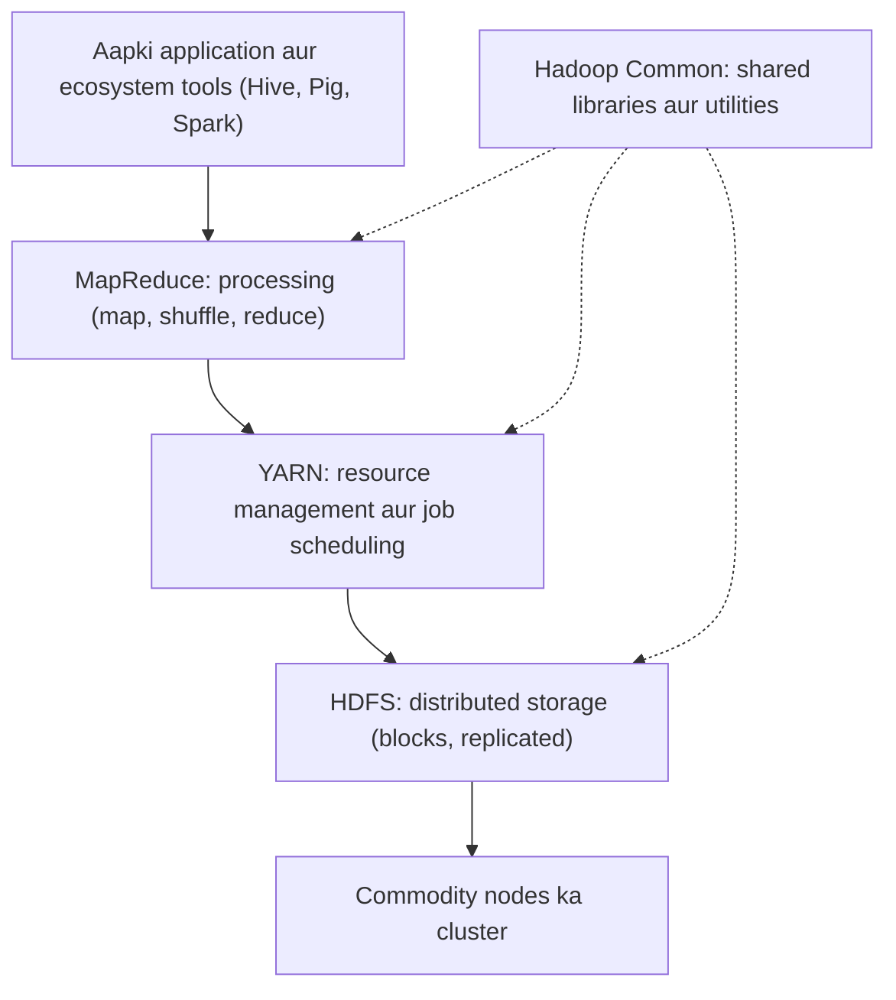
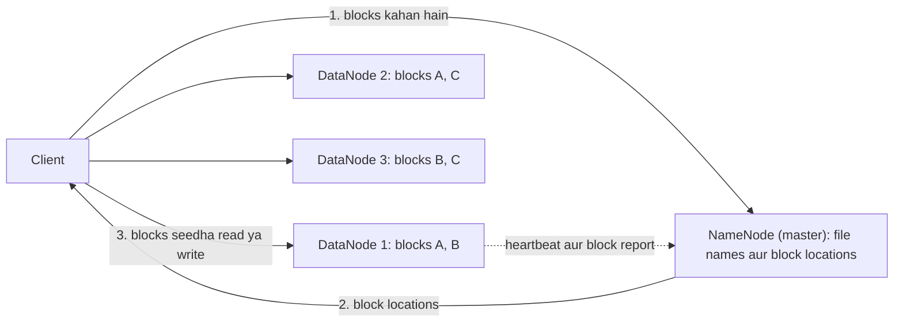

**Ek line mein:** <mark>Hadoop ek open-source framework hai jo bahut bada data commodity computers ke cluster pe store karta hai (HDFS) aur parallel process karta hai (MapReduce), aur YARN resources manage karta hai</mark>. <Cite id="hadoop-ecosystem-apache-hadoop" /> <Cite id="hadoop-ecosystem-ibm-hadoop" />

<Box kind="key">

**Hadoop kya hai, core components, architecture ke question mein ye points likho:**

- <mark>Hadoop = open-source Java framework, commodity hardware pe distributed storage aur parallel processing ke liye</mark>; Google ke GFS aur MapReduce papers pe based.
- <mark>Chaar core modules: Hadoop Common, HDFS, YARN, MapReduce</mark>.
- <mark>HDFS: master NameNode (metadata) aur slave DataNodes (blocks); block 128 MB, replication 3</mark>.
- <mark>MapReduce: map key-value pairs banata hai, shuffle aur sort unhe group karta hai, reduce combine karta hai</mark>.
- <mark>Data locality: program ko data ke paas bhejo, data ko program ke paas nahi</mark>.
- Strengths: **scalable, cheap, fault tolerant, flexible**.
- HDFS aur MapReduce dono **master-slave** hain.

</Box>

## Core answer (5 marks, yahan ke har question ke liye)

<Box kind="definition">

**Apache Hadoop** is a free, open-source framework, written in Java, for **storing** very large data sets across a cluster of commodity computers and **processing** them in parallel. Its design comes from two Google papers: the Google File System and MapReduce. <Cite id="hadoop-ecosystem-apache-hadoop" /> <Cite id="hadoop-ecosystem-ghemawat2003" /> <Cite id="hadoop-ecosystem-dean2004" /> <Cite id="hadoop-ecosystem-wiki-hadoop" />

</Box>

**Kyun chahiye:** ek machine terabytes store nahi kar sakti, ek disk se padhne mein ghante lagte hain, aur bada special machine bahut mehnga aur single point of failure hota hai. Hadoop ki jagah bahut saari cheap machines use karta hai. <Cite id="hadoop-ecosystem-ibm-hadoop" /> <Cite id="hadoop-ecosystem-gfg-hadoop-intro" />

**Core components:** <Cite id="hadoop-ecosystem-apache-hadoop" />

1. **Hadoop Common:** shared libraries aur utilities.
2. **HDFS:** storage layer.
3. **YARN:** resource management aur scheduling layer.
4. **MapReduce:** processing layer.

<Cite id="hadoop-ecosystem-gfg-hadoop-arch" loc="diagram" />

**Kyun important hai:** <mark>Hadoop scalable hai (nodes add karo), low cost hai (commodity hardware), fault tolerant hai (har block ki 3 copies) aur flexible hai (koi bhi data type)</mark>. <Cite id="hadoop-ecosystem-aws-hadoop" />

## Extended answer (10 marks): ye add karo

### 1. HDFS: storage component

File **blocks** mein kat jati hai (default 128 MB) aur har block 3 nodes pe rakha jata hai. Write once, read many model hai. <Cite id="hdfs-apache-design" />

- **NameNode (master):** metadata rakhta hai (file names, kis DataNode pe kaunsa block). Data store nahi karta.
- **DataNodes (slaves):** blocks store karte hain aur NameNode ko **heartbeats** aur **block reports** bhejte hain.
- **Replication:** copy 1 writer ke node pe, copy 2 doosre rack pe, copy 3 usi rack ke doosre node pe, isliye poora rack jaane pe bhi data nahi jata.

<Cite id="hadoop-ecosystem-apache-hdfs-design" loc="diagram" />

### 2. MapReduce: processing component

1. **Input split:** input splits mein bantta hai, har split pe ek map task, jo block wale node pe chalta hai (data locality).
2. **Map:** key-value pairs emit karta hai, jaise (to,1), (be,1).
3. **Shuffle aur sort:** same key wale pairs ek hi reducer ke paas jate hain, key se sorted. Optional **combiner** map side pe pehle counts add kar deta hai.
4. **Reduce:** ek key ki values combine karta hai, jaise (to, [1,1]) se (to, 2).
5. **Output** HDFS mein likha jata hai.

<Cite id="hadoop-ecosystem-apache-mr-tutorial" loc="Overview" />

### 3. YARN (Hadoop 2 se)

**ResourceManager** (master) CPU aur memory baantta hai, **NodeManager** (har node pe) containers chalata hai, **ApplicationMaster** (har job ka) job ke tasks chalata hai. Hadoop 1 mein ye kaam akela **JobTracker** aur **TaskTrackers** karte the, par JobTracker bottleneck tha. <Cite id="hadoop-ecosystem-apache-yarn" />

| Component | Master | Worker | Kaam |
|---|---|---|---|
| HDFS | NameNode | DataNode | Data store aur replicate karna |
| MapReduce (YARN pe) | ResourceManager aur per-job ApplicationMaster | NodeManager jo map aur reduce tasks chalata hai | Data ko parallel process karna |

### 4. Hadoop big data problems kaise handle karta hai

| Big data problem | Hadoop ka jawab |
|---|---|
| Ek disk ke liye data bahut zyada (volume) | HDFS files ko blocks mein kaat ke bahut nodes pe baantta hai; nodes badhao to space badhta hai |
| Processing bahut slow | MapReduce bahut saare chhote tasks parallel chalata hai |
| Bada data network pe move karna slow | Data locality: chhota program data ke paas bhejo |
| Machines baar baar fail hoti hain | Har block ki 3 copies; failed tasks doosre nodes pe dobara chalte hain |
| Bahut data formats (variety) | Files jaisi hain waisi store, structure padhte waqt (schema on read) |
| High cost | Commodity hardware aur open-source software |
| Tez arrival (velocity) | Flume streams ko HDFS mein laata hai, Spark tez process karta hai |

<Cite id="hadoop-ecosystem-apache-hdfs-design" loc="Data Replication" />

## Har question mein kaise fit karein

- **"What are the Core Hadoop components? Explain in detail."** (10 marks) <PYQ id="2022-12-ce/q4a" />: core answer layered diagram ke saath, phir section 1, 2 aur 3.
- **"What is Hadoop and Why it Matters."** (5 marks) <PYQ id="2023-12/q1a" />: definition, kyun chahiye, chaar core components, "why it matters" line (scalable, cheap, fault tolerant, flexible). HDFS ki detail nahi chahiye.
- **"Explain how big data problems are handled by Hadoop system."** (5 marks) <PYQ id="2024-05-ce/q1a" />: Hadoop pe ek line, phir **section 4 table** (problem aur Hadoop ka jawab); layered diagram add karo.
- **"Explain Hadoop Architectural Model with both components in detail."** (10 marks) <PYQ id="2024-12/q4a" />: "both components" ka matlab **HDFS (storage) aur MapReduce (processing)**: section 1 aur 2 unke diagrams ke saath, master-slave table, aur YARN pe ek line.

## Exam tips

- **Hamesha draw karo** layered core diagram, aur architecture ke liye HDFS NameNode aur DataNode ka diagram.
- HDFS aur MapReduce dono ke liye **"master-slave"** likho aur har ek ka master aur slave naam se batao.
- Numbers yaad rakho: **block 128 MB, replication 3**.
