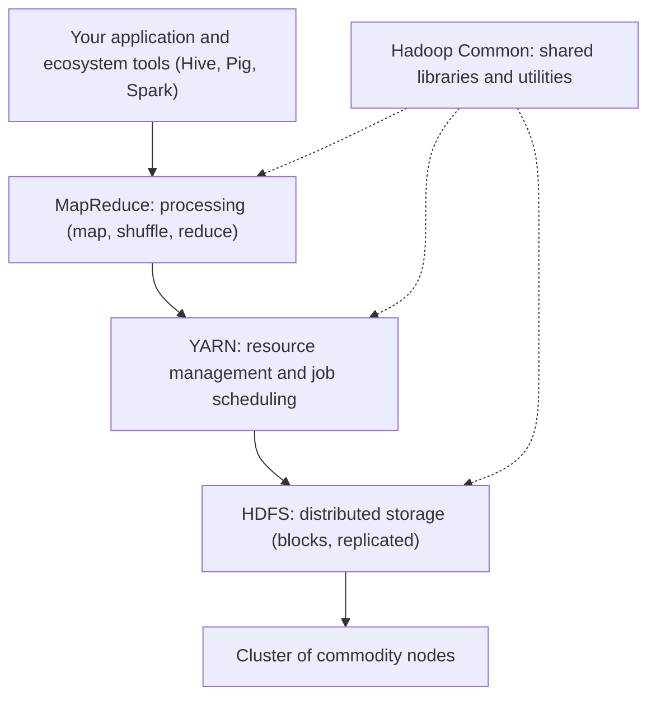
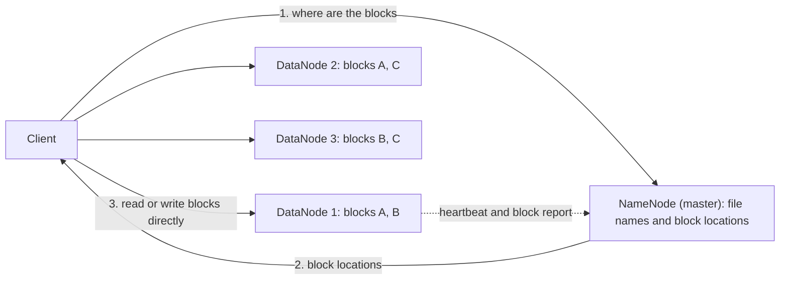

**In one line:** <mark>Hadoop is an open-source framework that stores very large data across a cluster of commodity computers (HDFS) and processes it in parallel (MapReduce), with YARN managing resources</mark>. <Cite id="hadoop-ecosystem-apache-hadoop" /> <Cite id="hadoop-ecosystem-ibm-hadoop" />

<Box kind="key">

**Key points to write (what is Hadoop, core components, architecture):**

- <mark>Hadoop = open-source Java framework for distributed storage and parallel processing on commodity hardware</mark>; based on Google's GFS and MapReduce papers.
- <mark>Four core modules: Hadoop Common, HDFS, YARN, MapReduce</mark>.
- <mark>HDFS: master NameNode (metadata) and slave DataNodes (blocks); block 128 MB, replication 3</mark>.
- <mark>MapReduce: map makes key-value pairs, shuffle and sort groups them, reduce combines them</mark>.
- <mark>Data locality: move the program to the data, not the data to the program</mark>.
- Strengths: **scalable, cheap, fault tolerant, flexible**.
- Both HDFS and MapReduce are **master-slave**.

</Box>

## Core answer (5 marks, fits every question here)

<Box kind="definition">

**Apache Hadoop** is a free, open-source framework, written in Java, for **storing** very large data sets across a cluster of commodity computers and **processing** them in parallel. Its design comes from two Google papers: the Google File System and MapReduce. <Cite id="hadoop-ecosystem-apache-hadoop" /> <Cite id="hadoop-ecosystem-ghemawat2003" /> <Cite id="hadoop-ecosystem-dean2004" /> <Cite id="hadoop-ecosystem-wiki-hadoop" />

</Box>

**Why it is needed:** one machine cannot store terabytes, reading them through one disk takes hours, and a big special machine is very costly and a single point of failure. Hadoop uses many cheap machines instead. <Cite id="hadoop-ecosystem-ibm-hadoop" /> <Cite id="hadoop-ecosystem-gfg-hadoop-intro" />

**Core components:** <Cite id="hadoop-ecosystem-apache-hadoop" />

1. **Hadoop Common:** shared libraries and utilities.
2. **HDFS:** the storage layer.
3. **YARN:** the resource management and scheduling layer.
4. **MapReduce:** the processing layer.

<Cite id="hadoop-ecosystem-gfg-hadoop-arch" loc="diagram" />

**Why it matters:** <mark>Hadoop is scalable (add nodes), low cost (commodity hardware), fault tolerant (3 copies of every block) and flexible (any data type)</mark>. <Cite id="hadoop-ecosystem-aws-hadoop" />

## Extended answer (10 marks): add these

### 1. HDFS: the storage component

A file is cut into **blocks** (128 MB by default) and each block is kept on 3 nodes. It follows write once, read many. <Cite id="hdfs-apache-design" />

- **NameNode (master):** keeps metadata (file names, which DataNodes hold each block). It does not store the data.
- **DataNodes (slaves):** store the blocks and send **heartbeats** and **block reports** to the NameNode.
- **Replication:** copy 1 on the writer's node, copy 2 on another rack, copy 3 on another node in that rack, so losing a rack loses no data.

<Cite id="hadoop-ecosystem-apache-hdfs-design" loc="diagram" />

### 2. MapReduce: the processing component

1. **Input split:** input is divided into splits, one map task per split, preferably on the node holding the block (data locality).
2. **Map:** emits key-value pairs, for example (to,1), (be,1).
3. **Shuffle and sort:** pairs with the same key go to the same reducer, sorted by key. An optional **combiner** adds counts on the map side first.
4. **Reduce:** combines the values of a key, for example (to, [1,1]) becomes (to, 2).
5. **Output** is written to HDFS.

<Cite id="hadoop-ecosystem-apache-mr-tutorial" loc="Overview" />

### 3. YARN (Hadoop 2 onwards)

**ResourceManager** (master) shares CPU and memory, **NodeManager** (per node) runs containers, **ApplicationMaster** (per job) runs the job's tasks. In Hadoop 1 the single **JobTracker** and **TaskTrackers** did this, but the JobTracker was a bottleneck. <Cite id="hadoop-ecosystem-apache-yarn" />

| Component | Master | Worker | Job |
|---|---|---|---|
| HDFS | NameNode | DataNode | Store and replicate data |
| MapReduce (on YARN) | ResourceManager and per-job ApplicationMaster | NodeManager running map and reduce tasks | Process data in parallel |

### 4. How Hadoop handles big data problems

| Big data problem | How Hadoop handles it |
|---|---|
| Too much data for one disk (volume) | HDFS splits files into blocks over many nodes; add nodes to add space |
| Processing too slow | MapReduce runs many small tasks in parallel |
| Moving big data over the network is slow | Data locality: send the small program to the data |
| Machines fail often | 3 copies of every block; failed tasks are re-run on other nodes |
| Many data formats (variety) | Files stored as they are, structure applied on reading (schema on read) |
| High cost | Commodity hardware and open-source software |
| Fast arrival (velocity) | Flume brings streams into HDFS, Spark processes quickly |

<Cite id="hadoop-ecosystem-apache-hdfs-design" loc="Data Replication" />

## Fit it to each question

- **"What are the Core Hadoop components? Explain in detail."** (10 marks) <PYQ id="2022-12-ce/q4a" />: core answer with the layered diagram, then sections 1, 2 and 3.
- **"What is Hadoop and Why it Matters."** (5 marks) <PYQ id="2023-12/q1a" />: definition, why needed, the four core components, the "why it matters" line (scalable, cheap, fault tolerant, flexible). No detail of HDFS is needed.
- **"Explain how big data problems are handled by Hadoop system."** (5 marks) <PYQ id="2024-05-ce/q1a" />: one line on Hadoop and then the **section 4 table** (problem and Hadoop's answer); add the layered diagram.
- **"Explain Hadoop Architectural Model with both components in detail."** (10 marks) <PYQ id="2024-12/q4a" />: "both components" means **HDFS (storage) and MapReduce (processing)**: sections 1 and 2 with their diagrams, the master-slave table, and one line on YARN.

## Exam tips

- **Always draw** the layered core diagram, and for architecture the HDFS NameNode and DataNode diagram.
- Say **"master-slave"** for both HDFS and MapReduce and name the master and slave of each.
- Remember the numbers: **block 128 MB, replication 3**.
