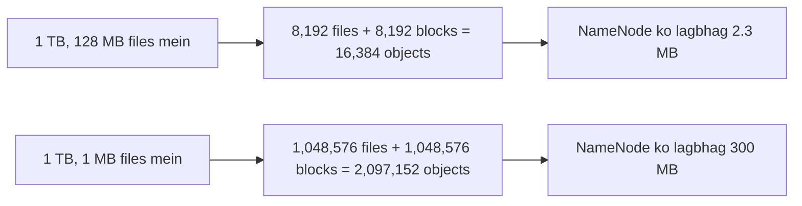

**Ek line mein:** <mark>HDFS kuch bahut bade files ko bade streams mein padhne ke liye bana hai, kyunki NameNode har file aur block ka ek object memory mein rakhta hai, isliye lakhon chhoti files use overload kar deti hain</mark>. <Cite id="hdfs-apache-design" /> <Cite id="hdfs-cloudera-small" />

<Box kind="key">

**HDFS mein large files versus small files ke question mein ye points likho:**

- <mark>Block size bada hai (128 MB), isliye bada file kai blocks mein banta hai jo parallel padhe jate hain</mark>.
- <mark>NameNode har file, directory aur block ka metadata RAM mein rakhta hai (lagbhag 150 bytes har ek)</mark>.
- <mark>Lakhon chhoti files NameNode memory khatam kar deti hain aur wahi bottleneck ban jata hai</mark>.
- <mark>Har chhoti file ko apna map task aur apna seek chahiye, isliye job kaam se zyada start hone mein time lagati hai</mark>.
- HDFS **write once, read many** hai, **streaming, high-throughput** access ke liye, low-latency ke liye nahi.
- Fix: **chhoti files pack karo** (SequenceFile, HAR archive, load se pehle merge).

</Box>

## Core answer (5 marks, yahan ke har question ke liye)

<Box kind="definition">

**HDFS** stores a file as large blocks (128 MB by default) spread over many DataNodes, with one NameNode holding the metadata of every file and block in memory. It is designed for very large files that are written once and read many times in big sequential streams. <Cite id="hdfs-apache-design" />

</Box>

**Bade files kyun fit hain:**

- Bada file kai blocks banata hai jo bahut machines **parallel** padhti hain, isliye read speed jud jati hai.
- Bade blocks matlab per terabyte **kam metadata** aur **kam seeks**.
- Write once, read many aur streaming access MapReduce jaise batch jobs ko suit karte hain, jinke tasks blocks ke paas chalte hain. <Cite id="hdfs-apache-mr" />

**Chhoti files problem kyun hain:**

- Har file, directory aur block **NameNode RAM mein ek object** hai, lagbhag 150 bytes (rule of thumb). Ek crore one-block files ko lagbhag 3 GB RAM chahiye, aur ek arab files practical nahi. <Cite id="hdfs-cloudera-small" />
- 1 MB ki file disk pe poora 128 MB waste nahi karti, lekin ek metadata entry aur ek block record to leti hi hai.
- Bahut saari chhoti files matlab bahut NameNode requests aur bahut chhote tasks, isliye start-up time hi zyada ho jata hai.

<Cite id="hdfs-cloudera-small" loc="diagram" />

**Conclusion:** <mark>HDFS kam bade files pe high throughput deta hai, aur bahut chhoti files ya low-latency access ke liye kharab choice hai</mark>.

## Extended answer (10 marks): ye add karo

### 1. Worked example: NameNode memory

<Sum>

<Given>

Memory cost is about 150 bytes for each file and each block object (rule of thumb). Store 1 TB $= 1{,}048{,}576$ MB, once as 128 MB files and once as 1 MB files, each file one block. Ignore directories.

</Given>

<Find>

NameNode memory in each case and the ratio.

</Find>

<Steps>

1. **128 MB files.** Files $= 1{,}048{,}576 \div 128 = 8{,}192$. *Reason: total size divided by file size.*
2. Objects $= 8{,}192 + 8{,}192 = 16{,}384$ (a file object and a block object per file). Memory $= 16{,}384 \times 150 = 2{,}457{,}600$ bytes, about 2.3 MB.
3. **1 MB files.** Files $= 1{,}048{,}576$. Objects $= 2{,}097{,}152$. Memory $= 2{,}097{,}152 \times 150 = 314{,}572{,}800$ bytes $= 300$ MB.
4. Ratio $= 2{,}097{,}152 \div 16{,}384 = 128$.

</Steps>

<Answer>

About 2.3 MB for 128 MB files and 300 MB for 1 MB files: 128 times more for the same 1 TB.

</Answer>

<Box kind="verify">

The file counts differ by $1{,}048{,}576 \div 8{,}192 = 128$, which equals $128 \text{ MB} \div 1 \text{ MB}$, so memory must scale by 128. The 150-byte figure is a rule of thumb from <Cite id="hdfs-cloudera-small" />, not an exact number.

</Box>

</Sum>

### 2. Large versus small files

| Point | Kam bade files | Bahut chhoti files |
|---|---|---|
| NameNode memory | Kam | Bahut zyada |
| Read speed | Parallel blocks, high throughput | Bahut seeks aur requests |
| MapReduce tasks | Har block pe ek, kaam lamba | Har file pe ek, zyadatar start-up time |
| Disk waste | Lagbhag nahi | Disk pe nahi, lekin metadata bhari |

### 3. Small files ke fixes

- HDFS mein load karne se pehle chhoti files **merge** karo.
- **SequenceFile** ya **HAR (Hadoop Archive)** bahut chhoti files ko ek bade file mein pack karte hain.
- Chhote records ke liye bana store use karo, jaise HBase.

### 4. HDFS ki doosri limitations

| Limitation | Kyun |
|---|---|
| Low-latency access nahi | Throughput ke liye bana hai, har read pehle NameNode se puchta hai |
| Random edits nahi | Write once, read many; sirf append |
| NameNode single point of failure (HA ke bina) | Ek master saara metadata rakhta hai |
| 3x storage overhead | Replication disk teen guna kar deta hai (Hadoop 3 ka erasure coding ise kam karta hai) <Cite id="web-bda-1-hdfs-erasure-coding" /> |

## Har question mein kaise fit karein

- **"Why is HDFS more suited for applications having large datasets and not when there are small files? Elaborate."** (5 marks) <PYQ id="2022-12-ce/q1c" />: core answer (bade files kyun fit, chhoti files problem kyun, diagram). Lamba answer chahiye to section 1 (memory sum) aur section 3 ke fixes add karo.

## Exam tips

- **Reason do**, sirf "HDFS bade files ke liye hai" mat likho: "NameNode har file ka metadata RAM mein rakhta hai".
- **Numbers** likho: block 128 MB, har object lagbhag 150 bytes.
- End mein **fix** likho (merge ya SequenceFile ya HAR); isse depth dikhti hai.
