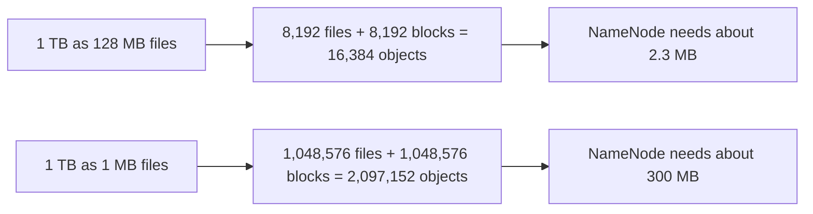

**In one line:** <mark>HDFS is built for a few very large files read in big streams, because the NameNode keeps one object in memory for every file and block, so millions of small files overload it</mark>. <Cite id="hdfs-apache-design" /> <Cite id="hdfs-cloudera-small" />

<Box kind="key">

**Key points to write (large files versus small files in HDFS):**

- <mark>Block size is large (128 MB), so a big file becomes many blocks read in parallel</mark>.
- <mark>NameNode keeps metadata of every file, directory and block in RAM (about 150 bytes each)</mark>.
- <mark>Millions of small files exhaust NameNode memory and make it the bottleneck</mark>.
- <mark>Each small file also needs its own map task and its own seek, so jobs spend more time starting than working</mark>.
- HDFS is **write once, read many** with **streaming, high-throughput** access, not low-latency access.
- Fix: **pack small files** (SequenceFile, HAR archive, merge before loading).

</Box>

## Core answer (5 marks, fits every question here)

<Box kind="definition">

**HDFS** stores a file as large blocks (128 MB by default) spread over many DataNodes, with one NameNode holding the metadata of every file and block in memory. It is designed for very large files that are written once and read many times in big sequential streams. <Cite id="hdfs-apache-design" />

</Box>

**Why large files fit:**

- A big file becomes many blocks that many machines read **in parallel**, so the read speed adds up.
- Big blocks mean **little metadata** per terabyte and **few seeks**.
- Write once, read many and streaming access suit batch jobs such as MapReduce, which run tasks next to the blocks. <Cite id="hdfs-apache-mr" />

**Why small files are a problem:**

- Every file, directory and block is an **object in NameNode RAM**, about 150 bytes each (a rule of thumb). Ten million one-block files need about 3 GB of RAM, and a billion files is not practical. <Cite id="hdfs-cloudera-small" />
- A 1 MB file does not waste a full 128 MB on disk, but it still costs one metadata entry and one block record.
- Many small files mean many NameNode requests and many short tasks, so start-up time dominates.

<Cite id="hdfs-cloudera-small" loc="diagram" />

**Conclusion:** <mark>HDFS gives high throughput on few large files, and it is a poor choice for many small files or low-latency access</mark>.

## Extended answer (10 marks): add these

### 1. Worked example: NameNode memory

<Sum>

<Given>

Memory cost is about 150 bytes for each file and each block object (rule of thumb). Store 1 TB $= 1{,}048{,}576$ MB, once as 128 MB files and once as 1 MB files, each file one block. Ignore directories.

</Given>

<Find>

NameNode memory in each case and the ratio.

</Find>

<Steps>

1. **128 MB files.** Files $= 1{,}048{,}576 \div 128 = 8{,}192$. *Reason: total size divided by file size.*
2. Objects $= 8{,}192 + 8{,}192 = 16{,}384$ (a file object and a block object per file). Memory $= 16{,}384 \times 150 = 2{,}457{,}600$ bytes, about 2.3 MB.
3. **1 MB files.** Files $= 1{,}048{,}576$. Objects $= 2{,}097{,}152$. Memory $= 2{,}097{,}152 \times 150 = 314{,}572{,}800$ bytes $= 300$ MB.
4. Ratio $= 2{,}097{,}152 \div 16{,}384 = 128$.

</Steps>

<Answer>

About 2.3 MB for 128 MB files and 300 MB for 1 MB files: 128 times more for the same 1 TB.

</Answer>

<Box kind="verify">

The file counts differ by $1{,}048{,}576 \div 8{,}192 = 128$, which equals $128 \text{ MB} \div 1 \text{ MB}$, so memory must scale by 128. The 150-byte figure is a rule of thumb from <Cite id="hdfs-cloudera-small" />, not an exact number.

</Box>

</Sum>

### 2. Large versus small files

| Point | Few large files | Many small files |
|---|---|---|
| NameNode memory | Little | Very high |
| Read speed | Parallel blocks, high throughput | Many seeks and requests |
| MapReduce tasks | One per block, long useful work | One per file, mostly start-up time |
| Disk waste | Almost none | None on disk, but heavy metadata |

### 3. Fixes for small files

- **Merge** small files before loading into HDFS.
- **SequenceFile** or **HAR (Hadoop Archive)** pack many small files into one big file.
- Use a store built for small records, such as HBase.

### 4. Other limitations of HDFS

| Limitation | Why |
|---|---|
| Not for low-latency access | Built for throughput, each read first asks the NameNode |
| No random edits | Write once, read many; only append |
| NameNode single point of failure (without HA) | One master holds the metadata |
| 3x storage overhead | Replication triples the disk needed (erasure coding in Hadoop 3 reduces it) <Cite id="web-bda-1-hdfs-erasure-coding" /> |

## Fit it to each question

- **"Why is HDFS more suited for applications having large datasets and not when there are small files? Elaborate."** (5 marks) <PYQ id="2022-12-ce/q1c" />: core answer (why large files fit, why small files are a problem, the diagram). For a longer answer add section 1 (the memory sum) and the fixes in section 3.

## Exam tips

- **Give the reason**, not just "HDFS is for big files": "the NameNode keeps metadata of every file in RAM".
- Quote the **numbers**: block 128 MB, about 150 bytes per object.
- Finish with the **fix** (merge or SequenceFile or HAR); it shows depth.
