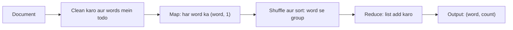

**Ek line mein:** <mark>Word count mein map har word ke liye (word, 1) emit karta hai, shuffle equal words group karta hai, aur reduce har word ke 1s add karta hai</mark>. <Cite id="hadoop-ecosystem-dean2004" loc="§2.1" /> <Cite id="mapreduce-gfg-wordcount" />

<Box kind="key">

**Word count (MapReduce) ke question mein ye points likho:**

- <mark>Key = word, value = har occurrence ke liye 1</mark>.
- <mark>Map: line ke har word w ke liye emit(w, 1)</mark>.
- <mark>Shuffle: key se group, jisse (word, [1, 1, ...]) milta hai</mark>.
- <mark>Reduce: list ka sum karke emit(word, total)</mark>.
- <mark>Combiner = reduce wala hi code</mark> (safe, kyunki addition associative hai).
- **Pehle clean karo**: lowercase karo aur punctuation hatao, taki "Apple" aur "apple" ek hi key rahein.
- **Check**: counts ka total words ki sankhya ke barabar hona chahiye.

</Box>

## Core answer (5 marks, woh method jo yahan ke har question mein chalta hai)

<Box kind="definition">

**Word count** counts how many times each word appears in a document. It is the "hello world" of MapReduce: the key is the word and the value is 1 per occurrence. <Cite id="mapreduce-gfg-wordcount" /> <Cite id="mapreduce-av" />

</Box>

**Pseudo code:** <Cite id="hadoop-ecosystem-apache-mr-tutorial" />

```text
map(offset, line):
    for each word w in line:           # lowercase it and strip punctuation
        emit(w, 1)

reduce(word, counts):
    total = 0
    for c in counts:
        total = total + c
    emit(word, total)

combiner = same as reduce             # safe, because addition is associative
```

**Har question mein ye steps follow karo:**

1. **Clean** karo: lowercase, punctuation hatao, words gino.
2. **Map:** har word ke liye ek (word, 1) likho.
3. **Shuffle aur sort:** equal words ko (word, [1, 1, ...]) mein group karo.
4. **Reduce:** har list add karo.
5. **Check:** counts ka total words ki sankhya ke barabar ho.




## Extended answer (10 marks): ek question poora solve karo

<Sum>

<Given>

Document: "Big data is powerful. Big data drives decisions." (asked in May 2025 and December 2025). Treat upper and lower case as the same and ignore full stops.

</Given>

<Find>

the count of every word, showing map output, shuffle and reduce output.

</Find>

<Steps>

1. **Clean.** `big data is powerful big data drives decisions` (8 words). *Reason: "Big" and "big" must be one key.*
2. **Map.** One (word, 1) pair per word:

   | Position | Word | Map output |
   |---|---|---|
   | 1 | big | (big, 1) |
   | 2 | data | (data, 1) |
   | 3 | is | (is, 1) |
   | 4 | powerful | (powerful, 1) |
   | 5 | big | (big, 1) |
   | 6 | data | (data, 1) |
   | 7 | drives | (drives, 1) |
   | 8 | decisions | (decisions, 1) |

3. **Shuffle and sort.** Group equal keys:

   | Key | List of values |
   |---|---|
   | big | [1, 1] |
   | data | [1, 1] |
   | decisions | [1] |
   | drives | [1] |
   | is | [1] |
   | powerful | [1] |

4. **Reduce.** Add each list: big 2, data 2, decisions 1, drives 1, is 1, powerful 1. *Reason: reduce sums the 1s of one key.*

</Steps>

<Answer>

(big, 2), (data, 2), (decisions, 1), (drives, 1), (is, 1), (powerful, 1)

</Answer>

<Box kind="verify">

The counts add up: $2 + 2 + 1 + 1 + 1 + 1 = 8$, the same as the 8 words in the cleaned text.

</Box>

</Sum>

### Doosre documents jo pooche gaye, wahi method

| Document | Words | Result |
|---|---|---|
| "This is an apple. Apple is red in color" | 9 | this 1, is 2, an 1, apple 2, red 1, in 1, color 1 (total 9) |
| "This is NoSQL. NoSQL handles complex data." | 7 | this 1, is 1, nosql 2, handles 1, complex 1, data 1 (total 7) |
| "Big data is powerful. Big data drives decisions." | 8 | big 2, data 2, is 1, powerful 1, drives 1, decisions 1 (total 8) |

### Combiner ke saath

Agar do sentences do map machines pe hain, to har machine pehle local add karti hai. Jo machine "big" do baar dekhti hai woh do (big, 1) ki jagah ek (big, 2) bhejti hai. Final answer same, network traffic kam. <Cite id="hadoop-ecosystem-mmds" loc="§2.2.4" />

### Questions kahan alag hain

- "**Illustrate with an example showing all the steps**" mein koi fixed document nahi hai: 6 se 8 words ka chhota sentence lo aur saari tables dikhao.
- Jin questions mein document diya hai, unme tables mein wahi document chahiye.

## Har question mein kaise fit karein

- **"Write a map reduce pseudo code for word count problem. Apply map reduce working on the following document: 'This is an apple. Apple is red in color'."** (10 marks) <PYQ id="2022-12-ce/q2b" />: pseudo code, phir is document (9 words) ki teen tables; upar ki table use karo.
- **"Write a map reduce pseudo code for word count problem. Illustrate with an example showing all the steps."** (10 marks) <PYQ id="2024-05-ce/q2b" />: pseudo code, phir **koi bhi chhota sentence** map, shuffle aur reduce tables aur diagram ke saath.
- **"... following document: 'This is NoSQL. NoSQL handles complex data.'"** (10 marks) <PYQ id="2024-12-ce/q2b" />: pseudo code aur 7-word trace (nosql 2, baaki 1).
- **"... following document: 'Big data is powerful. Big data drives decisions.'"** (10 marks) <PYQ id="2025-05-ce/q4a" /> <PYQ id="2025-12-ce/q2b" />: pseudo code aur upar ka solved sum, bilkul waisa hi.

## Exam tips

- **Pehle pseudo code likho** (lagbhag 8 lines), phir teen tables; examiner aadhe marks code ko dete hain.
- **Hamesha lowercase aur punctuation hatao** aur likho bhi; isse "NoSQL" aur "nosql" do keys nahi banti.
- **End mein check likho** (counts ka total = words ki sankhya); isse answer verified lagta hai.
