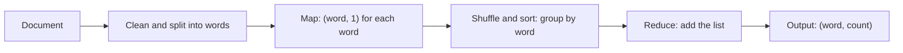

**In one line:** <mark>In word count, map emits (word, 1) for every word, the shuffle groups equal words, and reduce adds the 1s of each word</mark>. <Cite id="hadoop-ecosystem-dean2004" loc="§2.1" /> <Cite id="mapreduce-gfg-wordcount" />

<Box kind="key">

**Key points to write (word count with MapReduce):**

- <mark>Key = the word, value = 1 for each occurrence</mark>.
- <mark>Map: for each word w in the line, emit(w, 1)</mark>.
- <mark>Shuffle: group by key, giving (word, [1, 1, ...])</mark>.
- <mark>Reduce: sum the list and emit(word, total)</mark>.
- <mark>Combiner = same code as reduce</mark> (safe, because addition is associative).
- **Clean first**: lowercase and drop punctuation, so "Apple" and "apple" are one key.
- **Check**: the counts must add up to the number of words.

</Box>

## Core answer (5 marks, the method that fits every question here)

<Box kind="definition">

**Word count** counts how many times each word appears in a document. It is the "hello world" of MapReduce: the key is the word and the value is 1 per occurrence. <Cite id="mapreduce-gfg-wordcount" /> <Cite id="mapreduce-av" />

</Box>

**Pseudo code:** <Cite id="hadoop-ecosystem-apache-mr-tutorial" />

```text
map(offset, line):
    for each word w in line:           # lowercase it and strip punctuation
        emit(w, 1)

reduce(word, counts):
    total = 0
    for c in counts:
        total = total + c
    emit(word, total)

combiner = same as reduce             # safe, because addition is associative
```

**Steps to follow in every question:**

1. **Clean** the text: lowercase, remove punctuation, count the words.
2. **Map:** write one (word, 1) for each word.
3. **Shuffle and sort:** group equal words into (word, [1, 1, ...]).
4. **Reduce:** add each list.
5. **Check:** the total of the counts equals the number of words.




## Extended answer (10 marks): solve a question fully

<Sum>

<Given>

Document: "Big data is powerful. Big data drives decisions." (asked in May 2025 and December 2025). Treat upper and lower case as the same and ignore full stops.

</Given>

<Find>

the count of every word, showing map output, shuffle and reduce output.

</Find>

<Steps>

1. **Clean.** `big data is powerful big data drives decisions` (8 words). *Reason: "Big" and "big" must be one key.*
2. **Map.** One (word, 1) pair per word:

   | Position | Word | Map output |
   |---|---|---|
   | 1 | big | (big, 1) |
   | 2 | data | (data, 1) |
   | 3 | is | (is, 1) |
   | 4 | powerful | (powerful, 1) |
   | 5 | big | (big, 1) |
   | 6 | data | (data, 1) |
   | 7 | drives | (drives, 1) |
   | 8 | decisions | (decisions, 1) |

3. **Shuffle and sort.** Group equal keys:

   | Key | List of values |
   |---|---|
   | big | [1, 1] |
   | data | [1, 1] |
   | decisions | [1] |
   | drives | [1] |
   | is | [1] |
   | powerful | [1] |

4. **Reduce.** Add each list: big 2, data 2, decisions 1, drives 1, is 1, powerful 1. *Reason: reduce sums the 1s of one key.*

</Steps>

<Answer>

(big, 2), (data, 2), (decisions, 1), (drives, 1), (is, 1), (powerful, 1)

</Answer>

<Box kind="verify">

The counts add up: $2 + 2 + 1 + 1 + 1 + 1 = 8$, the same as the 8 words in the cleaned text.

</Box>

</Sum>

### Other documents asked, same method

| Document | Words | Result |
|---|---|---|
| "This is an apple. Apple is red in color" | 9 | this 1, is 2, an 1, apple 2, red 1, in 1, color 1 (total 9) |
| "This is NoSQL. NoSQL handles complex data." | 7 | this 1, is 1, nosql 2, handles 1, complex 1, data 1 (total 7) |
| "Big data is powerful. Big data drives decisions." | 8 | big 2, data 2, is 1, powerful 1, drives 1, decisions 1 (total 8) |

### With a combiner

If the two sentences sit on two map machines, each machine first adds locally. A machine that sees "big" twice sends (big, 2) once instead of two (big, 1) pairs. The final answer is the same, with less network traffic. <Cite id="hadoop-ecosystem-mmds" loc="§2.2.4" />

### Where the questions differ

- "**Illustrate with an example showing all the steps**" has no fixed document: choose a short sentence of 6 to 8 words and show all tables.
- Questions with a given document need exactly that document in your tables.

## Fit it to each question

- **"Write a map reduce pseudo code for word count problem. Apply map reduce working on the following document: 'This is an apple. Apple is red in color'."** (10 marks) <PYQ id="2022-12-ce/q2b" />: pseudo code, then the three tables for this document (9 words; use the table above).
- **"Write a map reduce pseudo code for word count problem. Illustrate with an example showing all the steps."** (10 marks) <PYQ id="2024-05-ce/q2b" />: pseudo code, then **any short sentence** with the map, shuffle and reduce tables and the diagram.
- **"... following document: 'This is NoSQL. NoSQL handles complex data.'"** (10 marks) <PYQ id="2024-12-ce/q2b" />: pseudo code and the 7-word trace (nosql 2, others 1).
- **"... following document: 'Big data is powerful. Big data drives decisions.'"** (10 marks) <PYQ id="2025-05-ce/q4a" /> <PYQ id="2025-12-ce/q2b" />: pseudo code and the solved sum above, exactly.

## Exam tips

- **Write the pseudo code first** (about 8 lines), then the three tables; examiners give half the marks to the code.
- **Always lowercase and strip punctuation** and say so; it avoids "NoSQL" and "nosql" being two keys.
- **Finish with the check** (counts add up to the number of words); it shows the answer is verified.
