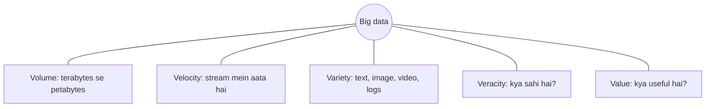
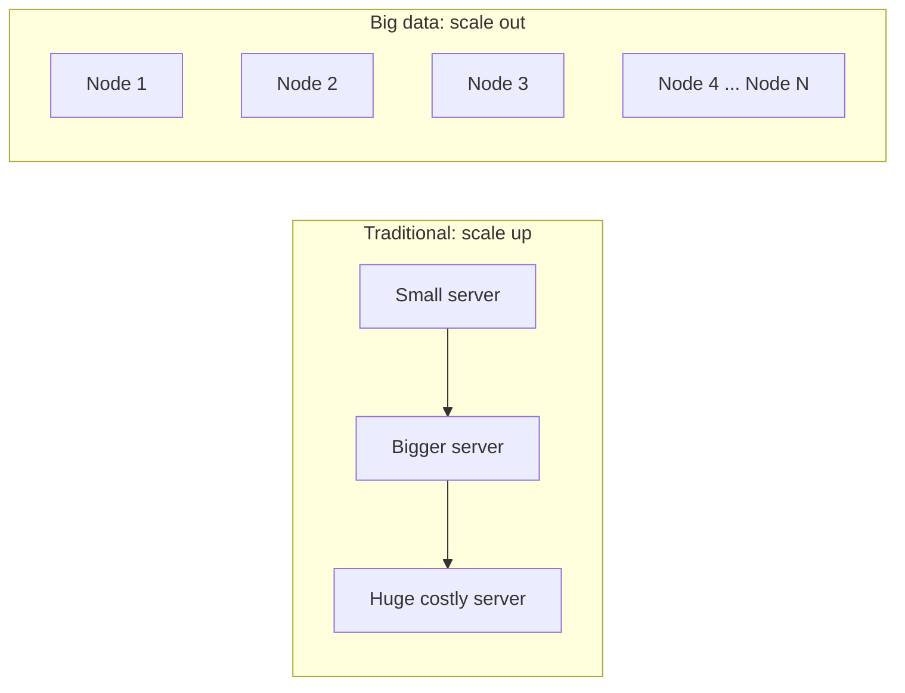
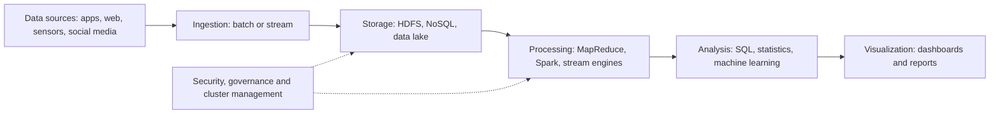
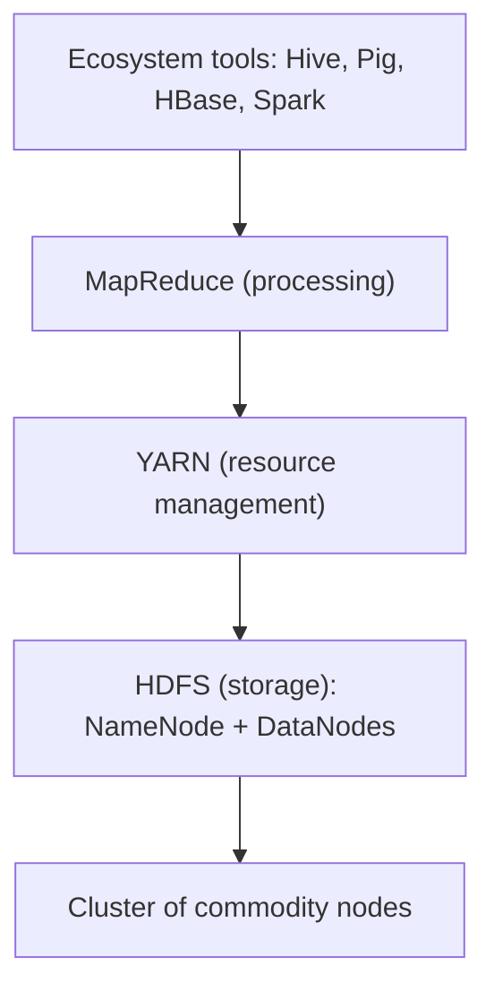

Naye ideas se pehle purane ideas jo aapko chahiye. Agar aapko pata hai, to seedha next section par jaao.

## The basics first

- **Data** record kiye hue facts hain: bank balance, photo, click, temperature reading.
- **Database** data ko store karta hai taaki search aur update ho sake. **Relational database (RDBMS)** data ko rows aur columns ki **tables** mein rakhta hai, aur aap **SQL** se sawaal poochte ho. <Cite id="big-data-intro-wiki-rdbms" />
- **Schema** table ka fixed plan hai: kaun se columns hain aur har column mein kis type ka data aayega.
- **Server** ek computer hai. **Cluster** bahut saare computers hain jo ek system ki tarah kaam karte hain. Cluster ka har computer ek **node** hai.
- **Commodity hardware** matlab normal, sasta computer, koi special mehnga machine nahi.
- Sizes: 1 KB = 1,000 bytes, 1 MB = 1,000 KB, 1 GB = 1,000 MB, 1 TB = 1,000 GB, 1 PB (petabyte) = 1,000 TB. (Kuch books 1,024 lete hain; idea same hai.)

## What is big data?

**Ye kya hai.** Big data matlab aise data sets jo itne bade ya complex hain ki traditional data-processing software unhe reasonable time mein capture, store, search, analyse ya present nahi kar sakta. <Cite id="big-data-intro-tp" /> <Cite id="big-data-intro-wiki" /> Ye syllabus <Syl m="1" /> hai, "Big data characteristics and types".

**Ye kyun zaroori hai.** Phone, website aur sensor har second data banate hain. Usme kaam ke jawab chhupe hain: customer kya khareedega, kaun si machine kharab hogi, kaun sa transaction fraud hai. Par data ek machine ke liye bahut bada hai aur ek table ke liye bahut mixed. Big data tools in jawabon ko nikaalne ke liye hain. <Cite id="big-data-intro-ibm" />

**Everyday analogy.** Ek aadmi chhote letters ke packet ko haath se sort kar sakta hai. Shehar ke post office mein roz lakhon letters aate hain, har shape mein (letters, parcels, postcards), aur aate hi rehte hain. Ek aadmi nahi sambhal sakta; bahut saare workers, sorting belts aur plan chahiye. Big data information ke liye wahi post office problem hai.

<Box kind="definition">

**Big data** wo data hai jo bahut bada (volume) hai, bahut tez aata hai (velocity) aur bahut varied (variety) hai, isliye traditional single-machine database use store aur process nahi kar sakta, aur cluster par distributed storage aur processing chahiye.

</Box>

Ye aata kahan se hai? Social media posts, search engines, stock exchange records, sensors aur IoT devices, mobile phones, log files, cameras aur aircraft black-box data. <Cite id="big-data-intro-tp" /> <Cite id="big-data-intro-wiki" />

## Characteristics: the V's

Pehle teen V's (volume, velocity, variety) classic description hain. Veracity aur value baad mein jode gaye, jisse **5 V's** bante hain; kuch log variability bhi jodte hain. <Cite id="big-data-intro-wiki" /> <Cite id="big-data-intro-av" /> <Cite id="big-data-intro-ibm" />

| V | Simple words mein matlab | Kaun sa sawaal |
|---|---|---|
| **Volume** | Data ki matra: terabytes, petabytes aur usse zyada. | Kitna? |
| **Velocity** | Data kitni tezi se banta hai aur kitni jaldi process hona chahiye, aksar near real time. | Kitna tez? |
| **Variety** | Bahut formats: tables, text, images, audio, video, logs, JSON, XML. | Kitna mixed? |
| **Veracity** | Data kitna sahi aur saaf hai. Noisy, duplicate ya galat data galat decisions deta hai. | Kitna reliable? |
| **Value** | Data se milne wala useful result. Jis data ko koi use na kar sake wo sirf kharcha hai. | Kitna useful? |
| **Variability** (extra) | Data ka meaning ya format time aur context ke saath badalta hai (jaise ek word alag posts mein alag matlab). | Kitna badalta? |

<Cite id="big-data-intro-gfg" loc="diagram" />

### The V's for social media websites

Ye wahi hai jo <PYQ id="2023-05-ce/q1c" />, <PYQ id="2024-05-ce/q1b" />, <PYQ id="2025-05-ce/q1a" />, <PYQ id="2024-05/q1a" /> aur <PYQ id="2024-12/q1a" /> alag alag shabdon mein poochte hain.

| V | Social media site par (jaise Facebook ya Instagram type site) |
|---|---|
| Volume | Millions users roz text, photos aur videos post karte hain, to stored data petabytes tak badhta hai. |
| Velocity | Posts, likes, comments aur messages har second aate hain, aur feeds aur trending lists turant update honi chahiye. |
| Variety | Text, emoji, images, video, audio, links, location, aur friend-graph khud. |
| Veracity | Fake accounts, spam, bots aur rumours ki wajah se har post sach ya trustworthy nahi hoti. |
| Value | Recommendations, targeted ads, trend detection aur harmful content pakadna. |

### Two small case studies (3 V's with justification)

<PYQ id="2023-12-ce/q1b" /> do cases maangta hai, har ek ek V se juda. Ye typical examples hain, kisi ek company ke figures nahi.

- **Stock exchange: velocity.** Buy aur sell orders har second bahut zyada aate hain, aur price signal ek minute late ho to uski value kam ho jaati hai. Isliye system ko stream real time mein process karna padta hai. <Cite id="big-data-intro-tp" />
- **Hospital ya health records: variety.** Ek patient ka table data (age, tests), free-text doctor notes, X-ray images aur monitors ke sensor readings hote hain. Ek fixed table ye sab nahi rakh sakta, isliye system ko mixed formats store karne padte hain. <Cite id="big-data-intro-ibm" />

Volume ka example: social network jo apne users ki har photo aur video store karta hai (neeche sum dekho).

### Sum: how fast does data pile up?

<Sum>

<Given>

Ek chhoti website (banaya hua example) ko roz $2{,}000{,}000$ posts milte hain. Har post, metadata ke saath, lagbhag $2$ KB hai.

</Given>

<Find>

roz aur saal bhar (365 din) mein kitna data judta hai, GB aur TB mein.

</Find>

<Steps>

1. KB mein per day: $2{,}000{,}000 \times 2 = 4{,}000{,}000$ KB. *Reason: posts ki sankhya guna ek post ka size.*
2. GB mein convert: $4{,}000{,}000$ KB $\div 1{,}000 = 4{,}000$ MB, aur $4{,}000$ MB $\div 1{,}000 = 4$ GB. *Reason: 1,000 KB = 1 MB aur 1,000 MB = 1 GB.*
3. GB mein per year: $4 \times 365 = 1{,}460$ GB. *Reason: 365 din wahi load.*
4. TB mein convert: $1{,}460 \div 1{,}000 = 1.46$ TB. *Reason: 1,000 GB = 1 TB.*

</Steps>

<Answer>

$4$ GB per day, lagbhag $1.46$ TB per year.

</Answer>

<Box kind="verify">

Ulta chalo: $1.46$ TB $= 1{,}460$ GB; $1{,}460 \div 365 = 4$ GB per day; $4$ GB $= 4{,}000{,}000$ KB; $4{,}000{,}000 \div 2 = 2{,}000{,}000$ posts. Match karta hai. Asli social network isse hazaaron guna bada hota hai, isliye volume ek problem hai.

</Box>

</Sum>

## Types of big data

<Cite id="big-data-intro-gfg" /> <Cite id="big-data-intro-ibm" /> <Cite id="big-data-intro-wiki-semi" />

| Type | Kya hai | Examples | Kahan store hota hai |
|---|---|---|---|
| **Structured** | Fixed rows aur columns, schema ke saath. | Bank transactions, student marks, employee records. | RDBMS, data warehouse |
| **Semi-structured** | Fixed table nahi, par tags ya keys se thodi structure. | JSON, XML, email, log files. | NoSQL (document) stores, files |
| **Unstructured** | Koi predefined structure nahi. | Photos, video, audio, free text, social media posts. | HDFS, object storage, data lakes |

Zyadatar big data unstructured ya semi-structured hota hai, isliye sirf-table database ko dikkat aati hai.

## Traditional data versus big data

<PYQ id="2023-12/q1b" /> aur <PYQ id="2025-05/q1a" /> ye comparison maangte hain. <PYQ id="2023-12-ce/q1a" /> wahi RDBMS versus Hadoop ke liye poochta hai (agli table dekho).

| Point | Traditional data / database | Big data |
|---|---|---|
| Size | Megabytes se kuch terabytes. | Terabytes se petabytes aur usse zyada. |
| Data type | Zyadatar structured. | Structured, semi-structured aur unstructured. |
| Schema | Data store karne se pehle fixed (schema-on-write). | Flexible; structure data padhte waqt lagta hai (schema-on-read). |
| Growth | Dheemi aur predictable. | Tez aur lagatar. |
| Scaling | Scale up: bada, mehnga server kharido. | Scale out: bahut saare cheap commodity nodes jodo. |
| Processing | Ek machine; data program tak laya jaata hai. | Cluster; program data ke paas le jaya jaata hai. |
| Speed of arrival | Zyadatar batch updates. | Batch aur real-time streams. |
| Tools | RDBMS, SQL, data warehouse. | Hadoop, Spark, NoSQL, Kafka, data lakes. |
| Failure | Server fail hona serious hai. | Kuch nodes ka fail hona expected hai aur copies se handle hota hai. |
| Cost | Mehnga hardware aur licences. | Sasta hardware, aksar open source. |

<Cite id="big-data-intro-oracle" /> <Cite id="big-data-intro-av" /> <Cite id="big-data-intro-mmds" />

### RDBMS versus Hadoop

| Point | RDBMS | Hadoop |
|---|---|---|
| Data | Sirf structured tables. | Koi bhi format. |
| Schema | On write (pehle fixed). | On read (flexible). |
| Scale | Vertical (bada server). | Horizontal (zyada nodes). |
| Hardware | Mehnga, high-end. | Commodity. |
| Best at | Tez chhote transactions, updates, modest data par joins. | Bade data sets ka batch analysis. |
| Access | SQL, low latency. | Batch jobs (MapReduce, Spark, Hive), high throughput. |
| Updates | Record ke andar kahin bhi read aur write. | Write once, read many; zyadatar append. |
| Fault tolerance | Special set-up chahiye. | Block copies ki wajah se built in. |

<Cite id="big-data-intro-hdfs" /> <Cite id="big-data-intro-wiki-hadoop" /> <Cite id="big-data-intro-gfg-hadoop" />

Hadoop RDBMS ko replace nahi karta. Banks balances ke liye abhi bhi RDBMS use karte hain; saalon ke transactions mein fraud dhoondhne ke liye Hadoop-type systems use karte hain.

<Cite id="big-data-intro-tp" loc="diagram" />

## Architecture of big data

<PYQ id="2023-12/q3a" /> architecture aur characteristics dono saath maangta hai. Koi ek official architecture nahi hai; books aur vendors thoda alag banate hain. Common view layers ka hai, aur data left se right behta hai. <Cite id="big-data-intro-gfg" /> <Cite id="big-data-intro-aws" /> <Cite id="big-data-intro-mmds" />

1. **Data sources:** jahan data paida hota hai (apps, web, sensors, social media, logs, databases).
2. **Ingestion (collection):** data ko system mein laata hai, ya batches mein (raat ka load) ya stream ki tarah (Kafka-type tools).
3. **Storage:** use scale par safe rakhta hai: HDFS jaisa distributed file system, NoSQL databases, ya raw files ka data lake.
4. **Processing:** raw data ko useful data banata hai. Batch processing (MapReduce, Spark) bade stored sets handle karti hai; stream processing data ko aate hi handle karti hai.
5. **Analysis:** SQL-style queries (Hive), statistics aur machine learning patterns dhoondhte hain.
6. **Visualization and use:** dashboards, reports aur apps results logon ko dikhate hain.
7. **Sab layers par:** security, governance (kaun kya dekh sakta hai) aur resource management.

<Cite id="big-data-intro-gfg" loc="diagram" />

## Big data enabling technologies

<PYQ id="2024-12/q2b" /> ye poochta hai. Ye wo inventions hain jinhone big data ko practical banaya. <Cite id="big-data-intro-gfg" /> <Cite id="big-data-intro-wiki" />

| Technology | Kya karti hai | Example |
|---|---|---|
| Cheap commodity hardware aur storage | Sau-sau nodes rakhna affordable banata hai. | Normal x86 servers |
| Cloud computing | Zaroorat par storage aur machines rent karo; jitna use karo utna pay karo. | AWS, Azure, Google Cloud <Cite id="big-data-intro-aws" /> |
| Distributed file systems | Bade files ko blocks mein kaat kar bahut nodes par rakhti hain aur copies banati hain. | HDFS <Cite id="big-data-intro-gfs" /> <Cite id="big-data-intro-hdfs" /> |
| Parallel processing frameworks | Job ko chhote tasks mein todkar bahut nodes par ek saath chalati hain. | MapReduce <Cite id="big-data-intro-mapreduce" />, Spark <Cite id="big-data-intro-spark" /> |
| NoSQL databases | Flexible, huge data ko easy scaling ke saath store karte hain. | MongoDB <Cite id="big-data-intro-mongo" />, Cassandra <Cite id="big-data-intro-cassandra" /> <Cite id="big-data-intro-nosql" /> |
| Streaming platforms | Data ko aate hi move aur process karte hain. | Apache Kafka, Spark Streaming |
| Data lakes | Kisi bhi format ka raw data sasta rakhte hain jab tak zaroorat na ho. <Cite id="big-data-intro-wiki-lake" /> | Cloud mein object storage |
| Machine learning aur analytics tools | Data se patterns dhoondhte aur predictions karte hain. | Spark MLlib |
| IoT aur mobile devices | Pehle data banate hain. | Sensors, phones |

## Hadoop: the basic idea

Ye syllabus <Syl m="1" /> hai, "Hadoop concept, core components and ecosystem". Poore ecosystem ka alag note hai; yahan sirf idea hai.

**Ye kya hai.** Apache Hadoop ek open-source framework hai jo bahut saare commodity computers ko milkar bahut bade data sets store aur process karne deta hai. <Cite id="big-data-intro-hadoop" /> Ye Google ke do papers se inspire hua: Google File System (2003) aur MapReduce (2004). <Cite id="big-data-intro-gfs" /> <Cite id="big-data-intro-mapreduce" /> <Cite id="big-data-intro-wiki-hadoop" />

**Core components.**

- **HDFS (Hadoop Distributed File System):** storage. File ko bade blocks mein kaata jaata hai (128 MB typical) aur har block kai nodes par copy hota hai, aam taur par teen. Master **NameNode** map rakhta hai ki kaun sa block kahan hai; **DataNodes** blocks store karte hain. <Cite id="big-data-intro-hdfs" />
- **YARN:** manager jo cluster ki CPU aur memory jobs mein baant'ta hai. <Cite id="big-data-intro-yarn" />
- **MapReduce:** processing model. **Map** data ke tukdon par parallel kaam karta hai; **reduce** results ko combine karta hai. <Cite id="big-data-intro-mapreduce" />
- **Hadoop Common:** shared libraries. <Cite id="big-data-intro-wiki-hadoop" />

Do key ideas: hazaaron cheap nodes par failure normal hai, isliye data ki copies rakhte hain; aur bade data ko network par bhejne se **program ko data ke paas le jaana** sasta hai. <Cite id="big-data-intro-hdfs" />

<Cite id="big-data-intro-gfg-hadoop" loc="diagram" />

## Advantages and challenges of big data

| Advantages | Challenges |
|---|---|
| Behtar, data-driven decisions | Huge volumes ko store aur move karna |
| Personalised products aur offers | Kharab data quality (veracity) |
| Fraud aur risk detection | Privacy aur security rules |
| Predictive maintenance, forecasting | Bahut data formats ko mix karna |
| Tez innovation | Skilled logon ki kami |

<Cite id="big-data-intro-ibm" /> <Cite id="big-data-intro-gfg" />

## Applications

Healthcare (personal treatment), retail (recommendations, stock), finance (fraud), manufacturing (machine failure prediction), transport (route planning), telecom (network traffic), government aur education. <Cite id="big-data-intro-av" /> <Cite id="big-data-intro-ibm" />

## One-line conclusion

Big data sirf "bahut saara data" nahi hai: ye wo data hai jiska volume, velocity aur variety traditional databases ko tod deta hai, isliye hum use clusters par HDFS, MapReduce, Spark aur NoSQL jaise tools se baant dete hain.

Exam mein English mein likho: "Big data is a collection of data sets so large, fast-moving and varied that traditional database systems cannot store or process them, so distributed tools such as Hadoop are used."
