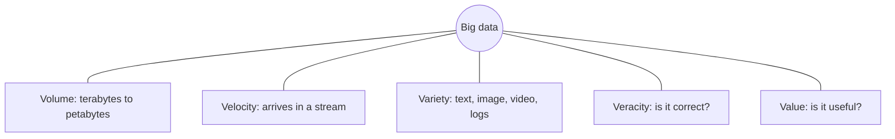
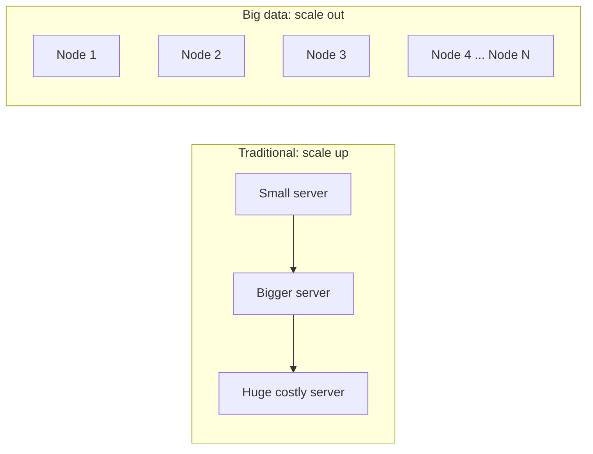
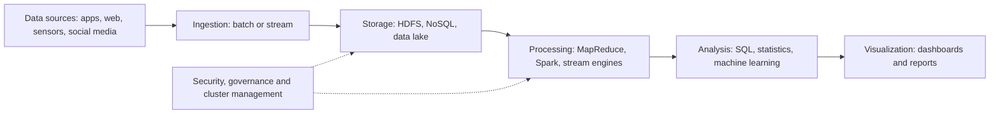
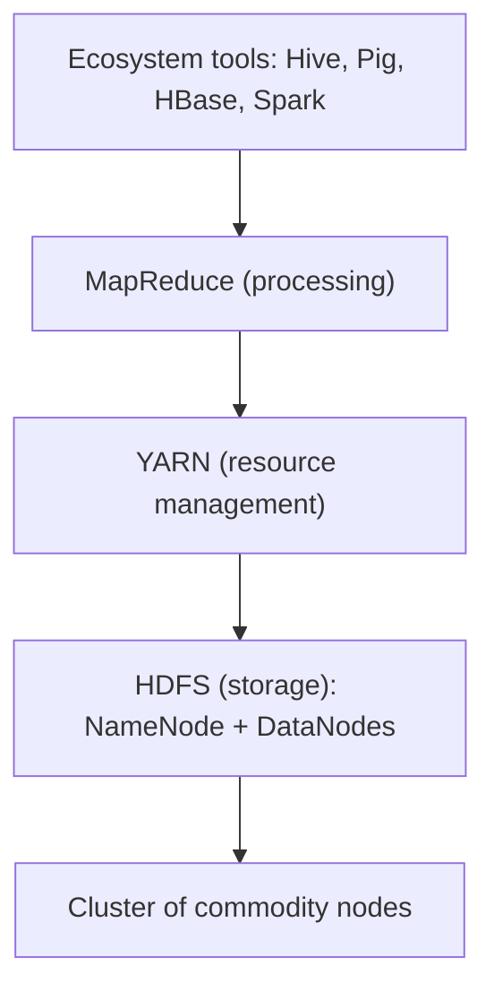

Before the new ideas, here are the old ones you need. If you already know them, skip to the next section.

## The basics first

- **Data** is recorded facts: a bank balance, a photo, a click, a temperature reading.
- A **database** stores data so it can be searched and updated. A **relational database (RDBMS)** keeps data in **tables** of rows and columns, and you ask questions with **SQL**. <Cite id="big-data-intro-wiki-rdbms" />
- A **schema** is the fixed plan of a table: which columns exist and what type each holds.
- A **server** is one computer. A **cluster** is many computers working together as one system. Each computer in a cluster is a **node**.
- **Commodity hardware** means ordinary, cheap computers, not special expensive machines.
- Sizes: 1 KB = 1,000 bytes, 1 MB = 1,000 KB, 1 GB = 1,000 MB, 1 TB = 1,000 GB, 1 PB (petabyte) = 1,000 TB. (Some books use 1,024; the idea is the same.)

## What is big data?

**What it is.** Big data means data sets that are so large or complex that traditional data-processing software cannot capture, store, search, analyse or present them in a reasonable time. <Cite id="big-data-intro-tp" /> <Cite id="big-data-intro-wiki" /> This is syllabus <Syl m="1" />, "Big data characteristics and types".

**Why it matters.** A phone, a website and a sensor all produce data every second. Hidden in it are useful answers: what a customer will buy, which machine will fail, which transaction is fraud. But the data is too big for one machine and too varied for one table. Big data tools exist to get those answers. <Cite id="big-data-intro-ibm" />

**Everyday analogy.** One person can sort a small packet of letters by hand. A city post office gets millions of letters a day, in all shapes (letters, parcels, postcards), and they keep arriving. One person cannot cope; you need many workers, sorting belts and a plan. Big data is the post office problem for information.

<Box kind="definition">

**Big data** is data that is too large (volume), arrives too fast (velocity) and is too varied (variety) to be stored and processed by a traditional single-machine database, so it needs distributed storage and processing on a cluster.

</Box>

Where does it come from? Social media posts, search engines, stock exchange records, sensors and IoT devices, mobile phones, log files, cameras and aircraft black-box data. <Cite id="big-data-intro-tp" /> <Cite id="big-data-intro-wiki" />

## Characteristics: the V's

The first three V's (volume, velocity, variety) are the classic description. Veracity and value were added later, giving **5 V's**; some writers also add variability. <Cite id="big-data-intro-wiki" /> <Cite id="big-data-intro-av" /> <Cite id="big-data-intro-ibm" />

| V | Meaning in simple words | Question it answers |
|---|---|---|
| **Volume** | The amount of data: terabytes, petabytes and more. | How much? |
| **Velocity** | The speed at which data is created and must be processed, often in near real time. | How fast? |
| **Variety** | Many formats: tables, text, images, audio, video, logs, JSON, XML. | How mixed? |
| **Veracity** | How truthful and clean the data is. Noisy, duplicated or wrong data gives wrong decisions. | How reliable? |
| **Value** | The useful result you get from the data. Data nobody can use is only a cost. | How useful? |
| **Variability** (extra) | The meaning or format of data changes with time and context (for example a word that means different things in different posts). | How changing? |

<Cite id="big-data-intro-gfg" loc="diagram" />

### The V's for social media websites

This is what <PYQ id="2023-05-ce/q1c" />, <PYQ id="2024-05-ce/q1b" />, <PYQ id="2025-05-ce/q1a" />, <PYQ id="2024-05/q1a" /> and <PYQ id="2024-12/q1a" /> ask in different words.

| V | On a social media site (for example a Facebook- or Instagram-type site) |
|---|---|
| Volume | Millions of users post text, photos and videos every day, so the stored data grows to petabytes. |
| Velocity | Posts, likes, comments and messages arrive every second, and feeds and trending lists must update at once. |
| Variety | Text, emoji, images, video, audio, links, location, and the friend-graph itself. |
| Veracity | Fake accounts, spam, bots and rumours mean not every post is true or trustworthy. |
| Value | Recommendations, targeted ads, trend detection and spotting harmful content. |

### Two small case studies (3 V's with justification)

<PYQ id="2023-12-ce/q1b" /> asks for two cases, each tied to a V. These are typical examples, not figures from one company.

- **Stock exchange: velocity.** Buy and sell orders arrive in huge numbers every second, and a price signal is worth little if it is a minute late. So the system must process the stream in real time. <Cite id="big-data-intro-tp" />
- **Hospital or health records: variety.** One patient has table data (age, tests), free-text doctor notes, X-ray images and sensor readings from monitors. A single fixed table cannot hold all of these, so the system must store mixed formats. <Cite id="big-data-intro-ibm" />

Volume example: a social network storing every photo and video of its users (see the sum below).

### Sum: how fast does data pile up?

<Sum>

<Given>

A small website (a made-up example) gets $2{,}000{,}000$ posts a day. Each post, with its metadata, is about $2$ KB.

</Given>

<Find>

the data added per day and per year (365 days), in GB and TB.

</Find>

<Steps>

1. Per day in KB: $2{,}000{,}000 \times 2 = 4{,}000{,}000$ KB. *Reason: number of posts times size of one post.*
2. Convert to GB: $4{,}000{,}000$ KB $\div 1{,}000 = 4{,}000$ MB, and $4{,}000$ MB $\div 1{,}000 = 4$ GB. *Reason: 1,000 KB = 1 MB and 1,000 MB = 1 GB.*
3. Per year in GB: $4 \times 365 = 1{,}460$ GB. *Reason: 365 days of the same load.*
4. Convert to TB: $1{,}460 \div 1{,}000 = 1.46$ TB. *Reason: 1,000 GB = 1 TB.*

</Steps>

<Answer>

$4$ GB per day, about $1.46$ TB per year.

</Answer>

<Box kind="verify">

Work backwards: $1.46$ TB $= 1{,}460$ GB; $1{,}460 \div 365 = 4$ GB per day; $4$ GB $= 4{,}000{,}000$ KB; $4{,}000{,}000 \div 2 = 2{,}000{,}000$ posts. This matches. A real social network is thousands of times bigger, which is why volume is a problem.

</Box>

</Sum>

## Types of big data

<Cite id="big-data-intro-gfg" /> <Cite id="big-data-intro-ibm" /> <Cite id="big-data-intro-wiki-semi" />

| Type | What it is | Examples | Stored in |
|---|---|---|---|
| **Structured** | Fixed rows and columns with a schema. | Bank transactions, student marks, employee records. | RDBMS, data warehouse |
| **Semi-structured** | No fixed table, but tags or keys give some structure. | JSON, XML, email, log files. | NoSQL (document) stores, files |
| **Unstructured** | No predefined structure. | Photos, video, audio, free text, social media posts. | HDFS, object storage, data lakes |

Most big data is unstructured or semi-structured, which is why a table-only database struggles.

## Traditional data versus big data

<PYQ id="2023-12/q1b" /> and <PYQ id="2025-05/q1a" /> ask for this comparison. <PYQ id="2023-12-ce/q1a" /> asks the same for RDBMS versus Hadoop (see the next table).

| Point | Traditional data / database | Big data |
|---|---|---|
| Size | Megabytes to a few terabytes. | Terabytes to petabytes and beyond. |
| Data type | Mostly structured. | Structured, semi-structured and unstructured. |
| Schema | Fixed before data is stored (schema-on-write). | Flexible; structure applied when data is read (schema-on-read). |
| Growth | Slow and predictable. | Fast and continuous. |
| Scaling | Scale up: buy a bigger, costlier server. | Scale out: add many cheap commodity nodes. |
| Processing | One machine; data is moved to the program. | Cluster; the program is moved to the data. |
| Speed of arrival | Mostly batch updates. | Batch and real-time streams. |
| Tools | RDBMS, SQL, data warehouse. | Hadoop, Spark, NoSQL, Kafka, data lakes. |
| Failure | Failure of the server is serious. | Failure of some nodes is expected and handled by copies. |
| Cost | Expensive hardware and licences. | Cheap hardware, often open source. |

<Cite id="big-data-intro-oracle" /> <Cite id="big-data-intro-av" /> <Cite id="big-data-intro-mmds" />

### RDBMS versus Hadoop

| Point | RDBMS | Hadoop |
|---|---|---|
| Data | Structured tables only. | Any format. |
| Schema | On write (fixed first). | On read (flexible). |
| Scale | Vertical (bigger server). | Horizontal (more nodes). |
| Hardware | Expensive, high-end. | Commodity. |
| Best at | Fast small transactions, updates, joins on modest data. | Batch analysis of huge data sets. |
| Access | SQL, low latency. | Batch jobs (MapReduce, Spark, Hive), high throughput. |
| Updates | Read and write anywhere in a record. | Write once, read many; mostly append. |
| Fault tolerance | Needs special set-up. | Built in through block copies. |

<Cite id="big-data-intro-hdfs" /> <Cite id="big-data-intro-wiki-hadoop" /> <Cite id="big-data-intro-gfg-hadoop" />

Hadoop does not replace an RDBMS. Banks still use an RDBMS for balances; they use Hadoop-type systems to analyse years of transactions for fraud.

<Cite id="big-data-intro-tp" loc="diagram" />

## Architecture of big data

<PYQ id="2023-12/q3a" /> asks for the architecture and characteristics together. There is no single official architecture; books and vendors draw it a little differently. The common view is layers, and the data flows from left to right. <Cite id="big-data-intro-gfg" /> <Cite id="big-data-intro-aws" /> <Cite id="big-data-intro-mmds" />

1. **Data sources:** where data is born (apps, web, sensors, social media, logs, databases).
2. **Ingestion (collection):** brings the data into the system, either in batches (a nightly load) or as a stream (Kafka-type tools).
3. **Storage:** keeps it safely at scale: a distributed file system such as HDFS, NoSQL databases, or a data lake of raw files.
4. **Processing:** turns raw data into useful data. Batch processing (MapReduce, Spark) handles big stored sets; stream processing handles data as it arrives.
5. **Analysis:** SQL-style queries (Hive), statistics and machine learning find patterns.
6. **Visualization and use:** dashboards, reports and apps show the results to people.
7. **Across all layers:** security, governance (who may see what) and resource management.

<Cite id="big-data-intro-gfg" loc="diagram" />

## Big data enabling technologies

<PYQ id="2024-12/q2b" /> asks for these. They are the inventions that made big data practical. <Cite id="big-data-intro-gfg" /> <Cite id="big-data-intro-wiki" />

| Technology | What it does | Example |
|---|---|---|
| Cheap commodity hardware and storage | Makes it affordable to own hundreds of nodes. | Ordinary x86 servers |
| Cloud computing | Rent storage and machines when needed; pay for what you use. | AWS, Azure, Google Cloud <Cite id="big-data-intro-aws" /> |
| Distributed file systems | Split big files into blocks across many nodes and keep copies. | HDFS <Cite id="big-data-intro-gfs" /> <Cite id="big-data-intro-hdfs" /> |
| Parallel processing frameworks | Break a job into small tasks that run on many nodes at once. | MapReduce <Cite id="big-data-intro-mapreduce" />, Spark <Cite id="big-data-intro-spark" /> |
| NoSQL databases | Store flexible, huge data with easy scaling. | MongoDB <Cite id="big-data-intro-mongo" />, Cassandra <Cite id="big-data-intro-cassandra" /> <Cite id="big-data-intro-nosql" /> |
| Streaming platforms | Move and process data as it arrives. | Apache Kafka, Spark Streaming |
| Data lakes | Keep raw data of any format cheaply until it is needed. <Cite id="big-data-intro-wiki-lake" /> | Object storage in the cloud |
| Machine learning and analytics tools | Find patterns and make predictions from the data. | Spark MLlib |
| IoT and mobile devices | Create the data in the first place. | Sensors, phones |

## Hadoop: the basic idea

This is syllabus <Syl m="1" />, "Hadoop concept, core components and ecosystem". The full ecosystem has its own note; here is the idea.

**What it is.** Apache Hadoop is an open-source framework that lets many commodity computers store and process very large data sets together. <Cite id="big-data-intro-hadoop" /> It was inspired by two Google papers, the Google File System (2003) and MapReduce (2004). <Cite id="big-data-intro-gfs" /> <Cite id="big-data-intro-mapreduce" /> <Cite id="big-data-intro-wiki-hadoop" />

**Core components.**

- **HDFS (Hadoop Distributed File System):** the storage. A file is cut into large blocks (128 MB is typical) and each block is copied to several nodes, usually three. A master **NameNode** keeps the map of which block is where; **DataNodes** store the blocks. <Cite id="big-data-intro-hdfs" />
- **YARN:** the manager that shares the cluster's CPU and memory among jobs. <Cite id="big-data-intro-yarn" />
- **MapReduce:** the processing model. **Map** works on pieces of data in parallel; **reduce** combines the results. <Cite id="big-data-intro-mapreduce" />
- **Hadoop Common:** the shared libraries. <Cite id="big-data-intro-wiki-hadoop" />

Two key ideas: failures are normal on thousands of cheap nodes, so data is copied; and it is cheaper to **move the program to the data** than to move huge data over the network. <Cite id="big-data-intro-hdfs" />

<Cite id="big-data-intro-gfg-hadoop" loc="diagram" />

## Advantages and challenges of big data

| Advantages | Challenges |
|---|---|
| Better, data-driven decisions | Storing and moving huge volumes |
| Personalised products and offers | Poor data quality (veracity) |
| Fraud and risk detection | Privacy and security rules |
| Predictive maintenance, forecasting | Mixing many data formats |
| Faster innovation | Shortage of skilled people |

<Cite id="big-data-intro-ibm" /> <Cite id="big-data-intro-gfg" />

## Applications

Healthcare (personal treatment), retail (recommendations, stock), finance (fraud), manufacturing (machine failure prediction), transport (route planning), telecom (network traffic), government and education. <Cite id="big-data-intro-av" /> <Cite id="big-data-intro-ibm" />

## One-line conclusion

Big data is not just "a lot of data": it is data whose volume, velocity and variety break traditional databases, so we spread it across clusters using tools such as HDFS, MapReduce, Spark and NoSQL.
