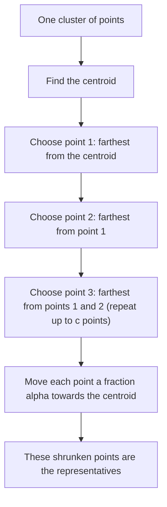

Naye ideas se pehle, purane ideas jo chahiye. Agar aapko pata hai to next section pe jao.

## The basics first

- **Clustering** ka matlab hai points ke set ko groups (**clusters**) mein todna, taaki ek group ke points aapas mein paas hon aur alag groups ke points door. Example: customers ko unki shopping ke hisaab se group karna. Ye syllabus <Syl m="5" /> hai.
- **Distance measure** batata hai ki do points kitne door hain. **Euclidean space** mein points numbers ki list hote hain aur normal straight-line distance chalta hai; Distance Measures note dekho. Non-Euclidean space (jaise words) mein koi aur distance lete hain, jaise edit distance.
- Cluster ka **centroid** uske points ka average hota hai (beech ka point). Non-Euclidean space mein average nahi ban sakta, to ek real point ko beech ka maan lete hain, use **clustroid** kehte hain.
- **Hierarchical (agglomerative) clustering** mein har point apna cluster hota hai aur do sabse paas ke clusters ko merge karte jaate hain jab tak wanted number na bache. **Point-assignment clustering** (k-means) mein k centres chunte hain aur har point ko nearest centre mein daalte hain.
- **Random sample** data ka chhota hissa hota hai jo fairly chuna gaya ho, taaki woh poore data jaisa dikhe.
- **Outlier** woh point hai jo saare clusters se door ho (noise ya error).

<Cite id="distance-measures-mmds" loc="ch. 7" /> <Cite id="cure-stream-clustering-wiki-hier" /> <Cite id="distance-measures-wiki-euclid" /> <Cite id="distance-measures-wiki-metric" />

## Why the older methods are not enough

**Problem.** Badi data set ki clustering fast honi chahiye aur sensible clusters deni chahiye, bhale hi clusters gol na hon, bahut alag sizes ke hon, aur data mein outliers hon. Original CURE paper batata hai ki common methods mein kya galat hota hai <Cite id="cure-stream-clustering-guha1998" loc="§1.1" />:

| Method | Cluster ko kaise describe karta hai | Kya galat hota hai |
| --- | --- | --- |
| k-means (square-error) | Ek centroid | Gol, similar size ke clusters pasand karta hai; bade cluster ke tukde ho jaate hain taaki woh chhote clusters mein behtar fit hon |
| Hierarchical, centroid distance | Ek centroid | Wahi problem: lambe clusters toot jaate hain |
| Hierarchical, minimum distance (all points) | Har point | Points ka patla bridge do clusters ko jod deta hai ("chaining"); outliers se bahut sensitive |
| BIRCH | Summaries, phir centroids | Final labelling sirf centroids se hoti hai, isliye bade cluster ke points paas ke chhote cluster ko mil jaate hain |

**Everyday analogy.** Lambe kele ko ek point (uske beech) se describe karna kharab hai: kele ki nok ka point kisi aur fal ke beech ke zyada paas ho sakta hai. Kele ko uske hazaar pixels se describe karna slow hai aur ek bhatka pixel confuse kar sakta hai. CURE kele ke saath phaile hue kuch points use karta hai: shape pakadne ke liye kaafi, fast hone ke liye kam.

<Cite id="cure-stream-clustering-guha1998" loc="§1.1" /> <Cite id="cure-stream-clustering-yorku-slides" /> <Cite id="cure-stream-clustering-wiki-birch" /> <Cite id="cure-stream-clustering-gfg-cure-dbscan" />

## CURE: Clustering Using REpresentatives

<PYQ id="2023-12/q4b" /> <PYQ id="2024-05/q6b" /> <PYQ id="2024-12/q6a" /> <PYQ id="2025-05/q6b" />

<Box kind="definition">

**CURE** (Clustering Using REpresentatives, Guha, Rastogi aur Shim, 1998) badi data ke liye hierarchical clustering algorithm hai. Woh har cluster ke liye fixed number $c$ of **well-scattered points** rakhta hai, har point ko cluster ke centroid ki taraf $\alpha$ fraction khiska deta hai, aur in **representative points** se decide karta hai ki kaun se clusters merge hon. Woh outliers se zyada robust hai aur non-spherical shape aur bahut alag sizes ke clusters dhoondh leta hai.

</Box>

Ye do extremes ke beech hai: centroid method (ek representative) aur all-points method (har point representative). <Cite id="cure-stream-clustering-guha1998" loc="§1.2" /> <Cite id="cure-stream-clustering-wiki-cure" /> <Cite id="cure-stream-clustering-tp-cure" />

### How CURE works

Book ise do stages mein batati hai, **initialization** aur **completion**. Ye Euclidean space mein chalta hai, kyunki centroids chahiye <Cite id="cure-stream-clustering-basile-slides" /> <Cite id="distance-measures-mmds" loc="ch. 7" />.

**Stage 1: initialization (sample ko cluster karo).**

1. **Data ka random sample lo** jo main memory mein aa jaaye. *Kyun: poore data par full hierarchical algorithm bahut slow hai.*
2. **Sample ko hierarchically cluster karo.** Har sampled point apna cluster hai; sabse paas ke clusters ko merge karte raho jab tak $k$ clusters bachein.
3. **Har cluster mein $c$ well-scattered points chuno.** Pehla woh point jo cluster ke centroid se sabse door ho; har agla woh point jo pehle chune hue points se sabse door ho. *Kyun: isse points cluster ke saath phail jaate hain aur shape pakadte hain.*
4. **Shrink karo.** Har chune hue point ko centroid ki taraf $\alpha$ fraction (jaise 20%) khisko:

$$
p_{\text{new}} = p + \alpha\,(\text{centroid} - p)
$$

   Yahan $p$ scattered point hai, $\alpha$ 0 aur 1 ke beech shrink fraction hai, aur $p_{\text{new}}$ representative point hai. *Kyun: outliers centre se door hote hain, isliye woh sabse zyada khiskte hain aur galat merges karane ki taaqat kho dete hain.*

**Stage 2: merging and completion.**

5. **Do clusters ke beech distance** = unke sabse paas ke representative points ka distance, ek-ek cluster se.
6. **Do sabse paas ke clusters ko merge karo**; merged cluster ke liye $c$ naye representatives chuno; tab tak repeat karo jab tak sirf $k$ clusters bachein.
7. **Baaki saare points ko label karo.** Poori data set ek baar scan karo; har point ko uske **nearest representative point** wale cluster mein daalo. Ek centroid ki jagah kai representatives use karne se lambe clusters ke points sahi jagah jaate hain.

<Cite id="cure-stream-clustering-gfg-cure" loc="diagram" /> <Cite id="cure-stream-clustering-guha1998" loc="Fig. 4" />

<Cite id="cure-stream-clustering-zilliz" loc="diagram" /> <Cite id="cure-stream-clustering-guha1998" loc="§3.2" />

**Convention warning.** Paper points ko centre ki taraf $\alpha$ se khiskata hai, isliye $\alpha = 1$ centroid method deta hai aur $\alpha = 0$ all-points method <Cite id="cure-stream-clustering-guha1998" loc="§1.2" />. Kuch sites ulta matlab use karti hain (point apni distance ka 70% par rehta hai) <Cite id="cure-stream-clustering-tp-cure" />. Hamesha dekho question kaunsa matlab use kar raha hai. Paper ke experiments mein $\alpha$ 0.2 se 0.7 ke beech achha chala <Cite id="cure-stream-clustering-yorku-slides" />.

<Sum>

<Given>

2-D mein 6 points ka ek cluster: $A(1,2)$, $B(3,2)$, $C(5,2)$, $D(9,2)$, $E(4,6)$, $F(2,-2)$. $c = 3$ representatives lo aur shrink fraction $\alpha = 0.2$ (centroid ki taraf 20% khisko).

</Given>

<Find>

centroid, 3 well-scattered points, aur 3 representative points.

</Find>

<Steps>

1. **Centroid.** $x$: $(1+3+5+9+4+2)/6 = 24/6 = 4$. $y$: $(2+2+2+2+6-2)/6 = 12/6 = 2$. Centroid $= (4, 2)$. *Reason: centroid points ka average hota hai.*
2. **Pehla scattered point: centroid se sabse door.** Squared distances (compare karne ke liye squares kaafi hain): $A$: $9$, $B$: $1$, $C$: $1$, $D$: $25$, $E$: $0+16 = 16$, $F$: $4+16 = 20$. Sabse bada $D(9,2)$. *Reason: rule centre se sabse door wale point se shuru hota hai.*
3. **Dusra: $D$ se sabse door.** $D(9,2)$ se squared distances: $A$: $64$, $B$: $36$, $C$: $16$, $E$: $25+16 = 41$, $F$: $49+16 = 65$. Sabse bada $F(2,-2)$. *Reason: har naya point pehle chune hue points se door hona chahiye.*
4. **Teesra: sabse paas ke chune hue point se sabse door.** Bache har point ke liye $D$ aur $F$ ke distances mein se chhota lo. $A$: $\min(64, 1+16) = 17$. $B$: $\min(36, 1+16) = 17$. $C$: $\min(16, 9+16) = 16$. $E$: $\min(41, 4+64) = 41$. Sabse bada $E(4,6)$. *Reason: jo point kisi bhi chune hue point ke paas ho woh "covered" hai.*
5. **$(4,2)$ ki taraf 20% shrink karo**, $p + 0.2(\text{centroid} - p)$ se:
   - $D$: $x = 9 + 0.2(4-9) = 8$, $y = 2$, to $(8, 2)$.
   - $F$: $x = 2 + 0.2(4-2) = 2.4$, $y = -2 + 0.2(2-(-2)) = -1.2$, to $(2.4, -1.2)$.
   - $E$: $x = 4$, $y = 6 + 0.2(2-6) = 5.2$, to $(4, 5.2)$.

</Steps>

<Answer>

centroid $(4, 2)$; scattered points $D(9,2)$, $F(2,-2)$, $E(4,6)$; representatives $(8, 2)$, $(2.4, -1.2)$, $(4, 5.2)$.

</Answer>

<Box kind="verify">

Check 1: sabse door point $D$ 1 unit khiska (uski distance 5 ka 20%), $x = 9$ se $x = 8$; $F$ sirf $0.2 \times \sqrt{20} \approx 0.89$ unit khiska. Door ke points zyada khiske, jaisa expected tha.

Check 2: har representative apne scattered point aur centroid ko jodne wali seedhi line par hai. $E$ ke liye line $x = 4$ hai, aur representative $(4, 5.2)$ ka $x = 4$ hai.

Check 3: shrink karne se 6 points ka centroid nahi badalta, kyunki centroid original points se banta hai. $x$ ka sum: $1+3+5+9+4+2 = 24$, to $24/6 = 4$. Dusre order mein: $(1+9)+(3+5)+(4+2) = 10+8+6 = 24$.

</Box>

</Sum>

Shrink fraction badle to wahi door ka point $D(9,2)$ alag jagah pahunchta hai. Isse dikhta hai $\alpha$ kya control karta hai:

| $\alpha$ | $D$ ka representative | Kiske jaisa behave karta hai |
| --- | --- | --- |
| 0 | $(9, 2)$ (khiska nahi) | All-points method (outlier-sensitive) |
| 0.2 | $(8, 2)$ | Zyadatar shape, thodi outlier protection |
| 0.5 | $(6.5, 2)$ | Compact, round-ish clusters |
| 1 | $(4, 2)$ (centroid) | Centroid method |

Har row $9 + \alpha(4-9)$ se aati hai: $9$, $8$, $6.5$, $4$.

### How two clusters are merged

Har step par CURE un do clusters ko merge karta hai jinke representatives ka pair sabse paas ho. Isi se woh lambe cluster ko follow kar paata hai: ek lambe cluster ke do tukdon ke representatives lagbhag chhoote hain, bhale hi unke centroids door hon.

<Sum>

<Given>

Teen clusters, har ek ke 2 representative points: $U = \{(1,1), (3,1)\}$, $V = \{(5,2), (9,2)\}$, $W = \{(4,6), (6,6)\}$.

</Given>

<Find>

CURE kaun se do clusters merge karega, aur centroid-distance method kaun se do merge karega.

</Find>

<Steps>

1. **CURE distance = representatives ka sabse paas ka pair** (ek-ek cluster se). $U$ aur $V$ ke chaaron distances: $(3,1)$ se $(5,2)$: $\sqrt{4+1} = \sqrt{5} \approx 2.24$; $(1,1)$ se $(5,2)$: $\sqrt{17}$; $(3,1)$ se $(9,2)$: $\sqrt{37}$; $(1,1)$ se $(9,2)$: $\sqrt{65}$. Sabse chhota: $\sqrt{5} \approx 2.24$.
2. **$U$ aur $W$:** $(3,1)$ se $(4,6)$: $\sqrt{1+25} = \sqrt{26}$; $(1,1)$ se $(4,6)$: $\sqrt{34}$; $(3,1)$ se $(6,6)$: $\sqrt{34}$; $(1,1)$ se $(6,6)$: $\sqrt{50}$. Sabse chhota: $\sqrt{26} \approx 5.10$.
3. **$V$ aur $W$:** $(5,2)$ se $(4,6)$: $\sqrt{1+16} = \sqrt{17}$; $(5,2)$ se $(6,6)$: $\sqrt{17}$; $(9,2)$ se $(4,6)$: $\sqrt{41}$; $(9,2)$ se $(6,6)$: $\sqrt{9+16} = 5$. Sabse chhota: $\sqrt{17} \approx 4.12$.
4. **CURE teeno mein sabse chhote ko merge karta hai:** $U$ aur $V$ (2.24).
5. **Centroid method:** centroids $U(2,1)$, $V(7,2)$, $W(5,6)$ hain. $UV$: $\sqrt{25+1} = \sqrt{26} \approx 5.10$. $UW$: $\sqrt{9+25} = \sqrt{34} \approx 5.83$. $VW$: $\sqrt{4+16} = \sqrt{20} \approx 4.47$. Sabse chhota $V$ aur $W$.

</Steps>

<Answer>

CURE $U$ aur $V$ ko merge karta hai (sabse paas ke representatives, distance $\approx 2.24$); centroid method $V$ aur $W$ ko merge karta (centroid distance $\approx 4.47$).

</Answer>

<Box kind="verify">

Check 1: $V$ lamba cluster hai (uske do points 4 door hain), isliye uska centroid $(7,2)$ uske apne end $(5,2)$ se door hai. End $(5,2)$ $U$ ke end $(3,1)$ ke paas hai, isliye representative distance chhota hai jabki centroid distance $UV = \sqrt{26}$ nahi.

Check 2: centroids averages se aate hain: $V$: $(5+9)/2 = 7$, $(2+2)/2 = 2$; $W$: $(4+6)/2 = 5$, $(6+6)/2 = 6$; $U$: $(1+3)/2 = 2$, $(1+1)/2 = 1$. $VW$ ko $\sqrt{(7-5)^2 + (2-6)^2} = \sqrt{20}$ se dobara nikalo to match karta hai.

</Box>

</Sum>

### Handling big data: sampling, partitioning, labelling, outliers

- **Random sampling.** CURE sirf random sample cluster karta hai jo memory mein aaye. Isse outliers se bhi bachaav hota hai, kyunki zyadatar draw hi nahi hote. Keemat: chhota cluster miss ho sakta hai, isliye sample kaafi bada ho; paper sample size chunne ke liye Chernoff bounds use karta hai <Cite id="cure-stream-clustering-guha1998" loc="§4.1" />.
- **Partitioning.** Sample phir bhi bada ho to use $p$ partitions mein baanto, har ek ko partially cluster karo (jab tak lagbhag $n/(pq)$ clusters bachein), phir saare partial clusters ko second pass mein cluster karo. Isse running time kam hota hai <Cite id="cure-stream-clustering-guha1998" loc="§4.2" />.
- **Labelling data on disk.** Sample ke bahar ka har point apne nearest representative wale cluster mein jaata hai <Cite id="cure-stream-clustering-guha1998" loc="§4.3" />. Sirf centroid (jaise BIRCH) se bade cluster ke points chhote padosi ko mil sakte hain.
- **Outliers**, do phases mein. Phase 1 mein clustering tab rok di jaati hai jab clusters ki sankhya shuru ki lagbhag ek-tihai reh jaaye, aur bahut kam points (1 ya 2) wale clusters hata diye jaate hain, kyunki outliers dheere merge hote hain. Phase 2 mein, end ke paas, chhote clusters phir hataye jaate hain <Cite id="cure-stream-clustering-guha1998" loc="§4.4" /> <Cite id="cure-stream-clustering-yorku-slides" />.
- **Cost.** $n$ sampled points ke liye worst-case time $O(n^2 \log n)$ aur space $O(n)$ <Cite id="cure-stream-clustering-guha1998" loc="§3.3" />.

<Sum>

<Given>

Do clusters. $X$ lamba hai, representatives $(1,0)$ aur $(9,0)$, centroid $(5,0)$. $Y$ chhota hai, representatives $(6,3)$ aur $(8,3)$, centroid $(7,3)$. Naya point $p = (10, 0)$ label karna hai.

</Given>

<Find>

representatives (CURE) se $p$ ka cluster, aur sirf centroids se $p$ ka cluster.

</Find>

<Steps>

1. **$p$ se $X$ ke representatives ka distance:** $(9,0)$ tak $1$, $(1,0)$ tak $9$. Sabse paas $1$.
2. **$p$ se $Y$ ke representatives ka distance:** $(8,3)$ tak $\sqrt{4+9} = \sqrt{13} \approx 3.61$, $(6,3)$ tak $\sqrt{16+9} = 5$. Sabse paas $3.61$.
3. **CURE overall nearest representative se label karta hai:** $1 < 3.61$, to $p$ $X$ mein jaata hai.
4. **Centroid labelling:** $p$ se $X$ ke centroid $(5,0)$ tak $5$; $p$ se $Y$ ke centroid $(7,3)$ tak $\sqrt{9+9} = \sqrt{18} \approx 4.24$. Chhota $Y$ hai, to centroid method $p$ ko galti se $Y$ mein daalta hai.

</Steps>

<Answer>

Representatives se $p$ lambe cluster $X$ mein jaata hai (distance 1); sirf centroids se woh galti se $Y$ mein jaata (4.24 against 5).

</Answer>

<Box kind="verify">

Check 1: $p = (10,0)$ usi seedhi line $y = 0$ par hai jis par poora $X$ hai, $X$ ke end se 1 unit aage, isliye use $X$ ka hona chahiye. Sirf representative method yehi kehta hai.

Check 2: centroid distances dusre tareeke se: $\sqrt{(10-5)^2 + 0^2} = 5$ aur $\sqrt{(10-7)^2 + (0-3)^2} = \sqrt{18} = 4.24$. Step 4 jaisa hi.

</Box>

</Sum>

### Advantages, disadvantages and uses

| Advantages | Disadvantages |
| --- | --- |
| Kisi bhi shape ke clusters dhoondhta hai (lambe, curved), sirf gol nahi | Euclidean space chahiye, kyunki centroids use hote hain |
| Bahut alag sizes ke clusters ke saath chalta hai | Result parameters par depend karta hai: $c$, $\alpha$, sample size, partitions ki sankhya, $k$ |
| Outliers se kam sensitive (shrinking, sampling, two-phase removal) | Sample bahut chhota ho to chhota cluster miss ho sakta hai |
| Sampling aur partitioning se badi data tak scale karta hai; space linear hai | Worst-case time $O(n^2 \log n)$ bahut bade sample ke liye bhaari hai |
| Kai representatives se label karta hai, isliye lambe clusters nahi tootte | High dimensions mein bahut distance computations |

<Cite id="cure-stream-clustering-guha1998" loc="§1.2, §3.3" /> <Cite id="cure-stream-clustering-zilliz" /> <Cite id="cure-stream-clustering-gfg-cure" />

**Advantages over traditional algorithms** (standard exam question): k-means aur centroid-based hierarchical methods gol, barabar size ke clusters dete hain aur bade ya lambe clusters ko tod dete hain; all-points (minimum-distance) method bridges se chain ho jaata hai aur outliers se bigadta hai; BIRCH sirf centroids se label karta hai. CURE apne kuch shrunken representatives se teeno problems bacha leta hai, aur sampling se scale bhi karta hai.

**Applications.** Sky objects ya customers ko group karna jab clusters gol na hon, spatial aur image data, aur koi bhi badi data jahan outliers aur odd shapes expected hon.

<Box kind="exam">

**Exam mein English mein likho:** "CURE represents each cluster by a fixed number of well-scattered points shrunk towards the centroid. Clusters with the closest pair of representatives are merged. It uses random sampling and partitioning to handle large data, and labels remaining points by the nearest representative. It handles non-spherical clusters and is robust to outliers."

</Box>

## Clustering a data stream

**Ye kya hai.** Stream model mein points ek ke baad ek, bina ruke aate hain, aur hum sab store nahi kar sakte (Stream Data Model note dekho). **Stream clustering** ka matlab hai thodi memory se recent points ki achhi clustering rakhna, jabki naye points aate rehte hain. <Cite id="cure-stream-clustering-wiki-dsc" /> <Cite id="stream-data-model-wiki-ds" /> <Cite id="stream-data-model-cs246-slides" />

**Everyday analogy.** Dukaan ka manager customers ko unki khareed se group karta hai. Din bhar naye customers aate hain, aur dukaan har group ki sirf chhoti summary rakh sakti hai, har bill nahi. Purane bill phek diye jaate hain; recent groups zyada matter karte hain.

### The stream-computing model

- Stream points ki sequence hai. Hum **sliding window** of last $N$ points ki parwah karte hain (purane drop ho jaate hain).
- **Query** poochti hai: "last $m$ points ke clusters batao", jahan $m \le N$. Woh kabhi bhi aa sakti hai.
- Clusters **time ke saath badalte hain**: subah ke shoppers ka cluster shaam ke shoppers se badal sakta hai.
- Space ke baare mein **koi assumption nahi**. Woh Euclidean ho sakta hai (centroids) ya nahi (clustroids).
- Answer **approximate** hota hai, kyunki hamare paas sirf summaries hain.

<Cite id="cure-stream-clustering-basile-slides" /> <Cite id="distance-measures-mmds" loc="ch. 7" /> <Cite id="stream-data-model-babcock2002" loc="§2" /> <Cite id="cure-stream-clustering-bdmo2003" loc="§1.2" />

### A stream-clustering algorithm: BDMO

Babcock, Datar, Motwani aur O'Callaghan (BDMO) ka method DGIM bucket idea ka generalisation hai, jo window mein ones count karne ke liye use hota hai. <Cite id="cure-stream-clustering-fiu-slides" /> <Cite id="cure-stream-clustering-bdmo2003" /> Stream ko **buckets** mein baanta jaata hai.

<Box kind="definition">

**Bucket rules.** Bucket ka size us bucket ke represent kiye hue points ki sankhya hai. (1) Har size power of two hota hai. (2) Har size ke ek ya do buckets hote hain. (3) Peeche jaate hue sizes kam nahi hote (purane buckets bade hote hain). Isliye sirf $O(\log N)$ buckets hote hain.

</Box>

**Bucket kya store karta hai.**

- apna **size** (points ki sankhya);
- apne sabse recent point ka **timestamp**;
- $k$ clusters mein se har ek ke liye (har bucket mein wahi $k$): **points ki sankhya**, **centroid ya clustroid**, aur baad mein clusters merge karne ke liye zaroori baaki facts (jaise cluster kitna phaila hai).

<Cite id="cure-stream-clustering-basile-slides" /> <Cite id="cure-stream-clustering-fiu-slides" />

<Cite id="cure-stream-clustering-fiu-slides" loc="diagram" />

### Initializing buckets

1. Sabse naye points ko main memory ke **buffer** mein rakho.
2. **Sabse chhota bucket size $p$** chuno (power of two).
3. Jab $p$ naye points aa jaayein, unhein kisi bhi method se (jaise k-means, ya CURE-style hierarchical clustering) $k$ clusters mein **cluster karo**.
4. **Size $p$ ka naya bucket** banao: sabse naye point ka timestamp aur har $k$ clusters ki summary (count aur centroid, ya clustroid) store karo. Buffer khaali karo.
5. Agar kisi bucket ka timestamp $N$ se zyada purana ho, use **drop karo**, kyunki woh poora window ke bahar hai.

<Cite id="cure-stream-clustering-basile-slides" /> <Cite id="cure-stream-clustering-bdmo2003" loc="§3" />

### Merging buckets

Size $p$ ka naya bucket banne ke baad:

1. Jis bucket ka timestamp ab se $N$ units se zyada purana ho use **drop karo**.
2. Agar ab size $p$ ke **teen** buckets hain, to **do sabse purane merge karo** aur size $2p$ ka ek bucket banao. Merge se size $2p$ ke teen buckets ban sakte hain; tab unmein se do sabse purane merge karke $4p$ banao, aur aise hi jab tak kisi size ke teen buckets na rahein.
3. **Do buckets merge karne ke liye**: naya size dono ka sum; naya timestamp zyada recent wala; $2k$ clusters ko baar-baar sabse paas ka pair jodke $k$ banao, naya count (sum) aur naya centroid (centroids ka count-weighted average). Non-Euclidean space mein naya clustroid purane clustroids mein se chuna jaata hai.

<Cite id="cure-stream-clustering-fiu-slides" /> <Cite id="cure-stream-clustering-basile-slides" /> <Cite id="cure-stream-clustering-wiki-dsc" />

<Sum>

<Given>

Sabse chhota bucket size $p = 4$. Points aate hain; har 4 points par size 4 ka bucket banta hai. Rule: jab teen buckets ka size same ho to do sabse purane merge karo. Maan lo window $N$ bahut badi hai, isliye kuch drop nahi hota.

</Given>

<Find>

4, 8, 12, 16, 20, 24, 28 aur 32 points ke baad bucket sizes (sabse purana pehle).

</Find>

<Steps>

1. **4 points ke baad:** ek bucket, $[4]$.
2. **8 ke baad:** $[4, 4]$. Size 4 ke do allowed hain.
3. **12 ke baad:** $[4, 4, 4]$ mein size 4 ke teen hain, to do sabse purane merge karo: $[8, 4]$.
4. **16 ke baad:** ek 4 jodo: $[8, 4, 4]$.
5. **20 ke baad:** ek 4 jodo: $[8, 4, 4, 4]$; do sabse purane 4 merge karo: $[8, 8, 4]$.
6. **24 ke baad:** $[8, 8, 4, 4]$.
7. **28 ke baad:** $[8, 8, 4, 4, 4]$; do sabse purane 4 merge karo: $[8, 8, 8, 4]$; ab teen 8 hain, do sabse purane merge karo: $[16, 8, 4]$.
8. **32 ke baad:** $[16, 8, 4, 4]$.

</Steps>

<Answer>

| Points seen | Buckets (oldest first) |
| --- | --- |
| 4 | 4 |
| 8 | 4, 4 |
| 12 | 8, 4 |
| 16 | 8, 4, 4 |
| 20 | 8, 8, 4 |
| 24 | 8, 8, 4, 4 |
| 28 | 16, 8, 4 |
| 32 | 16, 8, 4, 4 |

</Answer>

<Box kind="verify">

Check 1: har row ke sizes ka sum dekhe hue points ke barabar hai (jaise $16+8+4 = 28$, $16+8+4+4 = 32$).

Check 2: kisi row mein kisi size ke teen buckets nahi hain, aur left jaate hue sizes kam nahi hote (purane buckets sabse bade).

</Box>

</Sum>

<Sum>

<Given>

Do buckets merge karne hain, har ek mein 2-D ke $k = 2$ clusters. Old bucket: cluster $C_1$ mein 3 points, centroid $(1,1)$; $C_2$ mein 1 point, centroid $(9,9)$. New bucket: $C_3$ mein 2 points, centroid $(2,3)$; $C_4$ mein 2 points, centroid $(10,8)$.

</Given>

<Find>

merged bucket ka size aur uske do clusters (count aur centroid).

</Find>

<Steps>

1. **Size.** Old bucket $3+1 = 4$ points, new bucket $2+2 = 4$ points, merged size $= 8$. *Reason: size points ki sankhya hai.*
2. **Sabse paas ke clusters ko pair karo.** $C_1$ se $C_3$: $\sqrt{1+4} \approx 2.24$; $C_1$ se $C_4$: $\sqrt{81+49}$ bahut bada. To $C_1$, $C_3$ se judta hai, aur $C_2$, $C_4$ se ($\sqrt{1+1} \approx 1.41$).
3. **$C_1$ aur $C_3$ merge karo.** Count $= 3+2 = 5$. Centroid $x = (3\cdot 1 + 2\cdot 2)/5 = 7/5 = 1.4$. Centroid $y = (3\cdot 1 + 2\cdot 3)/5 = 9/5 = 1.8$. To $(1.4, 1.8)$. *Reason: naya centroid purane centroids ka point-counts se weighted average hai.*
4. **$C_2$ aur $C_4$ merge karo.** Count $= 1+2 = 3$. $x = (1\cdot 9 + 2\cdot 10)/3 = 29/3 \approx 9.67$. $y = (1\cdot 9 + 2\cdot 8)/3 = 25/3 \approx 8.33$.

</Steps>

<Answer>

size 8 ka merged bucket, clusters: 5 points centroid $(1.4, 1.8)$ par aur 3 points centroid $(9.67, 8.33)$ par. Uska timestamp new bucket ka timestamp hai.

</Answer>

<Box kind="verify">

Check 1: counts add up: $5 + 3 = 8$.

Check 2: merge se coordinate totals nahi badalte. Pehle: $x$: $3\cdot1 + 1\cdot 9 + 2\cdot 2 + 2\cdot 10 = 3+9+4+20 = 36$; $y$: $3+9+6+16 = 34$. Baad mein: $x$: $5\cdot 1.4 + 3\cdot 29/3 = 7 + 29 = 36$; $y$: $5\cdot 1.8 + 3\cdot 25/3 = 9 + 25 = 34$.

</Box>

</Sum>

### Answering queries

Query last $m$ points ke clusters maangti hai.

1. Sabse naye bucket se peeche dekho aur **sabse kam buckets chuno jo milkar kam se kam $m$ points cover karein**.
2. In buckets ki saari cluster summaries (counts aur centroids) ko pool karo; har ek ko weighted point ki tarah treat karo.
3. Unhein **$k$ clusters tak merge karo** (jaise sabse paas ka pair baar-baar jodke) aur wahi return karo.

Sabse purana chuna hua bucket $m$ points se thoda aur peeche tak ja sakta hai, isliye answer mein kuch purane points aa jaate hain; isi wajah se answer approximate hota hai.

<Cite id="cure-stream-clustering-basile-slides" /> <Cite id="cure-stream-clustering-bdmo2003" /> <Cite id="distance-measures-mmds" loc="ch. 7" />

<Sum>

<Given>

28 points ke baad buckets (sabse purana pehle): size 16 (points 1 se 16), size 8 (points 17 se 24), size 4 (points 25 se 28). Query last $m = 10$ points ke clusters maangti hai, $k = 2$.

</Given>

<Find>

kaun se buckets use hote hain, aur woh kitne points cover karte hain.

</Find>

<Steps>

1. **Sabse naye bucket se shuru:** size 4 points 25 se 28 cover karta hai, yaani 4 points. Abhi 10 se kam.
2. **Agla purana bucket jodo:** size 8 points 17 se 24 cover karta hai, to 4 + 8 = 12 points, jo 10 se kam nahi. Ruko.
3. In do buckets ki $2 \times 2 = 4$ cluster summaries **pool karo** aur sabse paas ke pairs merge karo jab tak $k = 2$ clusters bachein.

</Steps>

<Answer>

size 8 aur size 4 ke buckets use karo; woh 12 points (points 17 se 28) cover karte hain, maange gaye 10 se 2 zyada. Size-16 bucket ki zaroorat nahi.

</Answer>

<Box kind="verify">

Check 1: last 10 points number 19 se 28 hain. Chune hue buckets 17 se 28 cover karte hain, jisme sab aa jaate hain. Sirf size-4 bucket use karte to 4 points hote, 10 se kam.

Check 2: size-8 bucket ke bina count $4 < 10$ hai; uske saath $12 \ge 10$; to do buckets sabse chhota set hain.

</Box>

</Sum>

### Stream clustering compared with CURE

| Point | CURE | BDMO stream clustering |
| --- | --- | --- |
| Data | Disk par badi stored data set | Anant stream, sirf recent points matter karte hain |
| Passes | Sample, phir label karne ke liye ek pass | Ek pass; har point ek baar use hota hai |
| Kya rakha jaata hai | Har cluster ke $c$ representatives | Har bucket mein $k$ cluster summaries, $O(\log N)$ buckets |
| Space assumption | Euclidean (centroids) | Koi bhi space (centroids ya clustroids) |
| Answer | Final $k$ clusters | Last $m$ points ke $k$ clusters, kabhi bhi |

<Cite id="cure-stream-clustering-wiki-dsc" /> <Cite id="stream-counting-wiki-dsm" />

**Dusre stream clusterers (sirf naam).** STREAM (divide and conquer, k-median), BIRCH (CF-tree summary) aur CluStream (micro-clusters) streams ko cluster karne ke aur tareeke hain <Cite id="cure-stream-clustering-wiki-dsc" />.

**Ek line mein.** CURE har cluster ke kuch shrunken representative points se badi data cluster karta hai, isliye odd shapes aur outliers handle karta hai; BDMO stream ki sliding window ko cluster summaries ke power-of-two buckets mein rakhta hai, purane buckets merge karta hai, aur query ka answer last $m$ points cover karne wale buckets ko jodke deta hai.
