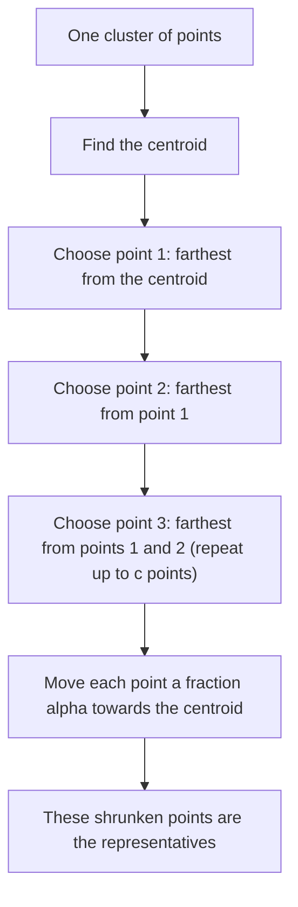

Before the new ideas, here are the old ones you need. If you already know them, skip to the next section.

## The basics first

- **Clustering** means splitting a set of points into groups (**clusters**) so that points in the same group are close to each other and points in different groups are far apart. Example: grouping customers by what they buy. This is syllabus <Syl m="5" />.
- A **distance measure** says how far apart two points are. In a **Euclidean space** the points are lists of numbers and the usual straight-line distance works; see the Distance Measures note. In a non-Euclidean space (for example words) we use another distance, such as edit distance.
- The **centroid** of a cluster is the average of its points (the "middle"). In a non-Euclidean space there is no average, so we pick one real point as the middle, called the **clustroid**.
- **Hierarchical (agglomerative) clustering** starts with every point as its own cluster and keeps merging the two closest clusters until the wanted number is left. **Point-assignment clustering** (k-means) picks k centres and puts every point in the nearest one.
- A **random sample** is a small part of the data picked fairly, so that it looks like the whole.
- An **outlier** is a point far away from all the clusters (noise or an error).

<Cite id="distance-measures-mmds" loc="ch. 7" /> <Cite id="cure-stream-clustering-wiki-hier" /> <Cite id="distance-measures-wiki-euclid" /> <Cite id="distance-measures-wiki-metric" />

## Why the older methods are not enough

**The problem.** Clustering a huge data set must be fast and must give sensible clusters even when they are not round, are of very different sizes, and the data contains outliers. The original CURE paper lists what goes wrong with the common methods <Cite id="cure-stream-clustering-guha1998" loc="§1.1" />:

| Method | How it describes a cluster | What goes wrong |
| --- | --- | --- |
| k-means (square-error) | One centroid | Prefers round clusters of similar size; a big cluster is cut into pieces so that its pieces fit the small clusters better |
| Hierarchical, centroid distance | One centroid | Same problem: long clusters are split |
| Hierarchical, minimum distance (all points) | Every point | A thin bridge of points joins two clusters ("chaining"); very sensitive to outliers |
| BIRCH | Summaries, then centroids | Final labelling uses only centroids, so points of a big cluster are given to a nearby small one |

**Everyday analogy.** Describing a long banana with one point (its middle) is poor: a point at the tip is closer to the middle of some other fruit. Describing it with every one of its thousand pixels is slow and a single stray pixel can confuse you. CURE uses a handful of points spread along the banana: enough to capture its shape, few enough to be fast.

<Cite id="cure-stream-clustering-guha1998" loc="§1.1" /> <Cite id="cure-stream-clustering-yorku-slides" /> <Cite id="cure-stream-clustering-wiki-birch" /> <Cite id="cure-stream-clustering-gfg-cure-dbscan" />

## CURE: Clustering Using REpresentatives

<PYQ id="2023-12/q4b" /> <PYQ id="2024-05/q6b" /> <PYQ id="2024-12/q6a" /> <PYQ id="2025-05/q6b" />

<Box kind="definition">

**CURE** (Clustering Using REpresentatives, Guha, Rastogi and Shim, 1998) is a hierarchical clustering algorithm for large data. It stores for each cluster a fixed number $c$ of **well-scattered points**, moves each of them a fraction $\alpha$ of the way towards the cluster's centroid, and uses these **representative points** to decide which clusters to merge. It is more robust to outliers and finds clusters of non-spherical shape and wide differences in size.

</Box>

It sits between two extremes: the centroid method (one representative) and the all-points method (every point is a representative). <Cite id="cure-stream-clustering-guha1998" loc="§1.2" /> <Cite id="cure-stream-clustering-wiki-cure" /> <Cite id="cure-stream-clustering-tp-cure" />

### How CURE works

The book describes it in two stages, **initialization** and **completion**. It works in a Euclidean space, because it needs centroids <Cite id="cure-stream-clustering-basile-slides" /> <Cite id="distance-measures-mmds" loc="ch. 7" />.

**Stage 1: initialization (cluster a sample).**

1. **Take a random sample** of the data small enough to fit in main memory. *Why: the full hierarchical algorithm is too slow for all the data.*
2. **Cluster the sample hierarchically.** Start with each sampled point as its own cluster and repeatedly merge the closest pair of clusters until $k$ clusters are left.
3. **Pick $c$ well-scattered points in each cluster.** The first is the point farthest from the cluster's centroid; each next one is the point farthest from the ones already chosen. *Why: this spreads the points along the cluster and captures its shape.*
4. **Shrink them.** Move each chosen point a fraction $\alpha$ (for example 20%) of the way towards the centroid:

$$
p_{\text{new}} = p + \alpha\,(\text{centroid} - p)
$$

   Here $p$ is the scattered point, $\alpha$ is the shrink fraction between 0 and 1, and $p_{\text{new}}$ is the representative point. *Why: outliers are far from the centre, so they move the most and lose their power to cause wrong merges.*

**Stage 2: merging and completion.**

5. **Distance between two clusters** = the distance between their closest pair of representative points, one from each cluster.
6. **Merge** the two closest clusters; pick $c$ new representatives for the merged cluster; repeat until only $k$ clusters remain.
7. **Label all the other points.** Scan the whole data set once; put each point in the cluster of its **nearest representative point**. Using several representatives per cluster (not one centroid) puts points of long clusters in the right place.

<Cite id="cure-stream-clustering-gfg-cure" loc="diagram" /> <Cite id="cure-stream-clustering-guha1998" loc="Fig. 4" />

<Cite id="cure-stream-clustering-zilliz" loc="diagram" /> <Cite id="cure-stream-clustering-guha1998" loc="§3.2" />

**Convention warning.** The paper moves the points *by* $\alpha$ towards the centre, so $\alpha = 1$ gives the centroid method and $\alpha = 0$ gives the all-points method <Cite id="cure-stream-clustering-guha1998" loc="§1.2" />. Some sites use the opposite meaning (a point stays at 70% of its distance) <Cite id="cure-stream-clustering-tp-cure" />. Always read which meaning a question uses. The paper's experiments found $\alpha$ between 0.2 and 0.7 works well <Cite id="cure-stream-clustering-yorku-slides" />.

<Sum>

<Given>

One cluster of 6 points in 2-D: $A(1,2)$, $B(3,2)$, $C(5,2)$, $D(9,2)$, $E(4,6)$, $F(2,-2)$. Take $c = 3$ representatives and shrink fraction $\alpha = 0.2$ (move 20% towards the centroid).

</Given>

<Find>

the centroid, the 3 well-scattered points, and the 3 representative points.

</Find>

<Steps>

1. **Centroid.** $x$: $(1+3+5+9+4+2)/6 = 24/6 = 4$. $y$: $(2+2+2+2+6-2)/6 = 12/6 = 2$. Centroid $= (4, 2)$. *Reason: the centroid is the average of the points.*
2. **First scattered point: farthest from the centroid.** Squared distances (squares are enough to compare): $A$: $9$, $B$: $1$, $C$: $1$, $D$: $25$, $E$: $0+16 = 16$, $F$: $4+16 = 20$. The largest is $D(9,2)$. *Reason: the rule starts with the point farthest from the centre.*
3. **Second: farthest from $D$.** Squared distances to $D(9,2)$: $A$: $64$, $B$: $36$, $C$: $16$, $E$: $25+16 = 41$, $F$: $49+16 = 65$. The largest is $F(2,-2)$. *Reason: each new point must be far from those already chosen.*
4. **Third: farthest from the nearest chosen point.** For each left-over point take the smaller of its distances to $D$ and $F$. $A$: $\min(64, 1+16) = 17$. $B$: $\min(36, 1+16) = 17$. $C$: $\min(16, 9+16) = 16$. $E$: $\min(41, 4+64) = 41$. The largest is $E(4,6)$. *Reason: a point is "covered" if it is close to any chosen point.*
5. **Shrink 20% towards $(4,2)$**, using $p + 0.2(\text{centroid} - p)$:
   - $D$: $x = 9 + 0.2(4-9) = 8$, $y = 2$, so $(8, 2)$.
   - $F$: $x = 2 + 0.2(4-2) = 2.4$, $y = -2 + 0.2(2-(-2)) = -1.2$, so $(2.4, -1.2)$.
   - $E$: $x = 4$, $y = 6 + 0.2(2-6) = 5.2$, so $(4, 5.2)$.

</Steps>

<Answer>

centroid $(4, 2)$; scattered points $D(9,2)$, $F(2,-2)$, $E(4,6)$; representatives $(8, 2)$, $(2.4, -1.2)$, $(4, 5.2)$.

</Answer>

<Box kind="verify">

Check 1: the farthest point $D$ moved 1 unit (20% of its distance 5) from $x = 9$ to $x = 8$, and $F$ moved $0.2 \times \sqrt{20} \approx 0.89$ units. Far points moved more than near ones, as expected.

Check 2: each representative lies on the straight line from its scattered point to the centroid. For $E$ the line is $x = 4$, and the representative $(4, 5.2)$ has $x = 4$.

Check 3: the centroid of the 6 points is unchanged by shrinking, because the centroid is computed from the original points. Sum of $x$: $1+3+5+9+4+2 = 24$, so $24/6 = 4$. The same again in another order gives $(1+9)+(3+5)+(4+2) = 10+8+6 = 24$.

</Box>

</Sum>

If the shrink fraction changes, the same far point $D(9,2)$ lands in a different place. This shows what $\alpha$ controls:

| $\alpha$ | Representative of $D$ | What it behaves like |
| --- | --- | --- |
| 0 | $(9, 2)$ (not moved) | All-points method (outlier-sensitive) |
| 0.2 | $(8, 2)$ | Mostly the shape, a little outlier protection |
| 0.5 | $(6.5, 2)$ | Compact, round-ish clusters |
| 1 | $(4, 2)$ (the centroid) | Centroid method |

Each row follows from $9 + \alpha(4-9)$: $9$, $8$, $6.5$, $4$.

### How two clusters are merged

At each step CURE merges the two clusters that have the closest pair of representatives. This is what lets it follow a long cluster: two pieces of the same long cluster have representatives that almost touch, even though their centroids are far apart.

<Sum>

<Given>

Three clusters, each with 2 representative points: $U = \{(1,1), (3,1)\}$, $V = \{(5,2), (9,2)\}$, $W = \{(4,6), (6,6)\}$.

</Given>

<Find>

which two clusters CURE merges, and which two a centroid-distance method would merge.

</Find>

<Steps>

1. **CURE distance = closest pair of representatives** (one from each cluster). For $U$ and $V$ the four distances are $(3,1)$ to $(5,2)$: $\sqrt{4+1} = \sqrt{5} \approx 2.24$; $(1,1)$ to $(5,2)$: $\sqrt{17}$; $(3,1)$ to $(9,2)$: $\sqrt{37}$; $(1,1)$ to $(9,2)$: $\sqrt{65}$. Smallest: $\sqrt{5} \approx 2.24$.
2. **$U$ and $W$:** $(3,1)$ to $(4,6)$: $\sqrt{1+25} = \sqrt{26}$; $(1,1)$ to $(4,6)$: $\sqrt{34}$; $(3,1)$ to $(6,6)$: $\sqrt{34}$; $(1,1)$ to $(6,6)$: $\sqrt{50}$. Smallest: $\sqrt{26} \approx 5.10$.
3. **$V$ and $W$:** $(5,2)$ to $(4,6)$: $\sqrt{1+16} = \sqrt{17}$; $(5,2)$ to $(6,6)$: $\sqrt{17}$; $(9,2)$ to $(4,6)$: $\sqrt{41}$; $(9,2)$ to $(6,6)$: $\sqrt{9+16} = 5$. Smallest: $\sqrt{17} \approx 4.12$.
4. **CURE merges the smallest of the three:** $U$ and $V$ (2.24).
5. **Centroid method:** the centroids are $U(2,1)$, $V(7,2)$, $W(5,6)$. $UV$: $\sqrt{25+1} = \sqrt{26} \approx 5.10$. $UW$: $\sqrt{9+25} = \sqrt{34} \approx 5.83$. $VW$: $\sqrt{4+16} = \sqrt{20} \approx 4.47$. The smallest is $V$ and $W$.

</Steps>

<Answer>

CURE merges $U$ and $V$ (closest representatives, distance $\approx 2.24$); a centroid method would merge $V$ and $W$ (centroid distance $\approx 4.47$).

</Answer>

<Box kind="verify">

Check 1: $V$ is a long cluster (its two points are 4 apart), so its centroid $(7,2)$ is far from its own end $(5,2)$. The end $(5,2)$ is close to $U$'s end $(3,1)$, which is why the representative distance is small while the centroid distance $UV = \sqrt{26}$ is not.

Check 2: the centroids come from the averages: $V$: $(5+9)/2 = 7$, $(2+2)/2 = 2$; $W$: $(4+6)/2 = 5$, $(6+6)/2 = 6$; $U$: $(1+3)/2 = 2$, $(1+1)/2 = 1$. Recomputing $VW$ as $\sqrt{(7-5)^2 + (2-6)^2} = \sqrt{20}$ matches.

</Box>

</Sum>

### Handling big data: sampling, partitioning, labelling, outliers

- **Random sampling.** CURE clusters only a random sample that fits in memory. It also helps against outliers, since most of them are not drawn. The price: a small cluster may be missed, so the sample must be big enough; the paper uses Chernoff bounds to choose the sample size <Cite id="cure-stream-clustering-guha1998" loc="§4.1" />.
- **Partitioning.** If the sample is still too big, split it into $p$ partitions, partially cluster each (until about $n/(pq)$ clusters remain), then cluster all the partial clusters in a second pass. This cuts the running time <Cite id="cure-stream-clustering-guha1998" loc="§4.2" />.
- **Labelling data on disk.** Every point not in the sample goes to the cluster of its nearest representative <Cite id="cure-stream-clustering-guha1998" loc="§4.3" />. With only a centroid (as BIRCH does) points of a big cluster can be given to a small neighbour.
- **Outliers**, in two phases. In phase 1 the clustering is paused when the number of clusters falls to about a third of the start, and clusters with very few points (1 or 2) are dropped, because outliers merge slowly. In phase 2, near the end, small clusters are removed again <Cite id="cure-stream-clustering-guha1998" loc="§4.4" /> <Cite id="cure-stream-clustering-yorku-slides" />.
- **Cost.** Worst-case time $O(n^2 \log n)$ and space $O(n)$ for $n$ sampled points <Cite id="cure-stream-clustering-guha1998" loc="§3.3" />.

<Sum>

<Given>

Two clusters. $X$ is long, with representatives $(1,0)$ and $(9,0)$ and centroid $(5,0)$. $Y$ is small, with representatives $(6,3)$ and $(8,3)$ and centroid $(7,3)$. A new point $p = (10, 0)$ must be labelled.

</Given>

<Find>

the cluster of $p$ when using representatives (CURE), and when using only centroids.

</Find>

<Steps>

1. **Distance from $p$ to the representatives of $X$:** to $(9,0)$ it is $1$, to $(1,0)$ it is $9$. The closest is $1$.
2. **Distance from $p$ to the representatives of $Y$:** to $(8,3)$ it is $\sqrt{4+9} = \sqrt{13} \approx 3.61$, to $(6,3)$ it is $\sqrt{16+9} = 5$. The closest is $3.61$.
3. **CURE labels by the nearest representative overall:** $1 < 3.61$, so $p$ goes to $X$.
4. **Centroid labelling:** $p$ to $X$'s centroid $(5,0)$ is $5$; $p$ to $Y$'s centroid $(7,3)$ is $\sqrt{9+9} = \sqrt{18} \approx 4.24$. The smaller is $Y$, so a centroid method wrongly puts $p$ in $Y$.

</Steps>

<Answer>

With representatives $p$ goes to the long cluster $X$ (distance 1); with centroids only it would wrongly go to $Y$ (distance 4.24 against 5).

</Answer>

<Box kind="verify">

Check 1: $p = (10,0)$ lies on the same straight line $y = 0$ as the whole of $X$, 1 unit past its end, so it should belong to $X$. Only the representative method says so.

Check 2: recompute the centroid distances another way: $\sqrt{(10-5)^2 + 0^2} = 5$ and $\sqrt{(10-7)^2 + (0-3)^2} = \sqrt{18} = 4.24$. Same as step 4.

</Box>

</Sum>

### Advantages, disadvantages and uses

| Advantages | Disadvantages |
| --- | --- |
| Finds clusters of any shape (long, curved), not only round ones | Needs a Euclidean space, because it uses centroids |
| Works with clusters of very different sizes | Results depend on the parameters: $c$, $\alpha$, sample size, number of partitions, $k$ |
| Less sensitive to outliers (shrinking, sampling, two-phase removal) | A small cluster can be missed if the sample is too small |
| Scales to large data by sampling and partitioning; space is linear | Worst-case time $O(n^2 \log n)$ is still heavy for a very large sample |
| Labels points by several representatives, so long clusters are not split | Many distance computations in high dimensions |

<Cite id="cure-stream-clustering-guha1998" loc="§1.2, §3.3" /> <Cite id="cure-stream-clustering-zilliz" /> <Cite id="cure-stream-clustering-gfg-cure" />

**Advantages over traditional algorithms** (the standard exam question): k-means and centroid-based hierarchical methods give round, equal-sized clusters and split big or long ones; the all-points (minimum-distance) method chains through bridges and is hurt by outliers; BIRCH labels with centroids only. CURE avoids all three problems with its few shrunken representatives, and still scales by sampling.

**Applications.** Grouping sky objects or customers when clusters are not round, spatial and image data, and any big data where outliers and odd shapes are expected.

<Box kind="exam">

**Write this in the exam:** "CURE represents each cluster by a fixed number of well-scattered points shrunk towards the centroid. Clusters with the closest pair of representatives are merged. It uses random sampling and partitioning to handle large data, and labels remaining points by the nearest representative. It handles non-spherical clusters and is robust to outliers."

</Box>

## Clustering a data stream

**What it is.** In the stream model, points arrive one after another, endlessly, and we cannot store them all (see the Stream Data Model note). **Stream clustering** means keeping a good clustering of the recent points using only a small amount of memory, while new points keep arriving. <Cite id="cure-stream-clustering-wiki-dsc" /> <Cite id="stream-data-model-wiki-ds" /> <Cite id="stream-data-model-cs246-slides" />

**Everyday analogy.** A shop manager groups customers by what they buy. New customers arrive all day, and the shop can keep only a short summary of each group, not every bill. Old bills are thrown away; recent groups matter most.

### The stream-computing model

- The stream is a sequence of points. We care about a **sliding window** of the last $N$ points (older ones are dropped).
- A **query** asks: "give the clusters of the last $m$ points", where $m \le N$. It can come at any time.
- Clusters **change over time**: a cluster of morning shoppers can be replaced by evening shoppers.
- **No assumption** is made about the space. It may be Euclidean (use centroids) or not (use clustroids).
- The answer is **approximate**, because we only hold summaries.

<Cite id="cure-stream-clustering-basile-slides" /> <Cite id="distance-measures-mmds" loc="ch. 7" /> <Cite id="stream-data-model-babcock2002" loc="§2" /> <Cite id="cure-stream-clustering-bdmo2003" loc="§1.2" />

### A stream-clustering algorithm: BDMO

The method of Babcock, Datar, Motwani and O'Callaghan (BDMO) is a generalisation of the DGIM bucket idea used for counting ones in a window. <Cite id="cure-stream-clustering-fiu-slides" /> <Cite id="cure-stream-clustering-bdmo2003" /> The stream is divided into **buckets**.

<Box kind="definition">

**Bucket rules.** The size of a bucket is the number of points it represents. (1) Every size is a power of two. (2) There are one or two buckets of each size. (3) Sizes never decrease as we go back in time (older buckets are bigger). So there are only $O(\log N)$ buckets.

</Box>

**What a bucket stores.**

- its **size** (number of points);
- the **timestamp** of its most recent point;
- for each of $k$ clusters (the same $k$ in every bucket): the **number of points**, the **centroid or clustroid**, and any other facts needed to merge clusters later (for example how spread out the cluster is).

<Cite id="cure-stream-clustering-basile-slides" /> <Cite id="cure-stream-clustering-fiu-slides" />

<Cite id="cure-stream-clustering-fiu-slides" loc="diagram" />

### Initializing buckets

1. Keep the newest points in a **buffer** in main memory.
2. Choose a **smallest bucket size $p$** (a power of two).
3. When $p$ new points have arrived, **cluster them** into $k$ clusters with any method (for example k-means, or CURE-style hierarchical clustering).
4. Make a new **bucket of size $p$**: store the timestamp of the newest point and the summary of each of the $k$ clusters (count and centroid, or clustroid). Empty the buffer.
5. If a bucket's timestamp is more than $N$ old, **drop** it, since it is wholly outside the window.

<Cite id="cure-stream-clustering-basile-slides" /> <Cite id="cure-stream-clustering-bdmo2003" loc="§3" />

### Merging buckets

After a new bucket of size $p$ is made:

1. **Drop** any bucket whose timestamp is more than $N$ units before now.
2. If there are now **three** buckets of size $p$, **merge the two oldest** into one bucket of size $2p$. Merging may create three buckets of size $2p$; then merge the two oldest of those into $4p$, and so on until no size has three buckets.
3. **To merge two buckets**: the new size is the sum; the new timestamp is the more recent one; the $2k$ clusters are combined into $k$ by repeatedly joining the closest pair, giving the new count (the sum) and the new centroid (the count-weighted average of the centroids). In a non-Euclidean space the new clustroid is chosen from the old ones.

<Cite id="cure-stream-clustering-fiu-slides" /> <Cite id="cure-stream-clustering-basile-slides" /> <Cite id="cure-stream-clustering-wiki-dsc" />

<Sum>

<Given>

Smallest bucket size $p = 4$. Points arrive; every 4 points a bucket of size 4 is made. Rule: when three buckets have the same size, merge the two oldest. Assume the window $N$ is large, so nothing is dropped.

</Given>

<Find>

the bucket sizes (oldest first) after 4, 8, 12, 16, 20, 24, 28 and 32 points.

</Find>

<Steps>

1. **After 4 points:** one bucket, $[4]$.
2. **After 8:** $[4, 4]$. Two of size 4 is allowed.
3. **After 12:** $[4, 4, 4]$ has three of size 4, so merge the two oldest: $[8, 4]$.
4. **After 16:** add a 4: $[8, 4, 4]$.
5. **After 20:** add a 4: $[8, 4, 4, 4]$; merge the two oldest 4s: $[8, 8, 4]$.
6. **After 24:** $[8, 8, 4, 4]$.
7. **After 28:** $[8, 8, 4, 4, 4]$; merge the two oldest 4s: $[8, 8, 8, 4]$; now three 8s, merge the two oldest: $[16, 8, 4]$.
8. **After 32:** $[16, 8, 4, 4]$.

</Steps>

<Answer>

| Points seen | Buckets (oldest first) |
| --- | --- |
| 4 | 4 |
| 8 | 4, 4 |
| 12 | 8, 4 |
| 16 | 8, 4, 4 |
| 20 | 8, 8, 4 |
| 24 | 8, 8, 4, 4 |
| 28 | 16, 8, 4 |
| 32 | 16, 8, 4, 4 |

</Answer>

<Box kind="verify">

Check 1: the sizes in each row add up to the number of points seen (for example $16+8+4 = 28$, $16+8+4+4 = 32$).

Check 2: no row has three buckets of the same size, and sizes never get smaller going to the left (older buckets are the biggest).

</Box>

</Sum>

<Sum>

<Given>

Two buckets to merge, each with $k = 2$ clusters in 2-D. Old bucket: cluster $C_1$ has 3 points and centroid $(1,1)$; $C_2$ has 1 point and centroid $(9,9)$. New bucket: $C_3$ has 2 points and centroid $(2,3)$; $C_4$ has 2 points and centroid $(10,8)$.

</Given>

<Find>

the merged bucket's size and its two clusters (count and centroid).

</Find>

<Steps>

1. **Size.** Old bucket $3+1 = 4$ points, new bucket $2+2 = 4$ points, merged size $= 8$. *Reason: size is the number of points.*
2. **Pair the closest clusters.** $C_1$ to $C_3$: $\sqrt{1+4} \approx 2.24$; $C_1$ to $C_4$: $\sqrt{81+49}$ is large. So $C_1$ joins $C_3$, and likewise $C_2$ joins $C_4$ ($\sqrt{1+1} \approx 1.41$).
3. **Merge $C_1$ and $C_3$.** Count $= 3+2 = 5$. Centroid $x = (3\cdot 1 + 2\cdot 2)/5 = 7/5 = 1.4$. Centroid $y = (3\cdot 1 + 2\cdot 3)/5 = 9/5 = 1.8$. So $(1.4, 1.8)$. *Reason: the new centroid is the average of the old centroids weighted by their point counts.*
4. **Merge $C_2$ and $C_4$.** Count $= 1+2 = 3$. $x = (1\cdot 9 + 2\cdot 10)/3 = 29/3 \approx 9.67$. $y = (1\cdot 9 + 2\cdot 8)/3 = 25/3 \approx 8.33$.

</Steps>

<Answer>

merged bucket of size 8 with clusters: 5 points at centroid $(1.4, 1.8)$ and 3 points at centroid $(9.67, 8.33)$. Its timestamp is the new bucket's timestamp.

</Answer>

<Box kind="verify">

Check 1: the counts add up: $5 + 3 = 8$.

Check 2: the coordinate totals are unchanged by merging. Before: $x$: $3\cdot1 + 1\cdot 9 + 2\cdot 2 + 2\cdot 10 = 3+9+4+20 = 36$; $y$: $3+9+6+16 = 34$. After: $x$: $5\cdot 1.4 + 3\cdot 29/3 = 7 + 29 = 36$; $y$: $5\cdot 1.8 + 3\cdot 25/3 = 9 + 25 = 34$.

</Box>

</Sum>

### Answering queries

A query asks for the clusters of the last $m$ points.

1. Look at the buckets from the newest backwards and **choose the fewest buckets that together cover at least $m$ points**.
2. Pool all the cluster summaries (counts and centroids) of these buckets; each is treated like a weighted point.
3. **Merge them down to $k$ clusters** (for example by repeatedly joining the closest pair) and return these.

The oldest chosen bucket may reach a little further back than $m$ points, so the answer includes some older points; that is part of why it is approximate.

<Cite id="cure-stream-clustering-basile-slides" /> <Cite id="cure-stream-clustering-bdmo2003" /> <Cite id="distance-measures-mmds" loc="ch. 7" />

<Sum>

<Given>

Buckets after 28 points (oldest first): size 16 (points 1 to 16), size 8 (points 17 to 24), size 4 (points 25 to 28). A query asks for the clusters of the last $m = 10$ points, with $k = 2$.

</Given>

<Find>

which buckets are used, and how many points they cover.

</Find>

<Steps>

1. **Start from the newest bucket:** size 4 covers points 25 to 28, that is 4 points. Still less than 10.
2. **Add the next older bucket:** size 8 covers points 17 to 24, so 4 + 8 = 12 points, which is at least 10. Stop.
3. **Pool** the $2 \times 2 = 4$ cluster summaries of these two buckets and merge the closest pairs until $k = 2$ clusters remain.

</Steps>

<Answer>

use the buckets of size 8 and size 4; they cover 12 points (points 17 to 28), 2 more than the 10 asked for. The size-16 bucket is not needed.

</Answer>

<Box kind="verify">

Check 1: the last 10 points are numbers 19 to 28. The chosen buckets cover 17 to 28, which includes all of them. If only the size-4 bucket was used, we would have 4 points, fewer than 10.

Check 2: without the size-8 bucket the count is $4 < 10$; with it the count is $12 \ge 10$; so two buckets are the smallest set.

</Box>

</Sum>

### Stream clustering compared with CURE

| Point | CURE | BDMO stream clustering |
| --- | --- | --- |
| Data | A big data set stored on disk | An endless stream, only recent points matter |
| Passes | Sample, then one pass to label | One pass; each point is used once |
| What is kept | $c$ representatives per cluster | $k$ cluster summaries per bucket, $O(\log N)$ buckets |
| Space assumption | Euclidean (centroids) | Any space (centroids or clustroids) |
| Answer | Final $k$ clusters | $k$ clusters of the last $m$ points, any time |

<Cite id="cure-stream-clustering-wiki-dsc" /> <Cite id="stream-counting-wiki-dsm" />

**Other stream clusterers (names only).** STREAM (divide and conquer, k-median), BIRCH (a CF-tree summary) and CluStream (micro-clusters) are other ways to cluster streams <Cite id="cure-stream-clustering-wiki-dsc" />.

**In one line.** CURE clusters big data by a few shrunken representative points per cluster, so it handles odd shapes and outliers; BDMO keeps a sliding window of a stream as power-of-two buckets of cluster summaries, merging old ones and answering queries by combining the buckets that cover the last $m$ points.
