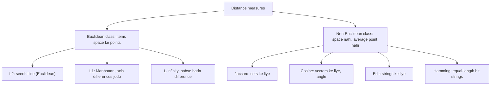
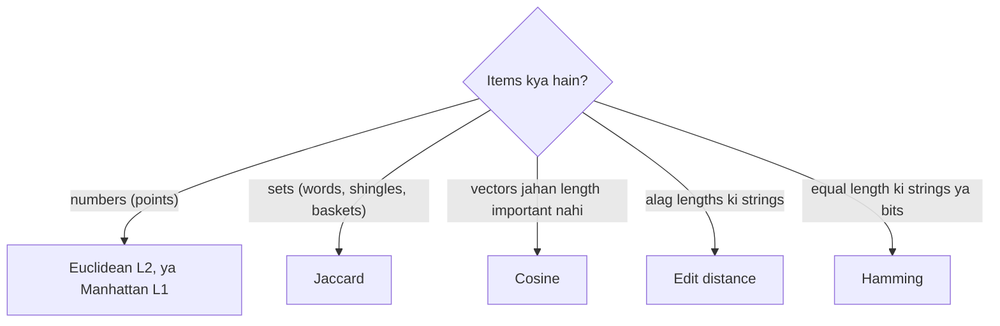

Naye ideas se pehle chhoti cheezein jo chahiye. Agar aati hain to next section pe jao.

## Pehle basics

- **Point** numbers ki list hai, jaise $(3, 4)$. Har number ek **coordinate** hai ek **axis** (dimension) pe. $n$ numbers wala point $n$ dimensions mein rehta hai. **Vector** wahi list hai, bas ise origin se nikalte hue arrow ki tarah sochte hain.
- **Set** alag-alag items ka collection hai bina order ke, jaise ek document ke distinct words. Set ko $\{a, b, c\}$ likhte hain. $|A|$ ka matlab $A$ mein items ki ginti.
- **Intersection** $A \cap B$ woh hai jo dono sets mein common hai. **Union** $A \cup B$ woh sab hai jo kisi bhi set mein hai.
- **String** characters ka sequence hai, jaise "kitten". **Bit vector** 0 aur 1 ki string hai.
- **Similarity** tab badi hoti hai jab do items milte-julte hon. **Distance** tab chhoti hoti hai jab items milte-julte hon. Kai measures dono form mein aate hain, aur ek se doosra banta hai.

## Distance measure kya hota hai

**Ye kya hai.** Distance measure do items $x$ aur $y$ leta hai aur ek number $d(x, y)$ deta hai jo batata hai ki ve kitne door hain. Ye syllabus <Syl m="5" /> hai, "Distance measures: definition of a distance measure, Euclidean, Jaccard, cosine, edit and Hamming distances". <Cite id="distance-measures-mmds" loc="§3.5" /> <Cite id="distance-measures-wiki-metric" />

**Ye kyun zaroori hai.** Big-data jobs baar baar pucchte hain "kaun se items milte-julte hain?": near-duplicate web pages dhundna, similar taste wale customers ka group banana, similar products suggest karna, naye point ke nearest neighbours nikalna. Computer "milta-julta" aankh se nahi judge kar sakta, isliye hum ise number banate hain aur numbers compare karte hain. <Cite id="distance-measures-ibm-knn" /> <Cite id="distance-measures-tp-knn" />

**Everyday analogy.** Do shehron ki doori kilometres mein hoti hai. Lekin "do gaane kitne alag hain?" ke liye alag scale chahiye, shehron wala nahi. Yahan bhi yehi hai: points, sets, vectors aur strings ko apna-apna scale chahiye.

<Box kind="definition">

Function $d(x, y)$ ek **distance measure** hai agar ye 4 rules maane: <Cite id="distance-measures-mmds" loc="§3.5.1" />

1. $d(x, y) \ge 0$ (distance kabhi negative nahi hoti).
2. $d(x, y) = 0$ sirf tab jab $x = y$ (sirf identical items ki doori zero hoti hai).
3. $d(x, y) = d(y, x)$ (symmetry: doori direction pe depend nahi karti).
4. $d(x, y) \le d(x, z) + d(z, y)$ (**triangle inequality**: teesre item $z$ se ghoom ke jaana seedhe jaane se kabhi chhota nahi hota).

</Box>

Triangle inequality wahi rule hai jo log bhool jaate hain. Simple shabdon mein, ghoom ke jaana shortcut nahi ban sakta. Similar items dhundne ke kai fast algorithms isi pe tike hain. <Cite id="distance-measures-wiki-metric" />

<Sum>

<Given>

Numbers pe ek proposed "distance": $d(x, y) = (x - y)^2$. Teen numbers lo: $0$, $1$ aur $2$.

</Given>

<Find>

kya $d$ triangle inequality maanta hai.

</Find>

<Steps>

1. 0 se 2 ki seedhi doori: $d(0, 2) = (0 - 2)^2 = 4$. *Reason: numbers ko seedha formula mein daalo.*
2. Beech ke number se hoke doori: $d(0, 1) + d(1, 2) = 1 + 1 = 2$. *Reason: triangle inequality seedhi doori ko ghoom ke jaane se compare karti hai.*
3. Compare karo: rule ke liye $d(0, 2) \le 2$ chahiye, lekin $d(0, 2) = 4$, aur $4 > 2$.

</Steps>

<Answer>

Nahi. Triangle inequality fail ho gayi, isliye $(x - y)^2$ distance measure nahi hai.

</Answer>

<Box kind="verify">

Rule todne ke liye ek failed case kaafi hai. Rules 1 se 3 sahi hain, sirf rule 4 fail hota hai. Normal distance $|x - y|$ se compare karo: $|0 - 2| = 2 \le 1 + 1 = 2$, ye pass hota hai.

</Box>

</Sum>

<Cite id="distance-measures-av" loc="diagram" /> <Cite id="distance-measures-mlm" />

## Do major classes: Euclidean aur non-Euclidean

**Ye kya hai.** Distance measures do badi classes mein bante hain. <Cite id="distance-measures-mmds" loc="§7.1.1" />

- **Euclidean distances.** Items **Euclidean space ke points** hain: aisi space jisme coordinates hain, seedhi line ki doori ka matlab banta hai, aur kai points ka **average** hamesha nikal sakte hain (har coordinate ka average lo). Usual measures $L_2$, $L_1$ aur $L_\infty$ distances hain.
- **Non-Euclidean distances.** Items aise space ke points nahi hain. Ve sets, strings, bit vectors ya documents hain. Do items kitne door hain ye bata sakte hain, lekin items ko jod nahi sakte aur "average item" nahi nikal sakte. Jaccard, cosine, edit aur Hamming distances standard examples hain.

**Ye farak kyun matter karta hai.** Clustering mein aksar group ka **centre** chahiye hota hai. Points ke liye bas average lete hain. Strings ya sets ka average nahi hota, isliye centre group ka koi asli item hona chahiye (**clustroid**, jo baaki sabke sabse paas hai). <Cite id="distance-measures-mmds" loc="§7.2.3" />

| Point | Euclidean distances | Non-Euclidean distances |
| --- | --- | --- |
| Items hain | Numeric coordinates wale points | Sets, strings, bit vectors, documents |
| Examples | $L_2$, $L_1$, $L_\infty$ | Jaccard, cosine, edit, Hamming |
| Items ka average | Hota hai (har coordinate ka average) | Nahi hota |
| Cluster ka centre | Centroid (naya point ho sakta hai) | Clustroid (existing item hona chahiye) |
| Typical data | Height-weight, coordinates, sensor values | Documents, DNA, customer baskets, usernames |

**Har class ka example.** Euclidean: map pe do ghar $(0, 0)$ aur $(3, 4)$ par $5$ units door hain, aur unki average position $(1.5, 2)$ hai. Non-Euclidean: words "cat" aur "cart" $1$ edit door hain (ek letter insert karo), lekin aisa koi word nahi jo dono ka "average" ho.

<Box kind="exam">

PYQ: <PYQ id="2023-12/q6a" /> do major classes examples ke saath maangta hai (10 marks). Distance measure ki definition 4 rules ke saath likho, phir upar ki table ke saath Euclidean versus non-Euclidean, har class ka ek worked example, aur clustroid point. <PYQ id="2024-05/q1b" /> aur <PYQ id="2025-05/q1d" /> (5-5 marks) measures list karke explain karne ko kehte hain: Euclidean, Jaccard, cosine, edit aur Hamming, jo aage ke sections mein hain.

</Box>

## Euclidean distances ($L_r$ norms)

**Ye kya hai.** Do points $x = (x_1, \dots, x_n)$ aur $y = (y_1, \dots, y_n)$ ke liye **$L_r$ distance** har axis ka difference leta hai, uski power $r$ karta hai, jodta hai, aur $r$-th root leta hai: <Cite id="distance-measures-mmds" loc="§3.5.2" /> <Cite id="distance-measures-wiki-minkowski" />

$$
d_r(x, y) = \left( \sum_{i=1}^{n} |x_i - y_i|^r \right)^{1/r}
$$

$r$ ki teen values important hain:

| Name | $r$ | Simple shabdon mein | Formula |
| --- | --- | --- | --- |
| Euclidean ($L_2$) | 2 | Seedhi line ki doori, "as the crow flies" | $\sqrt{\sum (x_i - y_i)^2}$ |
| Manhattan ($L_1$) | 1 | Axis differences jodo, jaise city blocks pe chalna | $\sum \lvert x_i - y_i \rvert$ |
| Chebyshev ($L_\infty$) | $\infty$ | Sirf sabse bada single difference | $\max_i \lvert x_i - y_i \rvert$ |

<Cite id="distance-measures-wiki-euclid" /> <Cite id="distance-measures-wiki-taxicab" /> <Cite id="distance-measures-wiki-chebyshev" /> <Cite id="distance-measures-gfg-euclid" loc="diagram" /> <Cite id="distance-measures-gfg-manhattan" /> <Cite id="distance-measures-gfg-minkowski" />

**Everyday analogy.** Roads ke grid wale shehar mein taxi buildings ke beech se nahi ja sakti, to ye $L_1$ chalti hai (kitne block east plus kitne block north). Drone seedha ud ke jaata hai, ye $L_2$ doori hai. Chess ka king kisi bhi direction mein, diagonal bhi, ek step chalta hai, to do squares ke beech moves ki ginti $L_\infty$ doori hai.

**Achha aur bura.** $L_2$ default hai aur doori ke hamare idea se match karta hai, lekin ek bahut bada difference usse dominate kar leta hai kyunki differences square hote hain. $L_1$ par ek bade difference ka kam asar padta hai. Teeno numbers pe chalte hain, isliye pehle features ko similar scale pe laao (jaise metres aur millimetres mat milao). <Cite id="distance-measures-av" /> <Cite id="distance-measures-mlm" />

<Sum>

<Given>

3 dimensions mein do points: $x = (1, 2, 3)$ aur $y = (4, 6, 3)$.

</Given>

<Find>

$x$ aur $y$ ke beech $L_2$ (Euclidean), $L_1$ (Manhattan) aur $L_\infty$ distance.

</Find>

<Steps>

1. Har axis pe difference: $|1 - 4| = 3$, $|2 - 6| = 4$, $|3 - 3| = 0$. *Reason: har $L_r$ distance inhi axis differences se shuru hoti hai.*
2. $L_2$: square karo, $9 + 16 + 0 = 25$, phir square root, $\sqrt{25} = 5$. *Reason: $r = 2$ matlab square, add, square root.*
3. $L_1$: differences jodo, $3 + 4 + 0 = 7$. *Reason: $r = 1$ matlab bas jodo.*
4. $L_\infty$: sabse bada difference lo, $\max(3, 4, 0) = 4$. *Reason: $r$ badhne par sabse bada term result decide karta hai.*

</Steps>

<Answer>

$L_2 = 5$, $L_1 = 7$, $L_\infty = 4$.

</Answer>

<Box kind="verify">

Kisi bhi do points ke liye $L_\infty \le L_2 \le L_1$ hota hai, aur $4 \le 5 \le 7$ sahi hai. Saath mein $3^2 + 4^2 = 5^2$ (3-4-5 right triangle), to $L_2$ value sahi hai.

</Box>

</Sum>

## Jaccard distance (sets ke liye)

**Ye kya hai.** Do sets ki **Jaccard similarity** = jo common hai uska size, divided by dono ke paas jitna kuch hai uska size. **Jaccard distance** usse $1$ minus hai. <Cite id="distance-measures-mmds" loc="§3.1.1" /> <Cite id="distance-measures-mmds" loc="§3.5.3" /> <Cite id="distance-measures-wiki-jaccard" />

$$
\text{sim}(A, B) = \frac{|A \cap B|}{|A \cup B|}, \qquad d_J(A, B) = 1 - \frac{|A \cap B|}{|A \cup B|}
$$

Similarity $0$ (kuch common nahi) se $1$ (same set) tak jaati hai, to distance bhi $0$ se $1$ tak jaati hai. Jaccard distance chaaron rules maanti hai, isliye ye asli distance hai. <Cite id="distance-measures-gfg-jaccard" />

**Kahan use hota hai.** Documents ko words ke sets ya text ke chhote tukdon (**shingles**) ke sets mein badalte hain, aur Jaccard batata hai do documents kitna text share karte hain: near-duplicate web pages, plagiarism, aur "similar cheezein kharidne wale customers". Arabon pairs pe seedha compute karna bahut slow hai, isliye big-data systems har set ko **MinHash** se chhota karte hain aur phir bhi Jaccard value estimate kar lete hain. <Cite id="distance-measures-mmds" loc="§3.3" />

<Sum>

<Given>

Do chhote documents words ke sets ki tarah: $A = \{\text{the, cat, sat, on, mat}\}$ aur $B = \{\text{the, dog, sat, on, log, mat}\}$.

</Given>

<Find>

$A$ aur $B$ ki Jaccard similarity aur Jaccard distance.

</Find>

<Steps>

1. Intersection (dono mein jo words): $A \cap B = \{\text{the, sat, on, mat}\}$, to $|A \cap B| = 4$. *Reason: fraction ka upar wala hissa common words ginta hai.*
2. Union (saare alag words): $A \cup B = \{\text{the, cat, sat, on, mat, dog, log}\}$, to $|A \cup B| = 7$. *Reason: neeche wala hissa har word ek baar ginta hai.*
3. Similarity: $4 / 7 \approx 0.571$.
4. Distance: $1 - 4/7 = 3/7 \approx 0.429$. *Reason: distance = 1 minus similarity.*

</Steps>

<Answer>

Jaccard similarity $= 4/7 \approx 0.571$, Jaccard distance $= 3/7 \approx 0.429$.

</Answer>

<Box kind="verify">

Union gin ke check karo: $|A| + |B| - |A \cap B| = 5 + 6 - 4 = 7$. Distance doosre tareeke se check: jo 3 words dono mein nahi hain ve cat, dog aur log hain, aur $3/7$ union mein unka hissa hai.

</Box>

</Sum>

## Cosine distance (vectors ke liye)

**Ye kya hai.** Har item ko vector sochho, jaise document word counts ki list. **Cosine similarity** do arrows ke beech ke angle ka cosine hai. Ye sirf **direction** dekhta hai, lambai nahi. Book mein **cosine distance** khud **angle** hai, $0°$ se $180°$ ke beech. <Cite id="distance-measures-mmds" loc="§3.5.4" /> <Cite id="distance-measures-wiki-cosine" /> <Cite id="distance-measures-gfg-cosine" loc="diagram" />

$$
\cos\theta = \frac{x \cdot y}{\lVert x \rVert \, \lVert y \rVert} = \frac{\sum_i x_i y_i}{\sqrt{\sum_i x_i^2}\ \sqrt{\sum_i y_i^2}}
$$

Yahan $x \cdot y$ **dot product** hai (matching numbers multiply karke jodo), aur $\lVert x \rVert$ vector ki **length** hai (squares ke sum ka square root). Same direction (angle $0°$) pe cosine $1$ hai, right angle pe $0$, aur ulti direction pe $-1$. Word counts kabhi negative nahi hote, isliye wahan ye $0$ aur $1$ ke beech rehta hai.

**Kyun use karte hain.** Lamba report aur uska chhota summary, same topic pe, same words same proportion mein rakhte hain, to unke arrows same taraf point karte hain chahe ek bahut lamba ho. Cosine unhe milta-julta bolta hai, jabki $L_2$ unhe door bolta. Isliye text aur recommendation vectors ke liye cosine usual choice hai. <Cite id="distance-measures-gfg-cosine" /> <Cite id="distance-measures-av" />

<Box kind="pitfall">

Kai sites $1 - \cos\theta$ ko "cosine distance" bolti hain. Ye same direction pe zero hai, lekin ye **triangle inequality tod sakti hai**, isliye asli distance nahi hai. Example: plane mein x-axis se $0°$, $45°$ aur $90°$ pe teen vectors. Tab har chhote hop ke liye $1 - \cos 45° \approx 0.293$ hai, jo $0.293 + 0.293 = 0.586$ deta hai, lekin seedha hop $1 - \cos 90° = 1$ hai, aur $1 > 0.586$. Angle khud ($45° + 45° = 90°$) rule maanta hai, isliye book angle use karti hai. <Cite id="distance-measures-wiki-cosine" />

</Box>

<Sum>

<Given>

Do documents ke word-count vectors, same teen words pe: $x = (1, 2, 3)$ aur $y = (2, 0, 1)$.

</Given>

<Find>

cosine similarity, angle (angle ke roop mein cosine distance) aur $1 - \cos\theta$.

</Find>

<Steps>

1. Dot product: $x \cdot y = 1 \times 2 + 2 \times 0 + 3 \times 1 = 2 + 0 + 3 = 5$. *Reason: matching positions multiply karke jodo.*
2. $x$ ki length: $\lVert x \rVert = \sqrt{1 + 4 + 9} = \sqrt{14} \approx 3.742$.
3. $y$ ki length: $\lVert y \rVert = \sqrt{4 + 0 + 1} = \sqrt{5} \approx 2.236$.
4. Cosine similarity: $\cos\theta = 5 / (3.742 \times 2.236) = 5 / 8.367 \approx 0.598$. *Reason: dot product ko dono lengths se divide karo.*
5. Angle: $\theta = \cos^{-1}(0.598) \approx 53.3°$.
6. $1 - \cos\theta \approx 1 - 0.598 = 0.402$.

</Steps>

<Answer>

$\cos\theta \approx 0.598$, angle $\approx 53.3°$, aur $1 - \cos\theta \approx 0.402$.

</Answer>

<Box kind="verify">

Lengths ka product doosre tareeke se: $\sqrt{14 \times 5} = \sqrt{70} \approx 8.367$, jo $3.742 \times 2.236$ ke barabar hai. Value $0.598$, $0$ aur $1$ ke beech hai, jaisa non-negative counts ke liye hona chahiye. Length matter nahi karti: $2x = (2, 4, 6)$ ke liye dot product $10$ hai aur length $2\sqrt{14}$, to $\cos\theta$ phir $10 / (2\sqrt{14}\sqrt{5}) \approx 0.598$ aata hai.

</Box>

</Sum>

## Edit distance (strings ke liye)

**Ye kya hai.** Do strings ke beech **edit distance** woh sabse kam edit operations hain jo ek ko doosri bana dein. <Cite id="distance-measures-wiki-lev" /> <Cite id="distance-measures-gfg-edit" loc="diagram" />

- Book (MMDS) ki definition mein allowed operations sirf **insert** (ek character daalna) aur **delete** (ek character hatana) hain. Tab distance $d(x, y) = |x| + |y| - 2\,|\text{LCS}(x, y)|$ hoti hai, jahan **LCS** (longest common subsequence) woh sabse lambi character list hai jo dono strings mein same order mein aati hai, zaroori nahi ki side-by-side ho. <Cite id="distance-measures-mmds" loc="§3.5.5" /> <Cite id="distance-measures-wiki-lcs" /> <Cite id="distance-measures-gfg-lcs" />
- Bahut use hone wali **Levenshtein distance** mein **substitution** (ek character ko doosre se badalna) bhi allowed hai, har operation ki cost 1. Ise table (dynamic programming) se compute karte hain. <Cite id="distance-measures-wiki-lev" />

**Kahan use hota hai.** Spell checkers ("teh" se "the"), search suggestions, alag-alag type kiye gaye names match karna, aur DNA sequences compare karna.

<Cite id="distance-measures-gfg-edit" loc="diagram" />

<Sum>

<Given>

$x = $ abcde aur $y = $ acfdeg. Sirf insertions aur deletions allowed hain (book ki definition).

</Given>

<Find>

$x$ aur $y$ ke beech edit distance.

</Find>

<Steps>

1. Longest common subsequence dhundo. Dono strings ko left se right padho, letters a, c, d, e dono mein isi order mein aate hain: **a**b**c**de aur **ac**f**de**g. To $\text{LCS} = $ acde, length $4$. *Reason: ye letters bina chhue reh sakte hain.*
2. Lengths: $|x| = 5$ aur $|y| = 6$.
3. Distance: $5 + 6 - 2 \times 4 = 3$. *Reason: $x$ ka jo $5 - 4 = 1$ letter LCS mein nahi hai use delete karo, aur $y$ ke jo $6 - 4 = 2$ letters LCS mein nahi hain unhe insert karo.*

</Steps>

<Answer>

Edit distance $3$ hai: b delete, f insert, g insert.

</Answer>

<Box kind="verify">

Edits karke dekho: abcde, b delete karo to acde, c ke baad f insert karo to acfde, end mein g insert karo to acfdeg, jo $y$ hai. Ye 3 operations hain. LCS 5 nahi ho sakta, kyunki $x$, $y$ ki subsequence nahi hai (b $y$ mein hai hi nahi), isliye 3 is tareeke se kam nahi ho sakta.

</Box>

</Sum>

Levenshtein distance ke liye table bharte hain. Cell $(i, j)$ $x$ ke pehle $i$ letters ko $y$ ke pehle $j$ letters banane ki cost hai. Ye in mein se sabse chhota leta hai: upar wala cell $+1$ (delete), left wala cell $+1$ (insert), ya diagonal cell $+0$ agar dono letters match karein aur $+1$ agar na karein (substitute). Pehli row aur column $0, 1, 2, \dots$ hote hain kyunki empty string ko $j$ letters banane mein $j$ inserts lagte hain.

<Sum>

<Given>

$x = $ kitten (6 letters) aur $y = $ sitting (7 letters), insert, delete aur substitute har ek ki cost 1.

</Given>

<Find>

kitten se sitting tak Levenshtein distance.

</Find>

<Steps>

1. Pehli row $0, 1, \dots, 7$ aur pehla column $0, 1, \dots, 6$ banao. *Reason: empty string se ya empty string tak, har letter ek edit hai.*
2. Baaki har cell upar ke rule se row-by-row bharo. Poori table ye hai:

   |   | ε | s | i | t | t | i | n | g |
   | --- | --- | --- | --- | --- | --- | --- | --- | --- |
   | **ε** | 0 | 1 | 2 | 3 | 4 | 5 | 6 | 7 |
   | **k** | 1 | 1 | 2 | 3 | 4 | 5 | 6 | 7 |
   | **i** | 2 | 2 | 1 | 2 | 3 | 4 | 5 | 6 |
   | **t** | 3 | 3 | 2 | 1 | 2 | 3 | 4 | 5 |
   | **t** | 4 | 4 | 3 | 2 | 1 | 2 | 3 | 4 |
   | **e** | 5 | 5 | 4 | 3 | 2 | 2 | 3 | 4 |
   | **n** | 6 | 6 | 5 | 4 | 3 | 3 | 2 | 3 |

3. Answer bottom-right cell hai. Dekho ye kaise bana: upar wala cell $4$ hai (to $4 + 1 = 5$), left wala cell $2$ hai (to $2 + 1 = 3$), aur diagonal cell $3$ hai jahan n aur g alag hain (to $3 + 1 = 4$). Sabse chhota $3$ hai. *Reason: delete, insert aur substitute mein jo sabse sasta hai wahi jeetta hai.*

</Steps>

<Answer>

Levenshtein distance $3$ hai.

</Answer>

<Box kind="verify">

3 edits dikhao: kitten, k ko s se substitute karo to sitten, e ko i se substitute karo to sittin, g insert karo to sitting. Teen edits, to distance zyada se zyada $3$ hai. Table kehti hai ki isse kam nahi ho sakta. Sirf insertions aur deletions ke saath answer alag aata hai: kitten aur sitting ka LCS ittn hai (length $4$), to wo distance $6 + 7 - 2 \times 4 = 5$ hai. Hamesha check karo ki sawal kaunsi definition use kar raha hai.

</Box>

</Sum>

## Hamming distance (equal-length strings ke liye)

**Ye kya hai.** **Same length** ki do strings (ya bit vectors) ke beech **Hamming distance** un positions ki ginti hai jahan values alag hain. Ise Richard Hamming ne error-detecting codes ke liye banaya tha. <Cite id="distance-measures-hamming1950" /> <Cite id="distance-measures-mmds" loc="§3.5.6" /> <Cite id="distance-measures-wiki-hamming" /> <Cite id="distance-measures-gfg-hamming" />

Bit vectors ke liye ye dono vectors ke XOR mein 1s ki ginti ke barabar hai.

**Kahan use hota hai.** Network pe bheje ya disk pe stored data mein bit errors detect aur correct karna (jinke liye ye bana tha), fingerprints aur hash values compare karna, aur similar-item search ke bit signatures compare karna.

<Sum>

<Given>

Bit vectors $x = 10110101$ aur $y = 11100111$ (8-8 bits). Saath mein words karolin aur kathrin.

</Given>

<Find>

dono cases mein Hamming distance.

</Find>

<Steps>

1. Bit vectors ko line up karo aur position-by-position compare karo:

   | Position | 1 | 2 | 3 | 4 | 5 | 6 | 7 | 8 |
   | --- | --- | --- | --- | --- | --- | --- | --- | --- |
   | $x$ | 1 | 0 | 1 | 1 | 0 | 1 | 0 | 1 |
   | $y$ | 1 | 1 | 1 | 0 | 0 | 1 | 1 | 1 |
   | Differ? | no | yes | no | yes | no | no | yes | no |

   *Reason: Hamming distance sirf alag values wali positions ginta hai.*
2. "yes" cells gino: positions 2, 4 aur 7, to distance $3$ hai.
3. Words: k-k, a-a, r-t (alag), o-h (alag), l-r (alag), i-i, n-n. Teen positions alag hain.

</Steps>

<Answer>

Bit vectors ki Hamming distance $= 3$; karolin aur kathrin $= 3$.

</Answer>

<Box kind="verify">

Bit vectors ka XOR: $10110101 \oplus 11100111 = 01010010$, jisme teen 1s hain. Har pair ki lengths barabar hain (bit vectors 8 bits, words 7 letters), isliye measure lagta hai.

</Box>

</Sum>

## Paanchon measures ki comparison

| Measure | Kispe chalta hai | Formula idea | Range | Kis kaam ke liye |
| --- | --- | --- | --- | --- |
| Euclidean ($L_2$) | Numeric points | $\sqrt{\sum (x_i - y_i)^2}$ | $0$ se $\infty$ | Numeric data clustering, nearest neighbours |
| Manhattan ($L_1$) | Numeric points | $\sum \lvert x_i - y_i \rvert$ | $0$ se $\infty$ | Grid-jaisa ya outlier-wala data |
| Jaccard | Sets | $1 - \lvert A \cap B \rvert / \lvert A \cup B \rvert$ | $0$ se $1$ | Near-duplicate documents, baskets |
| Cosine | Vectors | Vectors ke beech angle | $0°$ se $180°$ | Text, recommendations, jahan length matter na kare |
| Edit | Strings | Sabse kam edits | Levenshtein ke liye $0$ se $\max(\lvert x \rvert, \lvert y \rvert)$ | Spelling, names, DNA |
| Hamming | Equal-length strings ya bits | Alag positions ki ginti | $0$ se length tak | Error codes, hash aur bit signatures |

<Cite id="distance-measures-sklearn" /> <Cite id="distance-measures-scipy" /> <Cite id="distance-measures-w3s-dist" />

## Exam-ready summary

Exam mein English mein likho: A distance measure $d(x, y)$ gives a number for how far apart two items are and must be non-negative, zero only for identical items, symmetric, and obey the triangle inequality. There are two classes: **Euclidean** (points in a space, average exists, $L_2$, $L_1$, $L_\infty$) and **non-Euclidean** (sets, vectors, strings and bits, no average, so a clustroid is used instead). The standard measures are Euclidean (square root of summed squared differences), Jaccard (1 minus intersection over union), cosine (angle between vectors), edit (fewest insertions and deletions, or with substitutions) and Hamming (number of differing positions).

<Box kind="key">

Data ke hisaab se scale chuno: **points** ke liye Euclidean ya Manhattan, **sets** ke liye Jaccard, **direction** ke liye cosine, **strings** ke liye edit distance, aur **equal-length bits** ke liye Hamming.

</Box>
