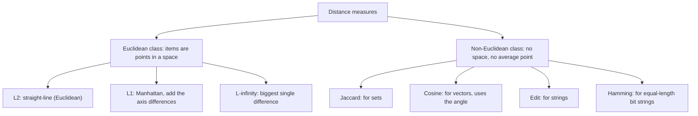
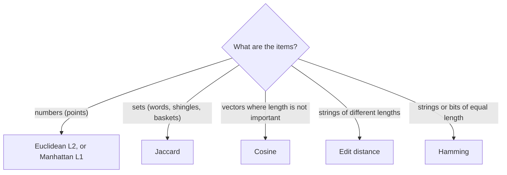

Before the new ideas, here are the small ones you need. If you know them, skip to the next section.

## The basics first

- A **point** is a list of numbers, like $(3, 4)$. Each number is a **coordinate** along one **axis** (dimension). A point with $n$ numbers lives in $n$ dimensions. A **vector** is the same list of numbers, thought of as an arrow from the origin.
- A **set** is a collection of different items with no order, for example the distinct words in a document. We write a set as $\{a, b, c\}$. $|A|$ means the number of items in $A$.
- **Intersection** $A \cap B$ is what the two sets share. **Union** $A \cup B$ is everything in either set.
- A **string** is a sequence of characters, such as "kitten". A **bit vector** is a string of 0s and 1s.
- A **similarity** is big when two items are alike. A **distance** is small when two items are alike. Many measures come in both forms and one is made from the other.

## What a distance measure is

**What it is.** A distance measure takes two items $x$ and $y$ and gives one number $d(x, y)$ that says how far apart they are. This is syllabus <Syl m="5" />, "Distance measures: definition of a distance measure, Euclidean, Jaccard, cosine, edit and Hamming distances". <Cite id="distance-measures-mmds" loc="§3.5" /> <Cite id="distance-measures-wiki-metric" />

**Why it is needed.** Big-data jobs keep asking "which items are alike?": find near-duplicate web pages, group customers with similar tastes, suggest similar products, find the nearest neighbours of a new point. Computers cannot judge "alike" by eye, so we turn it into a number and compare numbers. <Cite id="distance-measures-ibm-knn" /> <Cite id="distance-measures-tp-knn" />

**Everyday analogy.** The distance between two cities is a number of kilometres. But "how different are two songs?" needs a different ruler than "how different are two cities", and the same is true here: points, sets, vectors and strings each need their own ruler.

<Box kind="definition">

A function $d(x, y)$ is a **distance measure** if it obeys four rules: <Cite id="distance-measures-mmds" loc="§3.5.1" />

1. $d(x, y) \ge 0$ (a distance is never negative).
2. $d(x, y) = 0$ only if $x = y$ (only identical items are at distance zero).
3. $d(x, y) = d(y, x)$ (symmetry: the distance does not depend on the direction).
4. $d(x, y) \le d(x, z) + d(z, y)$ (the **triangle inequality**: going through a third item $z$ is never shorter than going directly).

</Box>

The triangle inequality is the rule people forget. In plain words, a detour cannot be a shortcut. Many fast algorithms for finding similar items depend on it. <Cite id="distance-measures-wiki-metric" />

<Sum>

<Given>

A proposed "distance" on numbers: $d(x, y) = (x - y)^2$. Take the three numbers $0$, $1$ and $2$.

</Given>

<Find>

whether $d$ obeys the triangle inequality.

</Find>

<Steps>

1. Direct distance from 0 to 2: $d(0, 2) = (0 - 2)^2 = 4$. *Reason: put the numbers straight into the formula.*
2. Distance through the middle number: $d(0, 1) + d(1, 2) = 1 + 1 = 2$. *Reason: the triangle inequality compares the direct distance with the detour.*
3. Compare: the rule needs $d(0, 2) \le 2$, but $d(0, 2) = 4$, and $4 > 2$.

</Steps>

<Answer>

No. The triangle inequality fails, so $(x - y)^2$ is not a distance measure.

</Answer>

<Box kind="verify">

One failed case is enough to break a rule. Rules 1 to 3 hold, so only rule 4 fails. Compare the ordinary distance $|x - y|$: $|0 - 2| = 2 \le 1 + 1 = 2$, which passes.

</Box>

</Sum>

<Cite id="distance-measures-av" loc="diagram" /> <Cite id="distance-measures-mlm" />

## The two major classes: Euclidean and non-Euclidean

**What it is.** Distance measures fall into two big classes. <Cite id="distance-measures-mmds" loc="§7.1.1" />

- **Euclidean distances.** Items are **points in a Euclidean space**: a space with coordinates, where the straight-line distance makes sense and you can always find the **average** of several points (just average each coordinate). The usual measures are the $L_2$, $L_1$ and $L_\infty$ distances.
- **Non-Euclidean distances.** Items are not points in such a space. They are sets, strings, bit vectors or documents. You can still say how far apart two items are, but you cannot add items together or find an "average item". Jaccard, cosine, edit and Hamming distances are the standard examples.

**Why the difference matters.** In clustering we often need the **centre** of a group. For points we simply average. For strings or sets there is no average, so the centre must be an actual item from the group (a **clustroid**, the item closest to all the others). <Cite id="distance-measures-mmds" loc="§7.2.3" />

| Point | Euclidean distances | Non-Euclidean distances |
| --- | --- | --- |
| Items are | Points with numeric coordinates | Sets, strings, bit vectors, documents |
| Examples | $L_2$, $L_1$, $L_\infty$ | Jaccard, cosine, edit, Hamming |
| Average of items | Exists (average each coordinate) | Does not exist |
| Centre of a cluster | Centroid (can be a new point) | Clustroid (must be an existing item) |
| Typical data | Heights and weights, coordinates, sensor values | Documents, DNA, customer baskets, usernames |

**Example for each class.** Euclidean: two houses at map positions $(0, 0)$ and $(3, 4)$ are $5$ units apart, and their average position is $(1.5, 2)$. Non-Euclidean: the words "cat" and "cart" are $1$ edit apart (insert one letter), but there is no word that is the "average" of the two.

<Box kind="exam">

PYQ: <PYQ id="2023-12/q6a" /> asks for the two major classes with examples (10 marks). Write the definition of a distance measure with its four rules, then Euclidean versus non-Euclidean with the table above, one worked example for each class, and the clustroid point. <PYQ id="2024-05/q1b" /> and <PYQ id="2025-05/q1d" /> (5 marks each) ask you to list and explain the measures: Euclidean, Jaccard, cosine, edit and Hamming, in the next sections.

</Box>

## Euclidean distances ($L_r$ norms)

**What it is.** For two points $x = (x_1, \dots, x_n)$ and $y = (y_1, \dots, y_n)$, the **$L_r$ distance** takes the difference on every axis, raises it to the power $r$, adds, and takes the $r$-th root: <Cite id="distance-measures-mmds" loc="§3.5.2" /> <Cite id="distance-measures-wiki-minkowski" />

$$
d_r(x, y) = \left( \sum_{i=1}^{n} |x_i - y_i|^r \right)^{1/r}
$$

Three values of $r$ matter:

| Name | $r$ | In words | Formula |
| --- | --- | --- | --- |
| Euclidean ($L_2$) | 2 | Straight-line distance, "as the crow flies" | $\sqrt{\sum (x_i - y_i)^2}$ |
| Manhattan ($L_1$) | 1 | Add the axis differences, like walking along city blocks | $\sum \lvert x_i - y_i \rvert$ |
| Chebyshev ($L_\infty$) | $\infty$ | Only the biggest single difference counts | $\max_i \lvert x_i - y_i \rvert$ |

<Cite id="distance-measures-wiki-euclid" /> <Cite id="distance-measures-wiki-taxicab" /> <Cite id="distance-measures-wiki-chebyshev" /> <Cite id="distance-measures-gfg-euclid" loc="diagram" /> <Cite id="distance-measures-gfg-manhattan" /> <Cite id="distance-measures-gfg-minkowski" />

**Everyday analogy.** A taxi in a city with a grid of roads cannot cut through buildings, so it drives $L_1$ (blocks east plus blocks north). A drone flies straight over, the $L_2$ distance. A chess king moves one step in any direction including diagonals, so the number of moves between two squares is the $L_\infty$ distance.

**Good and bad.** $L_2$ is the default and matches our idea of distance, but one very large difference dominates it because differences are squared. $L_1$ is less affected by one large difference. All three work on numbers, so change features to a similar scale first (for example, do not mix metres and millimetres). <Cite id="distance-measures-av" /> <Cite id="distance-measures-mlm" />

<Sum>

<Given>

Two points in 3 dimensions: $x = (1, 2, 3)$ and $y = (4, 6, 3)$.

</Given>

<Find>

the $L_2$ (Euclidean), $L_1$ (Manhattan) and $L_\infty$ distances between $x$ and $y$.

</Find>

<Steps>

1. Difference on each axis: $|1 - 4| = 3$, $|2 - 6| = 4$, $|3 - 3| = 0$. *Reason: every $L_r$ distance starts from these axis differences.*
2. $L_2$: square them, $9 + 16 + 0 = 25$, then take the square root, $\sqrt{25} = 5$. *Reason: $r = 2$ means square, add, square root.*
3. $L_1$: add the differences, $3 + 4 + 0 = 7$. *Reason: $r = 1$ means just add.*
4. $L_\infty$: take the largest difference, $\max(3, 4, 0) = 4$. *Reason: as $r$ grows, the biggest term decides the result.*

</Steps>

<Answer>

$L_2 = 5$, $L_1 = 7$, $L_\infty = 4$.

</Answer>

<Box kind="verify">

For any two points $L_\infty \le L_2 \le L_1$, and $4 \le 5 \le 7$ holds. Also $3^2 + 4^2 = 5^2$ (the 3-4-5 right triangle), so the $L_2$ value is right.

</Box>

</Sum>

## Jaccard distance (for sets)

**What it is.** The **Jaccard similarity** of two sets is the size of what they share divided by the size of everything they have between them. The **Jaccard distance** is $1$ minus that. <Cite id="distance-measures-mmds" loc="§3.1.1" /> <Cite id="distance-measures-mmds" loc="§3.5.3" /> <Cite id="distance-measures-wiki-jaccard" />

$$
\text{sim}(A, B) = \frac{|A \cap B|}{|A \cup B|}, \qquad d_J(A, B) = 1 - \frac{|A \cap B|}{|A \cup B|}
$$

The similarity runs from $0$ (nothing in common) to $1$ (same set), so the distance also runs from $0$ to $1$. Jaccard distance obeys all four rules, so it is a true distance. <Cite id="distance-measures-gfg-jaccard" />

**Where it is used.** Documents are turned into sets of words or of short pieces of text called **shingles**, and Jaccard tells how much text two documents share: finding near-duplicate web pages, plagiarism, and "customers who bought similar things". Computing it directly on billions of pairs is too slow, so big-data systems shrink each set with **MinHash** and still estimate the Jaccard value. <Cite id="distance-measures-mmds" loc="§3.3" />

<Sum>

<Given>

Two short documents as sets of words: $A = \{\text{the, cat, sat, on, mat}\}$ and $B = \{\text{the, dog, sat, on, log, mat}\}$.

</Given>

<Find>

the Jaccard similarity and Jaccard distance of $A$ and $B$.

</Find>

<Steps>

1. Intersection (words in both): $A \cap B = \{\text{the, sat, on, mat}\}$, so $|A \cap B| = 4$. *Reason: the top of the fraction counts what is shared.*
2. Union (all different words): $A \cup B = \{\text{the, cat, sat, on, mat, dog, log}\}$, so $|A \cup B| = 7$. *Reason: the bottom counts every word once.*
3. Similarity: $4 / 7 \approx 0.571$.
4. Distance: $1 - 4/7 = 3/7 \approx 0.429$. *Reason: distance is 1 minus similarity.*

</Steps>

<Answer>

Jaccard similarity $= 4/7 \approx 0.571$, Jaccard distance $= 3/7 \approx 0.429$.

</Answer>

<Box kind="verify">

Check the union by counting: $|A| + |B| - |A \cap B| = 5 + 6 - 4 = 7$. Check the distance another way: the 3 words not shared by both are cat, dog and log, and $3/7$ is their share of the union.

</Box>

</Sum>

## Cosine distance (for vectors)

**What it is.** Think of each item as a vector, for example a document as a list of word counts. The **cosine similarity** is the cosine of the angle between the two arrows. It looks only at the **direction**, not the length. The **cosine distance** in the book is the **angle** itself, between $0°$ and $180°$. <Cite id="distance-measures-mmds" loc="§3.5.4" /> <Cite id="distance-measures-wiki-cosine" /> <Cite id="distance-measures-gfg-cosine" loc="diagram" />

$$
\cos\theta = \frac{x \cdot y}{\lVert x \rVert \, \lVert y \rVert} = \frac{\sum_i x_i y_i}{\sqrt{\sum_i x_i^2}\ \sqrt{\sum_i y_i^2}}
$$

Here $x \cdot y$ is the **dot product** (multiply matching numbers and add), and $\lVert x \rVert$ is the **length** of the vector (square root of the sum of squares). Cosine is $1$ for the same direction (angle $0°$), $0$ for a right angle, and $-1$ for opposite directions. For word counts, which are never negative, it stays between $0$ and $1$.

**Why use it.** A long report and a short summary on the same topic have the same words in the same proportions, so their arrows point the same way even though one is much longer. Cosine calls them alike, while $L_2$ would call them far apart. That is why cosine is the usual choice for text and for recommendation vectors. <Cite id="distance-measures-gfg-cosine" /> <Cite id="distance-measures-av" />

<Box kind="pitfall">

Many sites use $1 - \cos\theta$ and call it "cosine distance". It is zero for the same direction, but it can **break the triangle inequality**, so it is not a true distance. Example: three vectors in the plane at angles $0°$, $45°$ and $90°$ from the x-axis. Then $1 - \cos 45° \approx 0.293$ for each short hop, which gives $0.293 + 0.293 = 0.586$, but the direct hop is $1 - \cos 90° = 1$, and $1 > 0.586$. The angle itself ($45° + 45° = 90°$) does obey the rule, which is why the book uses the angle. <Cite id="distance-measures-wiki-cosine" />

</Box>

<Sum>

<Given>

Word-count vectors of two documents over the same three words: $x = (1, 2, 3)$ and $y = (2, 0, 1)$.

</Given>

<Find>

the cosine similarity, the angle (cosine distance as an angle) and $1 - \cos\theta$.

</Find>

<Steps>

1. Dot product: $x \cdot y = 1 \times 2 + 2 \times 0 + 3 \times 1 = 2 + 0 + 3 = 5$. *Reason: multiply matching positions and add.*
2. Length of $x$: $\lVert x \rVert = \sqrt{1 + 4 + 9} = \sqrt{14} \approx 3.742$.
3. Length of $y$: $\lVert y \rVert = \sqrt{4 + 0 + 1} = \sqrt{5} \approx 2.236$.
4. Cosine similarity: $\cos\theta = 5 / (3.742 \times 2.236) = 5 / 8.367 \approx 0.598$. *Reason: dot product divided by the two lengths.*
5. Angle: $\theta = \cos^{-1}(0.598) \approx 53.3°$.
6. $1 - \cos\theta \approx 1 - 0.598 = 0.402$.

</Steps>

<Answer>

$\cos\theta \approx 0.598$, angle $\approx 53.3°$, and $1 - \cos\theta \approx 0.402$.

</Answer>

<Box kind="verify">

Product of the lengths another way: $\sqrt{14 \times 5} = \sqrt{70} \approx 8.367$, the same as $3.742 \times 2.236$. The value $0.598$ lies between $0$ and $1$, as it should for non-negative counts. Length does not matter: for $2x = (2, 4, 6)$ the dot product is $10$ and the length is $2\sqrt{14}$, so $\cos\theta$ is again $10 / (2\sqrt{14}\sqrt{5}) \approx 0.598$.

</Box>

</Sum>

## Edit distance (for strings)

**What it is.** The **edit distance** between two strings is the smallest number of edit operations that turn one into the other. <Cite id="distance-measures-wiki-lev" /> <Cite id="distance-measures-gfg-edit" loc="diagram" />

- In the book's definition (MMDS), the allowed operations are **insert** one character and **delete** one character. Then the distance is $d(x, y) = |x| + |y| - 2\,|\text{LCS}(x, y)|$, where the **LCS** (longest common subsequence) is the longest list of characters that appear in both strings in the same order, not necessarily next to each other. <Cite id="distance-measures-mmds" loc="§3.5.5" /> <Cite id="distance-measures-wiki-lcs" /> <Cite id="distance-measures-gfg-lcs" />
- The widely used **Levenshtein distance** also allows **substitution** (change one character to another), each operation costing 1. It is computed with a table (dynamic programming). <Cite id="distance-measures-wiki-lev" />

**Where it is used.** Spell checkers ("teh" to "the"), search suggestions, matching names that were typed differently, and comparing DNA sequences.

<Cite id="distance-measures-gfg-edit" loc="diagram" />

<Sum>

<Given>

$x = $ abcde and $y = $ acfdeg. Only insertions and deletions are allowed (the book's definition).

</Given>

<Find>

the edit distance between $x$ and $y$.

</Find>

<Steps>

1. Find a longest common subsequence. Reading both strings left to right, the letters a, c, d, e appear in both in this order: **a**b**c**de and **ac**f**de**g. So $\text{LCS} = $ acde, length $4$. *Reason: these letters can stay untouched.*
2. Lengths: $|x| = 5$ and $|y| = 6$.
3. Distance: $5 + 6 - 2 \times 4 = 3$. *Reason: delete the $5 - 4 = 1$ letter of $x$ that is not in the LCS, and insert the $6 - 4 = 2$ letters of $y$ that are not in it.*

</Steps>

<Answer>

The edit distance is $3$: delete b, insert f, insert g.

</Answer>

<Box kind="verify">

Do the edits: abcde, delete b gives acde, insert f after c gives acfde, insert g at the end gives acfdeg, which is $y$. That is 3 operations. The LCS cannot be 5, because $x$ is not a subsequence of $y$ (b never appears in $y$), so 3 cannot be improved this way.

</Box>

</Sum>

For Levenshtein distance we fill a table. Cell $(i, j)$ is the cost of turning the first $i$ letters of $x$ into the first $j$ letters of $y$. It takes the smallest of: the cell above $+1$ (delete), the cell to the left $+1$ (insert), or the diagonal cell $+0$ if the two letters match and $+1$ if not (substitute). The first row and column count $0, 1, 2, \dots$ because turning an empty string into $j$ letters takes $j$ inserts.

<Sum>

<Given>

$x = $ kitten (6 letters) and $y = $ sitting (7 letters), with insert, delete and substitute each costing 1.

</Given>

<Find>

the Levenshtein distance from kitten to sitting.

</Find>

<Steps>

1. Make the first row $0, 1, \dots, 7$ and the first column $0, 1, \dots, 6$. *Reason: from or to an empty string, each letter costs one edit.*
2. Fill each other cell with the rule above, row by row. The finished table is:

   |   | ε | s | i | t | t | i | n | g |
   | --- | --- | --- | --- | --- | --- | --- | --- | --- |
   | **ε** | 0 | 1 | 2 | 3 | 4 | 5 | 6 | 7 |
   | **k** | 1 | 1 | 2 | 3 | 4 | 5 | 6 | 7 |
   | **i** | 2 | 2 | 1 | 2 | 3 | 4 | 5 | 6 |
   | **t** | 3 | 3 | 2 | 1 | 2 | 3 | 4 | 5 |
   | **t** | 4 | 4 | 3 | 2 | 1 | 2 | 3 | 4 |
   | **e** | 5 | 5 | 4 | 3 | 2 | 2 | 3 | 4 |
   | **n** | 6 | 6 | 5 | 4 | 3 | 3 | 2 | 3 |

3. The answer is the bottom-right cell. Check how it is made: the cell above is $4$ (so $4 + 1 = 5$), the cell to the left is $2$ (so $2 + 1 = 3$), and the diagonal cell is $3$ with n and g different (so $3 + 1 = 4$). The smallest is $3$. *Reason: the cheapest of delete, insert and substitute wins.*

</Steps>

<Answer>

The Levenshtein distance is $3$.

</Answer>

<Box kind="verify">

Show the 3 edits: kitten, substitute k with s gives sitten, substitute e with i gives sittin, insert g gives sitting. Three edits, so the distance is at most $3$. The table says it cannot be less. With only insertions and deletions the answer is different: the LCS of kitten and sitting is ittn (length $4$), so that distance is $6 + 7 - 2 \times 4 = 5$. Always check which definition the question uses.

</Box>

</Sum>

## Hamming distance (for equal-length strings)

**What it is.** The **Hamming distance** between two strings (or bit vectors) of the **same length** is the number of positions where they have different values. It was introduced by Richard Hamming for error-detecting codes. <Cite id="distance-measures-hamming1950" /> <Cite id="distance-measures-mmds" loc="§3.5.6" /> <Cite id="distance-measures-wiki-hamming" /> <Cite id="distance-measures-gfg-hamming" />

For bit vectors it equals the number of 1s in the XOR of the two vectors.

**Where it is used.** Detecting and correcting bit errors in data sent over a network or stored on disk (the codes it was made for), comparing fingerprints and hash values, and comparing the bit signatures used for similar-item search.

<Sum>

<Given>

Bit vectors $x = 10110101$ and $y = 11100111$ (8 bits each). Also the words karolin and kathrin.

</Given>

<Find>

the Hamming distance in both cases.

</Find>

<Steps>

1. Line the bit vectors up and compare position by position:

   | Position | 1 | 2 | 3 | 4 | 5 | 6 | 7 | 8 |
   | --- | --- | --- | --- | --- | --- | --- | --- | --- |
   | $x$ | 1 | 0 | 1 | 1 | 0 | 1 | 0 | 1 |
   | $y$ | 1 | 1 | 1 | 0 | 0 | 1 | 1 | 1 |
   | Differ? | no | yes | no | yes | no | no | yes | no |

   *Reason: Hamming distance only counts positions with different values.*
2. Count the "yes" cells: positions 2, 4 and 7, so the distance is $3$.
3. Words: k-k, a-a, r-t (differ), o-h (differ), l-r (differ), i-i, n-n. Three positions differ.

</Steps>

<Answer>

Hamming distance of the bit vectors $= 3$; karolin and kathrin $= 3$.

</Answer>

<Box kind="verify">

XOR of the bit vectors: $10110101 \oplus 11100111 = 01010010$, which has three 1s. Each pair has equal lengths (8 bits each, 7 letters each), so the measure applies.

</Box>

</Sum>

## Comparing the five measures

| Measure | Works on | Formula idea | Range | Good for |
| --- | --- | --- | --- | --- |
| Euclidean ($L_2$) | Numeric points | $\sqrt{\sum (x_i - y_i)^2}$ | $0$ to $\infty$ | Clustering numeric data, nearest neighbours |
| Manhattan ($L_1$) | Numeric points | $\sum \lvert x_i - y_i \rvert$ | $0$ to $\infty$ | Grid-like or outlier-prone data |
| Jaccard | Sets | $1 - \lvert A \cap B \rvert / \lvert A \cup B \rvert$ | $0$ to $1$ | Near-duplicate documents, baskets |
| Cosine | Vectors | Angle between vectors | $0°$ to $180°$ | Text, recommendations, any case where length should not matter |
| Edit | Strings | Fewest edits | $0$ to $\max(\lvert x \rvert, \lvert y \rvert)$ for Levenshtein | Spelling, names, DNA |
| Hamming | Equal-length strings or bits | Number of different positions | $0$ to the length | Error codes, hash and bit signatures |

<Cite id="distance-measures-sklearn" /> <Cite id="distance-measures-scipy" /> <Cite id="distance-measures-w3s-dist" />

## Exam-ready summary

A distance measure $d(x, y)$ gives a number for how far apart two items are and must be non-negative, zero only for identical items, symmetric, and obey the triangle inequality. There are two classes: **Euclidean** (points in a space, average exists, $L_2$, $L_1$, $L_\infty$) and **non-Euclidean** (sets, vectors, strings and bits, no average, so a clustroid is used instead). The standard measures are Euclidean (square root of summed squared differences), Jaccard (1 minus intersection over union), cosine (angle between vectors), edit (fewest insertions and deletions, or with substitutions) and Hamming (number of differing positions).

<Box kind="key">

Pick the ruler to fit the data: **points** use Euclidean or Manhattan, **sets** use Jaccard, **direction** uses cosine, **strings** use edit distance, and **equal-length bits** use Hamming.

</Box>
