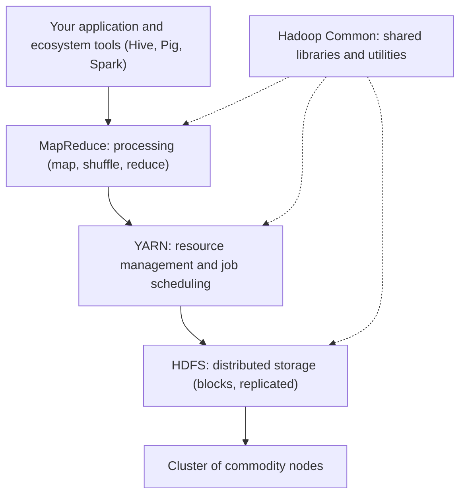
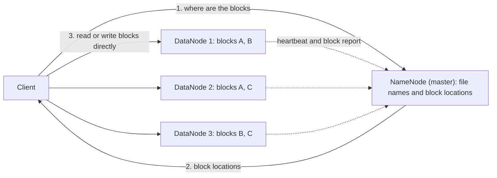
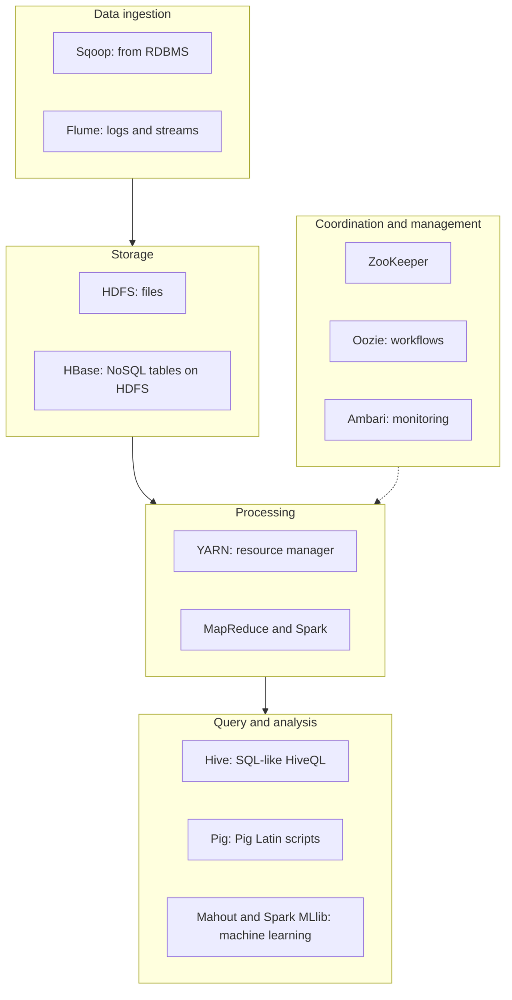

Hadoop se pehle kuch basic ideas chahiye. Agar aapko pata hain to seedha next section pe jao.

## The basics first

- **Big data** woh data hai jo itna bada, itni tezi se badhne wala ya itna alag-alag type ka hai ki ek normal computer aur ek normal database use store ya process nahi kar sakta. Ise "V"s se describe karte hain: volume (size), velocity (data aane ki speed) aur variety (kai formats).
- **Node** matlab ek computer. **Cluster** matlab kai nodes jo network se jude hain aur ek system ki tarah kaam karte hain. **Rack** matlab nodes ki ek shelf jo ek network switch share karti hai.
- **Commodity hardware** matlab ordinary, saste, market mein milne wale servers, koi special mehnge machines nahi.
- **Scale up** matlab ek bada computer kharidna. **Scale out** matlab aur ordinary computers jodna. Hadoop scale out ke liye bana hai.
- **Fault tolerance** matlab koi part fail ho jaye tab bhi system chalta rahe. Hazaaron sasti nodes mein hamesha koi na koi fail hoti rehti hai, isliye failure ko normal maanna padta hai.
- **Structured data** neat rows aur columns mein fit hota hai (bank table). **Semi-structured** data mein tags hote hain par fixed table nahi (XML, JSON, logs). **Unstructured** data ki koi fixed shape nahi (text, images, video).

## What Hadoop is and why it matters

<PYQ id="2023-12/q1a" />

**Ye kya hai.** Apache Hadoop ek free, open-source framework hai, Java mein likha hua, jo bahut bade data sets ko commodity computers ke cluster par **store** karta hai aur parallel mein **process** karta hai. Ise Doug Cutting aur Mike Cafarella ne shuru kiya aur iska design Google ke do papers se aaya: Google File System <Cite id="hadoop-ecosystem-ghemawat2003" /> aur MapReduce <Cite id="hadoop-ecosystem-dean2004" />. Naam ek toy elephant se aaya. <Cite id="hadoop-ecosystem-wiki-hadoop" />

**Ye kyun zaroori hai.** Socho ek cook ko 100,000 logon ka khana banana hai. Ek tez stove kharidna (scale up) jaldi kaam karna band kar deta hai. 1,000 ordinary cooks rakhna (scale out), jahan har ek ko kaam ka chhota hissa mile, kaam karta hai, bas koi unhe organize kare aur ek bimaar cook poora dinner kharab na kare. Hadoop wahi organizer hai. Traditional systems big data par teen wajah se fail hote hain:

1. **Storage:** data ek disk ya ek server mein nahi samata.
2. **Speed:** terabytes ko ek machine se padhne mein ghante lagte hain, kyunki disk aur network bottleneck hain.
3. **Failure aur cost:** ek bada special machine bahut mehnga hai, aur tootne par sab kuch ruk jaata hai.

**Ye kyun matter karta hai.** Hadoop ne big data analysis ko ordinary companies ke liye sasta aur possible bana diya. Iski chaar main strengths:

- **Scalable:** nodes jodo to storage aur speed badhti hai.
- **Cheap:** commodity hardware par chalta hai aur software free hai.
- **Fault tolerant:** data ki copies hoti hain, aur fail hua kaam dusri jagah dobara chalta hai.
- **Flexible:** koi bhi data (structured, semi-structured, unstructured) jaisa hai waisa store karta hai, pehle fixed table design kiye bina.

<Cite id="hadoop-ecosystem-ibm-hadoop" /> <Cite id="hadoop-ecosystem-aws-hadoop" /> <Cite id="hadoop-ecosystem-gfg-hadoop-intro" /> Ye syllabus <Syl m="1" /> hai, "Hadoop concept, core components and ecosystem".

## How Hadoop handles big data problems

<PYQ id="2024-05-ce/q1a" />

Hadoop har big data problem ka jawab ek simple idea se deta hai:

| Big data problem | How Hadoop handles it |
| --- | --- |
| Ek disk ke liye data bahut zyada (volume) | **HDFS** har file ko bade blocks mein kaat deta hai (default 128 MB) aur kai nodes par phaila deta hai. Space badhani ho to nodes jodo. |
| Ek machine par processing slow | **MapReduce** job ko kai chhote tasks mein todta hai jo nodes par parallel chalte hain. |
| Bada data network par bhejna slow hai | **Data locality:** program (chhota) us node ko bheja jaata hai jahan data (bada) hai, ulta nahi. |
| Machines aksar fail hoti hain | HDFS har block ki **3 copies** rakhta hai (replication, default 3) alag nodes aur racks par. Fail hua task dusri node par dobara chalta hai. |
| Kai data formats (variety) | Data plain files mein store hota hai, aur structure padhte waqt lagaya jaata hai ("schema on read"). |
| High cost | Commodity hardware aur open-source software. |
| Data tezi se aata hai (velocity) | **Flume** jaise tools streams ko HDFS mein laate hain, aur **Spark** (ya Storm) unhe fast process kar sakte hain. |

<Cite id="hadoop-ecosystem-apache-hdfs-design" loc="Data Replication" /> <Cite id="hadoop-ecosystem-mmds" />

### Big data enabling technologies

<PYQ id="2024-12/q2b" />

**Enabling technology** woh technology hai jo big data ko practical banati hai. Answers mein usual list ye hoti hai:

1. **Distributed storage and processing:** Hadoop with HDFS aur MapReduce, data ko kai nodes par store aur process karne ke liye.
2. **NoSQL databases:** MongoDB, Cassandra, HBase, Neo4j, jo scale out hote hain aur non-tabular data store karte hain.
3. **In-memory computing:** Spark, jo data ko RAM mein rakhta hai fast, repeated analysis ke liye.
4. **Cloud computing:** jitni machines chahiye utne time ke liye kiraye par lo (for example Amazon EMR).
5. **Stream processing and messaging:** Kafka, Storm, Flume, us data ke liye jo lagatar aata hai.
6. **Machine learning and analytics tools:** Mahout, Spark MLlib, patterns aur predictions dhoondhne ke liye.
7. **Data visualization and BI tools:** results ko charts aur dashboards mein dikhane ke liye.

## Hadoop versus a traditional RDBMS

<PYQ id="2023-12-ce/q1a" />

**RDBMS** (relational database management system, for example MySQL ya Oracle) neat tables store karta hai aur SQL queries ka jawab deta hai. Ye chhote aur medium structured data aur transactions ke liye excellent hai. Hadoop alag kaam ke liye alag tool hai.

| Point | RDBMS | Hadoop |
| --- | --- | --- |
| Data type | Sirf structured (fixed schema wali tables) | Structured, semi-structured aur unstructured |
| Data size | Gigabytes se kuch terabytes | Terabytes se petabytes |
| Schema | **Schema on write:** pehle table design karo, phir load karo | **Schema on read:** pehle koi bhi file load karo, padhte waqt structure do |
| Scaling | Zyadatar scale up (bada server), mehnga | Scale out (sasti nodes jodo), sasta |
| Hardware | Mehnge high-end servers | Commodity hardware |
| Processing | SQL, indexed data par quick | Batch jobs (MapReduce, Spark), start slow par throughput bahut |
| Updates | Kai baar read aur write, in place | Write once, read many times (append only) |
| Transactions (ACID) | Poora support | Iske liye design nahi hua |
| Fault tolerance | Special extra setup chahiye | Built in (replication aur task re-run) |
| Best for | Banking, billing, chhote reports | Log analysis, search indexes, recommendations, bada analytics |

**Conclusion:** structured data par fast transactions ke liye RDBMS use karo, aur bade, alag-alag data ko batches mein analyse karne ke liye Hadoop. Ye aksar saath kaam karte hain (Sqoop dono ke beech data le jaata hai). <Cite id="hadoop-ecosystem-gfg-hadoop-intro" /> <Cite id="hadoop-ecosystem-tp-hadoop-overview" />

## The core components of Hadoop

<PYQ id="2022-12-ce/q4a" /> <PYQ id="2024-12/q4a" />

Hadoop core ke chaar modules hain <Cite id="hadoop-ecosystem-apache-hadoop" />:

1. **Hadoop Common:** shared Java libraries aur utilities jo baaki saare modules use karte hain (file-system access, security, configuration).
2. **HDFS (Hadoop Distributed File System):** **storage** layer.
3. **YARN (Yet Another Resource Negotiator):** **resource management and scheduling** layer (Hadoop 2 se).
4. **MapReduce:** **processing** layer.

<Cite id="hadoop-ecosystem-gfg-hadoop-arch" loc="diagram" />

Exam question "Hadoop architectural model with both components" ka matlab hai do original parts: **HDFS (storage)** aur **MapReduce (processing)**. Dono **master-slave** design use karte hain: ek master jo coordinate karta hai, kai slaves jo kaam karte hain.

### HDFS: the storage component

HDFS file ko **blocks** mein kaat kar store karta hai (current versions mein default 128 MB) aur har block kai nodes par rakhta hai. Ye write-once, read-many model follow karta hai aur bade files ki streaming ke liye bana hai, chhote random reads ke liye nahi. <Cite id="hadoop-ecosystem-apache-hdfs-design" loc="Introduction" />

- **NameNode (master):** file names, folder tree aur ye jaanta hai ki har file ka har block kaun si DataNodes par hai. Is information ko **metadata** kehte hain. Ye asli data store nahi karta. Metadata memory mein rakhta hai, jiska backup disk par do files mein hota hai, **FsImage** (snapshot) aur **EditLog** (snapshot ke baad ke changes).
- **DataNodes (slaves):** asli blocks apni disks par store karte hain, read aur write requests serve karte hain, aur NameNode ko **heartbeats** ("main zinda hoon" signal, har kuch seconds mein) aur **block reports** (jo blocks unke paas hain unki list) bhejte hain. Heartbeats band ho jaayein to NameNode us node ko dead maanta hai aur uske blocks ki nayi copies dusri nodes par banata hai.
- **Secondary NameNode:** ye backup nahi hai. Ye sirf kabhi-kabhi EditLog ko FsImage mein merge karta hai (ek **checkpoint**) taaki EditLog bahut bada na ho. Asli failover ke liye Hadoop 2 ne **standby NameNode** (high availability) joda.
- **Replication:** har block default mein 3 baar store hota hai. HDFS pehli copy writer ki node par, doosri alag rack ki node par, aur teesri usi doosre rack ki ek aur node par rakhta hai. To poora rack kho jaaye tab bhi data nahi khota.

<Cite id="hadoop-ecosystem-apache-hdfs-design" loc="diagram" />

<Sum>

<Given>

500 MB ki ek file HDFS mein store hai, block size 128 MB aur replication factor 3.

</Given>

<Find>

blocks ki ginti, block copies ki ginti, aur raw storage jo use hua.

</Find>

<Steps>

1. Full blocks: $500 \div 128 = 3$ remainder $116$, to 3 full blocks 128 MB ke. *Reason: file block-size ke tukdon mein kati hai.*
2. Bacha hua $500 - 3 \times 128 = 116$ MB ek 4th, chhota block ban jaata hai. *Reason: HDFS last block ko pad nahi karta, sirf uski asli size use karta hai.*
3. Total blocks $= 3 + 1 = 4$.
4. Block copies $= 4 \times 3 = 12$. *Reason: har block 3 baar store hota hai.*
5. Raw storage $= 500 \text{ MB} \times 3 = 1500$ MB. *Reason: har byte 3 baar store hota hai.*

</Steps>

<Answer>

4 blocks, 12 block copies, 1500 MB (1.5 GB) raw disk.

</Answer>

<Box kind="verify">

Block sizes jodo: $128 + 128 + 128 + 116 = 500$ MB, yaani file size. Copies ko size ke hisaab se jodo: $3 \times (128 \times 3 + 116) = 3 \times 500 = 1500$ MB, pehle jaisa hi.

</Box>

</Sum>

### MapReduce: the processing component

MapReduce ek programming model hai jisme aap do chhote functions likhte ho, aur framework unhe cluster par parallel chalata hai. <Cite id="hadoop-ecosystem-dean2004" /> <Cite id="hadoop-ecosystem-mmds" />

1. **Input split:** HDFS ka input splits mein baanta jaata hai, ek block ke liye ek, aur har split ke liye ek **map task** shuru hota hai, jitna ho sake us node par jahan woh block pehle se hai (data locality).
2. **Map:** har map task apne records padhta hai aur **key-value pairs** nikalta hai. Word count mein "to be or not to be" line se (to,1), (be,1), (or,1), (not,1), (to,1), (be,1) milta hai.
3. **Shuffle and sort:** framework same key wale saare pairs ko same reducer tak pahunchata hai aur key ke hisaab se sort karta hai. Ek optional **combiner** map side par hi counts jod sakta hai, taaki network par kam data jaye.
4. **Reduce:** har reduce task ko ek key aur uski values ki list milti hai aur woh unhe combine karta hai, for example (to, [1,1]) se (to, 2) banta hai.
5. **Output:** result wapas HDFS mein likha jaata hai.

Map output node ki local disk par jaata hai, HDFS par nahi, kyunki wo temporary hai. <Cite id="hadoop-ecosystem-apache-mr-tutorial" loc="Overview" />

**Hadoop 1** mein ek **JobTracker** jobs chalata tha aur har node par ek **TaskTracker** tasks chalata tha. Wo ek JobTracker bottleneck tha, isliye **Hadoop 2** ne use YARN se replace kiya.

### YARN: the resource manager

YARN JobTracker ke do kaam, resource management aur job life-cycle, alag parts mein baant deta hai <Cite id="hadoop-ecosystem-apache-yarn" />:

- **ResourceManager (master):** cluster mein ek; decide karta hai kis application ko kitna CPU aur memory milega.
- **NodeManager (slave):** har node par ek; **containers** (CPU aur memory ka ek hissa) start karta hai aur usage report karta hai.
- **ApplicationMaster:** har application (job) ke liye ek; ResourceManager se containers maangta hai aur job ke tasks unme chalata hai.

YARN alag hone ki wajah se MapReduce ab akela engine nahi hai: Spark, Tez aur doosre bhi usi HDFS data par YARN par chalte hain.

## The Hadoop ecosystem

<PYQ id="2023-12/q2a" /> <PYQ id="2025-05/q2a" /> <PYQ id="2025-05-ce/q6a" /> <PYQ id="2024-12-ce/q4b" />

**Ye kya hai.** **Hadoop ecosystem** un tools ka parivaar hai jo Hadoop core ke aas-paas bane hain. Core data store aur process karta hai, lekin raw MapReduce Java mein likhna mushkil hai, aur ek real project ko loading, querying, coordination aur scheduling bhi chahiye. Har ecosystem tool aisi ek gap bharta hai. <Cite id="hadoop-ecosystem-gfg-hadoop-ecosystem" /> <Cite id="hadoop-ecosystem-av-hadoop-ecosystem" />

<Cite id="hadoop-ecosystem-gfg-hadoop-ecosystem" loc="diagram" />

Components ek table mein (core ke pehle chaar upar samjhaye ja chuke hain):

| Component | Layer | What it does, in simple words |
| --- | --- | --- |
| **HDFS** | Storage | Bade files ko replicated blocks ki tarah cluster par store karta hai. |
| **YARN** | Resource management | Cluster ka CPU aur memory applications ke beech baantta hai. |
| **MapReduce** | Processing | Map, shuffle, reduce steps mein batch processing. |
| **Hive** | Query | HDFS ke data par SQL-jaisi queries (HiveQL) likhne deta hai; unhe jobs mein badal deta hai. Analysts ke liye accha. |
| **Pig** | Scripting | Lambe Java ke bajaye Pig Latin mein data-flow script likhne deta hai (load, filter, group, join). |
| **HBase** | NoSQL database | HDFS par column-oriented database, Google ke Bigtable par based, single rows ke fast random read aur write ke liye. |
| **Spark** | Processing | Fast engine jo data memory mein rakhta hai; iterative jobs, machine learning aur streaming ke liye accha. |
| **Mahout** | Machine learning | Scalable machine learning algorithms (recommendation, clustering, classification). |
| **ZooKeeper** | Coordination | Distributed tools ke beech configuration, naming, locks aur leader election ke liye central service. |
| **Oozie** | Scheduling | Jobs ki chain (workflow) ko sahi order aur sahi time par chalata hai. |
| **Sqoop** | Ingestion | Relational databases aur HDFS ke beech data bulk mein copy karta hai. |
| **Ambari** | Management | Hadoop cluster ki nodes aur services set up, monitor aur manage karne ka web tool. |
| **Flume** | Ingestion | Server logs jaisa streaming data collect karke HDFS mein deliver karta hai. |

<Cite id="hadoop-ecosystem-apache-hive" /> <Cite id="hadoop-ecosystem-apache-pig" /> <Cite id="hadoop-ecosystem-apache-hbase" /> <Cite id="hadoop-ecosystem-apache-spark" /> <Cite id="hadoop-ecosystem-apache-zookeeper" /> <Cite id="hadoop-ecosystem-apache-oozie" /> <Cite id="hadoop-ecosystem-apache-sqoop" /> <Cite id="hadoop-ecosystem-apache-flume" />

Agar question bole "explain any two components", to har ek par 4 se 5 lines likho: ye kya hai, kyun chahiye, kaise kaam karta hai, ek example. Ek safe pair **Hive** aur **HBase** hai, jiska accha example ye hai:

- **Hive:** *Need:* analysts SQL jaante hain, Java nahi. *How:* aap `SELECT city, COUNT(*) FROM users GROUP BY city` likhte ho, aur Hive use distributed jobs mein translate kar deta hai jo cluster par chalte hain. *Note:* ye batch analysis ke liye hai, single-row quick lookups ke liye nahi.
- **HBase:** *Need:* HDFS ek record ko jaldi padhne mein weak hai. *How:* ye rows ko tables mein column families ke saath, row key ke hisaab se sorted, HDFS ke upar store karta hai. *Example:* ek user ka profile milliseconds mein dhoondhna.

Is list ke kuch tools ab kam use hote hain ya Apache ne retire kar diye hain (Sqoop inme se ek hai); naye project ke liye tool chunne se pehle project page check karo. Exams abhi bhi upar ki classic list poochte hain.

## Advantages and limitations of Hadoop

<PYQ id="2025-05/q1b" /> <PYQ id="2024-12/q1c" />

**Advantages**

1. **Scalable:** kuch nodes se hazaaron nodes tak, bas machines jodke.
2. **Low cost:** commodity hardware aur open-source software.
3. **Fault tolerant:** block replication aur fail hue tasks ka automatic re-run.
4. **Saare data types handle karta hai:** structured, semi-structured aur unstructured, schema on read ke saath.
5. **Bade data par fast:** parallel processing aur data locality se high throughput.
6. **Rich ecosystem aur community:** kai tools, kai vendors, aur bada community.

**Limitations** (syllabus <Syl m="2" />, "Hadoop limitations")

1. **Small files ke liye nahi:** har file, folder aur block NameNode ki memory mein ek object hai. Lakhon chhote files wo memory khaa jaate hain aur NameNode bottleneck ban jaata hai.
2. **Sirf batch, high latency:** MapReduce jobs ko start aur finish hone mein seconds se minutes lagte hain. Real-time answers ke liye nahi.
3. **Iterative kaam ke liye slow:** MapReduce steps ke beech results disk par likhta hai, isliye jo algorithms kai baar loop karte hain (machine learning, graphs) wo slow hote hain. Spark memory se ise fix karta hai.
4. **In-place update ya transactions nahi:** HDFS write-once, read-many (append only) hai, isliye banking jaise updates ke liye fit nahi.
5. **Programming model mushkil:** plain MapReduce ko lamba Java code chahiye, aur har problem map aur reduce mein aasani se fit nahi hoti.
6. **NameNode ek kamzor point hai:** Hadoop 1 mein ye single point of failure tha; Hadoop 2 ne standby NameNode joda, par isme extra setup chahiye.
7. **Storage overhead:** 3 copies matlab 3 guna disk space.
8. **Security aur administration:** basic security weak hai jab tak Kerberos jaise tools set up na ho, aur bade cluster ko chalane ke liye skilled log chahiye.

<Cite id="hadoop-ecosystem-gfg-hadoop-intro" /> <Cite id="hadoop-ecosystem-ibm-hadoop" />

**Conclusion:** Hadoop bahut bade, alag-alag data ke batch analysis ke liye low-cost, scalable aur fault-tolerant platform hai. Iska ecosystem gaps bharta hai (SQL ke liye Hive, fast access ke liye HBase, speed ke liye Spark), lekin ise small data, real-time answers ya transactions ke liye use nahi karna chahiye. <Cite id="hadoop-ecosystem-wiki-hadoop" /> <Cite id="hadoop-ecosystem-aws-hadoop" />
